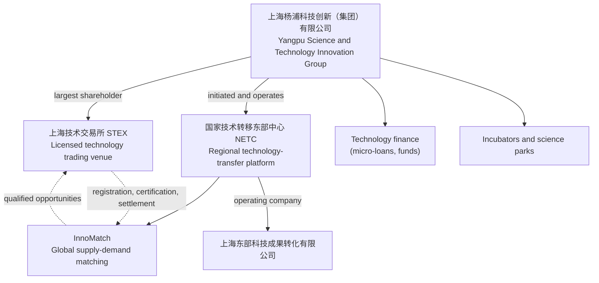

# 01 — Shanghai Technology-Trading Landscape: STEX, NETC and Related Platforms

> **About this document**
>
> - **Purpose:** Identify the main Shanghai platforms for technology trading and technology transfer, explain what each one actually does, and show how they relate to each other.
> - **Audience:** Founders, product managers and analysts who are designing a technology exchange and transfer platform.
> - **Status:** Market research. Figures are taken from the cited sources (2023–2025 data). Re-check them before quoting externally.
> - **Next:** [02 — STEX vs NETC/InnoMatch: scale and scope](02-stex-vs-netc-scale-and-scope.md)

---

## Summary

- Shanghai has two platforms that matter most for a project like ours:
  - **上海技术交易所 — Shanghai Technology Exchange (STEX, 上技所)**: a licensed **technology trading venue** (an "exchange").
  - **国家技术转移东部中心 — National Technology Transfer Center East (NETC)** and its **InnoMatch** platform: a **technology-transfer network** focused on supply–demand matching and commercialization services.
- The two are **not independent competitors**. Public fund-prospectus disclosures show that both sit inside the same state-owned group, **上海杨浦科技创新（集团）有限公司 (Yangpu Science & Technology Innovation Group, "杨科创")**. The group is STEX's largest shareholder and also initiated and operates NETC. One executive serves as both chairman of STEX and president of NETC.
- Shanghai deliberately built **two complementary layers**: a *network and matching layer* (NETC/InnoMatch) and a *trusted transaction layer* (STEX). That is the same combination our platform aims for (see [04](04-product-strategy.md)).

---

## 1. Shanghai Technology Exchange (STEX / 上海技术交易所)

### 1.1 Identity and history

| Item | Details |
| --- | --- |
| Chinese name | 上海技术交易所（上技所） |
| Legal entity | 上海技术交易所有限公司 — state-controlled limited liability company, located in Yangpu District, Shanghai |
| Founded | 1993, jointly by the Ministry of Science and Technology (MOST) and the Shanghai Municipal Government. Described as China's first national-level permanent technology market (首家国家级常设技术市场). |
| Re-launch | 31 Dec 2019: the State Council inter-ministerial joint conference on trading-venue clean-up accepted STEX's filing. 28 Oct 2020: STEX formally re-opened as a modern exchange. |
| Regulator | Shanghai Municipal Science and Technology Commission (STCSM, 上海市科委) is the industry authority for technology trading venues in Shanghai. |
| Governing rules | 《上海市技术交易场所管理细则》 (沪科规〔2025〕2号), effective 1 May 2025 – 30 Apr 2030 |
| Official site | <http://www.stte.com> |

### 1.2 What STEX actually does

STEX describes its core business as four functions:

| Function | Chinese | What it means in practice |
| --- | --- | --- |
| Registration | 登记 | Registers technology rights (技术权益登记) and technology demands. These records anchor later on-exchange and off-exchange transactions, combined with technology-achievement evaluation. |
| Trading | 交易 | Designs trading products and rules. Runs negotiated transfer, auction, tender and competitive bidding. Discovers market prices. |
| Custody / hosting | 托管 | Applies **tiered, classified information disclosure** to listed achievements, then organizes market promotion and deal matching on top of market-based evaluation. |
| Settlement | 结算 | Provides **third-party fund settlement** and issues **transaction certificates (交易凭证)** that record both the transaction and the money flow. |

Additional capabilities reported in public disclosures:

- **Specialized boards (专板):** science popularization, meteorological technology, green technology, standards, biomedicine and agricultural technology.
- **Technology-backed credit (技术授信):** about ¥4.058 billion of credit granted against technology assets, cumulative to July 2024.
- **Network:** links to 50 technology-market outlets across China, 19 core trading-network members, 8 regional innovation-center nodes, and cooperation with 32 countries.
- **International arm:** an international trading center in the Lingang New Area (operated through the wholly owned subsidiary 上技贸易).
- **New products:** a "科技成果 + 认股权" product (technology achievement plus equity warrant) was launched in 2024, with the first deal in China completed.

### 1.3 What the 2025 Shanghai rules require from a technology exchange

The 2025 STCSM rules are the best public description of what a *licensed* technology exchange must provide. Under these rules, a technology trading venue must provide:

| Requirement (Article 11 and related) | Detail |
| --- | --- |
| Rights registration (权属登记) | Issue technology-rights registration certificates where rights are clear and lawful. |
| Transaction certification (交易鉴证) | Issue transaction certificates for qualifying transactions. Certificates and public-notice proofs may be used as supporting evidence (Art. 13). |
| Information disclosure (信息披露) | Publish listing announcements, supply/demand information and the public notices required when public institutions transfer service inventions (职务科技成果). Information must be true, accurate and timely. |
| Market-based evaluation (评价) | Provide guidance on market-based evaluation and organize pre-transfer valuation. |
| Settlement (结算) | Settle transaction prices and deposits. Art. 12 requires **third-party settlement through a bank or a licensed non-bank payment institution**, with segregated per-client accounts. |
| Service-provider management | Manage IP, valuation, brokerage and legal service providers operating on the venue. |
| Risk control | Maintain a risk-prevention system and internal controls proportional to the business. |
| Dispute handling | Coordinate issues, mediate disputes and handle rule violations. |

- **Transaction modes (Art. 2):** technology transfer, technology licensing, technology-for-equity investment (作价投资), technology development, technical services and technical consulting.
- **Transaction methods (Art. 2):** negotiated transfer (协议转让), auction (拍卖), tender (招标), competitive bidding (竞价), and other lawful methods.
- **Conduct rules:** staff must recuse themselves from conflicts, may not misuse investor information or take improper benefits from listed projects (Art. 15), and must file monthly, quarterly and annual reports with STCSM (Art. 16).

> **Why this matters for us:** a private platform can copy the *workflow*, but some of these functions are *regulated activities*: certified rights registration, transaction certification, and holding or settling funds. New venues are approved under "total-quantity control and prudent approval" (Art. 6), so a venue licence is a long, uncertain path. The realistic route is to act as a **registered practising agent** of a licensed venue (STEX or CTEX) and run formal listing, bidding, settlement and certificates through it. See [09 §1–§2](09-reference-platform-features.md), [05 §2](05-system-design-blueprint.md) and [08](08-china-operating-model.md).

### 1.4 Scale

| Metric | Value | Source |
| --- | --- | --- |
| Technologies entering the exchange in 2024 | 2,383 | STCSM 2024 annual report |
| On-exchange transaction value in 2024 | ¥30.933 billion | STCSM 2024 annual report |
| Cumulative technologies (end of 2024) | > 12,800 | STCSM 2024 annual report |
| Cumulative transaction value (end of 2024) | > ¥63.4 billion | STCSM 2024 annual report |
| Cumulative transaction value (mid-2025) | ≈ ¥76 billion; > 13,000 technologies | Interview with STEX president, July 2025 |
| Annual transaction value 2021 / 2022 / 2023 | ¥3.047B / ¥10.115B / ¥18.922B | Fund prospectus (see §5) |

---

## 2. National Technology Transfer Center East (NETC / 国家技术转移东部中心)

### 2.1 Identity

| Item | Details |
| --- | --- |
| Chinese name | 国家技术转移东部中心（东部中心） |
| Status | National-level regional technology-transfer platform, approved by MOST in 2014 and jointly promoted by MOST and the Shanghai Municipal Government. Guided by STCSM. Establishment coordinated by the Shanghai Technology Innovation Center (上海市科技创业中心). |
| Operating company | 上海东部科技成果转化有限公司 (Shanghai Eastern Technology Achievement Transformation Co., Ltd.) |
| Positioning | A "fourth-party platform" (第四方平台) offering a full chain of technology trading, technology finance and industrial incubation. It describes its strategy as "technology trading as the main business, with services and finance as supporting businesses". |
| Official site | <https://www.netcchina.com> |

### 2.2 InnoMatch

**InnoMatch — 全球技术供需对接平台 (Global Technology Supply–Demand Matching Platform)** is NETC's digital product. Public descriptions say it:

- Aggregates technology results worldwide and matches them to enterprise technology demands, using big data and blockchain.
- Trains and manages **technology managers (技术经理人)**, the professional brokers who turn a match into a deal.
- Combines **online intelligent matching** with **offline brokerage and project operation**.
- Runs the annual **InnoMatch EXPO / Global Tech-Matching Fair**, part of the Pujiang Innovation Forum. The 2025 fair released more than 10,000 technology needs, with more than ¥20 billion of investment commitments from participating companies and 1,728 R&D results seeking commercialization.

### 2.3 Scale

Official figures (STCSM 2024 report; STCSM replies on InnoMatch):

| Metric | Value | Source |
| --- | --- | --- |
| Signed deals facilitated by NETC in 2024 | **≈ ¥4.2 billion** (近42亿元) | STCSM 2024 report |
| Signed deals facilitated, cumulative | **≈ ¥40 billion** (近400亿元) | STCSM 2024 report |
| Network | 44 domestic outlets, 11 international cooperation channels (8 added in 2024) | STCSM 2024 report |
| InnoMatch, mid-2024 | 4,395 demands; 3,295 results; match rate > 60%; ¥5.239 billion intended deals | STCSM reply |
| InnoMatch, 2025 | ≈ 30,000 users; 6,600 demands; ≈ ¥800 million signed | STCSM |

Figures published on NETC's own website for 2024 (6,468 demands, 4,390 results, 3,015 solutions, 313 completed transactions, ¥778 million completed value, > ¥3.4 billion intended value) could not be re-checked, because the site was unreachable. Treat them as self-reported.

> **Correction:** an earlier draft gave NETC's 2024 figure as "¥42 billion". The official text says 近42亿元, which is **¥4.2 billion** (亿 = 100 million).

---

## 3. How STEX and NETC relate

Fund-prospectus disclosures show:

- 杨科创 is STEX's largest shareholder. The prospectus presents this "technology-factor market" business segment as holding its own trading licence and being recognized as a national IP and technology-achievement property-rights trading institution.
- 杨科创 initiated and operates NETC, and built InnoMatch.
- One executive (谢吉华) is chairman of STEX, president of NETC and general manager of 杨科创. STEX's president (颜明峰) is also deputy general manager of 杨科创.

**Interpretation:** Shanghai did not build "one platform that does everything". It built a **matching and services network** (NETC/InnoMatch) and a **regulated transaction venue** (STEX) under common ownership, and connected them to finance and incubation. That supports the recommendation in [04](04-product-strategy.md): design our platform as distinct but integrated layers.

---

## 4. Other relevant platforms and context

| Platform | Role |
| --- | --- |
| 上海市科技创业中心 (Shanghai Technology Innovation Center) | Government innovation, startup and commercialization services; coordinated the establishment of NETC |
| 中国（上海）国际技术进出口交易会 (China Shanghai International Technology Fair, CSITF) | Annual international technology-trade fair |
| STEX International Trading Center (Lingang) | Cross-border technology trading arm of STEX |
| 中国技术交易所 (China Technology Exchange, CTEX, Beijing) | Beijing's national technology exchange; a useful second benchmark outside Shanghai |

National and city context:

| Indicator | Value | Source |
| --- | --- | --- |
| Shanghai registered technology contracts, 2024 | 53,864 contracts, ¥520.07 billion | STCSM 2024 annual report |
| National technology contract value | ¥2.83 trillion (2020) → ¥6.84 trillion (2024) | Science and Technology Daily, 2026 |
| Universities and research institutes, 2024 | 4,059 institutions transferred results via six modes (transfer, licensing, equity investment, development, consulting, services), total ¥226.91 billion | Xinhua, 2025 |

> **Note:** the city and national "technology contract" totals cover every *registered* technology contract (including development and service contracts signed off-exchange). They are far larger than any single platform's volume and should not be compared with STEX's on-exchange value.

---

## 5. Which platform to study, for which question

| If you want to understand… | Study | Why |
| --- | --- | --- |
| How a licensed exchange lists, prices, certifies and settles technology deals | **STEX** | Registration, disclosure, auction/tender/bidding, third-party settlement and transaction certificates |
| How demand-driven matching, brokers and ecosystem services work | **NETC / InnoMatch** | Demand collection, technology-manager network, online + offline matching, events, training |
| How the two layers are combined into one ecosystem | **杨科创 group structure** | Common ownership of exchange, network, finance and incubation |
| How a university must price and publicize a transfer in China | **促进科技成果转化法** + STEX disclosure services | Negotiated pricing with public notice, listing or auction (see [08](08-china-operating-model.md)) |

---

## Sources

- STCSM, *2024 Shanghai Science and Technology Progress Report* (STEX 2024 figures; Shanghai technology contracts): <https://stcsm.sh.gov.cn/newspecial/2024jb/pdf/4.pdf>
- STCSM, 《上海市技术交易场所管理细则》 (沪科规〔2025〕2号): <https://www.shanghai.gov.cn/nw12344/20250414/7d1e61e9a2de431aa524cb2f817845cf.html>
- China Merchants Fund, 招商科创孵化器封闭式基础设施证券投资基金更新的招募说明书（2025年第二号） (STEX and NETC company profiles, financials and group structure): <https://pdf.dfcfw.com/pdf/H2_AN202512151801143261_1.pdf>
- Interview with STEX president 颜明峰, July 2025: <https://news.10jqka.com.cn/20250728/c669930204.shtml>
- NETC, About us: <https://www.netcchina.com/about-us>; 2024 figures: <https://www.netcchina.com/archives/28860>
- Shanghai Municipal Government, *InnoMatch Global Tech-Matching Fair unveils 10,000 global tech needs* (2025): <https://english.shanghai.gov.cn/en-Latest-TalentsinShanghai/20250924/5af31034be3f4e358e44c40a292a4298.html>
- Shanghai Yangpu District Government, STEX profile: <https://xyd.shyp.gov.cn/company-detail/10>
- Science and Technology Daily (2026-03-30), national technology contract value: <https://www.stdaily.com/web/gdxw/2026-03/30/content_494646.html>
- Xinhua (2025-09-22), university and institute transfers in 2024: <https://www.news.cn/tech/20250922/51549784dc2d460db3cc76bcc401eaa5/c.html>
