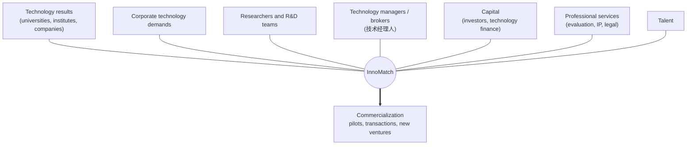
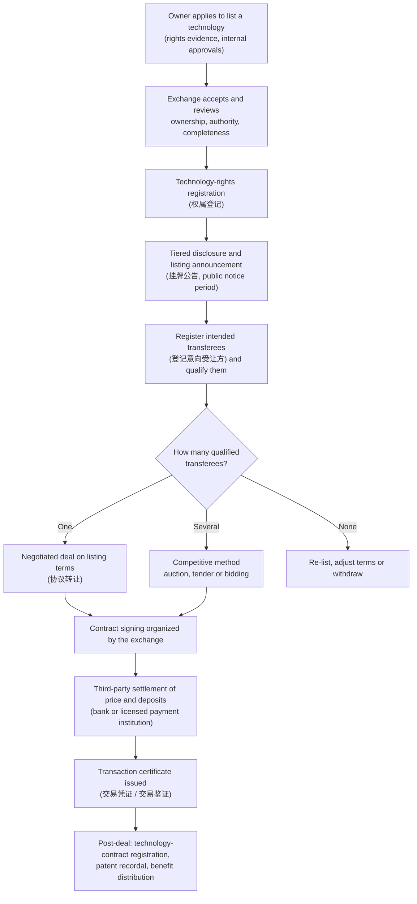
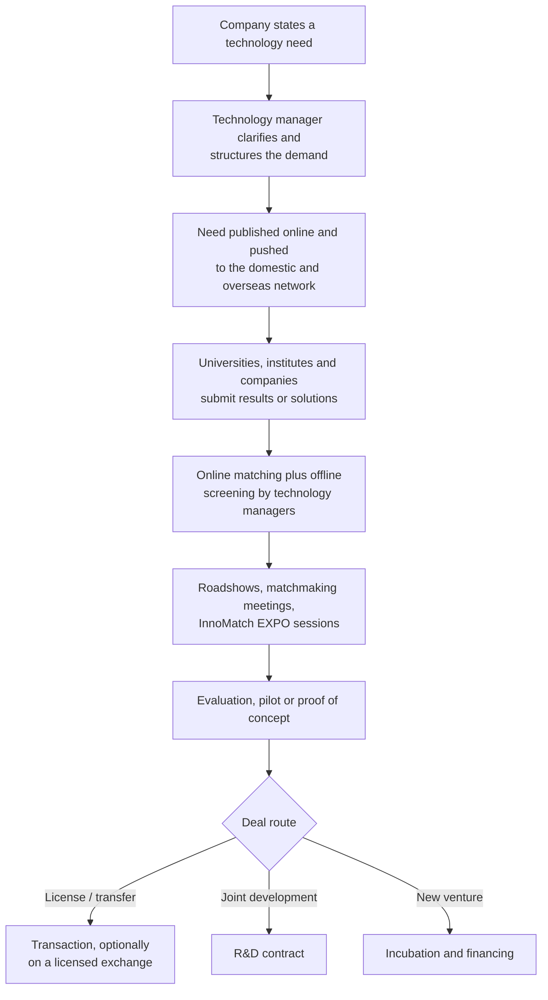

# 02 — STEX vs NETC/InnoMatch: Scale, Scope and What "Largest" Means

> **About this document**
>
> - **Purpose:** Compare STEX and NETC/InnoMatch on transaction scale, ecosystem breadth and platform revenue, and explain how each turns a technology into a deal.
> - **Audience:** Founders, product managers and analysts.
> - **Status:** Market research, corrected against primary sources (see "Corrections" at the end).
> - **Previous:** [01 — Shanghai landscape](01-shanghai-landscape.md) · **Next:** [03 — Business models and revenue](03-business-models-and-revenue.md)

---

## Summary

"Which platform is biggest?" has three different answers, because three different things can be measured:

| Question | Answer | Basis |
| --- | --- | --- |
| Largest **technology marketplace by transaction value** | **STEX** | ¥30.9B on-exchange in 2024; > ¥63.4B cumulative |
| Widest **technology-transfer ecosystem** (variety, demand side, services, international network) | **NETC + InnoMatch** | Demand-driven matching, technology managers, international network, events, training |
| Larger **platform business by revenue** (2023) | **NETC's operating company** (¥46.2M) vs **STEX** (¥28.4M) | Fund-prospectus financial disclosures |

> **Key rule:** transaction value ≠ platform revenue. STEX's 2023 revenue was about **0.15%** of the deal value it handled.

---

## 1. Qualitative comparison

| Dimension | STEX (上海技术交易所) | NETC / InnoMatch (国家技术转移东部中心) |
| --- | --- | --- |
| Core model | Technology **exchange** (trading venue) | Technology-transfer **ecosystem + matching platform** |
| Transaction infrastructure | **Strong:** registration, disclosure, auction/tender/bidding, third-party settlement, transaction certificates | Matching, brokerage and service oriented |
| Publicly reported transaction value | **Higher and well documented** | Large, but reported as "facilitated" or "intended" value |
| Breadth of online content | Large | **Very broad** (demands, results, solutions, talent) |
| Corporate demand side | Strong | **Exceptional:** demand collection is its core |
| Universities and research institutes | Very strong (pricing and disclosure services for public institutions) | Very strong (results sourcing) |
| Professional services | Coordinates service providers on the venue | **Broader:** brokers, training, evaluation, incubation, finance |
| International reach | Growing (Lingang international center, 32 cooperating countries) | **Very strong** (global network, InnoMatch EXPO) |
| Best one-line description | "Technology marketplace / exchange" | "Technology-transfer super-platform / ecosystem" |

These ratings are analytical judgments based on public information, not measured scores.

---

## 2. Largest marketplace by transaction value: STEX

### 2.1 Verified figures

| Year | Annual transaction value | Notes |
| --- | --- | --- |
| 2021 | ¥3.047B | First full year after the October 2020 re-launch |
| 2022 | ¥10.115B | |
| 2023 | ¥18.922B | Compound annual growth 2021–2023: 149.2% |
| 2024 | ¥30.933B on-exchange value (进场交易额); 2,383 technologies entered | STCSM 2024 report |
| Cumulative | > ¥42.99B and 10,435 technologies (26 Jul 2024) → > ¥63.4B and > 12,800 technologies (end of 2024) → ≈ ¥76B and > 13,000 technologies (mid-2025) | Different dates and definitions |

> **Note on definitions:** sources use different measures: *on-exchange transaction value* (进场交易额), *closed transaction value* (成交金额) and *cumulative* values at different cut-off dates. Always quote the metric name and date with the number.

### 2.2 Why STEX is the "exchange" benchmark

STEX performs the functions that make a market an *exchange* rather than a directory: rights registration, tiered disclosure, price discovery through competitive methods, third-party settlement and transaction certification (see [01 §1.2–1.3](01-shanghai-landscape.md)).

---

## 3. Widest ecosystem: NETC + InnoMatch

InnoMatch is not just a database of technologies. It connects every participant needed to commercialize a technology:

Self-reported 2024 figures (see [01 §2.3](01-shanghai-landscape.md); not independently re-verified):

| Metric | Value |
| --- | --- |
| Corporate demands | 6,468 |
| Technology results | 4,390 |
| Solutions | 3,015 |
| Completed transactions | 313 |
| Completed ("landed") value | ¥778M |
| Intended signing value | > ¥3.4B |

The 2025 InnoMatch fair released **more than 10,000 technology needs**, plus **1,728 R&D results** seeking commercialization and more than ¥20B of investment commitments from participating companies.

For **variety, discovery, demand-side depth and matching**, NETC/InnoMatch is ahead of STEX.

---

## 4. Platform revenue: now measurable

An earlier draft said neither platform's revenue could be found. In fact, both operating companies' financials appear in a public REIT fund prospectus, because both are tenants (cash-flow providers) of the fund's incubator assets.

| ¥ million | 2021 | 2022 | 2023 | H1 2024 |
| --- | ---: | ---: | ---: | ---: |
| **STEX** (上海技术交易所有限公司), revenue | 23.17 | 28.40 | **28.43** | 9.57 |
| STEX, net profit | −13.75 | −11.87 | **6.25** | −19.86 |
| **NETC operating company** (上海东部科技成果转化有限公司), revenue | 31.85 | 35.05 | **46.20** | 3.84 |
| NETC operating company, net profit | 2.66 | 1.72 | **1.75** | −24.23 |

Observations:

1. **Both are small businesses compared with the deal value they handle.** STEX's 2023 revenue was ≈ 0.15% of its ¥18.9B transaction value.
2. **NETC's operating company earned more revenue than STEX in 2023**, despite reporting far less *completed* transaction value. This is consistent with a diversified service model: consulting, training, events, government programme operation and incubation.
3. **Revenue is highly seasonal.** Both companies recognize most revenue in the second half or fourth quarter, often when government grants arrive or projects are accepted, which explains the negative first-half results.
4. **Government support matters.** STEX attributes swings in profit partly to the timing of government subsidies and investment disposals.

> **Caveat:** the NETC operating company is not the whole NETC network. Network partners and affiliated entities also earn revenue, so this figure is a floor for the NETC model, not a total.

---

## 5. How each platform turns a technology into a deal

### 5.1 STEX: listing-based exchange flow (typical)

This is the general sequence implied by the 2025 Shanghai rules and STEX's published process (accept application → publish information → register intended transferees → organize signing). Product-specific rules vary.

### 5.2 NETC/InnoMatch: demand-driven matching flow (typical)

### 5.3 The difference in one line

| | STEX | InnoMatch |
| --- | --- | --- |
| Chain | listing → disclosure → evaluation → matching → negotiation or competition → transaction → settlement → certification | demand → structuring → network sourcing → matching → expert/broker service → pilot → commercialization |
| Starts from | A **technology** someone wants to sell | A **problem** someone wants solved |
| Main value | Trust, price discovery and legal certainty | Discovery, matching and service |

---

## 6. Implications for our platform

1. **Benchmark both.** STEX is the model for the *transaction* layer; InnoMatch is the model for the *demand and network* layer.
2. **Do not measure success by transaction value alone.** Track platform-earned revenue, completed transfers and post-deal outcomes separately (see [05 §19](05-system-design-blueprint.md)).
3. **Expect a service-heavy revenue mix.** Both Shanghai operators earn modest revenue relative to deal value, and the network operator earns more through services.
4. **Combining the two models is the opportunity.** Shanghai runs them as two companies under one group; a single product can integrate them more tightly (see [04](04-product-strategy.md)).

---

## Corrections made in this revision

| Earlier statement | Correction |
| --- | --- |
| "STEX ~¥189B transaction volume" in 2024 | STEX's **2023** value was **¥18.922B** (a decimal error). 2024 on-exchange value was **¥30.933B**. |
| "NETC revenue not found reliably" | NETC's operating company reported **¥46.20M** revenue and ¥1.75M net profit in 2023. |
| "NETC ¥40B cumulative" vs "¥400B cumulative" (two drafts disagreed) | A cumulative total below one year's ¥42B is impossible. The cumulative figure is unverified; confirm it against NETC's report before use. |
| The STEX profile source was labelled "Shanxi Provincial Government" | The source (xyd.shyp.gov.cn) is the **Shanghai Yangpu District** government. |

---

## Sources

- STCSM 2024 report: <https://stcsm.sh.gov.cn/newspecial/2024jb/pdf/4.pdf>
- Fund prospectus with STEX and NETC operating-company financials: <https://pdf.dfcfw.com/pdf/H2_AN202512151801143261_1.pdf>
- Sohu Fund (STEX cumulative figures, July 2024): <https://q.fund.sohu.com/q/read.php?code=508012&id=4202136>
- Shanghai Yangpu District Government, STEX profile: <https://xyd.shyp.gov.cn/company-detail/10>
- NETC 2024 figures: <https://www.netcchina.com/archives/28860>; About: <https://www.netcchina.com/about-us>
- NETC 2025 InnoMatch release: <https://www.netcchina.com/archives/29963>
- Shanghai Municipal Government (English), InnoMatch 2025: <https://english.shanghai.gov.cn/en-Latest-TalentsinShanghai/20250924/5af31034be3f4e358e44c40a292a4298.html>
- 《上海市技术交易场所管理细则》 (2025): <https://www.shanghai.gov.cn/nw12344/20250414/7d1e61e9a2de431aa524cb2f817845cf.html>
- Sohu report on InnoMatch's technology-manager points system: <https://www.sohu.com/a/676377066_260616>
