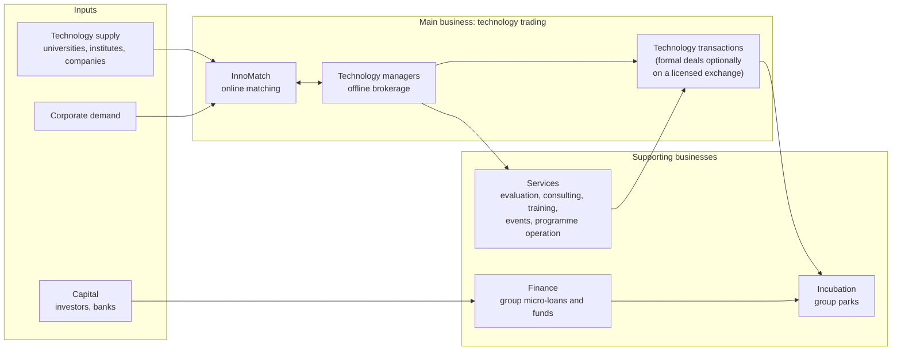
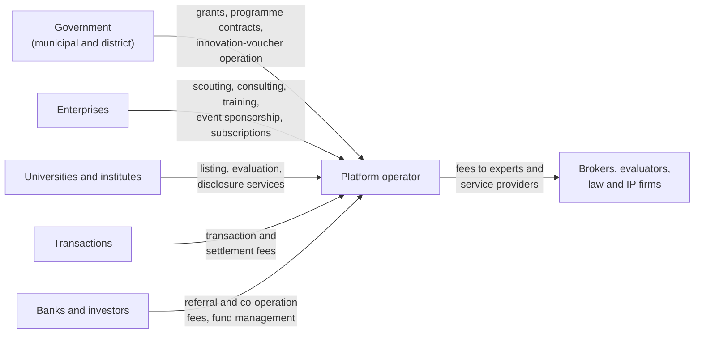

# 03 — Business Models and Revenue: How STEX and NETC Make Money

> **About this document**
>
> - **Purpose:** Explain how a technology exchange (STEX) and a technology-transfer network (NETC) earn revenue, why transaction value is a misleading proxy, and what this means for our own revenue model.
> - **Audience:** Founders, business planners and investors in the project. Chinese terms and units are defined in [01 — Key terms](01-shanghai-landscape.md#key-terms).
> - **Status:** Business analysis. Financial figures come from public disclosures. Revenue *mechanisms* are partly inferred from published services and are marked as such.
> - **Previous:** [02 — Scale and scope](02-stex-vs-netc-scale-and-scope.md) · **Next:** [04 — Product strategy](04-product-strategy.md)

---

## Summary

- **Transaction value is not revenue.** STEX handled ¥18.9B of deals in 2023 and earned ¥28.4M of revenue (≈ 0.15%).
- **NETC's operating company earned more** (¥46.2M in 2023) from a broad mix of services: consulting, training, events, government programme operation and incubation.
- Both operators are **modestly profitable or loss-making**. Results depend on when revenue is recognized and when government subsidies arrive.
- **Lesson:** a technology-transfer platform makes money from the *whole commercialization lifecycle* and from *institutional clients*, not mainly from a commission on each deal.
- **For our platform:** we follow NETC's revenue mix (services, subscriptions, programme operation). On venue-routed deals, the venue's own transaction and settlement fees belong to the venue; we earn the agent and service fees agreed with our clients (§7).

---

## 1. Transaction value vs platform revenue

| Concept | Meaning | Example (illustrative) |
| --- | --- | --- |
| Gross transaction value | Total contract value agreed between buyer and seller | A ¥10M licence agreement |
| Facilitated / intended value | Value of deals the platform helped start, including unsigned intentions | "¥3.4B intended signing value" (InnoMatch, 2024) |
| Funds settled | Money that actually passed through the settlement channel | Down-payment of ¥2M settled through the exchange |
| Platform revenue | Fees the platform itself earns and recognizes | Service fee of ¥50k on the ¥10M deal |
| Platform profit | Revenue minus operating costs | Often small or negative in early years |

The 2023 STEX ratio:

```text
Revenue / transaction value  =  ¥28.43M / ¥18,922M  ≈  0.15%
```

That ratio is **not** a commission rate. STEX's revenue (营业收入) covers all its business lines, not only fees on deals, while government subsidies are booked separately as "other income" and are not part of it. The ratio does show how far apart "volume" and "income" are.

---

## 2. Verified financials (¥ million)

| | 2021 | 2022 | 2023 | H1 2024 |
| --- | ---: | ---: | ---: | ---: |
| STEX transaction value (closed value, 成交金额) | 3,047 | 10,115 | 18,922 | — |
| STEX revenue | 23.17 | 28.40 | 28.43 | 9.57 |
| STEX net profit | −13.75 | −11.87 | 6.25 | −19.86 |
| NETC operating company revenue | 31.85 | 35.05 | 46.20 | 3.84 |
| NETC operating company net profit | 2.66 | 1.72 | 1.75 | −24.23 |

Source: China Merchants Fund REIT prospectus (2025 update), chapter 14, tables 14-1-24 and 14-1-25 (published in units of ¥10,000, 万元; converted here). See Sources.

What the disclosures explain:

- STEX's 2021–2022 losses were **mainly due to high R&D spending**. The prospectus does not say what was developed.
- STEX's first-half 2024 loss has two stated causes: **revenue is recognized mostly in the second half**, and **government subsidies** (recorded as "other income") usually arrive late in the year. No gains from selling equity investments were booked in that half.
- NETC's operating company recognizes **most revenue in Q4**. The prospectus gives no reason; our reading is that government-programme and project contracts are typically paid on year-end acceptance.

---

## 3. STEX revenue model (exchange model)

STEX's licensed functions suggest the following revenue streams. STEX's fee schedule could not be found (published benchmarks from other venues are in [09 §2.6](09-reference-platform-features.md)), so the streams and their relative sizes are **inferred**.

| Revenue stream | Based on | Who pays |
| --- | --- | --- |
| Transaction service fees | Listing, organizing negotiated or competitive transactions | Seller, buyer or both |
| Settlement services | Third-party settlement of price and deposits | Transaction parties |
| Registration and certification | Technology-rights registration, transaction certificates | Rights holders, transaction parties |
| Evaluation and disclosure services | Market-based evaluation, listing announcements for public institutions | Universities, institutes, companies |
| Specialized boards and products | Green, biomedicine, agriculture and other boards; "technology + equity warrant" product | Participants, partner institutions |
| Technology finance cooperation | Technology-backed credit (≈ ¥4.06B granted cumulatively to July 2024) | Banks and partners (referral or service fees) |
| Government support | Subsidies (booked as other income, not revenue) and commissioned public functions | Government |

## 4. NETC revenue model (network and service model)

NETC states that technology trading is its main business, with services and finance as supporting businesses. Observable revenue channels:

| # | Channel | Evidence or example |
| --- | --- | --- |
| 1 | Technology transaction services | Core business per NETC's self-description |
| 2 | Technology-transfer consulting | Service offering |
| 3 | Technology evaluation | Service offering |
| 4 | IP and technology services | Service offering |
| 5 | **Technology-manager training** | A 2024 advanced course on technology-innovation platforms charged **¥5,999 per person** |
| 6 | **Innovation-voucher operation** (科技创新券) | The operating company won a **¥1.875M** contract to operate an innovation-voucher programme |
| 7 | Government and platform operation contracts | Regional platform and programme operation |
| 8 | Global technology-transfer services | International network, overseas partners |
| 9 | Conferences and events | InnoMatch EXPO, matchmaking sessions, roadshows |
| 10 | Incubation and industrial services | Group incubators and parks |
| 11 | Technology finance and investment services | Group finance arm (micro-loans, funds) |

> **About innovation vouchers:** Shanghai's 科技创新券 pay part of the cost when small and medium enterprises buy approved technology services (such as testing, R&D support or training) from registered providers. Running the voucher programme (applications, provider management, redemption, reporting) is a paid government service contract. It also brings demand and suppliers onto the operator's platform. Voucher rules: [09 §3.6](09-reference-platform-features.md).

InnoMatch also uses **incentives instead of fees** to grow its broker network. A points system for technology managers, with points redeemable for cash, has been reported (Sohu). STCSM reported in June 2024 that technology managers had taken part in matching 18,569 times, 302 service institutions were involved, more than ¥1.5 million of collaboration rewards had been paid, and the platform was testing joint delivery and revenue sharing among technology managers. This shows the operator's priority on ecosystem growth over transaction commissions.

### 4.1 NETC business architecture

Simplified from NETC's self-description and the group structure in [01 §3](01-shanghai-landscape.md):



---

## 5. Who pays whom: profit pools

The diagram shows the profit pools open to a technology-transfer platform operator in general.



| Profit pool | Predictability | Scales with | Notes |
| --- | --- | --- | --- |
| Government programmes | Medium (annual budgets, tenders) | Policy priorities | Important in China; creates dependency risk |
| Enterprise services (scouting, consulting) | Medium–high | Number of enterprise clients | Closest to recurring revenue |
| Training and certification | High | Professional demand (technology managers) | Low marginal cost |
| Transaction and settlement fees | Low–medium | Deal volume and size | Lumpy; needs trust infrastructure. For us: settlement fees go to the venue or the payment institution, not to the platform |
| Events | Medium | Brand and network | Also a lead-generation channel |
| Finance (credit, funds) | Variable | Capital partners | Usually needs licensed partners |

---

## 6. Which is the more interesting business?

| Measure | Leader |
| --- | --- |
| Bigger technology transaction marketplace | **STEX** |
| Broader technology-transfer ecosystem | **NETC** |
| Higher revenue (2023) | **NETC operating company** |
| Clearer, more defensible transaction infrastructure | **STEX** |
| More diversified, more transferable business model | **NETC** |

NETC is the more useful model **for revenue design**, because it does not depend on a deal closing. STEX is the more useful model **for trust and transaction design**, because it provides the controls that make deals bankable. For our platform, both apply in different ways: we copy NETC's revenue mix directly, and we use STEX's trust functions through the venue as its registered practising agent, instead of rebuilding them.

---

## 7. Lessons for our revenue model

1. **Price the service, not only the deal.** Scouting, evaluation, diligence, training and programme operation should each be a priced product (see [04 §11–§12](04-product-strategy.md) and [05 §14](05-system-design-blueprint.md)).
2. **Plan for institutional customers.** Enterprises (scouting subscriptions) and public bodies (programme operation, vouchers) give more predictable revenue than commissions.
3. **Keep transaction fees simple and defined.** Define the triggering event (for example, signed contract or confirmed payment) and never charge on "intended" value ([08 §7](08-china-operating-model.md)). The fee schedule is open decision D-07 in [10 §12](10-product-requirements.md).
4. **Keep venue fees and our fees apart.** On a venue-routed deal, the venue charges the parties under its own schedule, and the bank or payment institution settles the money. Our income is the agent or service fee agreed with our client. Show the venue's fees separately from ours on every quote and invoice, and never take the deal price or deposits into our own accounts ([08 §1.2](08-china-operating-model.md)).
5. **Model seasonality and grant timing** in cash-flow planning.
6. **Report three numbers separately:** gross deal value, funds settled, platform revenue.

---

## Sources

Notes, excerpts and saved copies of these sources (with retrieval dates and archived links) are in [`references/`](references/README.md).

- China Merchants Fund REIT prospectus (2025 update), STEX and NETC operating-company financials: <https://pdf.dfcfw.com/pdf/H2_AN202512151801143261_1.pdf>
- STCSM 2024 report (InnoMatch intended value): <https://stcsm.sh.gov.cn/newspecial/2024jb/pdf/4.pdf>
- STCSM reply 沪科建复〔2024〕43号 (technology-manager participation and collaboration rewards): <https://stcsm.sh.gov.cn/cmsres/1d/1d53be21ff5f458c8edddaa63645470f/507c46bece268afb611978ef1082ae12.pdf>
- NETC, About us (business model): <https://www.netcchina.com/about-us>
- NETC, 2024 training course fee: <https://www.netcchina.com/archives/27000>
- Bid Center, innovation-voucher operation contract award: <https://sh.bidcenter.com.cn/gys/detail-4627393.html>
- Sohu, InnoMatch technology-manager points system: <https://www.sohu.com/a/676377066_260616>
- NETC, home page (note: its live statistics counters showed "0" placeholders at the time of the original research; use published reports instead): <https://www.netcchina.com/>
