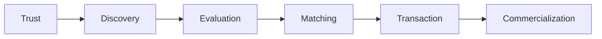
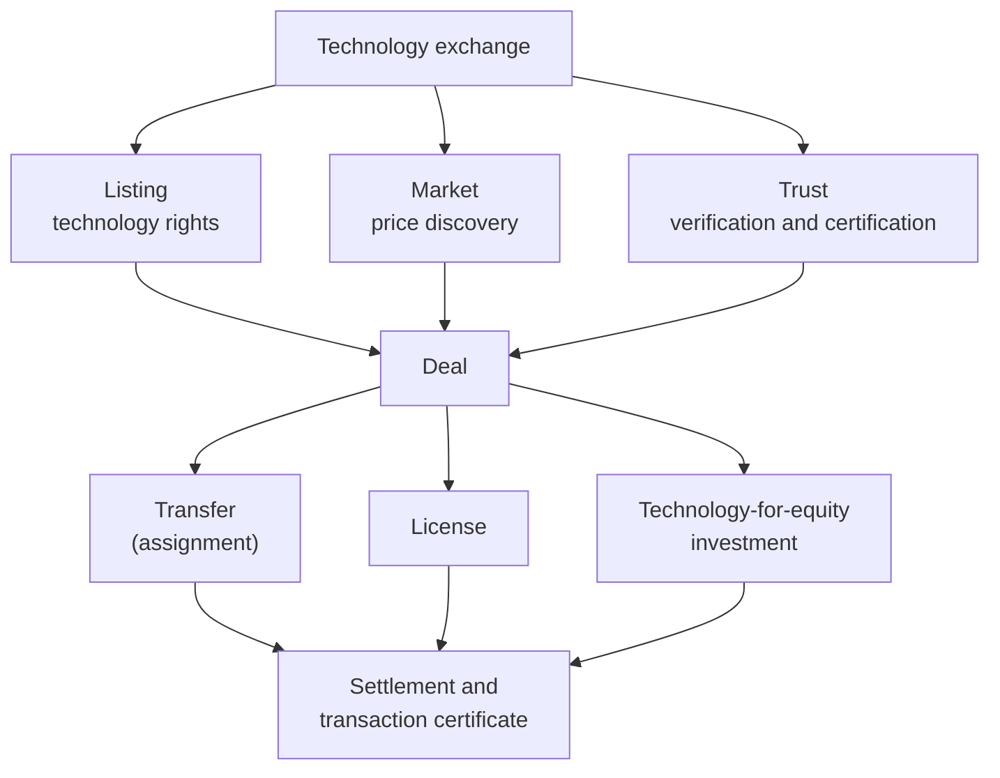
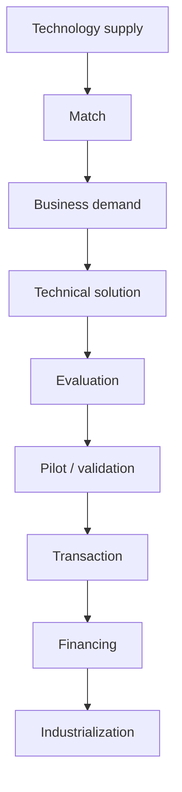
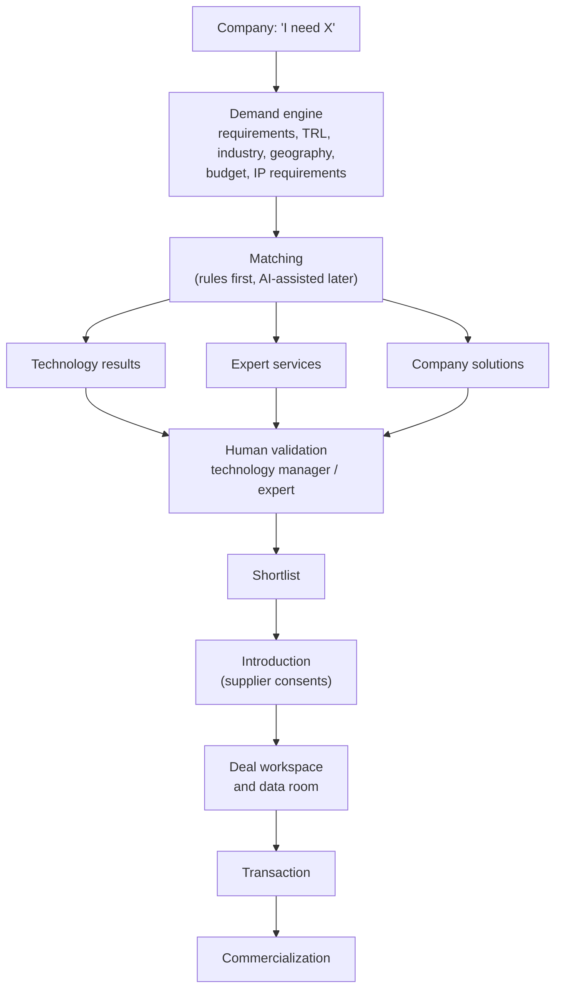
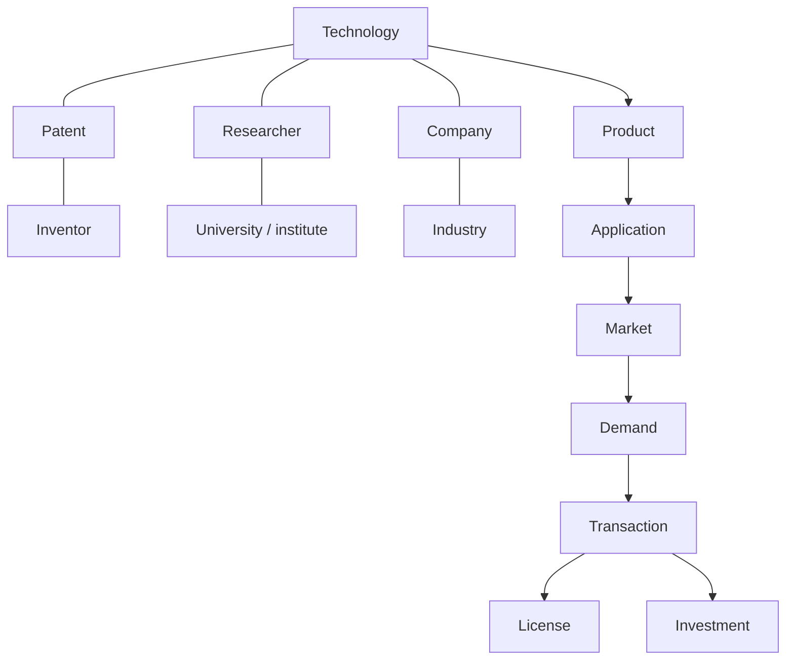
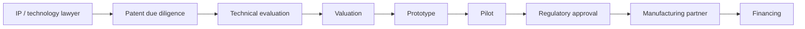
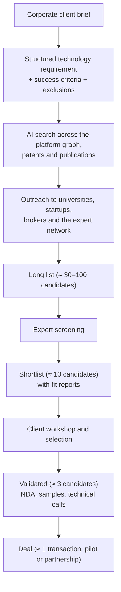
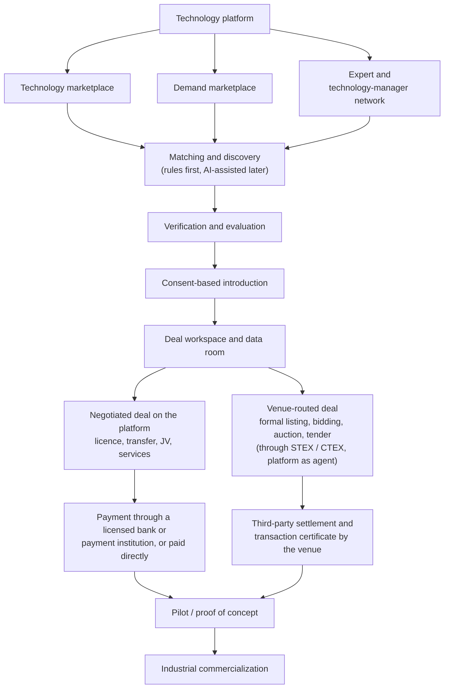
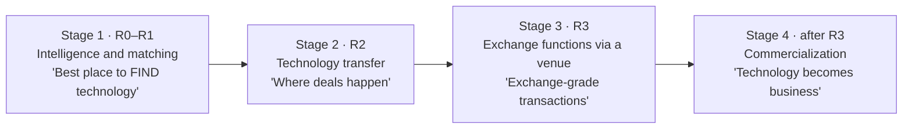

# 04 — Product Strategy: Combining an Exchange with a Technology-Transfer Network

> **About this document**
>
> - **Purpose:** Define what our platform should be, what it should borrow from STEX and NETC/InnoMatch, what it should do differently, and in which order to build it.
> - **Audience:** Founders, product managers and solution architects.
> - **Status:** Product strategy. The numbered requirements and releases (R0–R3) that implement it are in [10](10-product-requirements.md); the system design is in [05](05-system-design-blueprint.md) and [06](06-implementation-design-v1.md).
> - **Previous:** [03 — Business models](03-business-models-and-revenue.md) · **Next:** [05 — System design blueprint](05-system-design-blueprint.md)

---

## Summary

The recommended model is:

> **NETC's supply/demand network + STEX's trusted transaction infrastructure + a modern SaaS/marketplace experience + AI-assisted matching and evaluation.**

Our position, used in every document (see [10 §1.1](10-product-requirements.md)):

- We build a demand-driven **matching and service platform** with managed transfer workflows. We do **not** build a trading venue.
- Formal listing (挂牌), competitive bidding, auction and tender, third-party settlement and transaction certificates are **venue functions**. The platform performs them through a licensed venue (STEX or CTEX) as its **registered practising agent** (执业类交易服务机构).
- Client money is held and released only by a licensed bank or payment institution (for venue-routed deals, through the venue's third-party settlement). The platform coordinates the conditions and records verified events. It never holds client funds.
- Delivery follows the releases in [10 §9](10-product-requirements.md): R0 foundation, **R1** marketplace MVP, **R2** managed transfer and clients, **R3** venue-routed transactions and payments through a licensed partner. §15 maps the strategic stages to these releases.

Technology transfer is **not a listing problem**. It is a chain of six problems, and the platform must address all of them:



The 2025 Shanghai rules confirm this view. A licensed technology trading venue must provide rights registration, transaction certification, information disclosure, market-based evaluation, settlement, service-provider management, risk control and dispute resolution, not just publish listings (Art. 11; see [01 §1.3](01-shanghai-landscape.md)). Several of these are regulated venue functions, which is why the platform reaches them through a venue as its agent (§15).

---

## 1. What to take from STEX: the "Exchange" layer

STEX treats a technology as a **rights-bearing asset**, not as an e-commerce product. That idea should be copied most closely.



In our platform, formal listing, binding price discovery, settlement and the transaction certificate are performed by the licensed venue. The platform prepares the submissions, represents its clients as their agent and records the results (R3, [10 §3.10](10-product-requirements.md)).

The Shanghai framework (Art. 2 of the 2025 rules, see [01 §1.3](01-shanghai-landscape.md)) recognizes these **transaction modes**:

| Mode | Chinese | Typical deliverable |
| --- | --- | --- |
| Technology transfer (assignment) | 技术转让 | Ownership of patents or other rights |
| Technology licensing | 技术许可 | Permission to use rights within a scope |
| Technology-for-equity investment | 作价投资 | Shares in exchange for contributed technology |
| Technology development | 技术开发 | New technology developed under contract |
| Technical services | 技术服务 | Solving a specific technical problem |
| Technical consulting | 技术咨询 | Feasibility studies, analysis, reports |

And these **transaction methods**: negotiated transfer (协议转让), auction (拍卖), tender (招标), competitive bidding (竞价) and other lawful methods. On our platform, negotiated deals are managed on the platform (from R2). Auction, tender and binding bidding run on the venue (R3); auctions also need a licensed auction house ([09 §1](09-reference-platform-features.md)).

**Decision:** model *transaction mode* and *transaction method* as first-class, configurable fields from day one, even if early releases only support negotiated deals (offer types in FR-TEC-06, pricing method per university transfer in FR-UNI-05).

---

## 2. What to take from NETC/InnoMatch: the "Technology-Transfer Network" layer

NETC describes itself as "technology trading as the main business, with services and finance as supporting businesses". It combines online intelligent matching with offline brokerage. InnoMatch is not "here are 10,000 technologies". It is a pipeline:



Officially, NETC facilitated about **¥4.2 billion** (近42亿元) of signed deals in 2024 (STCSM 2024 report). Its InnoMatch platform has gathered 6,468 corporate demands, 4,390 technology results and 3,015 solutions, and completed 313 transactions worth ¥778 million, **cumulatively** from its launch in August 2022 to the end of 2024; in 2024 alone it recorded 595 matching intentions with more than ¥3.4 billion intended signing value (STCSM 2024 report; see [01 §2.3](01-shanghai-landscape.md)).

**Borrow the demand-driven approach:** demands rewritten and anonymized by technology managers (技术经理人, professional brokers), a response for every demand, solution submissions (揭榜) and challenges, and an accredited technology-manager network ([09 §3](09-reference-platform-features.md); FR-DEM-04 … FR-DEM-08, FR-MAT-04 … FR-MAT-07).

---

## 3. The trap to avoid: starting with a giant database

"We have 100,000 technologies!" sounds impressive, but a company typically arrives with a request like this:

> "I need a battery thermal-management technology that survives 150 °C, is at TRL 7 or higher, can be manufactured below a target unit cost, and can be licensed in Europe."

A database alone cannot answer that. The platform's first question should be:

> **"What technology problem are you trying to solve?"**

The platform should then turn the answer into a **structured demand** and actively find candidates.

---

## 4. Put Demand at the center



This matches NETC's philosophy of online matching plus offline professional transfer services. The human-validation step matters: the system produces candidates, and qualified people decide which ones are worth a client's time. In R1, matching uses hard filters, Chinese full-text retrieval and a versioned scoring formula with an explanation for each candidate (FR-MAT-01, [05 §7.3](05-system-design-blueprint.md)); a broker (platform staff in R1, accredited technology managers from R2) reviews uncertain or high-value candidates (FR-MAT-03). AI assistance is added from R2 (§6). Contact details stay masked and confidential documents stay closed until the supplier consents to the introduction (FR-INT-02, FR-INT-03).

---

## 5. Two marketplaces

### 5.1 Marketplace A: technology supply

Universities, research institutes, companies and inventors publish:

| Category | Examples |
| --- | --- |
| Rights | Patents, patent applications, software copyrights, know-how, trade secrets |
| Digital | Software, algorithms, AI models, datasets, data capabilities |
| Physical | Prototypes, materials, equipment, scientific instruments |
| Processes | Manufacturing processes, biotech and medical-technology methods |
| Capability | Laboratory testing, engineering services, R&D capacity |

Each technology gets a structured **Technology Passport**. The record below is illustrative, not a real listing:

```yaml
technology_id: TEC-018271
title: Solid-state battery electrolyte technology
owner:
  organization: Example University          # legal rights holder
  authorized_representative: Technology Transfer Office
  service_invention: true                   # 职务科技成果: institutional approval needed
technology_type: [patent, know-how]
industry: Energy / Battery
applications: [Electric vehicles, Grid storage]
maturity:
  trl_claimed: 6
  trl_assessed: null                        # filled in by an independent reviewer
  commercial_readiness: early trials
ip:
  granted_patents: 3
  pending_applications: 2
  jurisdictions: [CN, EU, US]
commercialization:
  seeking: [license, joint development]
  exclusivity: negotiable
  territories_available: [Global]
  required_investment: "RMB 3M–8M (indicative)"
validation:
  evidence: [Third-party laboratory report]
  badges: [Ownership verified, Patent verified]   # see §9
technology_manager: assigned
```

Field names in these examples are illustrative. The stored model (camelCase fields, references such as `TEC-000123`, money as `{ currency, amountMinor }` in fen) is in [06 §4](06-implementation-design-v1.md).

### 5.2 Marketplace B: technology demand

Companies publish structured needs. Illustrative record:

```yaml
demand_id: DEM-018291
company: Automotive manufacturer            # hidden in the public version by default (FR-DEM-03)
problem: Battery thermal runaway
need: Detect thermal runaway in under 500 ms
hard_constraints:
  trl_min: 7
  production_volume: ">100,000 units/year"
preferences:
  transaction: [license, acquisition]
  geography: Global
budget: "RMB 2M–10M (private: never shown publicly)"
deadline: 6 months
disclosure: anonymous public summary; details after NDA
```

The system then finds **technologies, researchers, companies, experts and service providers**. The network effect starts when both sides use structured records.

---

## 6. An AI "technology broker", not a chatbot

The AI's job is to perform specific broker tasks under human control:

| Broker task | AI contribution | Human control |
| --- | --- | --- |
| Clarify a vague need | Converts free text into a structured demand | Buyer confirms constraints |
| Find candidates | Searches the technology graph, patents and the expert network | Technology manager reviews the shortlist |
| Explain fit | Shows which requirements are met, missing or unknown | Buyer decides whether to proceed |
| Prepare evaluation | Drafts due-diligence questions and evidence requests | Expert decides |
| Support negotiation | Summarizes proposals and highlights changed terms | Parties approve every term |

Staging and limits:

- The core workflows work without AI ([06 §1.2](06-implementation-design-v1.md)). AI-assisted demand structuring (FR-DEM-02) and recommendations (FR-MAT-02) start in R2.
- In China, use only model providers that have completed generative-AI filing, and never send confidential documents to a provider without a data agreement ([10 §8](10-product-requirements.md), [05 §15.3](05-system-design-blueprint.md)).
- The AI never certifies ownership, approves a transaction or changes a record on its own. A named person confirms every result.

Example: a buyer writes "We need a low-cost technology for detecting defects in lithium battery electrodes." The AI produces:

```yaml
industry: Battery manufacturing
problem: Electrode defect detection
technical_requirements:
  - Computer vision (X-ray, optical or hyperspectral)
  - Real-time, inline inspection
  - Accuracy above 99%
commercial_requirements:
  - TRL 7 or higher
  - Proven industrial deployment
  - Unit cost below target
transaction_options: [license, acquisition, joint venture]
open_questions:
  - Line speed and electrode width?
  - Which defect classes matter most?
```

---

## 7. A technology graph, not just a database



A graph answers questions like:

> "Find all technologies related to solid-state batteries at TRL 6 or higher that are not exclusively licensed, have Asian manufacturing capability, and have at least one successful industrial validation."

The graph can be a **logical model** (MongoDB collections with reference fields, traversed with `$graphLookup`) long before it needs a graph database (see [05 §15.4](05-system-design-blueprint.md)).

---

## 8. Maturity: TRL plus commercial readiness

### 8.1 Technology Readiness Level (TRL)

Use the widely adopted EU/Horizon definitions:

| TRL | Definition | Typical evidence |
| --- | --- | --- |
| 1 | Basic principles observed | Publications |
| 2 | Technology concept formulated | Concept papers, models |
| 3 | Experimental proof of concept | Lab experiment results |
| 4 | Technology validated in the lab | Lab test reports |
| 5 | Technology validated in a relevant environment | Tests in simulated or industrially relevant conditions |
| 6 | Technology demonstrated in a relevant environment | Prototype demonstration report |
| 7 | System prototype demonstrated in an operational environment | Field or pilot-line trial report |
| 8 | System complete and qualified | Qualification and certification test results |
| 9 | Actual system proven in an operational environment | Commercial production or deployment records |

> **China note:** the national standard **GB/T 22900-2022** (《科学技术研究项目评价通则》, replacing the 2009 edition) defines a 9-level technology-readiness scale used in Chinese project evaluation. Map platform TRL values to it for domestic users and show both scales where needed.

Rules:

- Store **claimed TRL** and **assessed TRL** separately, with the evidence and the assessor (FR-TEC-04).
- A lab prototype is never automatically "industrially validated".

### 8.2 Commercial and manufacturing readiness

TRL is not enough: a technology can be technically mature but commercially useless. Track separate dimensions:

| Dimension | Example scale | What it answers |
| --- | --- | --- |
| Commercial readiness | ARENA Commercial Readiness Index (CRI 1–6), or an internal 1–9 scale | Is there a viable market and business model? |
| Manufacturing readiness | MRL 1–10 (US DoD) | Can it be produced at scale and cost? |
| Regulatory readiness | Internal scale | Are approvals obtained or obtainable? |
| IP position | Internal scale | Are rights clear, enforceable and available? |
| Customer validation | Internal scale | Has a paying customer used it? |

Do **not** use a fixed TRL → CRL mapping. The dimensions are independent: a TRL 8 technology can still be at the lowest commercial-readiness level.

---

## 9. Technology verification: the reputation system

Badges create trust, but only if each badge has a precise meaning:

| Badge | Meaning | Evidence | Verified by | Re-check |
| --- | --- | --- | --- | --- |
| Ownership verified | The listing organization holds or controls the rights | Assignment records, institutional authorization | Platform reviewer | On change or yearly |
| Patent verified | Patent numbers, status and holders match the registry | CNIPA / EPO / USPTO register extract | IP specialist | Every 6 months (legal-status re-check, FR-TEC-05) |
| Inventor verified | Named inventors confirmed | Inventor declaration | Platform reviewer | Once |
| Technical data verified | Key performance claims supported by documents | Test reports, publications | Technical expert | On new version |
| TRL assessed | Independent TRL assessment completed | Assessment report | Qualified assessor | On new version |
| Laboratory validated | Independent lab tested key claims | Third-party lab report | Lab (external) | Once per claim |
| Industrial pilot | Pilot completed with an industrial partner | Pilot report or partner letter | Platform reviewer | Once |
| Revenue generated / existing license | Technology already licensed or sold | Redacted contract or confirmation | Platform reviewer | Yearly |
| Commercial deployment | In commercial use | Customer reference | Platform reviewer | Yearly |

The emphasis that STEX and the Shanghai rules place on rights registration, certification, disclosure and evaluation is the right principle. Each badge shows its scope and date, and corresponds to one of the assurance levels in [05 §4.4](05-system-design-blueprint.md) (owner asserted, document checked, independently verified, legally confirmed).

A **badge is the platform's own review, not a legal certification**. Legally recognised rights-registration and transaction certificates are issued only by a licensed venue; the platform stores their numbers and links them to the deal (FR-VEN-09, [05 §2.2](05-system-design-blueprint.md)).

---

## 10. A professional-services marketplace

After a buyer finds a technology, a sequence of service needs follows. The platform should connect each one:



The platform then earns across the **whole commercialization lifecycle** instead of only from a transaction commission. These services run through the services module ([10 §3.11](10-product-requirements.md)): the expert pool starts in R1; service-institution onboarding, the service catalogue, service orders and valuation follow in R2.

---

## 11. A diversified revenue model

| Tier / product | Customer | Contents | Pricing approach (illustrative) |
| --- | --- | --- | --- |
| **Free** | Researchers, universities, small suppliers | Profile, basic technology publication, basic matching, receive inquiries | Free, to build supply |
| **Professional** | Companies | Advanced search, AI matching, private demands, analytics, saved searches, supplier comparison, deal pipeline | Monthly or annual subscription |
| **Transaction services** | Deal parties | Transaction coordination, documentation, coordination of settlement by the venue or the payment partner | Fixed fee or contractually agreed success fee |
| **Premium services** | Buyers and suppliers | Evaluation, patent due diligence, valuation, technical verification, market analysis, custom scouting, negotiation support, licensing support, pilot management | Fixed fee or statement of work |
| **Enterprise** | Large corporations | Private scouting, global database, AI matching, private demands, technology intelligence, deal rooms, expert network | Annual contract in RMB; price not yet set (fee schedule is open decision D-07 in [10 §12](10-product-requirements.md); benchmarks in [09 §2.6](09-reference-platform-features.md)) |
| **Institutional** | Governments, parks, universities | Programme operation, innovation vouchers, regional platforms, TTO tooling | Contract or tender |

Plans and entitlements (Free, Professional, Enterprise and institutional contracts) are enforced from R2 (FR-CLI-01). Registration and listing are free at launch ([08 §7.1](08-china-operating-model.md)). Fees are the platform's own revenue and are invoiced separately from the deal value (FR-CLI-07, FR-RPT-03).

Do not copy a fixed Chinese exchange fee blindly. Fees depend on jurisdiction, transaction type and the service actually delivered (see [07 §6](07-roles-workflows-and-money.md), [08 §7](08-china-operating-model.md) and the venue benchmarks in [09 §2.6](09-reference-platform-features.md)). The fee schedule and plan pricing are open decision D-07 in [10 §12](10-product-requirements.md).

---

## 12. The most interesting product: Technology Scouting-as-a-Service

Large companies (manufacturing, automotive, pharma, electronics) regularly need "technologies for X". Instead of having them search the marketplace themselves, the platform runs a managed scouting programme:



| Stage | Deliverable | Typical duration (indicative) |
| --- | --- | --- |
| Brief | Requirement specification signed off by the client | 1–2 weeks |
| Search and outreach | Long list with source evidence | 3–6 weeks |
| Screening | Shortlist with fit reports and gap analysis | 2–4 weeks |
| Validation | Calls, NDAs, samples and evaluation summaries | 4–8 weeks |
| Introduction to deal | Term-sheet support, handover to the deal workflow | Varies |

Charge for the **scouting programme** (fixed fee or subscription) and optionally a separate, pre-agreed **success fee** on a resulting transaction.

In the requirements this is the enterprise **scouting project** (FR-CLI-02, R2). The operational steps (service order, conflict check, private demand, outreach, report to authorized client users, client acceptance, hand-over to introductions) are in [05 §7.6](05-system-design-blueprint.md).

---

## 13. Target platform architecture (conceptual)



Boxes that name a venue or a bank are performed by those licensed partners. The platform prepares, instructs and records; it never holds the money.

---

## 14. What to copy and what to do differently

"Stage" refers to the strategic stages in §15; R1–R3 are the releases in [10 §9](10-product-requirements.md).

| Feature | STEX | NETC | Our recommendation |
| --- | --- | --- | --- |
| Technology listings | Yes | Yes | **Yes** |
| Corporate demands | Yes | **Strongest** | **Core** |
| AI matching | Limited | Yes | **Core, much stronger** |
| Technology verification | **Strongest** | Yes | **Core** |
| Rights registration | **Strongest** (licensed) | Yes | **Core** as records of claims and evidence; certified registration only through the venue, as its agent (R3) |
| Transaction marketplace | **Strongest** | Yes | **Core**: managed negotiated deals on the platform (R2); listing-based sales through the venue (R3) |
| Auction / bidding | **Strongest** | Some | **R3, through the venue** (auctions also need a licensed auction house) |
| Negotiated deals | Yes | **Strongest** | **Core** (R2) |
| Deal room | Limited | Limited | **Build very well** (R2) |
| Settlement | **Strongest** (licensed) | Yes | **Never by the platform**: the venue's third-party settlement for venue-routed deals; a licensed bank or payment institution for platform-managed deals (R3) |
| Technology evaluation | **Strong** | **Strong** | **Core** |
| Expert network | Yes | **Strongest** | **Core** |
| Technology scouting | Some | **Strongest** | **Core** (R2) |
| Financing | Yes | **Strongest** | Stage 4 (after R3) |
| Pilot / PoC | Some | **Strongest** | Core eventually (Stage 4) |
| Incubation | Some | **Strongest** | Stage 4, optional |
| Training | Some | **Strongest** | Optional |
| Global network | Strong | **Strongest** | Core eventually |
| Enterprise SaaS | Weak | Weak | **Big opportunity** |
| Technology intelligence | Weak | Limited | **Big opportunity** |
| AI technology broker | Weak | Limited | **Big differentiator** |

---

## 15. The most important strategic decision: do not start as a national exchange

Becoming a government-scale technology exchange requires trust, government relationships, university networks, legal recognition, transaction certification and liquidity. These take years, and parts of them require licences (see [01 §1.3](01-shanghai-landscape.md)). In Shanghai, new technology trading venues are approved under total-quantity control (《上海市技术交易场所管理细则》, 沪科规〔2025〕2号, in force 1 May 2025 – 30 April 2030; [09 §1](09-reference-platform-features.md)).

The platform therefore does not start as a venue. Its default route is to become a **registered practising agent** of STEX (or CTEX). STEX requires an agent to have been registered for at least 2 years, with registered capital of at least RMB 1 million, at least 2 recognised practitioners and a clean record for the last 24 months. The agent verifies the buyer materials it submits and bears joint liability for them ([09 §2.1](09-reference-platform-features.md)). The final route (become an agent, partner with an existing agent, or apply for a venue licence) is open decision D-01 in [10 §12](10-product-requirements.md), needed before R3 design.

Build in strategic stages:



| Stage | Release ([10 §9](10-product-requirements.md)) | Adds | Goal |
| --- | --- | --- | --- |
| 1 — Intelligence and matching | R0 foundation, R1 marketplace MVP | Verified organizations; reviewed technology listings with bulk import; demands with rewriting and basic challenges; Chinese search and public pages; matching with filters, scores and explanations; inquiries and introductions with contact masking; university public notices; expert pool; admin console and audit | Become the best place to **find** the right technology |
| 2 — Technology transfer | R2 managed transfer and clients | Technology-manager network; NDA and data rooms; proposals and negotiation; contracts with e-signature; deal workspace and milestones; valuation and other services; events; enterprise scouting and institutional (TTO, programme) workspaces; AI-assisted demand structuring | Become the place where technology **deals happen** |
| 3 — Exchange functions via a venue | R3 venue-routed transactions | Formal listing, buyer registration, competitive bidding, auction and tender, settlement tracking and certificates, **run through a licensed venue with the platform as its registered practising agent**; payments for platform-managed deals through a licensed bank or payment institution; royalty tracking | Give clients **exchange-grade transactions** without becoming a venue |
| 4 — Commercialization | After R3 (not yet in [10](10-product-requirements.md)) | PoC, pilots, manufacturing, investment, financing, regulatory support, industrial partners, M&A | Become the infrastructure through which technology **becomes products and businesses** |

The product phases in [05 §17](05-system-design-blueprint.md) and the engineering phases in [06 §13](06-implementation-design-v1.md) are mapped to the same releases in those sections. The releases cut across the phases: for example, enterprise scouting from 05 Phase 4 arrives in R2. The release scope in [10 §9](10-product-requirements.md) is the plan of record.

---

## 16. Recommendation

Build a serious, internationally capable technology-transfer company with four layers:

| Layer | Model | Role |
| --- | --- | --- |
| Exchange layer | **STEX** | Rights, disclosure, price discovery, certification, settlement. Performed by the licensed venue; the platform acts as its registered practising agent, and money moves only through the venue's settlement or a licensed bank or payment institution |
| Transfer-ecosystem layer | **NETC / InnoMatch** | Demand, network, brokers, services, events |
| Digital layer | LinkedIn + Bloomberg + Alibaba-style UX | Profiles, intelligence, marketplace usability |
| Intelligence layer | **AI** | Structuring, matching, explanation, diligence support |

The result is something neither STEX nor NETC fully provides today:

> **A technology marketplace where technologies are searchable like products, evaluated like investments, matched like jobs, negotiated like M&A, and transferred through a controlled transaction workflow.**

### Before writing code

1. Map the complete STEX and NETC/InnoMatch **user journeys and revenue flows screen by screen**.
2. Record what each does well and poorly.
3. Turn that into a **PRD, a domain model and a marketplace architecture**. That work is captured in [09](09-reference-platform-features.md) (what the reference platforms actually do), [10](10-product-requirements.md) (the PRD), [05](05-system-design-blueprint.md) and [06](06-implementation-design-v1.md) (domain model and architecture), and [07](07-roles-workflows-and-money.md) and [08](08-china-operating-model.md) (roles, workflows and money).

---

## Sources

Notes, excerpts and saved copies of these sources (with retrieval dates and archived links) are in [`references/`](references/README.md).

- 《上海市技术交易场所管理细则》 (2025): <https://www.shanghai.gov.cn/nw12344/20250414/7d1e61e9a2de431aa524cb2f817845cf.html>
- STCSM, *2024 Shanghai Science and Technology Progress Report* (NETC 2024 signed-deal value): <https://stcsm.sh.gov.cn/newspecial/2024jb/pdf/4.pdf>
- NETC, About us: <https://www.netcchina.com/about-us>; online + offline model: <https://www.netcchina.com/archives/21776>; InnoMatch cumulative figures to end-2024 (also in the STCSM 2024 report): <https://www.netcchina.com/archives/28860>
- European Commission, Horizon 2020 General Annex G, Technology Readiness Levels: <https://ec.europa.eu/research/participants/data/ref/h2020/wp/2014_2015/annexes/h2020-wp1415-annex-g-trl_en.pdf>
- GB/T 22900-2022 《科学技术研究项目评价通则》, issued 14 October 2022 by SAMR and SAC, replacing GB/T 22900-2009 (search by number on the national standards public service platform): <https://std.samr.gov.cn/gb/search/gbQueryPage?searchText=GB/T%2022900-2022>
- ARENA, Commercial Readiness Index for Renewable Energy Sectors (2014): <https://arena.gov.au/assets/2014/02/Commercial-Readiness-Index.pdf>
