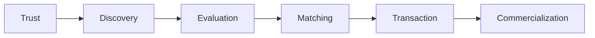
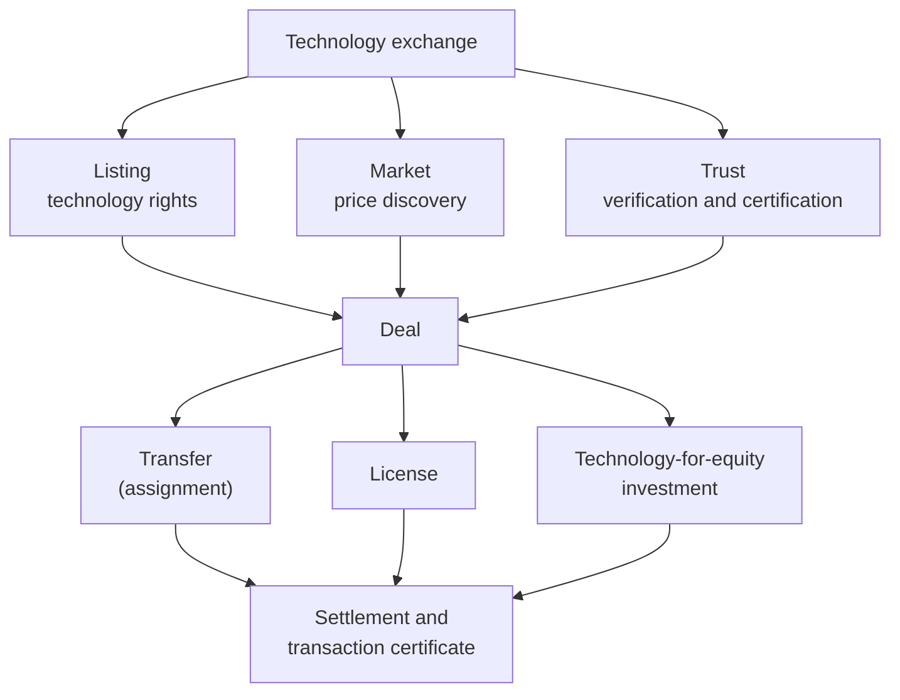
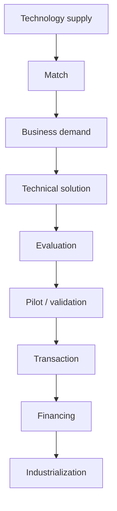
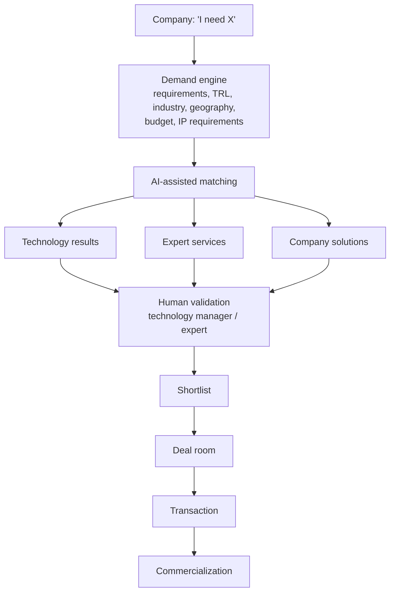
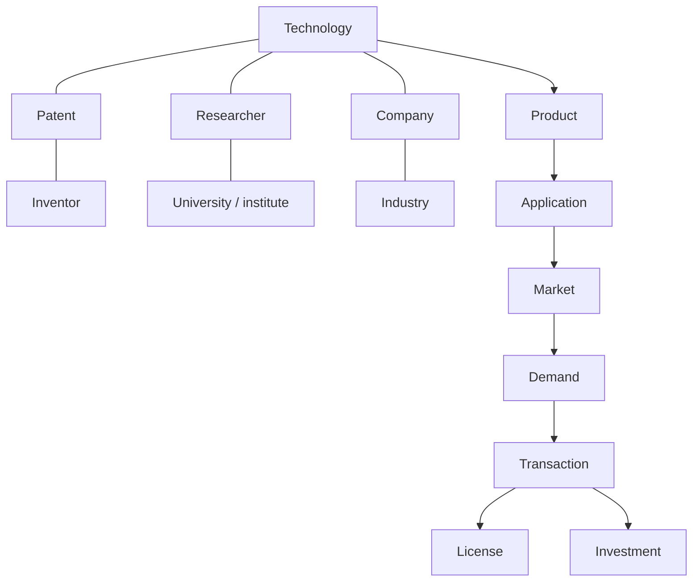
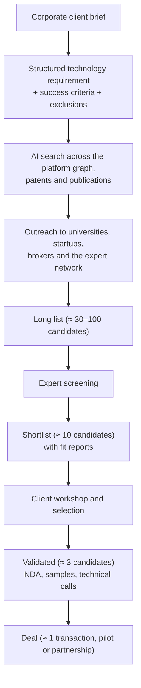
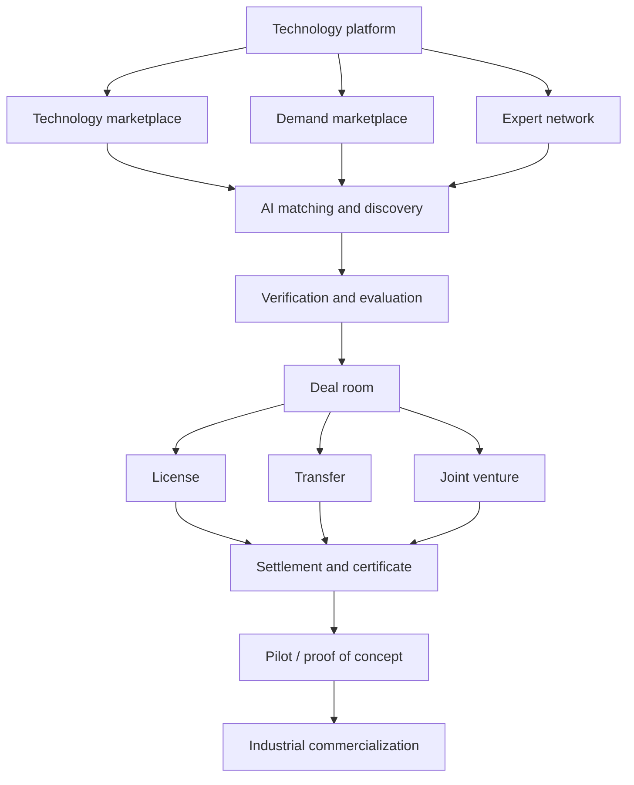
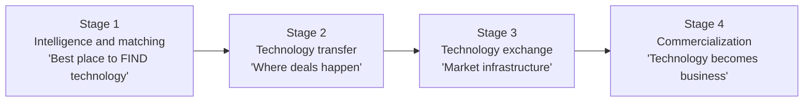

# 04 — Product Strategy: Combining an Exchange with a Technology-Transfer Network

> **About this document**
>
> - **Purpose:** Define what our platform should be, what it should borrow from STEX and NETC/InnoMatch, what it should do differently, and in which order to build it.
> - **Audience:** Founders, product managers and solution architects.
> - **Status:** Product strategy. Detailed system design follows in [05](05-system-design-blueprint.md) and [06](06-implementation-design-v1.md).
> - **Previous:** [03 — Business models](03-business-models-and-revenue.md) · **Next:** [05 — System design blueprint](05-system-design-blueprint.md)

---

## Summary

The recommended model is:

> **NETC's supply/demand network + STEX's trusted transaction infrastructure + a modern SaaS/marketplace experience + AI-assisted matching and evaluation.**

Technology transfer is **not a listing problem**. It is a chain of six problems, and the platform must address all of them:



The 2025 Shanghai rules confirm this view. A technology exchange is expected to provide rights registration, transaction certification, information disclosure, market-based evaluation, settlement, service-provider management, risk control and dispute resolution, not just publish listings (see [01 §1.3](01-shanghai-landscape.md)).

---

## 1. What to take from STEX: the "Exchange" layer

STEX treats a technology as a **rights-bearing asset**, not as an e-commerce product. That idea should be copied most closely.



The Shanghai framework recognizes these **transaction modes**:

| Mode | Chinese | Typical deliverable |
| --- | --- | --- |
| Technology transfer (assignment) | 技术转让 | Ownership of patents or other rights |
| Technology licensing | 技术许可 | Permission to use rights within a scope |
| Technology-for-equity investment | 作价投资 | Shares in exchange for contributed technology |
| Technology development | 技术开发 | New technology developed under contract |
| Technical services | 技术服务 | Solving a specific technical problem |
| Technical consulting | 技术咨询 | Feasibility studies, analysis, reports |

And these **transaction methods**: negotiated transfer (协议转让), auction (拍卖), tender (招标) and competitive bidding (竞价).

**Decision:** model *transaction mode* and *transaction method* as first-class, configurable fields from day one, even if early releases only support negotiated deals.

---

## 2. What to take from NETC/InnoMatch: the "Technology-Transfer Network" layer

NETC describes itself as "technology trading as the main business, with services and finance as supporting businesses". It combines online intelligent matching with offline brokerage. InnoMatch is not "here are 10,000 technologies". It is a pipeline:



In 2024 NETC reported (self-reported, see [01](01-shanghai-landscape.md)) 6,468 corporate demands, 4,390 technology results, 3,015 solutions and 313 completed transactions on InnoMatch. **Borrow the demand-driven approach.**

---

## 3. The trap to avoid: starting with a giant database

"We have 100,000 technologies!" sounds impressive, but a company typically arrives with a request like this:

> "I need a battery thermal-management technology that survives 150 °C, is at TRL 7 or higher, can be manufactured below a target unit cost, and can be licensed in Europe."

A database alone cannot answer that. The platform's first question should be:

> **"What technology problem are you trying to solve?"**

The platform should then turn the answer into a **structured demand** and actively find candidates.

---

## 4. Put Demand at the center



This matches NETC's philosophy of online matching plus offline professional transfer services. The human-validation step matters: AI produces candidates, and qualified people decide which ones are worth a client's time.

---

## 5. Two marketplaces

### 5.1 Marketplace A: technology supply

Universities, research institutes, companies and inventors publish:

| Category | Examples |
| --- | --- |
| Rights | Patents, patent applications, software copyrights, know-how, trade secrets |
| Digital | Software, algorithms, AI models, datasets, data capabilities |
| Physical | Prototypes, materials, equipment, scientific instruments |
| Processes | Manufacturing processes, biotech and medical-technology methods |
| Capability | Laboratory testing, engineering services, R&D capacity |

Each technology gets a structured **Technology Passport**. The record below is illustrative, not a real listing:

```yaml
technology_id: TEC-00018271
title: Solid-state battery electrolyte technology
owner:
  organization: Example University          # legal rights holder
  authorized_representative: Technology Transfer Office
  service_invention: true                   # 职务科技成果: institutional approval needed
technology_type: [patent, know-how]
industry: Energy / Battery
applications: [Electric vehicles, Grid storage]
maturity:
  trl_claimed: 6
  trl_assessed: null                        # filled in by an independent reviewer
  commercial_readiness: early trials
ip:
  granted_patents: 3
  pending_applications: 2
  jurisdictions: [CN, EU, US]
commercialization:
  seeking: [license, joint development]
  exclusivity: negotiable
  territories_available: [Global]
  required_investment: "3M–8M (indicative)"
validation:
  evidence: [Third-party laboratory report]
  badges: [Ownership verified, Patent verified]
technology_manager: assigned
```

### 5.2 Marketplace B: technology demand

Companies publish structured needs. Illustrative record:

```yaml
demand_id: DEM-18291
company: Automotive manufacturer            # can be anonymized publicly
problem: Battery thermal runaway
need: Detect thermal runaway in under 500 ms
hard_constraints:
  trl_min: 7
  production_volume: ">100,000 units/year"
preferences:
  transaction: [license, acquisition]
  geography: Global
budget: "2M–10M (private, visible to the platform only)"
deadline: 6 months
disclosure: anonymous public summary; details after NDA
```

The system then finds **technologies, researchers, companies, experts and service providers**. The network effect starts when both sides use structured records.

---

## 6. An AI "technology broker", not a chatbot

The AI's job is to perform specific broker tasks under human control:

| Broker task | AI contribution | Human control |
| --- | --- | --- |
| Clarify a vague need | Converts free text into a structured demand | Buyer confirms constraints |
| Find candidates | Searches the technology graph, patents and the expert network | Technology manager reviews the shortlist |
| Explain fit | Shows which requirements are met, missing or unknown | Buyer decides whether to proceed |
| Prepare evaluation | Drafts due-diligence questions and evidence requests | Expert decides |
| Support negotiation | Summarizes proposals and highlights changed terms | Parties approve every term |

Example: a buyer writes "We need a low-cost technology for detecting defects in lithium battery electrodes." The AI produces:

```yaml
industry: Battery manufacturing
problem: Electrode defect detection
technical_requirements:
  - Computer vision (X-ray, optical or hyperspectral)
  - Real-time, inline inspection
  - Accuracy above 99%
commercial_requirements:
  - TRL 7 or higher
  - Proven industrial deployment
  - Unit cost below target
transaction_options: [license, acquisition, joint venture]
open_questions:
  - Line speed and electrode width?
  - Which defect classes matter most?
```

---

## 7. A technology graph, not just a database



A graph answers questions like:

> "Find all technologies related to solid-state batteries at TRL 6 or higher that are not exclusively licensed, have Asian manufacturing capability, and have at least one successful industrial validation."

The graph can be a **logical model** (relational tables plus relationship tables) long before it needs a graph database (see [05 §15.4](05-system-design-blueprint.md)).

---

## 8. Maturity: TRL plus commercial readiness

### 8.1 Technology Readiness Level (TRL)

Use the widely adopted EU/Horizon definitions:

| TRL | Definition | Typical evidence |
| --- | --- | --- |
| 1 | Basic principles observed | Publications |
| 2 | Technology concept formulated | Concept papers, models |
| 3 | Experimental proof of concept | Lab experiment results |
| 4 | Technology validated in the lab | Lab test reports |
| 5 | Technology validated in a relevant environment | Tests in simulated or industrially relevant conditions |
| 6 | Technology demonstrated in a relevant environment | Prototype demonstration report |
| 7 | System prototype demonstrated in an operational environment | Field or pilot-line trial report |
| 8 | System complete and qualified | Qualification and certification test results |
| 9 | Actual system proven in an operational environment | Commercial production or deployment records |

> **China note:** the national standard **GB/T 22900-2022** (《科学技术研究项目评价通则》, replacing the 2009 edition) defines a 9-level technology-readiness scale used in Chinese project evaluation. Map platform TRL values to it for domestic users and show both scales where needed.

Rules:

- Store **claimed TRL** and **assessed TRL** separately, with the evidence and the assessor.
- A lab prototype is never automatically "industrially validated".

### 8.2 Commercial and manufacturing readiness

TRL is not enough: a technology can be technically mature but commercially useless. Track separate dimensions:

| Dimension | Example scale | What it answers |
| --- | --- | --- |
| Commercial readiness | ARENA Commercial Readiness Index (CRI 1–6), or an internal 1–9 scale | Is there a viable market and business model? |
| Manufacturing readiness | MRL 1–10 (US DoD) | Can it be produced at scale and cost? |
| Regulatory readiness | Internal scale | Are approvals obtained or obtainable? |
| IP position | Internal scale | Are rights clear, enforceable and available? |
| Customer validation | Internal scale | Has a paying customer used it? |

Do **not** use a fixed TRL → CRL mapping. The dimensions are independent: a TRL 8 technology can still be at the lowest commercial-readiness level.

---

## 9. Technology verification: the reputation system

Badges create trust, but only if each badge has a precise meaning:

| Badge | Meaning | Evidence | Verified by | Re-check |
| --- | --- | --- | --- | --- |
| Ownership verified | The listing organization holds or controls the rights | Assignment records, institutional authorization | Platform reviewer | On change or yearly |
| Patent verified | Patent numbers, status and holders match the registry | CNIPA / EPO / USPTO register extract | IP specialist | Every 6–12 months |
| Inventor verified | Named inventors confirmed | Inventor declaration | Platform reviewer | Once |
| Technical data verified | Key performance claims supported by documents | Test reports, publications | Technical expert | On new version |
| TRL assessed | Independent TRL assessment completed | Assessment report | Qualified assessor | On new version |
| Laboratory validated | Independent lab tested key claims | Third-party lab report | Lab (external) | Once per claim |
| Industrial pilot | Pilot completed with an industrial partner | Pilot report or partner letter | Platform reviewer | Once |
| Revenue generated / existing license | Technology already licensed or sold | Redacted contract or confirmation | Platform reviewer | Yearly |
| Commercial deployment | In commercial use | Customer reference | Platform reviewer | Yearly |

The emphasis that STEX and the Shanghai rules place on rights registration, certification, disclosure and evaluation is the right principle. Remember, though, that a **private platform's badge is not a legal certification** (see [05 §2](05-system-design-blueprint.md)).

---

## 10. A professional-services marketplace

After a buyer finds a technology, a sequence of service needs follows. The platform should connect each one:


The platform then earns across the **whole commercialization lifecycle** instead of only from a transaction commission.

---

## 11. A diversified revenue model

| Tier / product | Customer | Contents | Pricing approach (illustrative) |
| --- | --- | --- | --- |
| **Free** | Researchers, universities, small suppliers | Profile, basic technology publication, basic matching, receive inquiries | Free, to build supply |
| **Professional** | Companies | Advanced search, AI matching, private demands, analytics, saved searches, supplier comparison, deal pipeline | Monthly or annual subscription |
| **Transaction services** | Deal parties | Transaction coordination, documentation, settlement coordination | Fixed fee or contractually agreed success fee |
| **Premium services** | Buyers and suppliers | Evaluation, patent due diligence, valuation, technical verification, market analysis, custom scouting, negotiation support, licensing support, pilot management | Fixed fee or statement of work |
| **Enterprise** | Large corporations | Private scouting, global database, AI matching, private demands, technology intelligence, deal rooms, expert network | Annual contract (for example tens to hundreds of thousands of USD per year; validate with customers) |
| **Institutional** | Governments, parks, universities | Programme operation, innovation vouchers, regional platforms, TTO tooling | Contract or tender |

Do not copy a fixed Chinese exchange fee blindly. Fees depend on jurisdiction, transaction type and the service actually delivered (see [07 §6](07-roles-workflows-and-money.md) and [08 §7](08-china-operating-model.md)).

---

## 12. The most interesting product: Technology Scouting-as-a-Service

Large companies (manufacturing, automotive, pharma, electronics) regularly need "technologies for X". Instead of having them search the marketplace themselves, the platform runs a managed scouting programme:



| Stage | Deliverable | Typical duration (indicative) |
| --- | --- | --- |
| Brief | Requirement specification signed off by the client | 1–2 weeks |
| Search and outreach | Long list with source evidence | 3–6 weeks |
| Screening | Shortlist with fit reports and gap analysis | 2–4 weeks |
| Validation | Calls, NDAs, samples and evaluation summaries | 4–8 weeks |
| Introduction to deal | Term-sheet support, handover to the deal workflow | Varies |

Charge for the **scouting programme** (fixed fee or subscription) and optionally a separate, pre-agreed **success fee** on a resulting transaction.

---

## 13. Target platform architecture (conceptual)



---

## 14. What to copy and what to do differently

| Feature | STEX | NETC | Our recommendation |
| --- | --- | --- | --- |
| Technology listings | Yes | Yes | **Yes** |
| Corporate demands | Yes | **Strongest** | **Core** |
| AI matching | Limited | Yes | **Core, much stronger** |
| Technology verification | **Strongest** | Yes | **Core** |
| Rights registration | **Strongest** (licensed) | Yes | **Core** as records; certified registration only with a licence or partner |
| Transaction marketplace | **Strongest** | Yes | **Core** |
| Auction / bidding | **Strongest** | Some | **Phase 3** |
| Negotiated deals | Yes | **Strongest** | **Core** |
| Deal room | Limited | Limited | **Build very well** |
| Settlement | **Strongest** (licensed) | Yes | **Via licensed bank or payment partner** |
| Technology evaluation | **Strong** | **Strong** | **Core** |
| Expert network | Yes | **Strongest** | **Core** |
| Technology scouting | Some | **Strongest** | **Core** |
| Financing | Yes | **Strongest** | Phase 4 |
| Pilot / PoC | Some | **Strongest** | Core eventually |
| Incubation | Some | **Strongest** | Phase 4, optional |
| Training | Some | **Strongest** | Optional |
| Global network | Strong | **Strongest** | Core eventually |
| Enterprise SaaS | Weak | Weak | **Big opportunity** |
| Technology intelligence | Weak | Limited | **Big opportunity** |
| AI technology broker | Weak | Limited | **Big differentiator** |

---

## 15. The most important strategic decision: do not start as a national exchange

Becoming a government-scale technology exchange requires trust, government relationships, university networks, legal recognition, transaction certification and liquidity. These take years, and parts of them require licences (see [01 §1.3](01-shanghai-landscape.md)). Build in strategic stages instead:



| Stage | Adds | Goal |
| --- | --- | --- |
| 1 — Intelligence and matching | Technology database, demand database, AI matching, technology profiles, verification, expert network | Become the best place to **find** the right technology |
| 2 — Technology transfer | Private negotiation, deal room, NDA, due diligence, valuation, licensing, contract workflow | Become the place where technology **deals happen** |
| 3 — Technology exchange | Formal listings, competitive bidding, auction, transaction certification, settlement and escrow through licensed partners, rights registration | Become **market infrastructure** |
| 4 — Commercialization | PoC, pilots, manufacturing, investment, financing, regulatory support, industrial partners, M&A | Become the infrastructure through which technology **becomes products and businesses** |

These strategic stages map to the delivery phases in [05 §17](05-system-design-blueprint.md) and [06 §13](06-implementation-design-v1.md).

---

## 16. Recommendation

Build a serious, internationally capable technology-transfer company with four layers:

| Layer | Model | Role |
| --- | --- | --- |
| Exchange layer | **STEX** | Rights, disclosure, price discovery, certification, settlement |
| Transfer-ecosystem layer | **NETC / InnoMatch** | Demand, network, brokers, services, events |
| Digital layer | LinkedIn + Bloomberg + Alibaba-style UX | Profiles, intelligence, marketplace usability |
| Intelligence layer | **AI** | Structuring, matching, explanation, diligence support |

The result is something neither STEX nor NETC fully provides today:

> **A technology marketplace where technologies are searchable like products, evaluated like investments, matched like jobs, negotiated like M&A, and transferred through a controlled transaction workflow.**

### Before writing code

1. Map the complete STEX and NETC/InnoMatch **user journeys and revenue flows screen by screen**.
2. Record what each does well and poorly.
3. Turn that into a **PRD, a domain model and a marketplace architecture**. That work is captured in [05](05-system-design-blueprint.md), [06](06-implementation-design-v1.md), [07](07-roles-workflows-and-money.md) and [08](08-china-operating-model.md).

---

## Sources

- 《上海市技术交易场所管理细则》 (2025): <https://www.shanghai.gov.cn/nw12344/20250414/7d1e61e9a2de431aa524cb2f817845cf.html>
- NETC, About us: <https://www.netcchina.com/about-us>; online + offline model: <https://www.netcchina.com/archives/21776>; 2024 figures: <https://www.netcchina.com/archives/28860>
- European Commission, Horizon 2020 General Annex G, Technology Readiness Levels: <https://ec.europa.eu/research/participants/data/ref/h2020/wp/2014_2015/annexes/h2020-wp1415-annex-g-trl_en.pdf>
- GB/T 22900-2022 《科学技术研究项目评价通则》 (standard record): <https://www.chinesestandard.net/Related.aspx/GBT22900-2009>
- ARENA, Commercial Readiness Index for Renewable Energy Sectors (2014): <https://arena.gov.au/assets/2014/02/Commercial-Readiness-Index.pdf>
