# 05 — Technology Exchange & Transfer Platform: System Design Blueprint

> **About this document**
>
> - **Purpose:** The complete *target* design of the platform: business ecosystem, domain model, roles, user experience, end-to-end workflows, data, APIs, workflow engine, finance, AI, security, roadmap, testing, KPIs and deployment.
> - **Audience:** Product owners, architects, engineering leads and operations leads.
> - **Status:** Target-state blueprint. It explains *what* the platform does and *why* it is built this way. The *implementation-level* baseline for the first release is in [06](06-implementation-design-v1.md); the numbered requirements and the release plan are in [10](10-product-requirements.md); the runtime rules for Node.js 12.4 and MongoDB 4.4 / 5.0 are in [11](11-target-runtime-node12-mongodb.md). The real-world role and money model is in [07](07-roles-workflows-and-money.md); the China operating model is in [08](08-china-operating-model.md).
> - **Previous:** [04 — Product strategy](04-product-strategy.md) · **Next:** [06 — Implementation design](06-implementation-design-v1.md)

---

## Table of contents

1. [Product vision and design principles](#1-product-vision-and-design-principles)
2. [Business ecosystem](#2-business-ecosystem)
3. [Functional system architecture](#3-functional-system-architecture)
4. [Core domain model](#4-core-domain-model)
5. [Roles, permissions and accounts](#5-roles-permissions-and-accounts)
6. [User experience and information architecture](#6-user-experience-and-information-architecture)
7. [End-to-end business workflows](#7-end-to-end-business-workflows)
8. [Core sequence diagrams](#8-core-sequence-diagrams)
9. [Administrator and operations workflows](#9-administrator-and-operations-workflows)
10. [User stories and acceptance criteria](#10-user-stories-and-acceptance-criteria)
11. [Database and data architecture](#11-database-and-data-architecture)
12. [Backend modules and API contracts](#12-backend-modules-and-api-contracts)
13. [Workflow engine and state transitions](#13-workflow-engine-and-state-transitions)
14. [Revenue, pricing and financial architecture](#14-revenue-pricing-and-financial-architecture)
15. [AI and technology-intelligence architecture](#15-ai-and-technology-intelligence-architecture)
16. [Security, privacy, legal and trust](#16-security-privacy-legal-and-trust)
17. [Development roadmap](#17-development-roadmap)
18. [Testing and quality assurance](#18-testing-and-quality-assurance)
19. [Operational dashboards and KPIs](#19-operational-dashboards-and-kpis)
20. [Deployment and infrastructure](#20-deployment-and-infrastructure)
21. [Implementation work breakdown](#21-implementation-work-breakdown)
22. [Decision record: platform design profile](#22-decision-record-platform-design-profile)

---

## 1. Product vision and design principles

The platform combines the strongest business concepts of the Shanghai Technology Exchange (STEX, 上海技术交易所) and NETC/InnoMatch (国家技术转移东部中心), with the China Technology Exchange (CTEX, 中国技术交易所) as a further reference (see [01](01-shanghai-landscape.md)–[04](04-product-strategy.md) and [09](09-reference-platform-features.md)). It launches in China, Shanghai first, on a modular software architecture that runs on the given servers.

The goal is **not** just a website where universities upload patents and companies search for them. The goal is to move technologies from discovery and research into **licensing, acquisition, investment, pilot projects and commercial deployment**.

**Positioning.** The platform is a demand-driven **matching and service platform** with managed transfer workflows. It is **not** a trading venue. Formal listing (挂牌), competitive bidding, auctions and tenders, third-party settlement and official certificates are **venue functions**. The platform performs them through a licensed venue (STEX or CTEX), acting as that venue's **registered practising agent** (执业类交易服务机构). Money is held and released only by a licensed bank or payment institution; the platform coordinates the conditions. §2.2 explains this boundary and how the architecture keeps it.

### 1.1 The three pillars

| Pillar | Description |
| --- | --- |
| **Technology exchange** | A structured marketplace for patents, proprietary know-how, scientific discoveries, software, AI models, materials, manufacturing processes, prototypes and other licensable or transferable technologies. |
| **Technology transfer** | A managed workflow connecting technology owners, research institutions, corporate buyers, technology brokers, experts, legal professionals and commercialization partners. |
| **Commercialization infrastructure** | A process for validating technologies, negotiating rights, executing contracts, coordinating payments, organizing pilots and measuring real-world commercialization outcomes. |

### 1.2 The seven design principles

| # | Principle | What it means in the product |
| --- | --- | --- |
| 1 | **Demand-driven** | Corporate requirements are as important as technology listings. Every demand is a structured, matchable object. |
| 2 | **Trust before transactions** | Verify organizations, ownership claims, IP and technical evidence before parties invest time. |
| 3 | **Confidential by default** | Unpublished inventions and trade secrets never become public just because a listing exists. Disclosure is staged and recorded. |
| 4 | **Human accountability** | AI recommends, summarizes and prioritizes. It never certifies ownership or approves regulated transactions. |
| 5 | **Deal-centric workflows** | An inquiry becomes a traceable business process with an owner, state and history, not an email thread. |
| 6 | **Multiple revenue streams** | Subscriptions, scouting, diligence, evaluation, managed services and transaction fees (see [03](03-business-models-and-revenue.md)). |
| 7 | **Incremental implementation** | Start with a reliable marketplace and transfer workflow. Add venue-routed transactions and payment integrations only when the legal and partner foundations exist (§2.2). |

---

## 2. Business ecosystem

The platform serves several participant groups. Each needs a different interface, different permissions and different business processes.

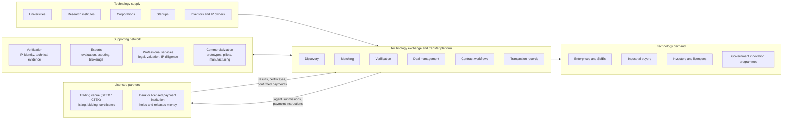

The supporting network and the licensed partners are outside the platform. The platform records their work; it does not replace it.

### 2.1 One platform, three business layers

| Layer | Responsibility | Business outcome | First release ([10 §9](10-product-requirements.md)) |
| --- | --- | --- | --- |
| **Discovery marketplace** | Publish, search and match technologies and demands; controlled introductions | Qualified opportunities | R1 |
| **Transfer management** | Confidentiality, diligence, negotiation, contracts, deal coordination | Completed technology deals | R2 |
| **Exchange and commercialization** | Venue-routed formal listing, bidding and certificates (as the venue's registered agent); payment-partner integration; pilots | Trusted transactions and deployed technologies | R3 |

All three layers **share** one identity system, one technology registry, one organization model, one permissions framework and one deal record. They must not be built as three disconnected products.

### 2.2 The regulatory boundary

An ordinary commercial marketplace may record agreements and coordinate transactions. Some exchange functions, however, are **regulated** and may require authorization, a licence or a licensed partner. In Shanghai, technology trading venues (技术交易场所) are governed by 《上海市技术交易场所管理细则》 (沪科规〔2025〕2号, in force 1 May 2025 – 30 April 2030), and new venues are approved under total-quantity control:

| Function | Ordinary platform can… | Requires authorization or a licensed partner |
| --- | --- | --- |
| Rights | Record ownership *claims* and evidence | Issue legally recognized rights-registration certificates (in Shanghai, a licensed technology trading venue issues 技术权益登记凭证) |
| Transactions | Record agreements and outcomes | Issue official transaction certificates (交易凭证; the venue function is called transaction certification, 交易鉴证) |
| Money | Show invoices and record provider-confirmed payments | Hold, pool, escrow or settle client funds (in China, only banks and licensed payment institutions; the Shanghai rules require third-party settlement) |
| Pricing | Support negotiation and prepare competitive processes | Formal listing, binding online bidding, tenders and auctions (auctions also need a licensed auction house); public listing of state-owned technology where law prescribes it |
| Venue access | Act as a **registered practising agent** of a licensed venue: prepare and verify submissions, represent clients | Becoming a venue: municipal approval under total-quantity control (Shanghai rules, Art. 6) |

To be a STEX practising agent, an organization must have been registered for at least 2 years, have registered capital of at least RMB 1 million and at least 2 practitioners recognised by STEX, and have a clean record for the last 24 months. The agent verifies the buyer materials it submits and bears **joint liability** for them ([09 §2.1](09-reference-platform-features.md)). Whether the platform becomes an agent itself or works with an existing one is open decision D-01 ([10 §12](10-product-requirements.md)).

The architecture keeps the regulated functions in **separate modules behind feature flags** (the venue route: `venue_submissions`, `buyer_registrations`, `venue_certificates`, [06 §4.9](06-implementation-design-v1.md)), so they can be enabled only when the legal basis exists. The default route is the agent model: the platform prepares, submits and tracks; the venue (STEX or CTEX) performs the regulated steps and issues the certificates ([09 §1–§2](09-reference-platform-features.md), [10 §3.10](10-product-requirements.md)).

---

## 3. Functional system architecture

Organize the product into **business domains**, not a collection of unrelated screens.

```mermaid
flowchart TB
    subgraph A["A. Experience layer"]
        A1["Public website and search"]
        A2["Buyer and supplier portal"]
        A3["Broker and expert workspace"]
        A4["Administration console"]
    end
    subgraph B["B. Core business services"]
        B1["Identity and organizations"]
        B2["Technology registry"]
        B3["Demand management"]
        B4["Search and matching"]
        B5["Verification and diligence"]
        B6["Deals and negotiations"]
        B7["Contracts and transaction records"]
        B8["Services and commercialization"]
    end
    subgraph C["C. Shared platform infrastructure"]
        C1["Workflow: state machines,<br/>tasks, deadlines"]
        C2["Audit and policies<br/>(CASL, tenant scope)"]
        C3["Document and evidence storage"]
        C4["Notifications and integrations<br/>(via the outbox)"]
        C5["AI orchestration (later)"]
        C6["Billing and accounting"]
    end
    subgraph D["D. Data and operations"]
        D1["MongoDB replica set<br/>(system of record)"]
        D2["Meilisearch<br/>(public snapshots only)"]
        D3["File storage<br/>(encrypted volume or bucket)"]
        D4["Outbox and job collections<br/>(in MongoDB)"]
        D5["Reporting views<br/>(warehouse later)"]
        D6["Monitoring, backup and recovery"]
    end
    A --> B
    B --> C
    C --> D
```

How the layers map to running software:

- **A** is a React single-page app (built on CI, served by Nginx) plus public technology pages that the worker pre-renders as static HTML.
- **B** and **C** are modules of **one** Express application written in TypeScript. It runs as two API processes (`tex-api@3001`, `tex-api@3002`) and one background worker (`tex-worker`), all under systemd behind Nginx ([06 §3](06-implementation-design-v1.md), [11 §9](11-target-runtime-node12-mongodb.md)).
- **D** is the data the modules own. MongoDB is the only source of truth; the search index and the public pages are copies that can be rebuilt from it.

### 3.1 Architecture style: modular monolith first

For the first production release, use a **modular monolith with asynchronous background workers** instead of many microservices.

| Benefit | Why it matters here |
| --- | --- |
| Transactional consistency | A state change, its history record, its outbox event and its audit event commit together in one MongoDB multi-document transaction |
| Simple deployment and debugging | One build artifact, run as two API processes and one worker; one log format |
| No distributed transactions | Avoids sagas and two-phase commits early on |
| Lower cost | Fewer servers and less operational work for a team of 1–4 developers |
| Clear migration path | Modules can be extracted when real scale justifies it |

Rules:

- Each module owns its Mongoose models (`*.model.ts`) and is the only code that reads or writes their collections.
- Modules **never** manipulate another module's collections directly; they call that module's service functions or react to its outbox events.
- Candidates for later extraction: search, document processing, AI matching, notifications, analytics and payment integrations.

**How one business change flows through the system** (the pattern every module follows; code in [06 §4.7](06-implementation-design-v1.md)):

1. The Express route validates the input with a zod schema and loads the session user.
2. The service opens a transaction, loads the document through its Mongoose model with the caller's **tenant scope**, and compares the client's `If-Match` value with the document's `rev`.
3. A CASL policy decides whether this actor may perform this action on this document in its current state.
4. The service changes the document and calls `save()`. Mongoose validates it and checks and increments `rev`.
5. In the same transaction, the service appends a `workflow_transitions` record, an `outbox_events` record and an audit event (in the separate `tex_audit` database). Everything commits, or nothing does.
6. After the commit, the worker reads the outbox and performs the side effects: search indexing, page rendering, notifications and calls to external providers. A failed side effect is retried; it never undoes the business change.

### 3.2 Technology stack

The target servers run **Node.js 12.4** and **MongoDB 4.4 / 5.0** (the "4.5" sometimes quoted is a development series, not a release). The stack below is chosen for, and verified on, that runtime with real binaries ([11](11-target-runtime-node12-mongodb.md) lists exact versions, the coding rules and the upgrade path):

| Component | Choice | Reason |
| --- | --- | --- |
| Web frontend | React 18 + TypeScript + Ant Design 5, built with Vite on CI, served by Nginx | Mature ecosystem for complex business portals; strong Chinese enterprise components; independent of the server's Node version |
| Public pages | Static HTML pre-rendered with EJS by the worker on publication + sitemap + Baidu push API | Search-engine indexing (Baidu) without a server-rendering framework, which would need a newer Node |
| Backend | Node.js 12.4 runtime; TypeScript compiled on CI to ES2019 / CommonJS; Express 4.22 modular monolith | Runs on the given runtime; one language across the stack |
| Validation | zod 3.22 schemas shared by API and frontend | One definition for input checks, forms and the OpenAPI document |
| Primary database | MongoDB 4.4 / 5.0 **replica set** (`w=majority` set explicitly; it is not the default on 4.4) | Given target; a replica set is required for multi-document transactions; flexible technical attributes |
| Data access | **Mongoose 5.13.23** (bundles driver 3.7.4): schemas, models, the Document API and plugins (`tenantScopePlugin`, `freezablePlugin`, `appendOnlyPlugin`); a strict `Int64` type for money | Newest Mongoose that runs on Node 12.4; one schema per collection defines types, validation, defaults, indexes and plugins |
| Schema control | `$jsonSchema` validators and database roles through `migrate-mongo` 8.2.3 (safety net); indexes declared in the schemas and created by `npm run db:indexes` at release | Rules still hold when a script or bug bypasses Mongoose |
| Authorization | CASL 5.4 policies (RBAC + ABAC); `@casl/mongoose` 5.0 turns them into query filters | One policy for API checks, list filters and UI hints |
| Authentication | SMS code or password (`bcryptjs`); TOTP MFA (`otplib`) for staff; sessions in MongoDB (`express-session` + `connect-mongo` 3.2) | China-friendly login; no native modules |
| Search | Meilisearch v1.11 (Chinese word segmentation, facets, typo tolerance), fed from the outbox; `full-icu` for Chinese dates and pinyin sorting | The MongoDB 4.4 / 5.0 text index cannot segment Chinese, so Chinese queries return nothing (verified) |
| Vector search | Later phase: Meilisearch hybrid search, or MongoDB Vector Search after an upgrade to 8.2+ | Not needed to prove the core business |
| File storage | Storage adapter: encrypted volume, S3-compatible store or Aliyun OSS | Large documents, versioning, retention, private files |
| Background jobs | One worker process: transactional outbox + leased job collection in MongoDB; `node-cron` schedules | No Redis or queue server at launch (`bull` 3 + Redis is an option later) |
| Workflow | Explicit state machines persisted in MongoDB (§13) | Clear, auditable business transitions |
| Analytics | MongoDB aggregation reports first; warehouse later | Avoid premature infrastructure |
| Deployment | systemd services behind Nginx on the target servers; nightly `mongodump --oplog` backups | Matches the existing server environment; no Docker Compose or Kubernetes |
| Observability | Structured logs (pino), Prometheus metrics (prom-client), request IDs, error tracking | Diagnosis and reliability |

**Considered and rejected:** NestJS 8 (end-of-life, and it pins an older Express with known vulnerabilities), and a Python + PostgreSQL stack (not what the given servers run). **Known risk:** Node.js 12, MongoDB 4.4 / 5.0 and Mongoose 5 are all end-of-life. The first upgrade step (Node 12.22.12 with Mongoose 6.13) is open decision D-08 ([10 §12](10-product-requirements.md), [11 §11](11-target-runtime-node12-mongodb.md)).

Do **not** introduce Kubernetes, Kafka, Redis, a graph database or several AI services on day one unless scale or deployment constraints really require them.

---

## 4. Core domain model

The domain model is the foundation. If it is wrong, the user interface and workflows become inconsistent as the platform grows.

### 4.1 Entity map: identity, supply and demand

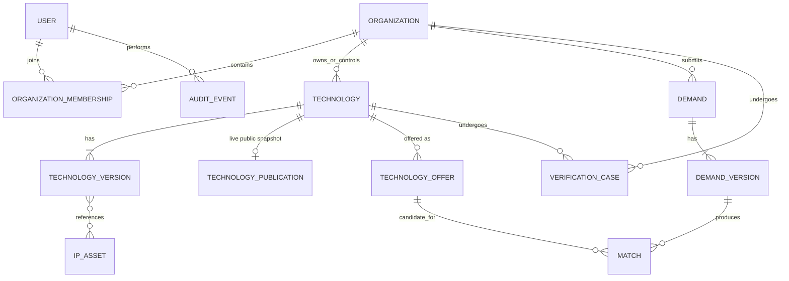

### 4.2 Entity map: deals and transactions

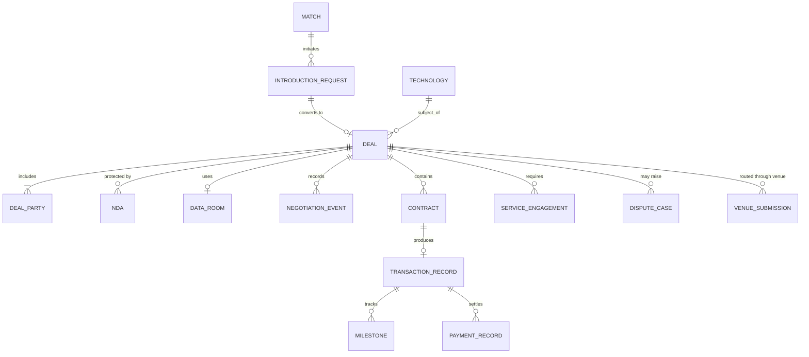

The diagrams show logical relationships, not every physical collection. For example, deal parties are embedded in the deal document, and most entities in §4.2 arrive in R2 or R3. [06 §4](06-implementation-design-v1.md) has the collection catalogue.

### 4.3 Entity catalogue

| Entity | Purpose |
| --- | --- |
| User | An individual identity and its authentication |
| Organization | University, company, research institute, agency or service provider |
| OrganizationMembership | A user's relationship, role and access rights within an organization |
| Technology | The stable identity and lifecycle status of a technology (the asset) |
| TechnologyVersion | An immutable revision of the technical description; frozen when submitted for review |
| TechnologyPublication | The **technology publication snapshot**: the reviewer-approved public fields of one version. The only technology data that search and public pages ever see |
| IPAsset | A patent, application, software right, know-how or other claimed right |
| TechnologyOffer | A specific commercial opportunity for a technology: licence, assignment, equity contribution, joint development, service or pilot, with its own territory, field of use and terms. Matching happens at offer level |
| Demand | A buyer's structured business problem or technology requirement |
| DemandVersion | An immutable revision of a demand; matches refer to the exact version |
| Match | A scored, explained pairing of one demand version with one offer, under one ranking version |
| IntroductionRequest | A consent-based request to put a buyer and a supplier in contact. The supplier must approve it (unless a documented policy or agreement says otherwise); contact details stay masked until then |
| VerificationCase | An identity, ownership, IP or technical review process (a review case in 06) |
| Deal | A managed negotiation and transfer case, usually opened from an approved introduction |
| DealParty | Buyer, seller, intermediary, beneficiary or other party |
| NDA | A confidentiality agreement and its execution status |
| DataRoom | Restricted document access for a specific deal |
| NegotiationEvent | A proposal, counter-proposal, decision or recorded discussion |
| Contract | An agreement with its versions, parties, approvals and execution records |
| TransactionRecord | The record of the agreed transaction and its status |
| PaymentRecord | A payment instruction, its external reference and reconciliation state |
| Milestone | A payment, delivery, validation or commercialization obligation |
| ServiceEngagement | Paid or contracted professional work |
| AuditEvent | An append-only record of an important action |
| DisputeCase | A complaint, contested right, or contractual or transaction dispute |
| VenueSubmission | A listing, buyer registration or notice that the platform prepares as registered agent and submits to a licensed venue, with the venue's results and certificate numbers (R3) |

**Modeling rule:** technology, offer, demand, match, introduction, deal, contract and payment are **different entities**. Never merge their fields into one large `technology` document.

- A technology can have several offers, many interested buyers, several matching demands and a history of deals.
- An offer can change without rewriting the technology's identity.
- A deal can cover several technologies and rights.

### 4.4 Technology is not the same as intellectual property

A single technology may include:

- Several patents and pending applications.
- Unpatented trade secrets and know-how.
- Software or model components.
- Test results and prototype evidence.
- Manufacturing processes.
- Third-party components and dependencies (which may carry their own licence terms).

Each IP asset has its own rights holder, jurisdiction, registration identifiers, legal status, evidence and review history. The platform distinguishes four **levels of assurance** for every claim:

| Assurance level | Meaning | Example |
| --- | --- | --- |
| Owner asserted | The supplier states it | "We own patent CN123…" |
| Document checked | A reviewer saw a supporting document | Assignment record uploaded and reviewed |
| Independently verified | Checked against an authoritative external source | Patent register shows the holder and an active status |
| Legally confirmed | Confirmed by a qualified legal opinion or official registration | Legal opinion, or registered transfer at the patent office |

The UI must always show which level applies; never display "verified" without the scope and date.

### 4.5 The Technology Passport

Every technology has a structured profile with three parts. Example header (illustrative, not a real listing): **Advanced battery technology** · TRL 6 (claimed) · Patent-backed · Licensing available.

| Section | Fields |
| --- | --- |
| **Technical profile** | Technical problem and proposed solution · Applications, sector and alternative approaches · Specifications and measured performance · TRL with supporting evidence · Manufacturing requirements and dependencies · Known limitations and failure modes |
| **Rights and commercial profile** | Owner and authorized representative · Patent jurisdictions, identifiers and status · Rights available (exclusive licence, non-exclusive licence, assignment, collaboration) · Territories, fields of use and restrictions · Indicative price, royalty or milestone terms · Disclosure classification and approved publication fields |
| **Evidence and provenance** | Publications and lab reports · Prototype and pilot results · Third-party assessments · Verification status and review date · Version history and supporting documents |

### 4.6 TRL must be evidence-backed

- Use a recognized 1–9 TRL scale with documented definitions (see [04 §8](04-product-strategy.md)).
- Store the **claimed** level separately from the **independently assessed** level.
- A laboratory prototype is never automatically "industrially validated".
- Add a separate **commercial-readiness** assessment. Manufacturing readiness, regulatory readiness, IP position, customer validation and unit economics are different dimensions from TRL.

---

## 5. Roles, permissions and accounts

Do **not** implement permissions as a single `role` column on the user. One person may be a technology owner at a university, a buyer at a startup and a technical expert elsewhere. Access depends on **organization, resource, action and deal**.

### 5.1 External roles

| Role | Main responsibilities |
| --- | --- |
| Individual inventor | Submit technology and evidence; respond to inquiries, subject to ownership authorization |
| University technology-transfer office (TTO) | Manage institutional IP, approve disclosures and negotiate licences |
| Technology supplier | Publish authorized offers and manage buyer relationships |
| Corporate buyer | Create demands, discover technologies, manage evaluation and procurement |
| R&D manager | Define requirements and assess technical fit |
| Technology manager (技术经理人, broker) | Manage assigned demands, matching and transfer cases |
| Technical expert | Review assigned evidence and submit assessments |
| IP / legal professional | Conduct scoped legal and rights diligence |
| Investor | Discover opportunities and review authorized investment information |
| Service provider | Offer evaluation, prototyping, regulatory or commercialization services |
| Enterprise administrator | Manage the organization's users, policies, subscriptions and permissions |

> **Naming:** in Chinese practice a *technology manager* (技术经理人) is a professional broker. Inside a supplier organization, the role code `technology_manager` ([06 §8.2](06-implementation-design-v1.md)) means the member who maintains that organization's listings. They are different people with different permissions, so the UI must give them different labels.

The first-release role codes and permission matrix are in [06 §8](06-implementation-design-v1.md).

### 5.2 Internal (platform staff) roles

| Role | Main responsibilities |
| --- | --- |
| Platform administrator | Global configuration, access control and operational oversight |
| Organization verification officer | Verify organizational identities and authority |
| Technology review officer | Review completeness, quality and publication suitability |
| IP verification specialist | Review IP documentation within the authorized scope |
| Deal operations manager | Monitor transaction workflows and unblock operational tasks |
| Finance / reconciliation officer | Reconcile invoices, payments and refunds |
| Dispute officer | Manage complaints and conflict-of-interest controls |
| Platform commercial manager | Pricing, enterprise accounts, service packages and revenue reporting |
| Compliance / privacy officer | Data requests, retention, access reviews and regulatory processes |
| Security auditor | Review security events and privileged actions |

### 5.3 Permission model: RBAC + ABAC

Use role-based access control (**RBAC**) combined with attribute/resource-based access control (**ABAC**). Example: a broker may read a deal only if **all** of these hold:

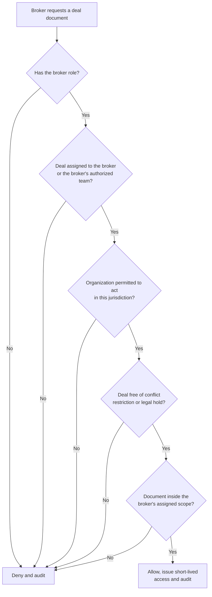

Sensitive actions require explicit permission checks **on the backend**. Hiding a button in React is not an authorization control.

In the implementation, two independent mechanisms enforce this ([06 §4.8, §8.4](06-implementation-design-v1.md)). **CASL policies** decide *what* an actor may do: role rules plus attribute conditions such as organization, deal assignment and current state. The Mongoose **tenant-scope plugin** decides *which documents can be loaded at all*: every query on a tenant-owned model must state whose data it may touch, or it throws. MongoDB has no row-level security, so both are required.

---

## 6. User experience and information architecture

The product should not feel like one giant admin dashboard. Each audience enters through an interface that reflects its work.

| Workspace | Primary navigation | The home page must answer… |
| --- | --- | --- |
| **Public marketplace** | Explore Technologies · Publish Technology · Post a Technology Need · Industries · Experts and Services · How It Works · About Verification | "Is there something relevant here, and can I trust it?" Optimize for discovery, credible evidence and conversion into qualified inquiries. |
| **Buyer workspace** | Overview · My Technology Needs · Recommended Technologies · Shortlists · Evaluations · Deals · Data Rooms · Contracts · Service Requests · Team and Billing | (1) Which technologies best match our needs? (2) Which actions or decisions are waiting for us? (3) What is the status of each opportunity? |
| **Supplier workspace** | Overview · My Technologies · Offers and Rights · Inquiries · Match Recommendations · Verification · Negotiations · Contracts and Transactions · Analytics | What needs my response, what is my publication scope, and where are opportunities progressing or failing? |
| **Broker and expert workspace** | Assigned Cases · Matching Queue · Due Diligence · Expert Tasks · Client Communications · Deal Pipeline · Milestones · Fees and Commissions · Performance | What is in my queue, what is overdue, and what is my next action? Brokers need an operational work queue, not the buyer's pages. |
| **Administrator console** | Operations Overview · Organization Verification · Technology Review · IP and Evidence Review · Demand Review · Matching Quality · Deals and Transactions · Finance and Reconciliation · Service Providers · User Access · Content and Taxonomy · Audit and Compliance · Platform Configuration · Reports | Queue-based work with assignments, due dates, checklists, escalation paths and measurable service levels. |

---

## 7. End-to-end business workflows

This is the heart of the system. Every workflow defines an **owner, input, states, authorized transitions, output, failure paths and audit record**.

| Workflow | Starts in ([10](10-product-requirements.md)) | Stored state machine |
| --- | --- | --- |
| A. Technology registration and publication | R1 | `technologies.lifecycleStatus` ([06 §6.1](06-implementation-design-v1.md)) |
| B. Corporate technology demand | R1 | `demands.status` ([06 §6.2](06-implementation-design-v1.md)) |
| C. Matching and recommendation | R1 (technology-manager network R2) | None: matches are versioned records |
| D. Inquiry, introduction, NDA and disclosure | R1 (inquiries, introductions); R2 (NDA, data rooms) | `introduction_requests.status` ([06 §6.3](06-implementation-design-v1.md)) |
| E. Deal negotiation and transaction | R2 (venue route R3) | `deals.status` ([06 §6.4](06-implementation-design-v1.md), §13 below) |
| F. Managed technology scouting | R2 | Service order |
| G. Disputes | R1 (basic); R2 (mediation) | Dispute case ([08 §8](08-china-operating-model.md)) |

### 7.1 Workflow A: technology registration and publication

| Item | Definition |
| --- | --- |
| Objective | Let a legitimate rights holder publish a discoverable technology without accidentally disclosing confidential information |
| Actors | Supplier user (organization role `technology_manager`, admin or owner), technology reviewer, IP specialist, system |
| Trigger | Supplier clicks "Publish Technology" |
| Preconditions | Verified mobile number (or e-mail); active membership of an organization with the role `technology_manager`, `org_admin` or `org_owner` |
| Output | A technology publication snapshot, indexed in Meilisearch, pre-rendered as a public page and matched against open demands |
| Service level | First review within 5 working days (FR-TEC-11; [06 §14](06-implementation-design-v1.md)) |

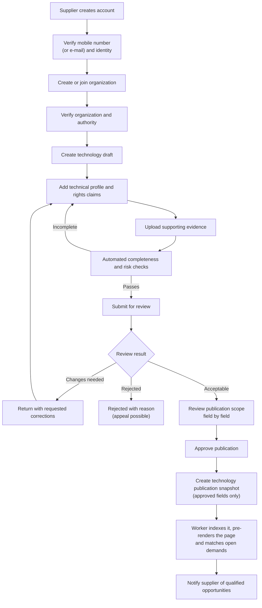

**Detailed steps**

| # | Actor | Action | System behaviour / output |
| --- | --- | --- | --- |
| 1 | Supplier | Creates an account and accepts the platform terms | Account in `pending` status; terms version recorded |
| 2 | Supplier | Creates an organization profile or requests membership of an existing one | Duplicate check on the unified social credit code (统一社会信用代码); membership request routed to that organization's admin |
| 3 | Verification officer | Verifies identity, organizational existence and the user's authority to act | Verification case with evidence and expiry date |
| 4 | Supplier | Creates a draft: technology type, applications, maturity, intended transaction model | Draft saved automatically; version 1 created |
| 5 | System | Requests the relevant IP records, technical evidence and rights declarations for the technology type | Checklist generated per technology type |
| 6 | System | Runs automated checks: missing fields, inconsistent claims, unsupported TRL claims, potentially sensitive documents, duplicates | Completeness report shown next to each field |
| 7 | Supplier | Submits the record to the review queue | Version frozen; review case created **once**, even if the request is retried |
| 8 | Reviewer | Evaluates completeness, evidence quality, publication permissions and restrictions | Checklist completed; conflict-of-interest declaration recorded |
| 9 | Reviewer | Approves, rejects or requests corrections | Decision with reason and evidence; supplier notified |
| 10 | System | Publishes the approved version: writes the technology publication snapshot containing **only approved fields**, the `approved → published` transition and an outbox event `technology.published`, in one transaction | Snapshot in `technology_publications` (status `live`) |
| 11 | Worker | Relays the outbox event: indexes the snapshot in Meilisearch, pre-renders the public page, updates the sitemap; matching evaluates open demands | Index status recorded; retries and alerts on failure; target ≤ 5 minutes (FR-TEC-12) |
| 12 | Supplier | Updates the record later | Material changes create a new version that needs review (`update_pending`); the old snapshot stays live until the new one is approved |

**Publication states**

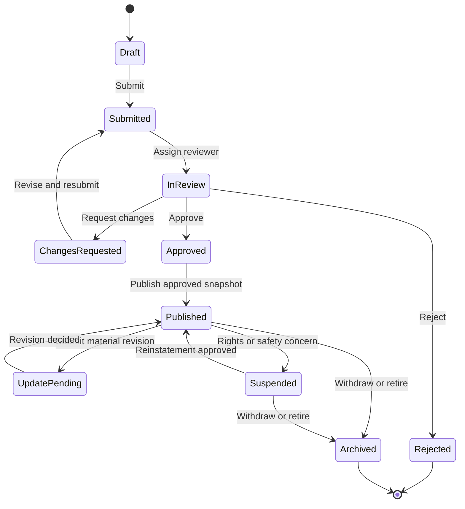

The stored values are `draft`, `submitted`, `in_review`, `changes_requested`, `approved`, `rejected`, `published`, `update_pending`, `suspended` and `archived` ([06 §6.1](06-implementation-design-v1.md) has the transition table). While a revision is in `update_pending`, the old snapshot stays public. If the revision is approved, a new snapshot replaces the old one; if it is rejected, the old snapshot simply stays.

A published technology can be **suspended without deleting its history**, for example because of an ownership dispute, an expired offer, a changed patent status or a security concern. Suspension removes it from search and the public pages within minutes and blocks new introductions.

> **Critical detail:** *publication state* and *rights-verification state* are separate. A listing may be publishable as an "unverified opportunity" while only some of its claims are independently verified. The UI must make that distinction obvious.

**Exceptions**

| Exception | Handling |
| --- | --- |
| Supplier lacks authority (e.g. a researcher at a university) | Route to the TTO or an organization admin for authorization; the listing cannot be submitted until approved |
| Duplicate technology detected | Reviewer links or merges the records, or rejects the duplicate with a reason |
| Confidential content found in public fields | Reviewer restricts the field or attachment; supplier is notified |
| Patent lapsed or disputed after publication | Automatic suspension flag, review case, supplier notified |
| Indexing fails | Retry with backoff, then alert operations; never shown as "searchable" until indexed |

### 7.2 Workflow B: corporate technology demand

| Item | Definition |
| --- | --- |
| Objective | Turn a vague industrial problem into a structured requirement that can be matched, evaluated and fulfilled |
| Actors | Buyer (R&D manager / demand manager), technology manager (技术经理人) who helps rewrite the demand, demand reviewer, system |
| Trigger | Buyer clicks "Post a Technology Need", or a scouting engagement creates the demand |
| Output | An approved, versioned demand with hard constraints and preferences, ready for matching |

Example: a manufacturer needs a faster, more reliable inspection process. The demand wizard asks about:

| Topic | Questions | Typically mandatory? |
| --- | --- | --- |
| Problem | What is the problem? What is the current process? | Yes |
| Performance | Required performance and acceptable trade-offs | Yes (at least one measurable target) |
| Approach | Acceptable or excluded technical approaches | No |
| Maturity | Minimum TRL and deployment maturity | Yes |
| Constraints | Integration, manufacturing and regulatory constraints | No |
| Rights | Target geography and rights requirements (exclusive? territory?) | Yes |
| Budget | Indicative budget and procurement authority | No (can be private) |
| Timing | Desired delivery timeline | No |
| Route | Licence, acquisition, development partnership, supplier engagement or investment | Yes |

The system separates **minimum matching requirements** from **optional refinements**, and **hard constraints** ("TRL 7 is mandatory") from **preferences** ("TRL 5 is acceptable with a funded development plan").

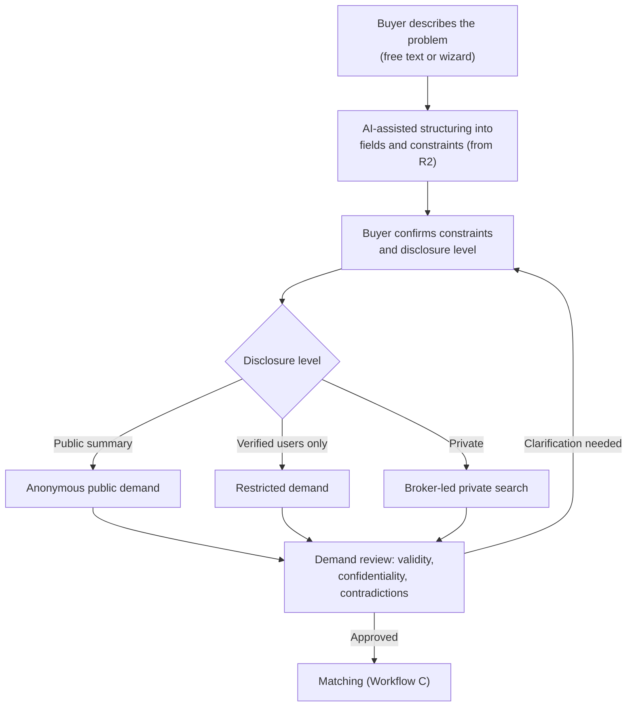

For public demands, a technology manager or expert writes a demand analysis and an anonymized public version; the buyer approves it before publication (FR-DEM-04). The buyer's identity and budget are never public by default.

**Demand lifecycle**

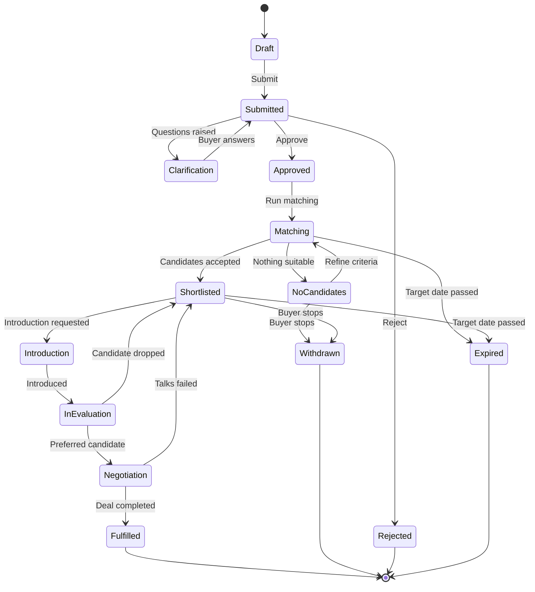

The stored values (`demands.status`) are `draft`, `submitted`, `clarification`, `approved`, `rejected`, `matching`, `shortlisted`, `no_candidates`, `introduction`, `in_evaluation`, `negotiation`, `fulfilled`, `withdrawn` and `expired`. A scheduled job moves open demands past their target date to `expired` ([06 §6.2](06-implementation-design-v1.md)).

Every closure records a **reason** (`closureReason`): fulfilled, withdrawn, expired, no suitable technology, budget unavailable, or transferred to an external procurement process.

> **Important rule:** do not force every demand into a technology purchase. A demand may be best fulfilled by a new research collaboration, a custom development contract, a group of complementary technologies, a consulting engagement, a pilot or proof of concept, or an investment or joint venture. The domain model must support those routes **without inventing a fake technology listing**.

### 7.3 Workflow C: matching and recommendation

Use a **staged pipeline**:

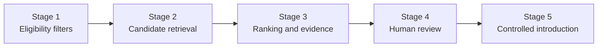

| Stage | What happens | Output |
| --- | --- | --- |
| 1. Eligibility filters | Rights availability, geography, required TRL, prohibited sectors, budget range, mandatory technical constraints. Runs as a MongoDB query on offers | Eligible offers only |
| 2. Candidate retrieval | Chinese and English keyword search with synonyms in Meilisearch, restricted to the eligible offers; taxonomy relationships; semantic retrieval in a later phase | Candidate list |
| 3. Ranking and evidence | Technical fit, maturity, deployment constraints, rights compatibility, evidence quality, commercial terms. Scored in the worker | Ranked list with explanations, stored as matches |
| 4. Human review | A broker or specialist reviews top candidates, rejects false positives and identifies missing information | Approved shortlist |
| 5. Controlled introduction | The system asks for approval before disclosing confidential details or introducing the parties | Introduction request (Workflow D) |

Matching runs as a background job per demand version; [06 §10](06-implementation-design-v1.md) has the implementation.

**Initial scoring model**

```text
S = 0.35·T + 0.20·M + 0.15·C + 0.15·R + 0.10·E + 0.05·G
```

| Symbol | Component (each normalized 0–100) | Initial weight |
| --- | --- | ---: |
| T | Technical fit | 0.35 |
| M | Maturity and readiness | 0.20 |
| C | Commercial fit | 0.15 |
| R | Rights and transaction compatibility | 0.15 |
| E | Evidence quality | 0.10 |
| G | Geographic and deployment compatibility | 0.05 |

Rules:

- The weights are **starting assumptions, not validated data**. Make them configurable and sector-specific, store each set under a `rankingVersion`, and test them against expert judgments and completed deals.
- **Hard constraints are filters, not score components.** A technology lacking a legally necessary right is ineligible however high its technical score.
- Show **why** a technology was recommended, which evidence supports it and which gaps remain.
- Never present a match score as a probability of commercial success.
- Keep **commercial prioritization** (for example, paying clients) separate from **technical relevance**, and disclose it.

### 7.4 Workflow D: inquiry, NDA and confidential disclosure

This workflow protects both sides and prevents accidental disclosure. It has two steps: an **introduction** (consent to make contact) and, later, **confidential disclosure** (access to specific documents under an NDA).

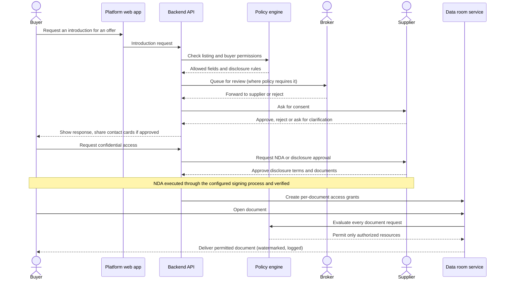

The introduction request has its own states ([06 §6.3](06-implementation-design-v1.md)): `requested` → `under_review` → `supplier_pending` → `approved` → `introduced` → `converted_to_deal`, or `rejected` / `withdrawn`. Until it is approved, messages between the parties have phone numbers, e-mail addresses, WeChat IDs and URLs masked (FR-INT-02). A unique index allows only one deal per introduction, so a retried "create deal" never creates a second one.

**Access classes**

| Class | Who can see it | Example content |
| --- | --- | --- |
| Public | Anyone | Non-confidential summary, applications, TRL claim |
| Registered user | Logged-in users | More detail, organization profile |
| Verified buyer | Verified organizations | Indicative terms, evidence summaries |
| NDA-covered | Parties to a verified NDA, per document | Test data, drawings, process details |
| Deal-team only | Named deal participants | Contract drafts, source code, know-how packages |

Rules:

- An NDA's status is verified against the actual execution process. It never becomes "active" just because a user clicked "I agree".
- A signed NDA does **not** grant access to every supplier document; each document needs its own grant.
- Access can be revoked, but downloaded information cannot be reliably recalled.
- Log every sensitive document view, download, export and permission change.
- Watermarks, download restrictions, expiry and view-only access reduce exposure but cannot guarantee that information is not copied.

### 7.5 Workflow E: deal negotiation and transaction

A deal has its own state machine and an assigned owner (the deal manager).

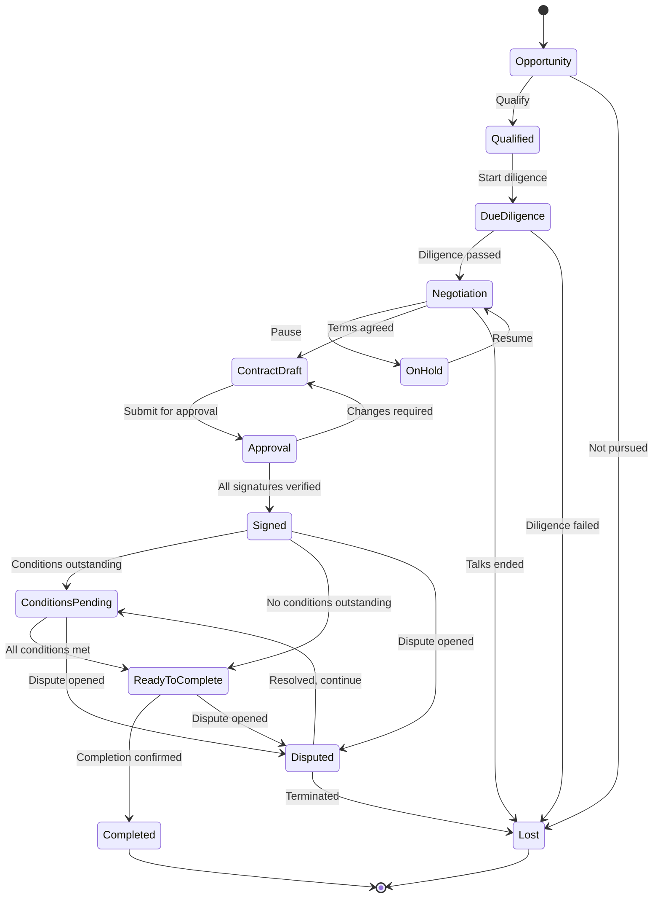

| State (`deals.status`) | Meaning |
| --- | --- |
| `opportunity` | A possible deal, usually created from an approved introduction |
| `qualified` | Both parties identified and the deal is worth pursuing |
| `due_diligence` | Technical, IP and commercial evaluation, under an NDA where confidential data is needed |
| `negotiation` | Versioned proposals and counter-proposals |
| `on_hold` | Negotiation paused, with a reason |
| `contract_draft` | All parties accepted the same proposal version; the contract is being drafted |
| `approval` | Each party's internal approvals and authorized signatories |
| `signed` | Signatures verified; the contract is executed |
| `conditions_pending` | Completion conditions outstanding: payment, registration, delivery or approvals |
| `ready_to_complete` | Every condition is met; the final completion check runs as its own audited step |
| `completed` | Completion confirmed for the deal type (see below) |
| `lost` | Ended without completion, with a loss reason |
| `disputed` | A dispute is open; the deal cannot complete through the normal path |

`ready_to_complete` is the last step before `completed`, in this blueprint, in [06 §6.4](06-implementation-design-v1.md) and in the stored enum. It separates "all conditions are met" from "completion confirmed", so the deal-type completion check is explicit and a dispute can still stop the deal. Disputes can be opened only after signature. Before that, a party that disagrees ends the talks (`lost`) or pauses them (`on_hold`), and complaints go through the complaints process (FR-CMP-04).

`Completed` needs a precise business definition **for each transaction type**. A signed contract, a paid licence fee, delivery of source code and transfer of legal title are different events:

| Deal type (`dealType`) | Completion requires (configurable) |
| --- | --- |
| Licence (`ip_license`) | Licence effective + required conditions met + initial payment confirmed |
| Assignment (`ip_assignment`) | Executed assignment + registration or recordal at the relevant IP office (where required) + consideration paid |
| Development partnership (`rnd_collaboration`) | Contract executed; the deal stays **active** through milestones for months |
| Technical service (`technical_service`) | Deliverables accepted under the agreed acceptance criteria |
| Investment (`investment`) | Closing conditions satisfied + shares or rights issued |

The platform therefore supports **configurable completion criteria per deal type** (see [07 §7](07-roles-workflows-and-money.md) and [08 §3](08-china-operating-model.md)). The deal stage is only one dimension: contract, payment, milestone and dispute statuses are separate records with their own state machines ([07 §8.1](07-roles-workflows-and-money.md)).

**Venue-routed deals (R3).** When a transfer must be sold through formal listing, bidding, auction or tender, the platform does not run the binding steps itself. As the venue's registered agent, it prepares the submission (`venue_submissions`), registers buyers on behalf of clients and tracks the venue's timeline (for example, disclosure for at least 5 working days on STEX). The venue runs the competitive method and third-party settlement and issues the certificates; the platform records the results and certificate numbers on the deal ([10 §3.10](10-product-requirements.md)).

**Deal status on the venue route.** The deal stays `negotiation` while the venue lists and discloses the technology and runs buyer registration and price discovery. It moves to `contract_draft` when the venue confirms the buyer and price, then through `approval` to `signed` (contract within 5 WD), and stays `conditions_pending` until venue settlement is confirmed and the transaction certificate (交易凭证) is recorded: both are completion conditions of a venue-routed deal. The venue's own steps are tracked on `venue_submissions`, not as extra deal statuses.

### 7.6 Workflow F: managed technology scouting (service engagement)

| Item | Definition |
| --- | --- |
| Objective | Deliver a paid, structured search for technologies that meet an enterprise client's requirement |
| Actors | Enterprise client, commercial manager, analyst or broker, experts |
| Output | Shortlist with evidence, introductions, optional deal |

| # | Step | Owner | Output |
| --- | --- | --- | --- |
| 1 | Scope, deliverables, deadlines, price and acceptance criteria agreed | Commercial manager + client | Service order |
| 2 | Analyst or broker assigned (after a conflict check) | Operations manager | Assignment |
| 3 | Private demand created from the brief (not published) | Analyst | Private demand |
| 4 | Search, outreach and screening | Analyst + experts | Long list → shortlist, each candidate traceable to evidence |
| 5 | Report delivered to authorized client users only | Analyst | Scouting report |
| 6 | Client accepts the deliverable | Client | Service milestone accepted, invoice issued |
| 7 | Selected candidates move to introduction and deals, without the client re-publishing confidential information | Broker | Introduction requests |

### 7.7 Workflow G: disputes (summary)

Any party to a signed deal can open a dispute about delivery, acceptance, IP, confidentiality or payment. The dispute workflow records the issue, the remedy sought and the evidence, notifies the other party with a response deadline, and applies the contract's and payment provider's rules. Disputed deals cannot be completed through the normal path. Complaints before signature use the same ticket and evidence process without changing the deal state (FR-CMP-04). The full dispute and funds-hold design is in [08 §8](08-china-operating-model.md).

---

## 8. Core sequence diagrams

These diagrams show how the system components cooperate internally, not just what the user sees. "API" is one of the `tex-api` processes; the identity, technology, workflow and document modules run inside it. "Worker" is `tex-worker`.

### 8.1 Publish a technology

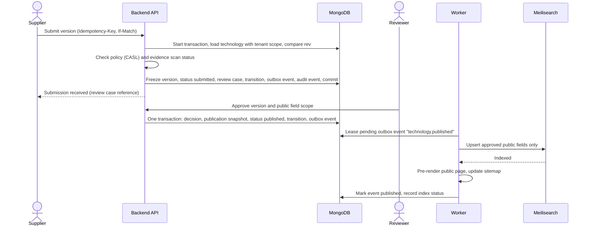

The API never calls Meilisearch, the page renderer or a notification provider inside a transaction. It writes an outbox event, and the worker performs the side effect after the commit. If indexing fails, the event stays pending and is retried; the business change is not rolled back.

Implementation requirements:

- Submission is **idempotent**, so a retried request never creates a duplicate review case.
- Review decisions include reviewer, timestamp, decision, reason and evidence.
- Only approved publication fields are indexed for public search.
- Indexing failures retry and eventually alert operations. They never silently mark a listing as searchable.
- Document uploads use short-lived authorized upload URLs, malware scanning and file-type validation.

### 8.2 Generate and deliver matches

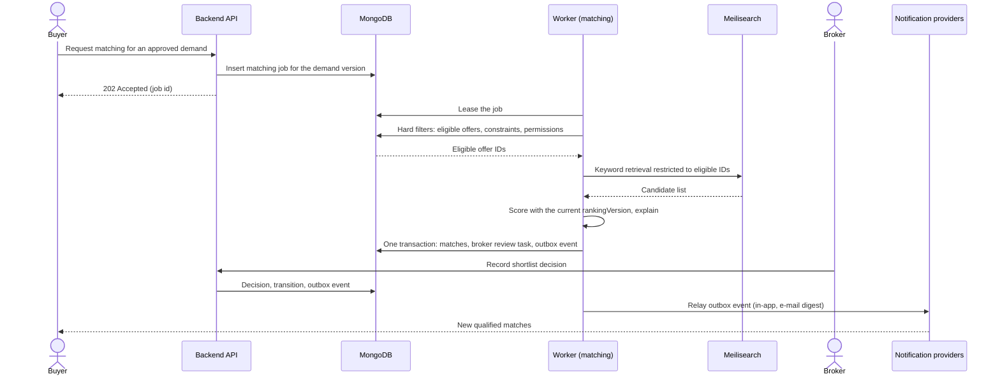

Jobs live in a MongoDB collection with leases, so no queue server is needed ([06 §4.9](06-implementation-design-v1.md)). Match records store the **versions** of the demand and technology and the ranking version used for scoring; a unique index on (demand, demand version, offer, ranking version) makes a re-run harmless. Otherwise it is impossible to explain why a recommendation appeared six months ago.

### 8.3 Execute a deal safely

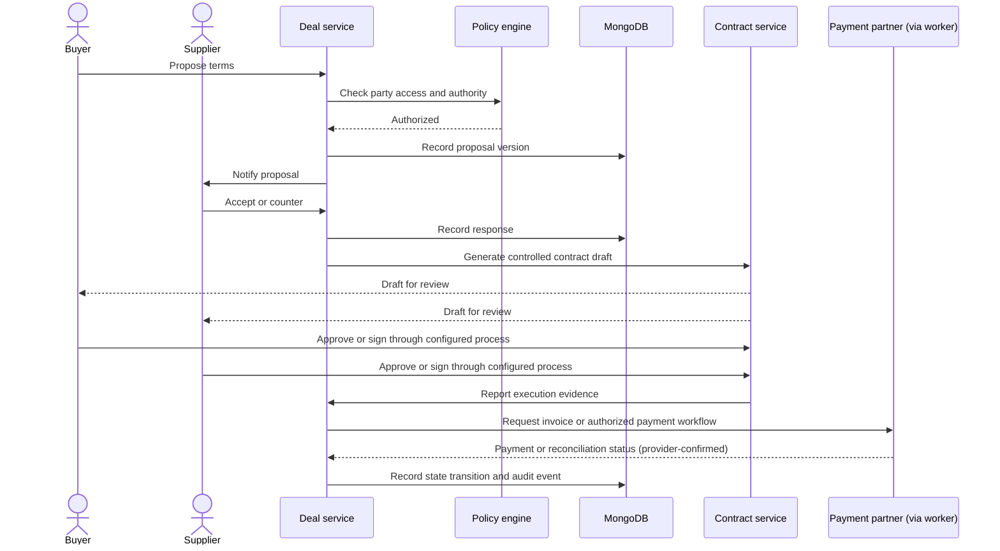

The contract service keeps the **exact document version and execution evidence**. The payment partner (a bank or licensed payment institution) reports **authoritative** payment status; an operator can never mark an unverified payment as successful. Until the payment integration exists (R3), payment status is recorded from verified evidence, such as a bank receipt checked by a finance officer.

---

## 9. Administrator and operations workflows

Many marketplace designs are incomplete here. A platform with a polished website still fails if no one owns verification queues, transaction exceptions, disputes or supplier quality.

### 9.1 Operations control center

The administrator home page is an actionable workbench. Example widgets (not live data):

| Widget | Shows | Typical actions |
| --- | --- | --- |
| Organization verification | Pending applications, authority checks, escalations | Claim, request documents, approve, reject |
| Technology review | New listings, corrections, evidence reviews | Claim, review checklist, approve scope |
| Deal operations | At-risk deals: overdue diligence, stalled negotiations, outstanding conditions | Reassign, escalate, contact parties |
| Finance exceptions | Failed payments, refunds, invoice issues, reconciliation gaps | Investigate, reconcile, approve refund |

Each item shows its **age, owner, next action and deadline**. A count without ageing and ownership is not enough.

### 9.2 Organization verification

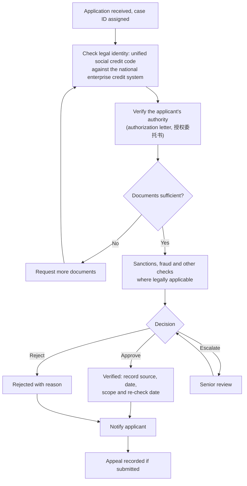

Sensitive decisions such as this one use **maker-checker**: one officer prepares the decision and a second one approves it (FR-ADM-02). Organization verification does **not** prove ownership of every technology the organization uploads. Technology rights are assessed separately.

### 9.3 Technology review checklist

| Check | Example evidence |
| --- | --- |
| Completeness | Required technical fields populated |
| Ownership / authority | Assignment, inventor declaration, institutional authorization |
| IP claims | Patent register data and relevant documents |
| Technical claims | Publications, test reports, specifications |
| Maturity | Prototype and validation evidence |
| Publication safety | Confidentiality and third-party information review |
| Offer authority | Permission to license, assign or negotiate |
| Duplication | Existing technology record or competing submissions |
| Restricted content | Export controls, sanctions or other restrictions |

Reviewers can approve the public profile while restricting confidential attachments. They do **not** have to approve or reject a technology as one indivisible object.

### 9.4 Matching operations

AI-generated matches need quality control:

- Review low-confidence or high-value candidates.
- Detect false positives caused by misleading terminology.
- Identify demands with no viable candidates and assign experts for manual scouting.
- Record why each candidate was rejected.
- Collect buyer feedback and eventual deal outcomes.
- Compare predicted relevance with human judgments and tune weights against real results.

Never let a high-value paying client silently influence technical rankings.

### 9.5 Transaction operations

The transaction operations team monitors contracts awaiting approval, outstanding signatures and conditions, invoice and payment status, reconciliation discrepancies, rights-transfer evidence and delivery obligations, failed integrations, refunds and cancellations, and disputes, holds and legal restrictions.

There is **no "Force Complete" button**. Exceptional actions require a specific permission, a reason, supporting evidence and an audit record. High-risk transitions require **dual approval**.

### 9.6 Admin state-transition matrix

| Action | Normal owner | Required controls |
| --- | --- | --- |
| Approve organization | Verification officer | Evidence and review record |
| Approve technology publication | Technology reviewer | Checklist and publication scope |
| Change IP verification status | Authorized specialist | Evidence, scope and review date |
| Assign broker | Operations manager | Conflict-of-interest check |
| Change deal stage | Deal owner / authorized operator | Preconditions and audit event |
| Mark payment reconciled | Finance officer / system integration | Bank or provider evidence |
| Approve refund | Finance role | Original payment reference and policy |
| Resolve dispute | Authorized dispute officer | Evidence, rationale and required approvals |
| Change global permission policy | Platform security administrator | Change review and audit trail |

---

## 10. User stories and acceptance criteria

These are production-oriented examples. Each becomes a ticket with tests, design references, API contracts and measurable acceptance criteria.

### Epic A — Identity and organizations

**US-001 Register an account.** *As a prospective participant, I want to register and verify my mobile number (or e-mail) so that I can access the platform.*

- [ ] Protected functions are unavailable until the required verification is complete.
- [ ] Repeated registration requests do not create duplicate accounts.
- [ ] Rate limits and abuse detection protect authentication endpoints.
- [ ] The user can recover access through a controlled process.
- [ ] Authentication events are logged without storing plaintext passwords or secrets.

**US-002 Create an organization.** *As a company representative, I want to create an organization profile so that I can manage technologies or demands on behalf of my company.*

- [ ] Organization type, jurisdiction, legal name and relevant identifiers are captured.
- [ ] Duplicate organizations are flagged for review.
- [ ] The creator receives only the initial permissions granted by account policy.
- [ ] Verification status is displayed accurately.
- [ ] Membership can be revoked without deleting historical activity.

**US-003 Invite a colleague.** *As an organization administrator, I want to invite colleagues with specific roles.*

- [ ] Invitations expire and cannot be reused after acceptance.
- [ ] Invitees must authenticate and accept the invitation.
- [ ] Admins cannot grant permissions beyond their own delegated authority.
- [ ] Membership changes invalidate affected sessions or permissions.

### Epic B — Technology registration

**US-010 Create a technology.** *As a technology owner, I want to create a draft with technical, commercial and IP information.*

- [ ] An incomplete draft can be saved.
- [ ] Mandatory fields vary by technology type.
- [ ] Uploaded files stay private until access is explicitly authorized.
- [ ] Every submitted version has a stable identifier.
- [ ] Material change history is preserved.

**US-011 Submit for publication.** *As an authorized supplier, I want to submit a technology for review.*

- [ ] The submission captures the exact version reviewed.
- [ ] A review case is created once, even if the client retries.
- [ ] The supplier can see review status and requested corrections.
- [ ] Reviewers can approve only fields within their permission scope.
- [ ] Only approved fields become publicly searchable.

### Epic C — Demand and matching

**US-020 Create a demand.** *As an R&D manager, I want to define a technical challenge with measurable requirements.*

- [ ] Hard constraints are distinguished from preferences.
- [ ] Budget, target dates and geography can be private.
- [ ] The demand can be saved as a draft and reviewed before publication.
- [ ] Invalid or contradictory hard constraints are rejected or trigger clarification.
- [ ] Edits create a new version and trigger re-matching where relevant.

**US-021 Review recommendations.** *As a buyer, I want to see matching technologies and understand why they were recommended.*

- [ ] Each recommendation includes an explanation and relevant evidence.
- [ ] Disqualifying constraints are visible.
- [ ] Results respect access permissions and publication restrictions.
- [ ] The buyer can shortlist, reject or request an introduction.
- [ ] Rejection reasons are captured as structured feedback.

### Epic D — Confidentiality and deal management

**US-030 Request confidential information.** *As a buyer, I want to request access to restricted technical information.*

- [ ] The supplier controls disclosure approval unless an explicit prior authorization applies.
- [ ] The applicable confidentiality agreement and its status are recorded.
- [ ] Access is checked on every document request.
- [ ] Access expires or is revoked according to policy.
- [ ] Confidential files are excluded from search indexing.

**US-031 Open a deal.** *As a buyer or authorized broker, I want to create a deal from a qualified opportunity.*

- [ ] The deal references the relevant technology and/or demand.
- [ ] Parties and authorized representatives are identified.
- [ ] The initial stage and assigned owner are recorded.
- [ ] Each party receives only the access it is entitled to.
- [ ] Prohibited transitions are blocked.

**US-032 Complete a transfer.** *As the parties to a deal, we want to record the executed agreement and completion conditions.*

- [ ] The executed contract version is immutable in the audit record.
- [ ] Required approvals and signatures are verified.
- [ ] Completion conditions are checked for the deal type.
- [ ] Payment status comes from authorized evidence or an integration.
- [ ] Disputed or suspended deals cannot complete through the normal path.

### Epic E — Administration

**US-040 Process a review queue.** *As a review officer, I want to claim, assess and resolve assigned cases.*

- [ ] Cases have an owner, priority, due date and history.
- [ ] Decisions require a reason and the applicable checklist.
- [ ] Conflicts of interest can be declared and trigger reassignment.
- [ ] Overdue cases can be escalated.
- [ ] Review metrics can be calculated from recorded timestamps.

**US-041 Reconcile transactions.** *As a finance officer, I want to reconcile invoices, payment-provider records and platform transaction records.*

- [ ] Each payment maps to an internal transaction reference.
- [ ] Duplicate provider events do not create duplicate accounting entries.
- [ ] Amount, currency and status discrepancies are flagged.
- [ ] Refunds reference their original transactions.
- [ ] Adjustments require authorization and a recorded reason.

### Epic F — Commercial services

**US-050 Purchase a technology scouting service.** *As an enterprise client, I want to commission a structured search for technologies that meet a business requirement.*

- [ ] The service defines scope, deliverables, deadlines, price and acceptance criteria.
- [ ] An authorized analyst or broker is assigned.
- [ ] Candidates are traceable to evidence and search criteria.
- [ ] Deliverables are visible only to authorized client users.
- [ ] The service can lead to a deal without re-publishing confidential information.

These epics are an initial backlog, not a substitute for acceptance tests covering every state transition, permission boundary, integration failure and exception path. The numbered requirements and user acceptance scenarios that releases are tested against are in [10 §3 and §10](10-product-requirements.md).

---

## 11. Database and data architecture

The system of record is **MongoDB** (target servers run 4.4 / 5.0; see [11](11-target-runtime-node12-mongodb.md)). MongoDB is schemaless, so the design adds the discipline a technology exchange needs: Mongoose schemas in the application, database validators as a safety net, explicit indexes, immutable versions, transactions and least-privilege roles. Search runs in a separate, rebuildable index.

### 11.1 Core data conventions

Every major business collection has:

- An `ObjectId` primary key **and** a human-readable reference (`TEC-000123`, `DEM-…`, `DEAL-000042`, `CASE-…`) for users and support staff, generated from an atomic counter.
- `createdAt` and `updatedAt`.
- An organization (tenant) ownership field where applicable, enforced by `tenantScopePlugin` (§11.3).
- An explicit status, validated as an enum.
- A `rev` field for optimistic concurrency: the Mongoose version key with `optimisticConcurrency`, so every `save()` checks and increments it, and a stale `If-Match` returns `409 VERSION_CONFLICT`. Where history matters, an immutable version collection (`freezablePlugin`) and append-only transition records (`appendOnlyPlugin`).
- A Mongoose schema (types, enums, required fields, cross-field rules) plus a `$jsonSchema` validator in the database and unique indexes for invariants that must hold under concurrency.
- Indexes for its common access patterns, declared in the schema.
- Audit events for sensitive transitions.

Use structured, validated fields for relationships, state, rights, money and permissions. Use flexible sub-documents only for sector-specific technical attributes and extraction metadata. Money is stored as **integer minor units (fen) with a currency** (`{ currency: 'CNY', amountMinor: Int64 }`), never as floating point; rates and percentages use `Decimal128`. Mongoose 5 has no 64-bit integer type, so the project registers a strict `Int64` type that rejects fractions ([06 §4.5](06-implementation-design-v1.md)).

### 11.2 Document model (excerpt)

A technology is split into a small, frequently updated **identity document**, **immutable versions**, and the **technology publication snapshot**, the only part that search and public pages ever see. This split lets version 4 be edited and reviewed while version 3 stays public:

```javascript
// technologies: identity and lifecycle
{ _id: ObjectId("…"), ref: "TEC-000123", ownerOrganizationId: ObjectId("…"),
  technologyType: "process_technology", lifecycleStatus: "published", visibility: "public",
  currentVersion: 4, publishedVersion: 3, rev: 9, createdAt: ISODate("…"), updatedAt: ISODate("…") }

// technology_versions: immutable once submitted
{ technologyId: ObjectId("…"), version: 3, frozen: true,
  title: { zh: "锂电池极片缺陷在线检测技术", en: "Inline defect detection for lithium-battery electrodes" },
  publicSummary: { zh: "…", en: "…" }, claimedTrl: 6, assessedTrl: null,
  technicalAttributes: { lineSpeed: "≤ 80 m/min", accuracy: "> 99%" }, createdAt: ISODate("…") }

// technology_publications: technology publication snapshot (source for search and public pages)
{ technologyId: ObjectId("…"), version: 3, ref: "TEC-000123", status: "live",
  title: { zh: "…", en: "…" }, summary: { zh: "…" }, industryCodes: ["C384"],
  trl: { claimed: 6, assessed: null }, offerTypes: ["license"], badges: ["patent_verified"] }
```

The full collection catalogue, Mongoose models, validators, indexes, roles and verified code are in [06 §4](06-implementation-design-v1.md).

**Intentionally deferred.** Payment obligations, provider transactions, payouts, ledger entries and reconciliation ([08 §9](08-china-operating-model.md)) are added when money starts flowing through the platform.

Use **migrations from the beginning**: `migrate-mongo` for validators, roles and data fixes, and `npm run db:indexes` to create the indexes declared in the Mongoose schemas, both run at release as the `tex_migrator` user. The application user cannot create indexes, so the API and worker never do it. Never change validators, indexes or roles manually in production.

### 11.3 Multi-tenant isolation

When many organizations share the platform, tenant isolation is a first-class security requirement:

1. Every tenant-owned document has an explicit ownership or access relationship.
2. Every tenant-owned Mongoose model carries a **tenant-scope plugin** that adds the tenant filter to every query, and rejects any query that does not state a tenant or an audited staff reason (06 §4.8). MongoDB has no row-level security, so this rule is enforced in one place and covered by automated cross-tenant tests.
3. The application connects with a **least-privilege role** (`texApp`): CRUD on business collections, insert-only on the audit trail (kept in a separate `tex_audit` database), no index or validator changes.
4. Privileged staff access goes through a separate path that requires a case-related reason and writes an audit event.
5. Background jobs carry and validate their tenant and resource scope.
6. Search results, caches, exports and document URLs obey the same access policy.

### 11.4 Search architecture

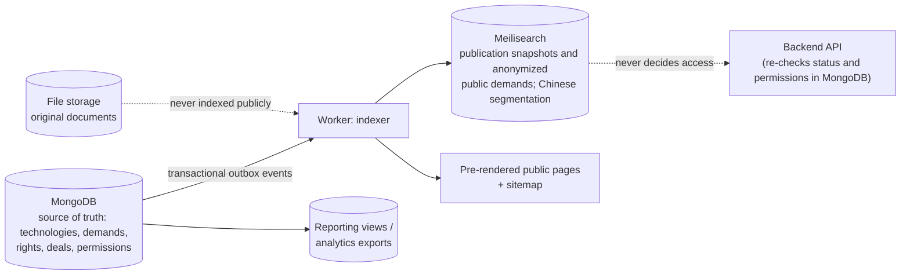

- The search index is a **derived** representation. It never decides whether a user may access a confidential document, and it can be rebuilt from MongoDB at any time (`npm run search:rebuild`). The API holds only a search-only key and re-checks every result's status and permissions in MongoDB before returning it.
- When a technology is suspended or its visibility changes, the change must reach the index, the pre-rendered page and any cache. The **transactional outbox** guarantees that the event is not lost when indexing fails, and a nightly job reconciles the index with MongoDB.
- Semantic (vector) matching is a later phase: Meilisearch hybrid search, or MongoDB Search / Vector Search after a database upgrade to 8.2+.

### 11.5 Document lifecycle

Technical documents can be the most valuable assets on the platform, so their lifecycle is explicit:

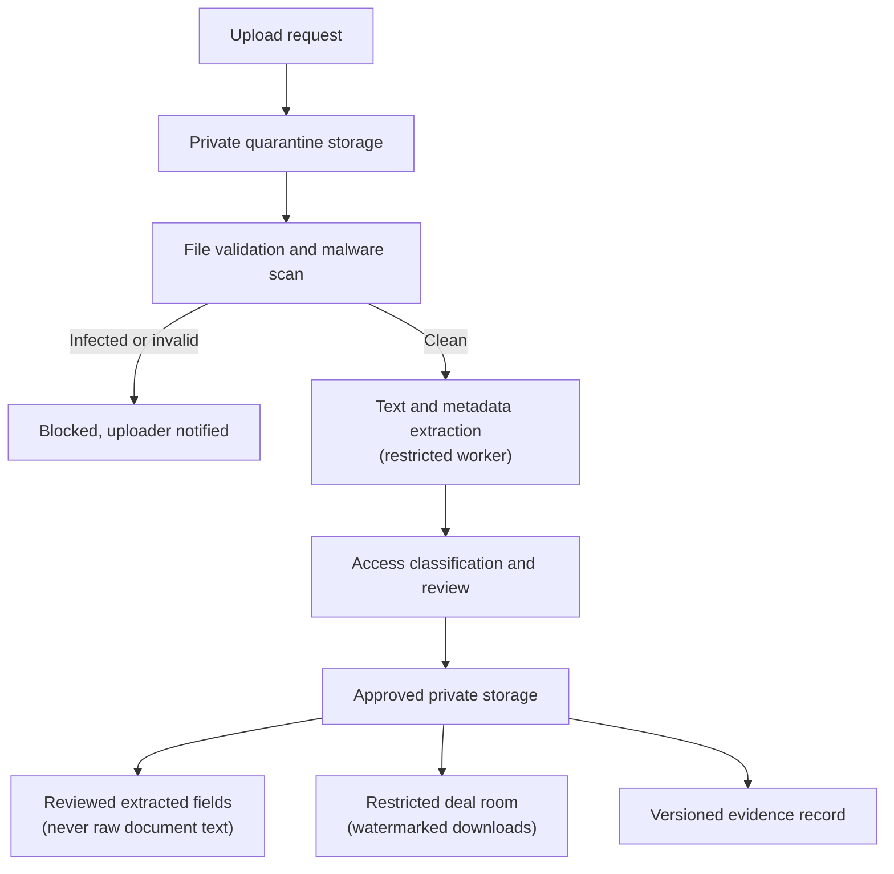

The extraction pipeline **never publishes document text automatically**. It must also handle embedded metadata, hidden spreadsheet content, tracked revisions and other unintended disclosures. If the scanner is unavailable, files stay in quarantine; they never become available because a timeout elapsed ([06 §9.1](06-implementation-design-v1.md)).

---

## 12. Backend modules and API contracts

The backend exposes **business operations**. It never lets the frontend edit state fields arbitrarily.

### 12.1 Module boundaries

| Module | Owns | Folder ([06 §11.4](06-implementation-design-v1.md)) · first release |
| --- | --- | --- |
| Identity and access | Users, sessions, memberships, policies | `identity/` · R0 |
| Organization management | Organization profiles, verification, delegated authority | `organizations/` · R0–R1 |
| Taxonomy | Industry codes, technology fields, synonyms | `taxonomy/` · R1 |
| Technology registry | Technology identity, versions, publication snapshots, IP assets | `technology/` · R1 |
| Offer management | Rights available, commercial terms and territories | `offers/` · R1 |
| Demand management | Requirements, demand versions and approvals | `demands/` · R1 |
| Discovery | Search, filters, facets and result explanations | `discovery/` · R1 |
| Matching | Candidate retrieval, scores, feedback and match versions | `matching/` · R1 |
| Exchange | Shortlists, introduction requests, broker assignments | `exchange/` · R1 |
| Verification and workflow | Review cases, evidence, decisions, tasks, state transitions, deadlines, escalations, the outbox | `workflow/` · R1 |
| Documents | Private files, quarantine, access grants, data rooms | `documents/` · R1 (data rooms R2) |
| Deal management | Deal parties, stages, proposals and milestones | `deals/` · R2 |
| Contract management | Contract versions, approvals and execution evidence | new folder · R2 |
| Services | Scouting, evaluation, experts and service orders | new folder · R1 (expert pool), R2 |
| Venue route | Venue submissions, buyer registrations, certificates | new folder · R3 |
| Transactions and finance | Completion criteria, invoices, provider events, refunds, reconciliation | new folder · R2 (invoices), R3 (payments) |
| Notifications | E-mail, SMS, WeChat and in-app notifications, delivery status | `notifications/` · R1 |
| Content | News, policies, help pages, events | `content/` · R1 (events R2) |
| Audit | Append-only audit trail in `tex_audit` | `audit/` · R0 |
| Reporting | Operational, marketplace and commercial analytics | `reporting/` · R1 |

All of these are module folders inside one deployable Express application. The folders marked "new" do not exist in the first-release layout; they are added to the same application when their release starts.

### 12.2 Example REST API

State changes are **action endpoints** (`…/submissions`, `…/decisions`, `…/stage-actions`), not field updates. Examples (all under `/api/v1`):

| Method | Endpoint | Purpose |
| --- | --- | --- |
| `POST` | `/api/v1/technologies` | Create technology draft |
| `PATCH` | `/api/v1/technologies/{id}/draft` | Update the editable draft |
| `POST` | `/api/v1/technologies/{id}/submissions` | Submit a version for review |
| `GET` | `/api/v1/technologies/{id}` | Read technology with access controls |
| `POST` | `/api/v1/technologies/{id}/offers` | Create licensing or transfer offer |
| `POST` | `/api/v1/demands` | Create demand |
| `POST` | `/api/v1/demands/{id}/submissions` | Submit demand for review |
| `POST` | `/api/v1/demands/{id}/matching-jobs` | Request matching (`202 Accepted` + job ID) |
| `GET` | `/api/v1/demands/{id}/matches` | Retrieve authorized recommendations |
| `POST` | `/api/v1/matches/{id}/shortlist-actions` | Shortlist or remove a candidate |
| `POST` | `/api/v1/matches/{id}/introduction-requests` | Request supplier introduction |
| `POST` | `/api/v1/introduction-requests/{id}/decisions` | Record the supplier's or broker's decision |
| `POST` | `/api/v1/deals` | Create deal |
| `POST` | `/api/v1/deals/{id}/proposals` | Submit proposal |
| `POST` | `/api/v1/deals/{id}/stage-actions` | Request an allowed stage transition (§13) |
| `POST` | `/api/v1/deals/{id}/completion-checks` | Evaluate completion prerequisites |
| `GET` | `/api/v1/admin/review-queues` | Retrieve authorized review tasks |
| `POST` | `/api/v1/admin/review-cases/{id}/decisions` | Record a review decision |

Never let clients set a status field (`lifecycle_status`, a verification status) through a general-purpose update endpoint. The full endpoint catalogue, request and response formats and error codes for the first release are in [06 §5](06-implementation-design-v1.md).

### 12.3 API implementation rules

- Validate inputs at the API boundary (zod) **and** again at critical domain transitions (Mongoose schema, policy and preconditions). Build MongoDB filters only from validated values; Mongoose 5 has no filter sanitizer.
- Require an **idempotency key** (`Idempotency-Key` header, results kept in `idempotency_keys`) for retriable requests, especially submissions, deal creation, payment initiation, refunds and external callbacks.
- Apply authorization to every resource access.
- Return structured error codes and safe messages.
- Use pagination, filtering and deterministic sorting.
- Rate-limit authentication, search and expensive AI operations.
- Use **optimistic concurrency control** (`If-Match` compared with `rev`; `409 VERSION_CONFLICT` on mismatch) when several users may edit the same record.
- Version APIs and document their contracts (OpenAPI generated from the zod schemas).
- Never trust frontend-supplied prices, fees, organization roles or completion status.
- Write domain events to the **outbox in the same transaction** as the business change. The worker delivers them only after the commit, so no event is sent for a change that was rolled back, and no committed change loses its event.

---

## 13. Workflow engine and state transitions

Do not scatter business rules as conditions across controllers. Each workflow is a **state machine with explicit transition rules**: a table of `(current state, action) → next state`, each with its own precondition check. The table below is the complete deal state machine of §7.5; the technology, demand and introduction machines follow the same pattern ([06 §6](06-implementation-design-v1.md)).

```typescript
// src/modules/deals/deal-transitions.ts — transitions are data, not scattered if-statements.
type DealStatus =
  | 'opportunity' | 'qualified' | 'due_diligence' | 'negotiation' | 'contract_draft' | 'approval'
  | 'signed' | 'conditions_pending' | 'ready_to_complete' | 'completed' | 'on_hold' | 'lost' | 'disputed';
type DealAction =
  | 'qualify' | 'start_diligence' | 'pass_diligence' | 'pause' | 'resume' | 'agree_terms'
  | 'submit_for_approval' | 'request_changes' | 'record_signatures' | 'await_conditions'
  | 'confirm_conditions' | 'confirm_completion' | 'open_dispute' | 'resolve_dispute' | 'mark_lost';

interface Deal { status: DealStatus; rev: number }
interface Command { action: DealAction; reason?: string; evidence?: Record<string, unknown> }
interface Actor { userId: string; can(action: DealAction, deal: Deal): boolean }   // CASL ability in the real code

interface Transition {
  to: DealStatus;
  validate(deal: Deal, cmd: Command): void;                  // throws PreconditionFailedError with a reason
}

export class InvalidTransitionError extends Error {}         // 409 INVALID_STATE_TRANSITION
export class ForbiddenError extends Error {}                 // 403 PERMISSION_DENIED
export class PreconditionFailedError extends Error {}        // 422 VALIDATION_FAILED

const noCheck = (): void => undefined;
const needsReason = (_deal: Deal, cmd: Command): void => {
  if (!cmd.reason) throw new PreconditionFailedError('A reason is required');
};
const needsEvidence = (...keys: string[]) => (_deal: Deal, cmd: Command): void => {
  const missing = keys.filter((k) => !cmd.evidence || cmd.evidence[k] === undefined);
  if (missing.length > 0) throw new PreconditionFailedError(`Missing evidence: ${missing.join(', ')}`);
};
const t = (to: DealStatus, validate: Transition['validate'] = noCheck): Transition => ({ to, validate });

const TRANSITIONS = new Map<string, Transition>([
  ['opportunity:qualify',                    t('qualified')],
  ['opportunity:mark_lost',                  t('lost', needsReason)],
  ['qualified:start_diligence',              t('due_diligence')],
  ['due_diligence:pass_diligence',           t('negotiation', needsEvidence('diligenceSummary'))],
  ['due_diligence:mark_lost',                t('lost', needsReason)],
  ['negotiation:pause',                      t('on_hold', needsReason)],
  ['on_hold:resume',                         t('negotiation')],
  ['negotiation:agree_terms',                t('contract_draft', needsEvidence('acceptedProposalVersion'))],
  ['negotiation:mark_lost',                  t('lost', needsReason)],
  ['contract_draft:submit_for_approval',     t('approval', needsEvidence('contractVersion'))],
  ['approval:request_changes',               t('contract_draft', needsReason)],
  ['approval:record_signatures',             t('signed', needsEvidence('signatures'))],
  ['signed:await_conditions',                t('conditions_pending', needsEvidence('openConditions'))],
  ['signed:confirm_conditions',              t('ready_to_complete')],          // no conditions outstanding
  ['conditions_pending:confirm_conditions',  t('ready_to_complete', needsEvidence('conditionEvidence'))],
  ['ready_to_complete:confirm_completion',   t('completed', needsEvidence('completionCheck'))],
  ['signed:open_dispute',                    t('disputed', needsEvidence('issue', 'remedySought'))],
  ['conditions_pending:open_dispute',        t('disputed', needsEvidence('issue', 'remedySought'))],
  ['ready_to_complete:open_dispute',         t('disputed', needsEvidence('issue', 'remedySought'))],
  ['disputed:resolve_dispute',               t('conditions_pending', needsEvidence('resolution'))],
  ['disputed:mark_lost',                     t('lost', needsReason)],
]);

export function resolveTransition(deal: Deal, cmd: Command, actor: Actor): Transition {
  if (!actor.can(cmd.action, deal)) throw new ForbiddenError(`Not allowed: ${cmd.action}`);
  const transition = TRANSITIONS.get(`${deal.status}:${cmd.action}`);
  if (!transition) throw new InvalidTransitionError(`Action ${cmd.action} is not allowed from ${deal.status}`);
  transition.validate(deal, cmd);                           // evidence, approvals, holds
  return transition;
}

// The caller (deal.service.ts) applies the transition inside inTransaction() (06 §4.7):
//   load the deal with tenant scope → compare If-Match with rev → resolveTransition()
//   → deal.status = transition.to → deal.save() (checks and increments rev)
//   → append workflow_transitions + outbox_events + audit event → commit.
```

*Type-checked with TypeScript 5 (`strict`, target and `lib` ES2019). The evidence keys are placeholders; real `validate` functions also check approvals, holds and deal-type completion criteria.*

The transition table:

| From | Action | To | Allowed actors | Preconditions |
| --- | --- | --- | --- | --- |
| `opportunity` | `qualify` | `qualified` | Deal owner, broker | Both parties identified |
| `qualified` | `start_diligence` | `due_diligence` | Deal owner | NDA verified, if confidential data is needed |
| `due_diligence` | `pass_diligence` | `negotiation` | Deal owner | Diligence findings recorded |
| `negotiation` | `pause` / `resume` | `on_hold` / `negotiation` | Deal owner | Reason recorded |
| `negotiation` | `agree_terms` | `contract_draft` | Each party's authorized representative | All parties accepted the **same** proposal version |
| `contract_draft` | `submit_for_approval` | `approval` | Deal owner | A contract version exists |
| `approval` | `request_changes` | `contract_draft` | Any required approver | Reason recorded |
| `approval` | `record_signatures` | `signed` | Contract module (e-signature result) | Verified signatures from all required signatories |
| `signed` | `await_conditions` | `conditions_pending` | Deal owner | Open completion conditions listed |
| `signed` or `conditions_pending` | `confirm_conditions` | `ready_to_complete` | Deal owner | Every completion condition satisfied with evidence (or none outstanding) |
| `ready_to_complete` | `confirm_completion` | `completed` | Deal owner | Deal-type completion check passes (`completion-checks`); no open dispute |
| `signed`, `conditions_pending` or `ready_to_complete` | `open_dispute` | `disputed` | Any deal party | Issue, remedy sought and evidence provided |
| `disputed` | `resolve_dispute` | `conditions_pending` | Dispute officer | Resolution and evidence recorded |
| `opportunity`, `due_diligence`, `negotiation` or `disputed` | `mark_lost` | `lost` | Deal owner (dispute officer for `disputed`) | Loss reason recorded |

### Required workflow capabilities

- Allowed transitions and their prerequisites.
- Role- and attribute-based authorization.
- Task assignment and reassignment.
- Deadlines, reminders and escalation, counted in working days on the official China calendar (`calendar_days`, FR-ADM-09).
- Approval chains and dual control.
- Idempotent commands.
- Immutable transition history.
- Retryable external actions.
- Timeout and exception handling.
- Versioned workflow definitions, so old cases continue under their original rules.

State machines implemented in the application and persisted in MongoDB (status + `rev` + `workflow_transitions`, changed in one transaction) are enough for the first release. Timers (review deadlines, reminders, demand expiry) run as scheduled jobs in the worker. Consider a dedicated engine such as **Temporal** only after the runtime upgrade, and only when workflows become long-running, distributed, timer-heavy and dependent on reliable retries across many systems.

---

## 14. Revenue, pricing and financial architecture

Build the commercial model into the domain design from the start, even if the first release has only two or three paid services.

### 14.1 Revenue streams

| Stream | Description |
| --- | --- |
| A. Enterprise subscriptions | Private scouting, advanced search, multiple users, team workflows, analytics, saved demands, API access |
| B. Transaction services | Fixed transaction charges, negotiated service fees, or success fees where legally permissible and contractually agreed |
| C. Managed technology scouting | Paid programmes to find, shortlist, evaluate and introduce technologies |
| D. Professional services | Due diligence, evaluation, valuation, IP review, pilot coordination, technical consulting, commercialization support |
| E. Institutional and network services | University or regional innovation programmes, sponsored scouting, TTO tools, contracted platform operation (for example innovation vouchers, see [03 §4](03-business-models-and-revenue.md)) |

### 14.2 Transaction value is not revenue

The finance model distinguishes:

- Gross contract value.
- Platform fee earned.
- Professional-service revenue.
- Third-party service costs.
- Amounts collected on behalf of another party.
- Refunds and reversals.
- Taxes.
- Recognized and deferred revenue.
- Outstanding receivables and payables.

If a licence is worth ¥1,000,000 and the platform earns a ¥20,000 service fee, platform revenue is ¥20,000 (an illustrative example; see [03 §1](03-business-models-and-revenue.md)). Money held or transmitted on behalf of parties is **not** platform revenue. In China it may be held only by a bank or licensed payment institution, and it needs specific accounting treatment.

### 14.3 First-year commercial design

Test offerings instead of imposing one commission model:

| Offering | Initial monetization |
| --- | --- |
| Basic supplier profile | Free |
| Basic technology publication | Free, subject to review rules |
| Basic demand publication | Free or a limited free tier |
| Enterprise discovery workspace | Annual or monthly subscription |
| Managed scouting project | Fixed project fee |
| Technical evaluation | Fixed fee or scoped statement of work |
| Due diligence | Fixed fee or staged engagement |
| Transaction coordination | Contractually agreed fee |
| API and bulk data access | Enterprise licence |

Do not charge for every action before there is enough supply and demand. Tie monetization to **measurable value**, especially for enterprise buyers.

### 14.4 Finance implementation

Use a separate finance domain with:

- Immutable invoice and payment references; digital e-invoices (数电票) for platform services.
- Money as `{ currency, amountMinor: Int64 }` in fen; rates as `Decimal128`.
- A ledger or accounting integration suited to the business.
- Explicit transaction fees and versioned fee-calculation rules.
- Reconciliation against authoritative provider or bank records.
- Refund, reversal and dispute workflows.
- Separation of revenue, receivables, payables and third-party funds.
- Audit trails for all financial adjustments.

Never use floating-point numbers for money: use integer minor units with an explicit currency, and `Decimal128` only for rates and percentages. Do **not** build an internal wallet or escrow service. Funds are held and released only by a bank or licensed payment institution; the platform records the conditions, sends authorized instructions and reconciles the provider's confirmations (see [07 §6](07-roles-workflows-and-money.md), [08 §1.2 and §6](08-china-operating-model.md)).

---

## 15. AI and technology-intelligence architecture

AI enhances the workflow. It is not an isolated chatbot without authority over business records.

### 15.1 AI capabilities

| Capability | Input | Output | Human control |
| --- | --- | --- | --- |
| Document extraction | Approved documents | Candidate metadata and extracted facts | Review before publication |
| Technology classification | Technology description | Taxonomy suggestions | Supplier or reviewer confirms |
| Demand structuring | Natural-language business problem | Structured demand fields | Buyer confirms constraints |
| Semantic matching | Approved demand and technology content | Candidate rankings and explanations | Broker reviews important matches |
| Due-diligence assistance | Authorized evidence | Questions, inconsistencies and risk flags | Qualified specialist decides |
| Translation | Approved content | Multilingual draft | Review of sensitive material |
| Deal assistance | Authorized deal documents | Summaries and action lists | Authorized party approves actions |
| Market intelligence | Licensed and authorized datasets | Trends and comparable evidence | Analyst validates methodology |

### 15.2 Recommended AI pipeline

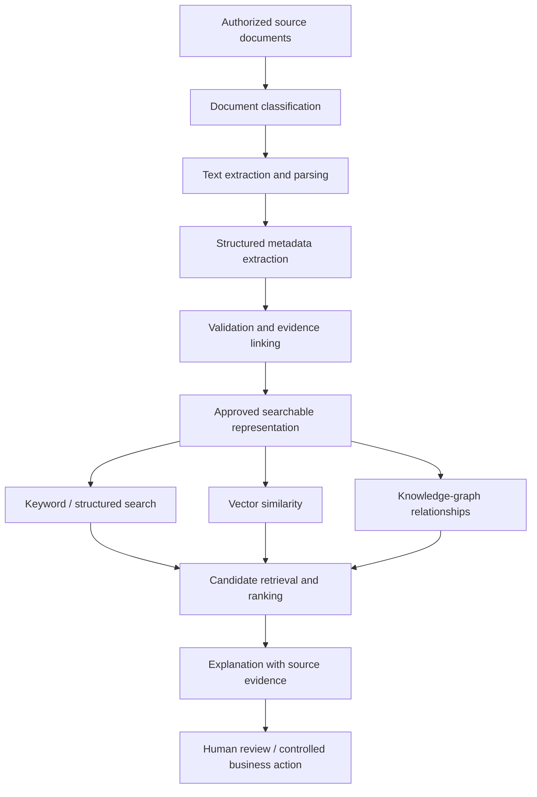

This is the target pipeline. At launch, retrieval is keyword and structured search only (Meilisearch and MongoDB filters); vector similarity and graph relationships are later phases (§3.2, §15.4), and the core flows work without AI.

Every AI-generated fact keeps its **provenance**: source document, page or passage, extraction time, model or pipeline version, and review status.

### 15.3 AI safety and reliability requirements

- Never send confidential documents to an external AI provider without an approved data-processing and confidentiality arrangement. In China, use domestic model providers that have completed generative-AI filing, and assess cross-border data rules before any data leaves the country (see [08 §1](08-china-operating-model.md), [10 §8](10-product-requirements.md)).
- Enforce tenant and deal permissions **before** retrieving content for a model's context.
- Treat document text as untrusted data, never as instructions to the AI system (prompt-injection defence).
- Prevent retrieval from leaking confidential records across organizations.
- Store model-generated claims separately from verified facts.
- Measure retrieval precision, ranking quality and hallucination rates with evaluation datasets.
- Audit AI-assisted decisions that materially affect access, review or deal workflows.
- Keep human approval for ownership, legal status, technical certification and financial actions.

### 15.4 Do you need a graph database?

Not at the beginning. Start with collections and explicit reference fields; MongoDB's `$graphLookup` covers simple multi-hop traversals. Add a dedicated graph database only when real workloads need complex multi-hop queries that are otherwise hard to run efficiently. The technology graph in [04 §7](04-product-strategy.md) can be a logical model long before it becomes a separate database.

---

## 16. Security, privacy, legal and trust

A technology-transfer platform handles patent strategies, confidential research, trade secrets, source code, unpublished data, contract negotiations and cross-border transactions. Security is part of the initial architecture.

### 16.1 Security controls

- Strong authentication; TOTP MFA mandatory for platform staff; enterprise controls (SSO) where needed.
- RBAC/ABAC authorization with resource-level checks.
- Encryption in transit and at rest.
- Managed secrets and key rotation.
- Private object storage and short-lived access URLs.
- Malware scanning and controlled document processing.
- Rate limiting, abuse prevention and account protection.
- Append-only audit records and monitoring of privileged actions.
- Backups, tested recovery and incident response.
- Dependency scanning, patch management and secure releases.
- Separate production, test and development environments.
- Data minimization and explicit retention policies.
- Personal data, documents and backups stored in mainland China; the system prepared for an MLPS (等保) level 2 filing at launch (NFR-06, NFR-08 in [10 §7](10-product-requirements.md)).
- Compensating controls for the end-of-life runtime: TLS terminated in a current Nginx, Node and MongoDB reachable only on private interfaces, strict input limits ([11 §11](11-target-runtime-node12-mongodb.md)).

### 16.2 Legal and jurisdictional questions to resolve first

Before enabling real transactions, answer:

1. Which jurisdictions will the platform operate in?
2. Is it an information marketplace, a broker, a contractual intermediary or an officially recognized exchange?
3. What evidence is required to authorize an IP transfer or licence?
4. Who is responsible for legal review and the accuracy of listings?
5. Which electronic-signature rules apply?
6. Which privacy, data-localization, export-control, sanctions and technology-transfer rules apply?
7. Which payment services require regulated providers?
8. How are disputes, refunds, fraud and misrepresentation handled?
9. How are conflicts of interest disclosed?
10. What legal responsibilities apply to professional service providers?

These answers change product scope and data flows. Do not defer them until after the transaction engine is built. For the China launch, questions 1, 2 and 7 are answered: China, Shanghai first; a matching and service platform that reaches venue functions as a registered practising agent of a licensed venue (§2.2); and payments only through a bank or licensed payment institution. The others are worked through in [08](08-china-operating-model.md) (checklist in 08 §10) and the open decisions in [10 §12](10-product-requirements.md).

---

## 17. Development roadmap

Build in stages, each with explicit exit criteria. The goal is a useful commercial platform early, without painting the system into an architectural corner.

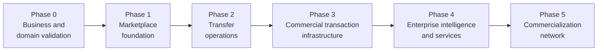

| Phase | Features / deliverables | Exit criteria |
| --- | --- | --- |
| **0 — Business and domain validation** (before development) | Business model and target market · Target jurisdictions and compliance boundaries · Stakeholder interviews and journey maps · Domain glossary and ER model · Workflow state machines · Information architecture and wireframes · Security and confidentiality requirements · Monetization experiments and cost model · PRD | The team can explain how a technology moves from submission to completed transfer, who is responsible at each stage, and what a completed deal is |
| **1 — Marketplace foundation** | Registration and authentication · Organizations, memberships, permissions · Technology registration and versioning · Publication review · Search, filters, detail pages · Demand registration · Basic matching and shortlists · Admin queues and audit logs · Private document storage and notifications | Suppliers publish reviewed technologies, buyers submit demands, and both sides discover and manage opportunities securely |
| **2 — Transfer operations** | Introduction requests · NDA workflow and controlled disclosure · Restricted deal rooms · Broker assignments and expert tasks · Due-diligence cases · Deal pipeline and negotiation records · Contract versions and approvals · Milestones, reminders and exception handling | A qualified opportunity can be managed through diligence and negotiation with a complete history |
| **3 — Commercial transaction infrastructure** | Configurable transaction types · Licensing and assignment workflows · Contract-execution integrations · Payment-partner integration, invoicing and reconciliation · Fee calculation and revenue reporting · Completion evidence · Disputes, refunds, audit controls · Venue-routed listing, bidding, auction and tender, as the venue's registered agent | The platform records and coordinates a transaction, including financial and contractual conditions, without confusing contract value with platform revenue |
| **4 — Enterprise intelligence and services** | Enterprise subscriptions · Managed scouting · Advanced multilingual search · AI-assisted matching and evidence extraction · Expert marketplace · Evaluation and valuation services · Enterprise reporting and API · CRM and procurement integrations | Repeatable paid services and recurring enterprise usage, not only sporadic transaction fees |
| **5 — Commercialization network** | PoC project management · Pilot milestones and validation evidence · Manufacturing and industrial partners · Financing and investment workflows · Regional and international networks · Post-transfer outcome tracking · Advanced analytics and benchmarking | The platform measures deployment and commercial impact, not just transactions |

These phases describe the product's growth. The **release plan of record** is R0–R3 in [10 §9](10-product-requirements.md), and [06 §13](06-implementation-design-v1.md) splits the engineering work into vertical slices. The releases cut across the phases:

| Release ([10 §9](10-product-requirements.md)) | Covers |
| --- | --- |
| R0 Foundation | Runtime set-up, CI, authentication, organizations, audit: the base of Phase 1 |
| R1 Marketplace MVP | Phase 1, plus introductions with contact masking |
| R2 Managed transfer and clients | Phase 2, plus the enterprise and institutional services of Phase 4 (subscriptions, scouting, client workspaces) |
| R3 Venue-routed transactions and payments | Phase 3 |
| After R3 | The rest of Phases 4 and 5 |

### Practical initial scope

Do not attempt all five phases in the first release. The **minimum commercially meaningful product** is:

> Organization management + technology registry + demand management + discovery and matching + verification + confidential introduction + deal pipeline + administration.

That is R1 plus the NDA, data-room and deal parts of R2. Build contracts, finance and commercialization on that foundation as the first real transactions reveal the requirements. The first-release implementation plan is in [06 §13](06-implementation-design-v1.md).

---

## 18. Testing and quality assurance

The platform needs more than unit tests for CRUD endpoints.

| Test layer | What to validate |
| --- | --- |
| Unit tests | Domain rules, pricing, state transitions, permission decisions; run on `node:12.4.0`, the real runtime |
| Integration tests | MongoDB 4.4 replica set (transactions, validators, tenant scope), file storage, Meilisearch, outbox worker and external APIs |
| Compatibility gate | Every dependency change passes the Node 12 smoke test (`draft-implementation/run.sh`, [11 §2](11-target-runtime-node12-mongodb.md)) |
| API contract tests | Request validation, response schemas and error behaviour |
| Authorization tests | Cross-tenant access, role escalation and restricted documents |
| Workflow tests | Valid and invalid transitions, timeouts and recovery |
| Concurrency tests | Two users editing a record, duplicate submissions, simultaneous approvals |
| Security tests | Upload attacks, IDOR, injection, authentication abuse and data leakage |
| AI evaluation | Match relevance, evidence accuracy, multilingual behaviour and false positives |
| Financial tests | Decimal precision, duplicate payments, refunds and reconciliation |
| Recovery tests | Database restore, object recovery, event replay and failed integrations |
| User acceptance tests | Buyer, supplier, broker, expert and administrator scenarios |

### Release blockers (automate these)

1. A buyer from Organization A **cannot** retrieve Organization B's confidential document by guessing its identifier or URL.
2. A failed or repeated payment callback **cannot** create duplicate payment records or accounting effects.
3. A technology suspended for a rights dispute **cannot** stay discoverable through a stale search index or cached recommendation.
4. A query on a tenant-owned model without a tenant scope **cannot** run: it throws instead of returning another organization's data.

---

## 19. Operational dashboards and KPIs

Use separate dashboards for marketplace performance, transfer operations, finance and technology quality.

| Dashboard | Metrics |
| --- | --- |
| **Marketplace** | Verified active suppliers · Active published technologies · Active qualified demands · % of technologies with complete evidence · Search-to-inquiry conversion · Demand-to-qualified-match conversion · % of demands with at least one qualified candidate · Repeat buyer and supplier activity · Category coverage and supply–demand gaps |
| **Transfer** | Time from submission to review · Time from demand approval to first qualified match · Time from introduction to NDA · Time from qualification to contract execution · Time from execution to completion · Deal abandonment by stage and reason · Qualified candidates per demand · Dispute rate and resolution time · Pilot completion and deployment rates |
| **Financial** | Recognized platform revenue · Annual recurring revenue (ARR) · Revenue by subscription, service and transaction fee · Gross margin per stream · Customer acquisition cost (CAC) · Customer lifetime value (LTV) · Renewal and churn · Scouting project margin · Invoice collection time · Reconciliation exceptions and outstanding liabilities |
| **AI quality** | Precision of top-ranked matches · Recall against expert-identified candidates · % of recommendations accepted · Human rejection rate and reasons · Match-to-deal conversion · Unsupported-claim rate in generated summaries · Search latency and document-processing failure rate |

Do not optimize for the number of listings or nominal transaction value. A platform with a million low-quality listings and few qualified matches is worth less than a smaller, well-verified marketplace that consistently produces completed transfers.

---

## 20. Deployment and infrastructure

For the initial release, deploy a small number of clearly separated components on self-hosted Linux servers. Every process is a systemd service; there is no Docker Compose or Kubernetes:

```mermaid
flowchart TB
    U["Web and enterprise users"] --> EDGE["Nginx: TLS, WAF rules, rate limits,<br/>static web and pre-rendered pages"]
    EDGE --> BE["tex-api@3001, tex-api@3002<br/>(Node 12, Express, systemd)"]
    BE --> DB[("MongoDB 4.4 / 5.0<br/>replica set")]
    BE --> OS[("Private file storage")]
    BE --> SI[("Meilisearch")]
    WK["tex-worker (systemd): outbox, indexing,<br/>page rendering, notifications, jobs"] --> DB
    WK --> SI
    WK --> OS
    WK --> AI["AI providers or local models<br/>(later phase)"]
    WK --> EXT["SMS, e-mail, WeChat, e-signature,<br/>payment and venue interfaces"]
    BE -.-> OBS["Logs / metrics / alerts"]
    WK -.-> OBS
    DB -.-> BK["Nightly mongodump --oplog<br/>to separate backup storage"]
    OS -.-> BK
```

External providers are called only after the business transaction has committed, normally by the worker relaying an outbox event; never from inside a transaction.

### Deployment rules

- Keep the primary database private.
- Use managed or controlled secrets; never store credentials in source code.
- Back up both database records and the required object-storage content.
- Test recovery; do not rely on "backup job succeeded".
- Use separate development, staging and production environments; staging runs exactly the production Node and MongoDB versions.
- Run migrations and index creation through the release process, as `tex_migrator`. Migrations are expand-and-contract, so a rollback is a switch of the release symlink ([11 §9.4](11-target-runtime-node12-mongodb.md)).
- Alert on outbox backlog, failed jobs, indexing delays, authentication anomalies and database capacity.
- Document a recovery time objective (RTO) and recovery point objective (RPO); the launch targets are RPO ≤ 24 h and RTO ≤ 4 h (NFR-05).
- Track infrastructure costs per major subsystem.
- Never store confidential documents in public buckets or unprotected application logs.

For an early-stage system, two API instances plus one worker are enough. Search and AI workloads can scale independently later. The self-hosted deployment for the first release (hosts, network zones, systemd units, Nginx configuration and release procedure) is in [06 §11](06-implementation-design-v1.md) and [11 §9](11-target-runtime-node12-mongodb.md).

---

## 21. Implementation work breakdown

| Workstream | Main deliverables | Depends on |
| --- | --- | --- |
| Product and UX | PRD, journeys, wireframes, design system | Business scope |
| Domain architecture | Entity model, states, permissions, event definitions | Business workflows |
| Platform foundation | Authentication, organizations, API conventions, audit | Domain architecture |
| Technology marketplace | Registration, versions, offers, review and search | Platform foundation |
| Demand and matching | Requirement schema, candidate retrieval, shortlist and feedback | Technology marketplace |
| Transfer operations | NDA, data room, broker tasks, deal management | Identity and documents |
| Contracts and finance | Execution integrations, invoicing, reconciliation | Deal workflows and legal review |
| AI and intelligence | Extraction, semantic search, ranking and evaluation | Approved data and permissions |
| Administration | Queues, escalation, policies, reporting | All business modules |
| DevOps and security | CI/CD with the Node 12 compatibility gate, systemd and Nginx configuration, monitoring, backups, incident response, security tests | Platform foundation onward |
| Venue route | Venue submission packages, buyer registration, timeline tracking, certificate records | Deal workflows, venue partnership (D-01) |
| Commercialization | Pilots, milestones, service providers, outcome reporting | Deal and service modules |

Every workstream delivers its own requirements and acceptance criteria, data model and migration, API contract, UI states and error handling, authorization policy, automated tests, and monitoring and operational documentation.

This avoids the common failure where the frontend is mostly finished before the team discovers that the backend cannot represent the real business workflow.

---

## 22. Decision record: platform design profile

Several business decisions change the detailed design. They were settled step by step in the follow-up documents:

| # | Decision | Options considered | Decision taken | Where |
| --- | --- | --- | --- | --- |
| 1 | Initial operating region | Global · China · Europe · one region first | One region first ([06](06-implementation-design-v1.md)), then **China, Shanghai first** ([08](08-china-operating-model.md)) | 06 §1, 08 |
| 2 | Primary business model | Formal exchange · transfer and brokerage · hybrid exchange + services + SaaS | **Demand-driven matching and service platform with managed transfer workflows**; venue functions through a licensed venue (STEX or CTEX) as its registered practising agent | 06 §1, 10 §1, §2.2 here |
| 3 | Initial users | Suppliers first · buyers first · both | **Both** suppliers and buyers | 06 §1 |
| 4 | Deployment | Cloud · self-hosted · hybrid · on-premises | **Self-hosted** Linux servers: systemd services behind Nginx; no Docker Compose or Kubernetes. A container with a current Node LTS is only a later upgrade option (11 §11.2) | 06 §3, §11; 11 §9 |
| 5 | Team size | 1–4 · 5–12 · multiple squads | **1–4 developers** | 06 §13 |
| 6 | Transactions at launch | Managed introductions and deal records · contracts and payments · formal exchange mechanisms | Managed introductions and deal tracking first ([06](06-implementation-design-v1.md)); later **all deal types with provider-backed conditional funds handling** ([08](08-china-operating-model.md)) and venue-routed listing sales (R3) | 06, 07, 08, 10 §9 |
| 7 | Technology scope | All industries · deep tech · specific industries | **Broad, cross-industry** | 06 §1 |
| 8 | Backend stack | Python + PostgreSQL · NestJS 8 · Node.js + Express + MongoDB | **Express 4 modular monolith on the given servers: Node 12.4, MongoDB 4.4 / 5.0.** NestJS 8 rejected (end-of-life, pins an older Express) | 06 §3, 11 §3 |
| 9 | Data access | Native driver with repositories · Mongoose ODM | **Mongoose 5.13** schemas, models and Document API, with tenant-scope and immutability plugins; database validators kept as a safety net. The move to Mongoose 6.13 with Node 12.22.12 is open decision D-08 | 06 §4, 11 §5.2, §11.2 |
| 10 | Search | MongoDB text index · Elasticsearch 7.17 + IK · Meilisearch | **Meilisearch**, fed from the outbox; MongoDB 4.4 / 5.0 cannot search Chinese text | 06 §10, 11 §6 |
| 11 | Background work | Redis + `bull` · MongoDB outbox and leased jobs | **Transactional outbox and leased jobs in MongoDB**, one worker process; no Redis at launch | 06 §3, 11 §3 |

### Final architectural recommendation

Start with the hybrid model: a demand-driven marketplace, rigorous technology records, controlled verification, explainable matching and a complete transfer workflow. Reach regulated venue functions through a licensed venue, and money through licensed payment providers, instead of building them.

Use a modular Express backend (TypeScript on Node.js 12) with one worker, MongoDB as the source of truth (Mongoose models, database validators, transactions and least-privilege roles), Meilisearch for Chinese search, private document storage, explicit state machines, a transactional outbox and strong resource-level permissions. Keep **transaction completion, financial records and legal status** as separate, auditable concepts.

Above all, design the business operations alongside the software. Verification staff, technology brokers, deal managers, finance operators and administrators are not secondary users. They are part of the service that makes the marketplace trustworthy.
