# 05 — Technology Exchange & Transfer Platform: System Design Blueprint

> **About this document**
>
> - **Purpose:** The complete *target* design of the platform: business ecosystem, domain model, roles, user experience, end-to-end workflows, data, APIs, workflow engine, finance, AI, security, roadmap, testing, KPIs and deployment.
> - **Audience:** Product owners, architects, engineering leads and operations leads.
> - **Status:** Target-state blueprint. The *implementation-level* baseline for the first release is in [06](06-implementation-design-v1.md). The real-world role and money model is in [07](07-roles-workflows-and-money.md); the China operating model is in [08](08-china-operating-model.md).
> - **Previous:** [04 — Product strategy](04-product-strategy.md) · **Next:** [06 — Implementation design](06-implementation-design-v1.md)

---

## Table of contents

1. [Product vision and design principles](#1-product-vision-and-design-principles)
2. [Business ecosystem](#2-business-ecosystem)
3. [Functional system architecture](#3-functional-system-architecture)
4. [Core domain model](#4-core-domain-model)
5. [Roles, permissions and accounts](#5-roles-permissions-and-accounts)
6. [User experience and information architecture](#6-user-experience-and-information-architecture)
7. [End-to-end business workflows](#7-end-to-end-business-workflows)
8. [Core sequence diagrams](#8-core-sequence-diagrams)
9. [Administrator and operations workflows](#9-administrator-and-operations-workflows)
10. [User stories and acceptance criteria](#10-user-stories-and-acceptance-criteria)
11. [Database and data architecture](#11-database-and-data-architecture)
12. [Backend modules and API contracts](#12-backend-modules-and-api-contracts)
13. [Workflow engine and state transitions](#13-workflow-engine-and-state-transitions)
14. [Revenue, pricing and financial architecture](#14-revenue-pricing-and-financial-architecture)
15. [AI and technology-intelligence architecture](#15-ai-and-technology-intelligence-architecture)
16. [Security, privacy, legal and trust](#16-security-privacy-legal-and-trust)
17. [Development roadmap](#17-development-roadmap)
18. [Testing and quality assurance](#18-testing-and-quality-assurance)
19. [Operational dashboards and KPIs](#19-operational-dashboards-and-kpis)
20. [Deployment and infrastructure](#20-deployment-and-infrastructure)
21. [Implementation work breakdown](#21-implementation-work-breakdown)
22. [Decision record: platform design profile](#22-decision-record-platform-design-profile)

---

## 1. Product vision and design principles

The platform combines the strongest business concepts of the Shanghai Technology Exchange (STEX) and NETC/InnoMatch (see [01](01-shanghai-landscape.md)–[04](04-product-strategy.md)) with a modern, internationally scalable software architecture.

The goal is **not** just a website where universities upload patents and companies search for them. The goal is to move technologies from discovery and research into **licensing, acquisition, investment, pilot projects and commercial deployment**.

### 1.1 The three pillars

| Pillar | Description |
| --- | --- |
| **Technology exchange** | A structured marketplace for patents, proprietary know-how, scientific discoveries, software, AI models, materials, manufacturing processes, prototypes and other licensable or transferable technologies. |
| **Technology transfer** | A managed workflow connecting technology owners, research institutions, corporate buyers, technology brokers, experts, legal professionals and commercialization partners. |
| **Commercialization infrastructure** | A process for validating technologies, negotiating rights, executing contracts, coordinating payments, organizing pilots and measuring real-world commercialization outcomes. |

### 1.2 The seven design principles

| # | Principle | What it means in the product |
| --- | --- | --- |
| 1 | **Demand-driven** | Corporate requirements are as important as technology listings. Every demand is a structured, matchable object. |
| 2 | **Trust before transactions** | Verify organizations, ownership claims, IP and technical evidence before parties invest time. |
| 3 | **Confidential by default** | Unpublished inventions and trade secrets never become public just because a listing exists. Disclosure is staged and recorded. |
| 4 | **Human accountability** | AI recommends, summarizes and prioritizes. It never certifies ownership or approves regulated transactions. |
| 5 | **Deal-centric workflows** | An inquiry becomes a traceable business process with an owner, state and history, not an email thread. |
| 6 | **Multiple revenue streams** | Subscriptions, scouting, diligence, evaluation, managed services and transaction fees (see [03](03-business-models-and-revenue.md)). |
| 7 | **Incremental implementation** | Start with a reliable marketplace and transfer workflow. Add regulated exchange and financial capabilities only when the legal and operational foundations exist. |

---

## 2. Business ecosystem

The platform serves several participant groups. Each needs a different interface, different permissions and different business processes.

```mermaid
flowchart LR
    subgraph SUPPLY["Technology supply"]
        S1["Universities"]
        S2["Research institutes"]
        S3["Corporations"]
        S4["Startups"]
        S5["Inventors and IP owners"]
    end
    subgraph PLATFORM["Technology exchange and transfer platform"]
        P1["Discovery"]
        P2["Matching"]
        P3["Verification"]
        P4["Deal management"]
        P5["Contract workflows"]
        P6["Transaction records"]
    end
    subgraph DEMAND["Technology demand"]
        D1["Enterprises and SMEs"]
        D2["Industrial buyers"]
        D3["Investors and licensees"]
        D4["Government innovation programmes"]
    end
    subgraph NETWORK["Supporting network"]
        N1["Verification<br/>IP, identity, technical evidence"]
        N2["Experts<br/>evaluation, scouting, brokerage"]
        N3["Professional services<br/>legal, valuation, IP diligence"]
        N4["Commercialization<br/>prototypes, pilots, manufacturing"]
    end
    SUPPLY --> PLATFORM
    PLATFORM --> DEMAND
    NETWORK <--> PLATFORM
```

### 2.1 One platform, three business layers

| Layer | Responsibility | Business outcome |
| --- | --- | --- |
| **Discovery marketplace** | Publish, search and match technologies and demands | Qualified opportunities |
| **Transfer management** | Confidentiality, diligence, negotiation, contracts, deal coordination | Completed technology deals |
| **Exchange and commercialization** | Formal listings, auctions, transaction certification, settlement integrations, pilots | Trusted transactions and deployed technologies |

All three layers **share** one identity system, one technology registry, one organization model, one permissions framework and one deal record. They must not be built as three disconnected products.

### 2.2 The regulatory boundary

An ordinary commercial marketplace may record agreements and coordinate transactions. Some exchange functions, however, are **regulated** and may require authorization, a licence or a licensed partner:

| Function | Ordinary platform can… | Requires authorization or a licensed partner |
| --- | --- | --- |
| Rights | Record ownership *claims* and evidence | Issue legally recognized rights-registration certificates (in Shanghai, a licensed technology trading venue issues 技术权益登记凭证) |
| Transactions | Record agreements and outcomes | Issue official transaction certificates (交易鉴证) |
| Money | Show invoices and record provider-confirmed payments | Hold, pool, escrow or settle client funds (in China, only banks and licensed payment institutions; Shanghai rules require third-party settlement) |
| Pricing | Support negotiation and auctions between private parties | Run public listing and auction processes for state-owned technology where law prescribes them |

The architecture keeps these functions in **separate modules with feature flags**, so they can be enabled only when the legal basis exists.

---

## 3. Functional system architecture

Organize the product into **business domains**, not a collection of unrelated screens.

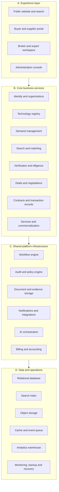

### 3.1 Architecture style: modular monolith first

For the first production release, use a **modular monolith with asynchronous background workers** instead of many microservices.

| Benefit | Why it matters here |
| --- | --- |
| Transactional consistency | Deals, permissions and workflow state change together in one database transaction |
| Simple deployment and debugging | One deployable backend, one log stream |
| No distributed transactions | Avoids sagas and two-phase commits early on |
| Lower cost | Fewer servers and less operational work |
| Clear migration path | Modules can be extracted when real scale justifies it |

Rules:

- Each module owns its domain model and its data access.
- Modules **never** manipulate another module's tables directly; they call that module's service interface or react to its events.
- Candidates for later extraction: search, document processing, AI matching, notifications, analytics and payment integrations.

### 3.2 Suggested technology stack

A practical starting point, not the only acceptable stack:

| Component | Recommendation | Reason |
| --- | --- | --- |
| Web frontend | React + TypeScript | Mature ecosystem for complex business portals |
| UI framework | One component system with design tokens | Accessible, consistent admin and marketplace screens |
| Backend | Python + FastAPI (or another strongly structured backend) | Python suits AI, document processing and matching |
| Primary database | PostgreSQL | Relational integrity, JSONB, mature transactions, row-level security |
| Search | OpenSearch or Elasticsearch (later); PostgreSQL full-text search initially | Faceted, multilingual search and relevance tuning |
| Vector search | PostgreSQL with pgvector initially | Semantic matching without another mandatory datastore |
| File storage | S3-compatible object storage | Large documents, versioning, retention, private files |
| Background jobs | Durable queue (database-backed or Redis-backed); dedicated broker when volume requires | Matching, document parsing, notifications |
| Workflow | Explicit state machines persisted in the database | Clear, auditable business transitions |
| Analytics | PostgreSQL reporting first; warehouse later | Avoid premature infrastructure |
| Deployment | Docker on managed services or controlled VMs | Repeatable, predictable deployments |
| Observability | Centralized logs, metrics, tracing, error tracking | Diagnosis and reliability |

Do **not** introduce Kubernetes, Kafka, a graph database and several AI services on day one unless scale or deployment constraints really require them.

---

## 4. Core domain model

The domain model is the foundation. If it is wrong, the user interface and workflows become inconsistent as the platform grows.

### 4.1 Entity map: identity, supply and demand

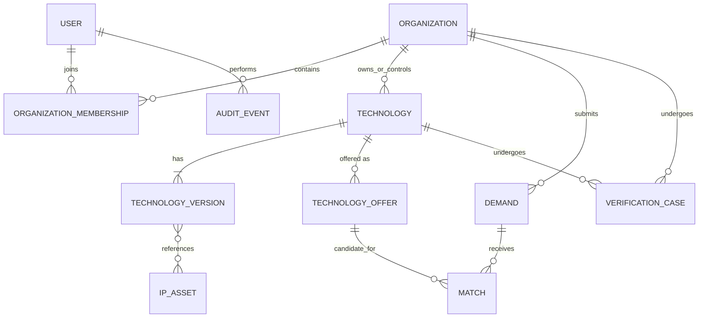

### 4.2 Entity map: deals and transactions

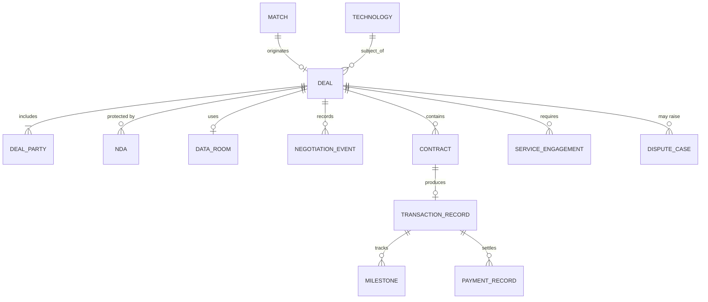

The diagrams show logical relationships, not every physical table.

### 4.3 Entity catalogue

| Entity | Purpose |
| --- | --- |
| User | An individual identity and its authentication |
| Organization | University, company, research institute, agency or service provider |
| OrganizationMembership | A user's relationship, role and access rights within an organization |
| Technology | The stable identity of a technology opportunity |
| TechnologyVersion | A versioned technical description and published snapshot |
| IPAsset | A patent, application, software right, know-how or other claimed right |
| TechnologyOffer | Available licensing, assignment, acquisition or collaboration terms |
| Demand | A structured business problem or technology requirement |
| Match | A relationship between a demand and an offer, with evidence and scores |
| VerificationCase | An identity, ownership, IP or technical review process |
| Deal | A negotiation and transfer case |
| DealParty | Buyer, seller, intermediary, beneficiary or other party |
| NDA | A confidentiality agreement and its execution status |
| DataRoom | Restricted document access for a specific deal |
| NegotiationEvent | A proposal, counter-proposal, decision or recorded discussion |
| Contract | An agreement with its versions, parties, approvals and execution records |
| TransactionRecord | The record of the agreed transaction and its status |
| PaymentRecord | A payment instruction, its external reference and reconciliation state |
| Milestone | A payment, delivery, validation or commercialization obligation |
| ServiceEngagement | Paid or contracted professional work |
| AuditEvent | An append-only record of an important action |
| DisputeCase | A complaint, contested right, or contractual or transaction dispute |

**Modeling rule:** technology, offer, demand, deal, contract and payment are **different entities**. Never merge their fields into one large `technology` table.

- A technology can have several offers, many interested buyers, several matching demands and a history of deals.
- An offer can change without rewriting the technology's identity.
- A deal can cover several technologies and rights.

### 4.4 Technology is not the same as intellectual property

A single technology may include:

- Several patents and pending applications.
- Unpatented trade secrets and know-how.
- Software or model components.
- Test results and prototype evidence.
- Manufacturing processes.
- Third-party components and dependencies (which may carry their own licence terms).

Each IP asset has its own rights holder, jurisdiction, registration identifiers, legal status, evidence and review history. The platform distinguishes four **levels of assurance** for every claim:

| Assurance level | Meaning | Example |
| --- | --- | --- |
| Owner asserted | The supplier states it | "We own patent CN123…" |
| Document checked | A reviewer saw a supporting document | Assignment record uploaded and reviewed |
| Independently verified | Checked against an authoritative external source | Patent register shows the holder and an active status |
| Legally confirmed | Confirmed by a qualified legal opinion or official registration | Legal opinion, or registered transfer at the patent office |

The UI must always show which level applies; never display "verified" without the scope and date.

### 4.5 The Technology Passport

Every technology has a structured profile with three parts. Example header (illustrative, not a real listing): **Advanced battery technology** · TRL 6 (claimed) · Patent-backed · Licensing available.

| Section | Fields |
| --- | --- |
| **Technical profile** | Technical problem and proposed solution · Applications, sector and alternative approaches · Specifications and measured performance · TRL with supporting evidence · Manufacturing requirements and dependencies · Known limitations and failure modes |
| **Rights and commercial profile** | Owner and authorized representative · Patent jurisdictions, identifiers and status · Rights available (exclusive licence, non-exclusive licence, assignment, collaboration) · Territories, fields of use and restrictions · Indicative price, royalty or milestone terms · Disclosure classification and approved publication fields |
| **Evidence and provenance** | Publications and lab reports · Prototype and pilot results · Third-party assessments · Verification status and review date · Version history and supporting documents |

### 4.6 TRL must be evidence-backed

- Use a recognized 1–9 TRL scale with documented definitions (see [04 §8](04-product-strategy.md)).
- Store the **claimed** level separately from the **independently assessed** level.
- A laboratory prototype is never automatically "industrially validated".
- Add a separate **commercial-readiness** assessment. Manufacturing readiness, regulatory readiness, IP position, customer validation and unit economics are different dimensions from TRL.

---

## 5. Roles, permissions and accounts

Do **not** implement permissions as a single `role` column on the user. One person may be a technology owner at a university, a buyer at a startup and a technical expert elsewhere. Access depends on **organization, resource, action and deal**.

### 5.1 External roles

| Role | Main responsibilities |
| --- | --- |
| Individual inventor | Submit technology and evidence; respond to inquiries, subject to ownership authorization |
| University technology-transfer office (TTO) | Manage institutional IP, approve disclosures and negotiate licences |
| Technology supplier | Publish authorized offers and manage buyer relationships |
| Corporate buyer | Create demands, discover technologies, manage evaluation and procurement |
| R&D manager | Define requirements and assess technical fit |
| Technology broker / manager | Manage assigned matching and transfer cases |
| Technical expert | Review assigned evidence and submit assessments |
| IP / legal professional | Conduct scoped legal and rights diligence |
| Investor | Discover opportunities and review authorized investment information |
| Service provider | Offer evaluation, prototyping, regulatory or commercialization services |
| Enterprise administrator | Manage the organization's users, policies, subscriptions and permissions |

### 5.2 Internal (platform staff) roles

| Role | Main responsibilities |
| --- | --- |
| Platform administrator | Global configuration, access control and operational oversight |
| Organization verification officer | Verify organizational identities and authority |
| Technology review officer | Review completeness, quality and publication suitability |
| IP verification specialist | Review IP documentation within the authorized scope |
| Deal operations manager | Monitor transaction workflows and unblock operational tasks |
| Finance / reconciliation officer | Reconcile invoices, payments and refunds |
| Dispute officer | Manage complaints and conflict-of-interest controls |
| Platform commercial manager | Pricing, enterprise accounts, service packages and revenue reporting |
| Compliance / privacy officer | Data requests, retention, access reviews and regulatory processes |
| Security auditor | Review security events and privileged actions |

### 5.3 Permission model: RBAC + ABAC

Use role-based access control (**RBAC**) combined with attribute/resource-based access control (**ABAC**). Example: a broker may read a deal only if **all** of these hold:

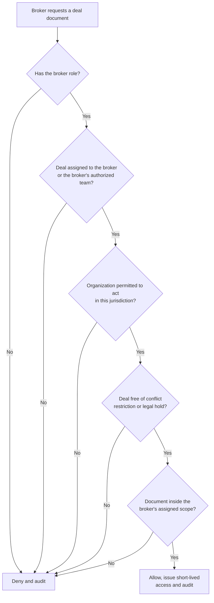

Sensitive actions require explicit permission checks **on the backend**. Hiding a button in React is not an authorization control.

---

## 6. User experience and information architecture

The product should not feel like one giant admin dashboard. Each audience enters through an interface that reflects its work.

| Workspace | Primary navigation | The home page must answer… |
| --- | --- | --- |
| **Public marketplace** | Explore Technologies · Publish Technology · Post a Technology Need · Industries · Experts and Services · How It Works · About Verification | "Is there something relevant here, and can I trust it?" Optimize for discovery, credible evidence and conversion into qualified inquiries. |
| **Buyer workspace** | Overview · My Technology Needs · Recommended Technologies · Shortlists · Evaluations · Deals · Data Rooms · Contracts · Service Requests · Team and Billing | (1) Which technologies best match our needs? (2) Which actions or decisions are waiting for us? (3) What is the status of each opportunity? |
| **Supplier workspace** | Overview · My Technologies · Offers and Rights · Inquiries · Match Recommendations · Verification · Negotiations · Contracts and Transactions · Analytics | What needs my response, what is my publication scope, and where are opportunities progressing or failing? |
| **Broker and expert workspace** | Assigned Cases · Matching Queue · Due Diligence · Expert Tasks · Client Communications · Deal Pipeline · Milestones · Fees and Commissions · Performance | What is in my queue, what is overdue, and what is my next action? Brokers need an operational work queue, not the buyer's pages. |
| **Administrator console** | Operations Overview · Organization Verification · Technology Review · IP and Evidence Review · Demand Review · Matching Quality · Deals and Transactions · Finance and Reconciliation · Service Providers · User Access · Content and Taxonomy · Audit and Compliance · Platform Configuration · Reports | Queue-based work with assignments, due dates, checklists, escalation paths and measurable service levels. |

---

## 7. End-to-end business workflows

This is the heart of the system. Every workflow defines an **owner, input, states, authorized transitions, output, failure paths and audit record**.

### 7.1 Workflow A: technology registration and publication

| Item | Definition |
| --- | --- |
| Objective | Let a legitimate rights holder publish a discoverable technology without accidentally disclosing confidential information |
| Actors | Supplier (technology manager), organization admin, technology reviewer, IP specialist, system |
| Trigger | Supplier clicks "Publish Technology" |
| Preconditions | Verified email; membership in an organization with the `technology_manager` permission |
| Output | A published, versioned public snapshot, indexed and matched against open demands |
| Service level | First review within 5 business days (see [06 §14](06-implementation-design-v1.md)) |

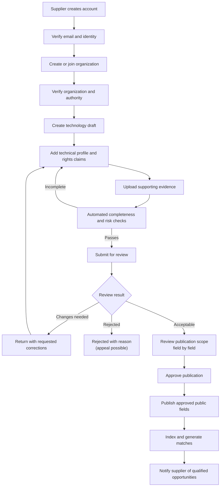

**Detailed steps**

| # | Actor | Action | System behaviour / output |
| --- | --- | --- | --- |
| 1 | Supplier | Creates an account and accepts the platform terms | Account in `pending` status; terms version recorded |
| 2 | Supplier | Creates an organization profile or requests membership of an existing one | Duplicate check on registration number; membership request routed to that organization's admin |
| 3 | Verification officer | Verifies identity, organizational existence and the user's authority to act | Verification case with evidence and expiry date |
| 4 | Supplier | Creates a draft: technology type, applications, maturity, intended transaction model | Draft saved automatically; version 1 created |
| 5 | System | Requests the relevant IP records, technical evidence and rights declarations for the technology type | Checklist generated per technology type |
| 6 | System | Runs automated checks: missing fields, inconsistent claims, unsupported TRL claims, potentially sensitive documents, duplicates | Completeness report shown next to each field |
| 7 | Supplier | Submits the record to the review queue | Version frozen; review case created **once**, even if the request is retried |
| 8 | Reviewer | Evaluates completeness, evidence quality, publication permissions and restrictions | Checklist completed; conflict-of-interest declaration recorded |
| 9 | Reviewer | Approves, rejects or requests corrections | Decision with reason and evidence; supplier notified |
| 10 | System | Generates a versioned publication snapshot containing **only approved fields** | Immutable snapshot ID |
| 11 | System | Indexes the snapshot; matching engine evaluates open demands | Index status recorded; retries and alerts on failure |
| 12 | Supplier | Updates the record later | Material changes create a new version that needs review; the old snapshot stays live until approval |

**Publication states**

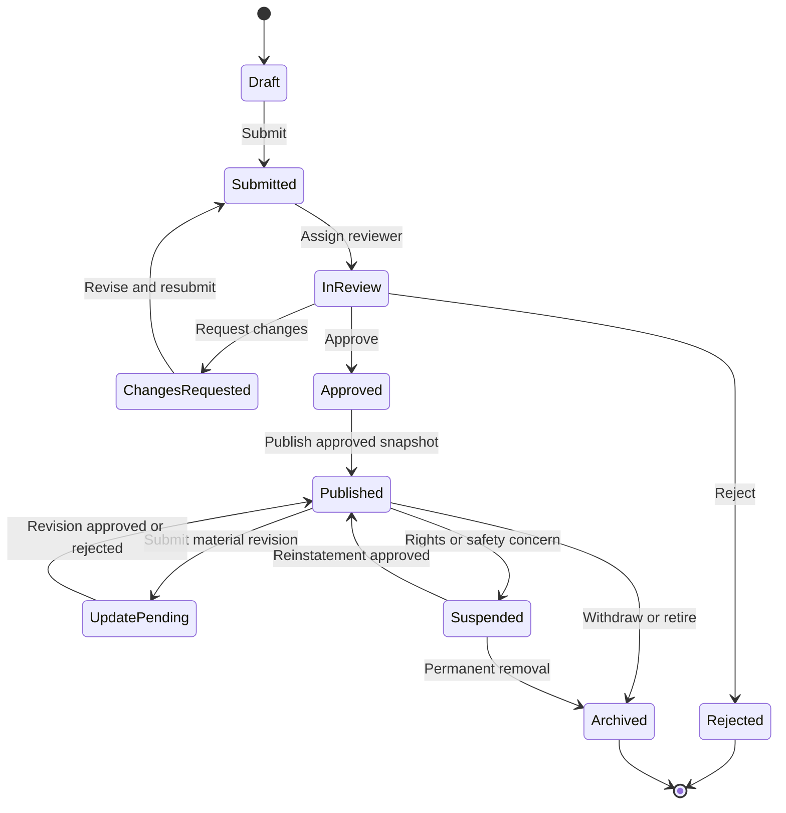

A published technology can be **suspended without deleting its history**, for example because of an ownership dispute, an expired offer, a changed patent status or a security concern.

> **Critical detail:** *publication state* and *rights-verification state* are separate. A listing may be publishable as an "unverified opportunity" while only some of its claims are independently verified. The UI must make that distinction obvious.

**Exceptions**

| Exception | Handling |
| --- | --- |
| Supplier lacks authority (e.g. a researcher at a university) | Route to the TTO or an organization admin for authorization; the listing cannot be submitted until approved |
| Duplicate technology detected | Reviewer links or merges the records, or rejects the duplicate with a reason |
| Confidential content found in public fields | Reviewer restricts the field or attachment; supplier is notified |
| Patent lapsed or disputed after publication | Automatic suspension flag, review case, supplier notified |
| Indexing fails | Retry with backoff, then alert operations; never shown as "searchable" until indexed |

### 7.2 Workflow B: corporate technology demand

| Item | Definition |
| --- | --- |
| Objective | Turn a vague industrial problem into a structured requirement that can be matched, evaluated and fulfilled |
| Actors | Buyer (R&D manager / demand manager), technology manager, demand reviewer, system |
| Trigger | Buyer clicks "Post a Technology Need", or a scouting engagement creates the demand |
| Output | An approved, versioned demand with hard constraints and preferences, ready for matching |

Example: a manufacturer needs a faster, more reliable inspection process. The demand wizard asks about:

| Topic | Questions | Typically mandatory? |
| --- | --- | --- |
| Problem | What is the problem? What is the current process? | Yes |
| Performance | Required performance and acceptable trade-offs | Yes (at least one measurable target) |
| Approach | Acceptable or excluded technical approaches | No |
| Maturity | Minimum TRL and deployment maturity | Yes |
| Constraints | Integration, manufacturing and regulatory constraints | No |
| Rights | Target geography and rights requirements (exclusive? territory?) | Yes |
| Budget | Indicative budget and procurement authority | No (can be private) |
| Timing | Desired delivery timeline | No |
| Route | License, acquisition, development partnership, supplier engagement or investment | Yes |

The system separates **minimum matching requirements** from **optional refinements**, and **hard constraints** ("TRL 7 is mandatory") from **preferences** ("TRL 5 is acceptable with a funded development plan").

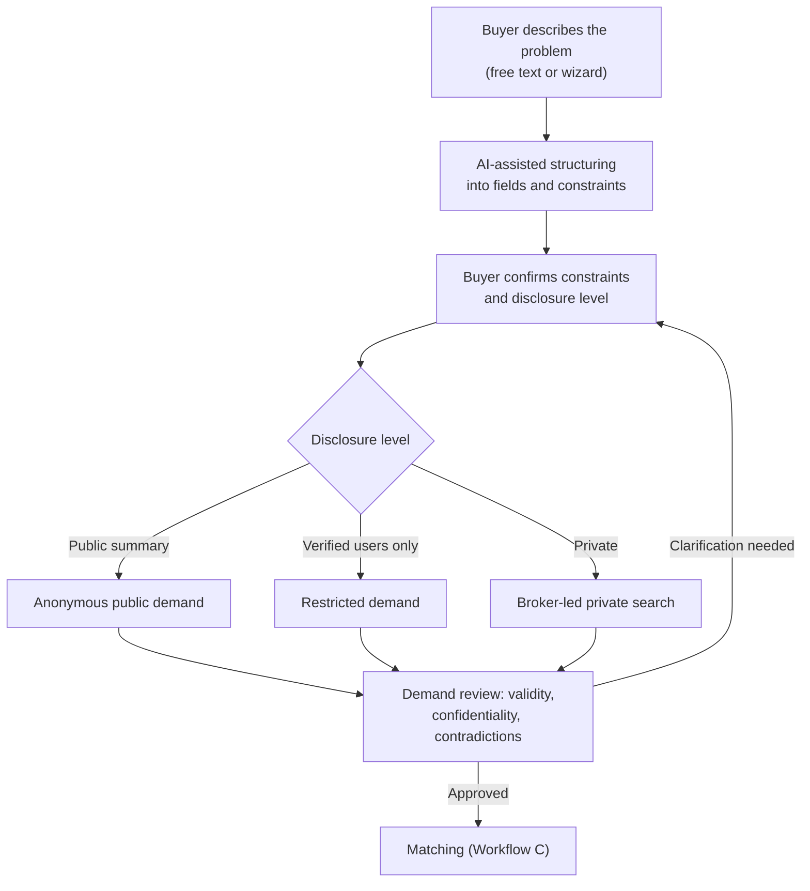

**Demand lifecycle**

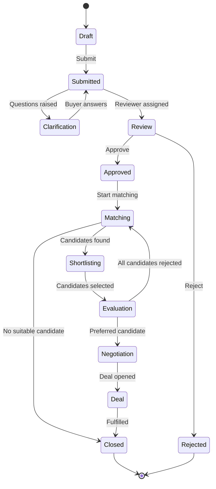

Every closure records a **reason**: fulfilled, withdrawn, expired, no suitable technology, budget unavailable, or transferred to an external procurement process.

> **Important rule:** do not force every demand into a technology purchase. A demand may be best fulfilled by a new research collaboration, a custom development contract, a group of complementary technologies, a consulting engagement, a pilot or proof of concept, or an investment or joint venture. The domain model must support those routes **without inventing a fake technology listing**.

### 7.3 Workflow C: matching and recommendation

Use a **staged pipeline**:

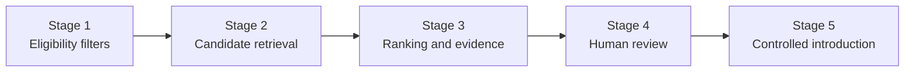

| Stage | What happens | Output |
| --- | --- | --- |
| 1. Eligibility filters | Rights availability, geography, required TRL, prohibited sectors, budget range, mandatory technical constraints | Eligible offers only |
| 2. Candidate retrieval | Structured filters, keyword search, multilingual search, semantic retrieval, taxonomy relationships | Candidate list |
| 3. Ranking and evidence | Technical fit, maturity, deployment constraints, rights compatibility, evidence quality, commercial terms | Ranked list with explanations |
| 4. Human review | A broker or specialist reviews top candidates, rejects false positives and identifies missing information | Approved shortlist |
| 5. Controlled introduction | The system asks for approval before disclosing confidential details or introducing the parties | Introduction request (Workflow D) |

**Initial scoring model**

```text
S = 0.35·T + 0.20·M + 0.15·C + 0.15·R + 0.10·E + 0.05·G
```

| Symbol | Component (each normalized 0–100) | Initial weight |
| --- | --- | ---: |
| T | Technical fit | 0.35 |
| M | Maturity and readiness | 0.20 |
| C | Commercial fit | 0.15 |
| R | Rights and transaction compatibility | 0.15 |
| E | Evidence quality | 0.10 |
| G | Geographic and deployment compatibility | 0.05 |

Rules:

- The weights are **starting assumptions, not validated data**. Make them configurable and sector-specific, and test them against expert judgments and completed deals.
- **Hard constraints are filters, not score components.** A technology lacking a legally necessary right is ineligible however high its technical score.
- Show **why** a technology was recommended, which evidence supports it and which gaps remain.
- Never present a match score as a probability of commercial success.
- Keep **commercial prioritization** (for example, paying clients) separate from **technical relevance**, and disclose it.

### 7.4 Workflow D: inquiry, NDA and confidential disclosure

This workflow protects both sides and prevents accidental disclosure.

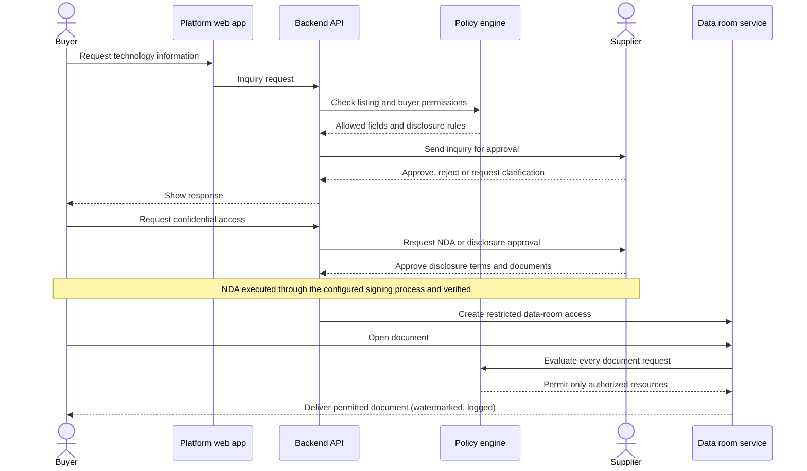

**Access classes**

| Class | Who can see it | Example content |
| --- | --- | --- |
| Public | Anyone | Non-confidential summary, applications, TRL claim |
| Registered user | Logged-in users | More detail, organization profile |
| Verified buyer | Verified organizations | Indicative terms, evidence summaries |
| NDA-covered | Parties to a verified NDA, per document | Test data, drawings, process details |
| Deal-team only | Named deal participants | Contract drafts, source code, know-how packages |

Rules:

- An NDA's status is verified against the actual execution process. It never becomes "active" just because a user clicked "I agree".
- A signed NDA does **not** grant access to every supplier document; each document needs its own grant.
- Access can be revoked, but downloaded information cannot be reliably recalled.
- Log every sensitive document view, download, export and permission change.
- Watermarks, download restrictions, expiry and view-only access reduce exposure but cannot guarantee that information is not copied.

### 7.5 Workflow E: deal negotiation and transaction

A deal has its own state machine and an assigned owner.

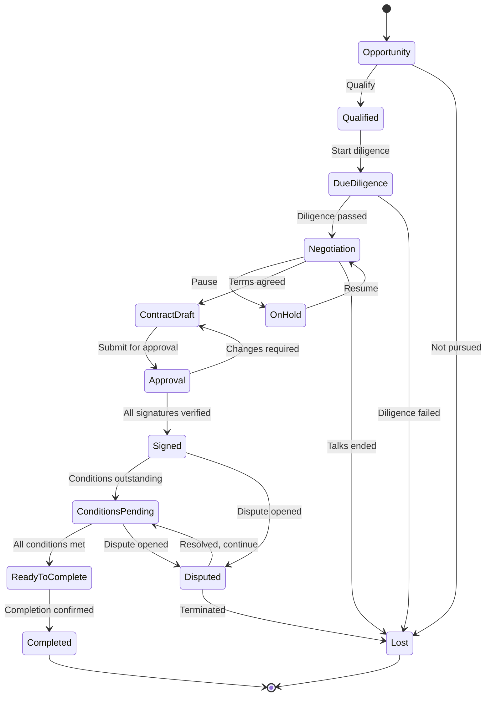

`Completed` needs a precise business definition **for each transaction type**. A signed contract, a paid licence fee, delivery of source code and transfer of legal title are different events:

| Deal type | Completion requires (configurable) |
| --- | --- |
| Licence | Licence effective + required conditions met + initial payment confirmed |
| Assignment | Executed assignment + registration or recordal at the relevant IP office (where required) + consideration paid |
| Development partnership | Contract executed; the deal stays **active** through milestones for months |
| Technical service | Deliverables accepted under the agreed acceptance criteria |
| Investment | Closing conditions satisfied + shares or rights issued |

The platform therefore supports **configurable completion criteria per deal type** (see [07 §7](07-roles-workflows-and-money.md) and [08 §3](08-china-operating-model.md)).

### 7.6 Workflow F: managed technology scouting (service engagement)

| Item | Definition |
| --- | --- |
| Objective | Deliver a paid, structured search for technologies that meet an enterprise client's requirement |
| Actors | Enterprise client, commercial manager, analyst or broker, experts |
| Output | Shortlist with evidence, introductions, optional deal |

| # | Step | Owner | Output |
| --- | --- | --- | --- |
| 1 | Scope, deliverables, deadlines, price and acceptance criteria agreed | Commercial manager + client | Service order |
| 2 | Analyst or broker assigned (after a conflict check) | Operations manager | Assignment |
| 3 | Private demand created from the brief (not published) | Analyst | Private demand |
| 4 | Search, outreach and screening | Analyst + experts | Long list → shortlist, each candidate traceable to evidence |
| 5 | Report delivered to authorized client users only | Analyst | Scouting report |
| 6 | Client accepts the deliverable | Client | Service milestone accepted, invoice issued |
| 7 | Selected candidates move to introduction and deals, without the client re-publishing confidential information | Broker | Introduction requests |

### 7.7 Workflow G: disputes (summary)

Any deal party can open a dispute about delivery, acceptance, IP, confidentiality or payment. The dispute workflow records the issue, the remedy sought and the evidence, notifies the other party with a response deadline, and applies the contract's and payment provider's rules. Disputed deals cannot be completed through the normal path. The full dispute and funds-hold design is in [08 §8](08-china-operating-model.md).

---

## 8. Core sequence diagrams

These diagrams show how the system components cooperate internally, not just what the user sees.

### 8.1 Publish a technology

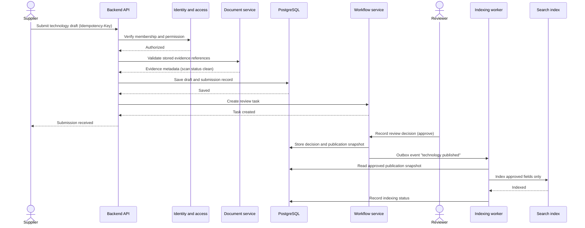

Implementation requirements:

- Submission is **idempotent**, so a retried request never creates a duplicate review case.
- Review decisions include reviewer, timestamp, decision, reason and evidence.
- Only approved publication fields are indexed for public search.
- Indexing failures retry and eventually alert operations. They never silently mark a listing as searchable.
- Document uploads use short-lived authorized upload URLs, malware scanning and file-type validation.

### 8.2 Generate and deliver matches

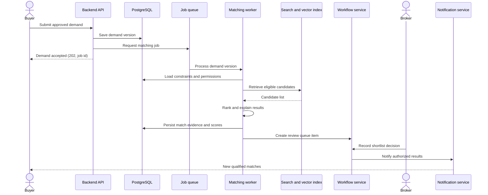

Match records store the **versions** of the demand and technology used for scoring. Otherwise it is impossible to explain why a recommendation appeared six months ago.

### 8.3 Execute a deal safely

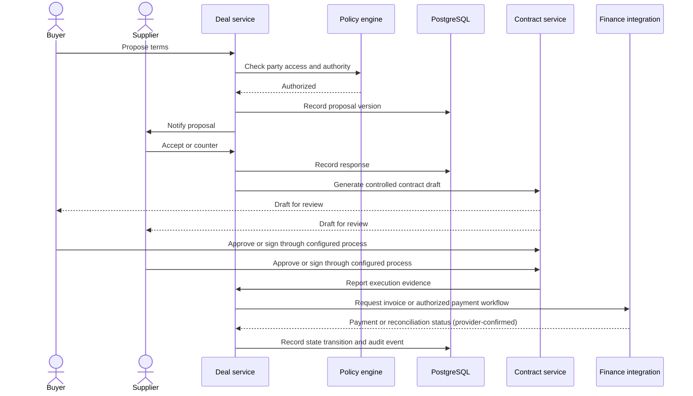

The contract service keeps the **exact document version and execution evidence**. The finance integration reports **authoritative** payment status; an operator can never mark an unverified payment as successful.

---

## 9. Administrator and operations workflows

Many marketplace designs are incomplete here. A platform with a polished website still fails if no one owns verification queues, transaction exceptions, disputes or supplier quality.

### 9.1 Operations control center

The administrator home page is an actionable workbench. Example widgets (not live data):

| Widget | Shows | Typical actions |
| --- | --- | --- |
| Organization verification | Pending applications, authority checks, escalations | Claim, request documents, approve, reject |
| Technology review | New listings, corrections, evidence reviews | Claim, review checklist, approve scope |
| Deal operations | At-risk deals: overdue diligence, stalled negotiations, outstanding conditions | Reassign, escalate, contact parties |
| Finance exceptions | Failed payments, refunds, invoice issues, reconciliation gaps | Investigate, reconcile, approve refund |

Each item shows its **age, owner, next action and deadline**. A count without ageing and ownership is not enough.

### 9.2 Organization verification

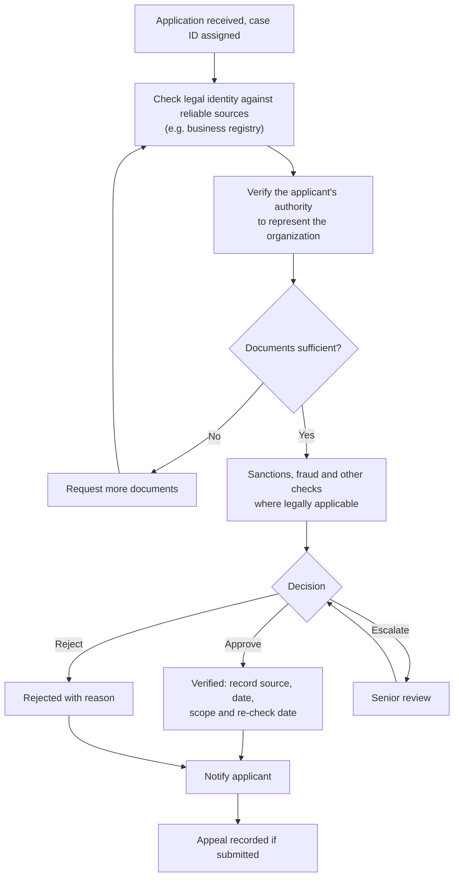

Organization verification does **not** prove ownership of every technology the organization uploads. Technology rights are assessed separately.

### 9.3 Technology review checklist

| Check | Example evidence |
| --- | --- |
| Completeness | Required technical fields populated |
| Ownership / authority | Assignment, inventor declaration, institutional authorization |
| IP claims | Patent register data and relevant documents |
| Technical claims | Publications, test reports, specifications |
| Maturity | Prototype and validation evidence |
| Publication safety | Confidentiality and third-party information review |
| Offer authority | Permission to license, assign or negotiate |
| Duplication | Existing technology record or competing submissions |
| Restricted content | Export controls, sanctions or other restrictions |

Reviewers can approve the public profile while restricting confidential attachments. They do **not** have to approve or reject a technology as one indivisible object.

### 9.4 Matching operations

AI-generated matches need quality control:

- Review low-confidence or high-value candidates.
- Detect false positives caused by misleading terminology.
- Identify demands with no viable candidates and assign experts for manual scouting.
- Record why each candidate was rejected.
- Collect buyer feedback and eventual deal outcomes.
- Compare predicted relevance with human judgments and tune weights against real results.

Never let a high-value paying client silently influence technical rankings.

### 9.5 Transaction operations

The transaction operations team monitors contracts awaiting approval, outstanding signatures and conditions, invoice and payment status, reconciliation discrepancies, rights-transfer evidence and delivery obligations, failed integrations, refunds and cancellations, and disputes, holds and legal restrictions.

There is **no "Force Complete" button**. Exceptional actions require a specific permission, a reason, supporting evidence and an audit record. High-risk transitions require **dual approval**.

### 9.6 Admin state-transition matrix

| Action | Normal owner | Required controls |
| --- | --- | --- |
| Approve organization | Verification officer | Evidence and review record |
| Approve technology publication | Technology reviewer | Checklist and publication scope |
| Change IP verification status | Authorized specialist | Evidence, scope and review date |
| Assign broker | Operations manager | Conflict-of-interest check |
| Change deal stage | Deal owner / authorized operator | Preconditions and audit event |
| Mark payment reconciled | Finance officer / system integration | Bank or provider evidence |
| Approve refund | Finance role | Original payment reference and policy |
| Resolve dispute | Authorized dispute officer | Evidence, rationale and required approvals |
| Change global permission policy | Platform security administrator | Change review and audit trail |

---

## 10. User stories and acceptance criteria

These are production-oriented examples. Each becomes a ticket with tests, design references, API contracts and measurable acceptance criteria.

### Epic A — Identity and organizations

**US-001 Register an account.** *As a prospective participant, I want to register and verify my email so that I can access the platform.*

- [ ] Protected functions are unavailable until the required verification is complete.
- [ ] Repeated registration requests do not create duplicate accounts.
- [ ] Rate limits and abuse detection protect authentication endpoints.
- [ ] The user can recover access through a controlled process.
- [ ] Authentication events are logged without storing plaintext passwords or secrets.

**US-002 Create an organization.** *As a company representative, I want to create an organization profile so that I can manage technologies or demands on behalf of my company.*

- [ ] Organization type, jurisdiction, legal name and relevant identifiers are captured.
- [ ] Duplicate organizations are flagged for review.
- [ ] The creator receives only the initial permissions granted by account policy.
- [ ] Verification status is displayed accurately.
- [ ] Membership can be revoked without deleting historical activity.

**US-003 Invite a colleague.** *As an organization administrator, I want to invite colleagues with specific roles.*

- [ ] Invitations expire and cannot be reused after acceptance.
- [ ] Invitees must authenticate and accept the invitation.
- [ ] Admins cannot grant permissions beyond their own delegated authority.
- [ ] Membership changes invalidate affected sessions or permissions.

### Epic B — Technology registration

**US-010 Create a technology.** *As a technology owner, I want to create a draft with technical, commercial and IP information.*

- [ ] An incomplete draft can be saved.
- [ ] Mandatory fields vary by technology type.
- [ ] Uploaded files stay private until access is explicitly authorized.
- [ ] Every submitted version has a stable identifier.
- [ ] Material change history is preserved.

**US-011 Submit for publication.** *As an authorized supplier, I want to submit a technology for review.*

- [ ] The submission captures the exact version reviewed.
- [ ] A review case is created once, even if the client retries.
- [ ] The supplier can see review status and requested corrections.
- [ ] Reviewers can approve only fields within their permission scope.
- [ ] Only approved fields become publicly searchable.

### Epic C — Demand and matching

**US-020 Create a demand.** *As an R&D manager, I want to define a technical challenge with measurable requirements.*

- [ ] Hard constraints are distinguished from preferences.
- [ ] Budget, target dates and geography can be private.
- [ ] The demand can be saved as a draft and reviewed before publication.
- [ ] Invalid or contradictory hard constraints are rejected or trigger clarification.
- [ ] Edits create a new version and trigger re-matching where relevant.

**US-021 Review recommendations.** *As a buyer, I want to see matching technologies and understand why they were recommended.*

- [ ] Each recommendation includes an explanation and relevant evidence.
- [ ] Disqualifying constraints are visible.
- [ ] Results respect access permissions and publication restrictions.
- [ ] The buyer can shortlist, reject or request an introduction.
- [ ] Rejection reasons are captured as structured feedback.

### Epic D — Confidentiality and deal management

**US-030 Request confidential information.** *As a buyer, I want to request access to restricted technical information.*

- [ ] The supplier controls disclosure approval unless an explicit prior authorization applies.
- [ ] The applicable confidentiality agreement and its status are recorded.
- [ ] Access is checked on every document request.
- [ ] Access expires or is revoked according to policy.
- [ ] Confidential files are excluded from search indexing.

**US-031 Open a deal.** *As a buyer or authorized broker, I want to create a deal from a qualified opportunity.*

- [ ] The deal references the relevant technology and/or demand.
- [ ] Parties and authorized representatives are identified.
- [ ] The initial stage and assigned owner are recorded.
- [ ] Each party receives only the access it is entitled to.
- [ ] Prohibited transitions are blocked.

**US-032 Complete a transfer.** *As the parties to a deal, we want to record the executed agreement and completion conditions.*

- [ ] The executed contract version is immutable in the audit record.
- [ ] Required approvals and signatures are verified.
- [ ] Completion conditions are checked for the deal type.
- [ ] Payment status comes from authorized evidence or an integration.
- [ ] Disputed or suspended deals cannot complete through the normal path.

### Epic E — Administration

**US-040 Process a review queue.** *As a review officer, I want to claim, assess and resolve assigned cases.*

- [ ] Cases have an owner, priority, due date and history.
- [ ] Decisions require a reason and the applicable checklist.
- [ ] Conflicts of interest can be declared and trigger reassignment.
- [ ] Overdue cases can be escalated.
- [ ] Review metrics can be calculated from recorded timestamps.

**US-041 Reconcile transactions.** *As a finance officer, I want to reconcile invoices, payment-provider records and platform transaction records.*

- [ ] Each payment maps to an internal transaction reference.
- [ ] Duplicate provider events do not create duplicate accounting entries.
- [ ] Amount, currency and status discrepancies are flagged.
- [ ] Refunds reference their original transactions.
- [ ] Adjustments require authorization and a recorded reason.

### Epic F — Commercial services

**US-050 Purchase a technology scouting service.** *As an enterprise client, I want to commission a structured search for technologies that meet a business requirement.*

- [ ] The service defines scope, deliverables, deadlines, price and acceptance criteria.
- [ ] An authorized analyst or broker is assigned.
- [ ] Candidates are traceable to evidence and search criteria.
- [ ] Deliverables are visible only to authorized client users.
- [ ] The service can lead to a deal without re-publishing confidential information.

These epics are an initial backlog, not a substitute for acceptance tests covering every state transition, permission boundary, integration failure and exception path.

---

## 11. Database and data architecture

Start with PostgreSQL and a normalized transactional schema. Add dedicated search and analytics systems as needed.

### 11.1 Core database conventions

Every major business table should have:

- A stable primary key (UUID).
- `created_at` and `updated_at`.
- An organization or tenant ownership field where applicable.
- An explicit, constrained status.
- A version number or immutable revision record where history matters.
- Foreign keys and uniqueness constraints.
- Indexes for common access patterns.
- Audit events for sensitive transitions.

Use relational columns for core relationships, state, rights, money and permissions. Use JSONB only for flexible technical attributes, extraction metadata and rarely queried extensions.

### 11.2 Illustrative schema

A design excerpt, not a complete deployable schema (the full baseline is in [06 §4](06-implementation-design-v1.md)):

```sql
CREATE TABLE organizations (
    id                  UUID PRIMARY KEY,
    legal_name          TEXT NOT NULL,
    organization_type   TEXT NOT NULL,
    jurisdiction_code   TEXT NOT NULL,
    verification_status TEXT NOT NULL DEFAULT 'pending',
    created_at          TIMESTAMPTZ NOT NULL DEFAULT now(),
    updated_at          TIMESTAMPTZ NOT NULL DEFAULT now()
);

CREATE TABLE organization_memberships (
    organization_id UUID NOT NULL REFERENCES organizations(id),
    user_id         UUID NOT NULL,
    role_code       TEXT NOT NULL,
    status          TEXT NOT NULL DEFAULT 'invited',
    created_at      TIMESTAMPTZ NOT NULL DEFAULT now(),
    PRIMARY KEY (organization_id, user_id, role_code)
);

CREATE TABLE technologies (
    id                    UUID PRIMARY KEY,
    owner_organization_id UUID NOT NULL REFERENCES organizations(id),
    created_by            UUID NOT NULL,
    technology_type       TEXT NOT NULL,
    lifecycle_status      TEXT NOT NULL DEFAULT 'draft',
    current_version       INTEGER NOT NULL DEFAULT 1,
    created_at            TIMESTAMPTZ NOT NULL DEFAULT now(),
    updated_at            TIMESTAMPTZ NOT NULL DEFAULT now()
);

CREATE TABLE technology_versions (
    technology_id        UUID NOT NULL REFERENCES technologies(id),
    version              INTEGER NOT NULL,
    title                TEXT NOT NULL,
    public_summary       TEXT,
    technical_attributes JSONB NOT NULL DEFAULT '{}',
    claimed_trl          SMALLINT,
    rights_status        TEXT NOT NULL DEFAULT 'unverified',
    publication_status   TEXT NOT NULL DEFAULT 'draft',
    created_by           UUID NOT NULL,
    created_at           TIMESTAMPTZ NOT NULL DEFAULT now(),
    PRIMARY KEY (technology_id, version),
    CHECK (claimed_trl IS NULL OR claimed_trl BETWEEN 1 AND 9)
);

CREATE TABLE demands (
    id                    UUID PRIMARY KEY,
    buyer_organization_id UUID NOT NULL REFERENCES organizations(id),
    status                TEXT NOT NULL DEFAULT 'draft',
    current_version       INTEGER NOT NULL DEFAULT 1,
    created_by            UUID NOT NULL,
    created_at            TIMESTAMPTZ NOT NULL DEFAULT now(),
    updated_at            TIMESTAMPTZ NOT NULL DEFAULT now()
);

CREATE TABLE deals (
    id                  UUID PRIMARY KEY,
    status              TEXT NOT NULL DEFAULT 'opportunity',
    deal_type           TEXT NOT NULL,
    currency_code       CHAR(3),
    assigned_manager_id UUID,
    created_at          TIMESTAMPTZ NOT NULL DEFAULT now(),
    updated_at          TIMESTAMPTZ NOT NULL DEFAULT now()
);

CREATE TABLE audit_events (
    id              UUID PRIMARY KEY,
    actor_user_id   UUID,
    organization_id UUID REFERENCES organizations(id),
    action          TEXT NOT NULL,
    resource_type   TEXT NOT NULL,
    resource_id     UUID NOT NULL,
    correlation_id  UUID,
    details         JSONB NOT NULL DEFAULT '{}',
    occurred_at     TIMESTAMPTZ NOT NULL DEFAULT now()
);
```

**Intentionally missing.** A production schema also needs tables for: users and authentication identities; technology offers and IP assets; versioned demands and matching results; verification cases, evidence and decisions; deal parties, negotiations and communications; NDAs, data rooms and document permissions; contract versions, signatures and completion conditions; invoices, payments, refunds and reconciliation; service engagements and milestones; subscription entitlements and billing; notifications, workflow tasks and idempotency keys; disputes, legal holds and retention requirements.

Use **database migrations from the beginning**. Never change a production schema manually without a reproducible migration and a rollback or recovery plan.

### 11.3 Multi-tenant isolation

When many organizations share the platform, tenant isolation is a first-class security requirement:

1. Every tenant-owned resource has an explicit ownership or access relationship.
2. Backend queries enforce that relationship.
3. PostgreSQL **Row-Level Security (RLS)** adds a second layer of protection.
4. Privileged administrative access is separate from normal user access.
5. Background jobs carry and validate their tenant and resource scope.
6. Search results, caches, exports and document URLs obey the same access policy.

RLS is **defence in depth**, not a replacement for application authorization. Run the application with a restricted database role and tightly control any table-owner access that could bypass RLS.

### 11.4 Search architecture

Keep transactional data and search representations separate:

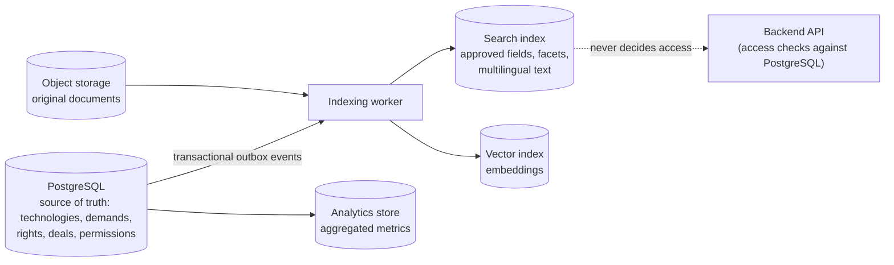

- The search index is a **derived** representation. It never decides whether a user may access a confidential document.
- When a technology is suspended or its visibility changes, the change must reach every index and cache. Use a **transactional outbox** (or an equivalent reliable mechanism) so updates are not lost when indexing fails.

### 11.5 Document lifecycle

Technical documents can be the most valuable assets on the platform, so their lifecycle is explicit:

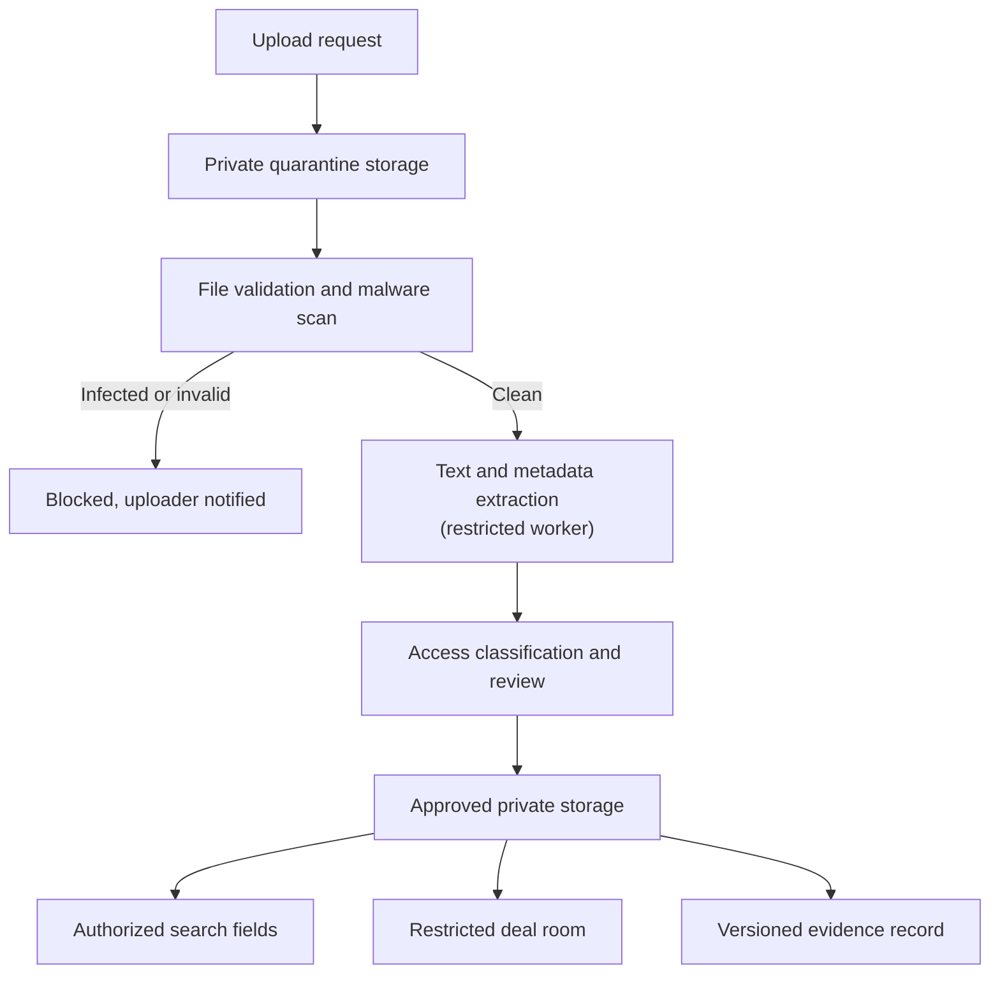

The extraction pipeline **never publishes document text automatically**. It must also handle embedded metadata, hidden spreadsheet content, tracked revisions and other unintended disclosures.

---

## 12. Backend modules and API contracts

The backend exposes **business operations**. It never lets the frontend edit state fields arbitrarily.

### 12.1 Module boundaries

| Module | Owns |
| --- | --- |
| Identity and access | Users, sessions, memberships, policies |
| Organization management | Organization profiles and verification |
| Technology registry | Technology identity and revisions |
| Offer management | Rights available, commercial terms and territories |
| Demand management | Requirements, demand versions and approvals |
| Discovery | Search, filters, facets and result explanations |
| Matching | Candidate retrieval, scores, feedback and match versions |
| Verification | Review cases, evidence and decisions |
| Workflow | Tasks, state transitions, deadlines and escalations |
| Deal management | Deal parties, stages, negotiations and milestones |
| Contract management | Document versions, approvals and execution evidence |
| Transaction management | Completion criteria and transaction records |
| Finance | Invoices, provider events, refunds and reconciliation |
| Services | Scouting, evaluation, experts and service engagements |
| Notifications | Email, in-app notifications and delivery status |
| Reporting | Operational, marketplace and commercial analytics |

These can start as Python packages inside one deployable backend.

### 12.2 Example REST API

| Method | Endpoint | Purpose |
| --- | --- | --- |
| `POST` | `/v1/technologies` | Create technology draft |
| `PATCH` | `/v1/technologies/{id}` | Update draft metadata |
| `POST` | `/v1/technologies/{id}/submissions` | Submit a version for review |
| `GET` | `/v1/technologies/{id}` | Read technology with access controls |
| `POST` | `/v1/technologies/{id}/offers` | Create licensing or transfer offer |
| `POST` | `/v1/demands` | Create demand |
| `POST` | `/v1/demands/{id}/submissions` | Submit demand for review |
| `GET` | `/v1/demands/{id}/matches` | Retrieve authorized recommendations |
| `POST` | `/v1/matches/{id}/shortlists` | Shortlist a candidate |
| `POST` | `/v1/matches/{id}/introduction-requests` | Request supplier introduction |
| `POST` | `/v1/deals` | Create deal |
| `POST` | `/v1/deals/{id}/proposals` | Submit proposal |
| `POST` | `/v1/deals/{id}/transition` | Request an allowed state transition |
| `POST` | `/v1/deals/{id}/documents` | Register an authorized deal document |
| `POST` | `/v1/deals/{id}/completion-checks` | Evaluate completion prerequisites |
| `GET` | `/v1/admin/review-queues` | Retrieve authorized review tasks |

For privileged operations, use explicit endpoints such as `POST /v1/admin/verification-cases/{id}/decisions`. Never let clients set `verification_status` through a general-purpose update endpoint. The full endpoint catalogue for the first release is in [06 §5](06-implementation-design-v1.md).

### 12.3 API implementation rules

- Validate inputs at the API boundary **and** again at critical domain transitions.
- Require an **idempotency key** for retriable requests, especially deal creation, payment initiation, refunds and external callbacks.
- Apply authorization to every resource access.
- Return structured error codes and safe messages.
- Use pagination, filtering and deterministic sorting.
- Rate-limit authentication, search and expensive AI operations.
- Use **optimistic concurrency control** when several users may edit the same record.
- Version APIs and document their contracts.
- Never trust frontend-supplied prices, fees, organization roles or completion status.
- Publish domain events **only after** the business change has committed.

---

## 13. Workflow engine and state transitions

Do not scatter business rules as conditions across controllers. Each workflow is a **state machine with explicit transition rules**.

```python
def transition_deal(deal, command, actor, policy):
    current_state = deal.status

    # Verify actor, resource access and assigned responsibility.
    policy.require_permission(
        actor=actor,
        resource=deal,
        action=command.action,
    )

    # Resolve the transition from a controlled transition table.
    transition = TRANSITION_TABLE.get((current_state, command.action))
    if transition is None:
        raise InvalidTransition(
            f"Action {command.action!r} is not allowed from {current_state!r}"
        )

    # Enforce domain-specific prerequisites (evidence, approvals, holds).
    transition.validate(deal, command)

    # Update state and append the transition record
    # within one database transaction; queue events via the outbox.
    return transition.execute(deal, command, actor)
```

*Illustrative pseudocode, not production code.*

An excerpt from the transition table:

| From | Action | To | Allowed actors | Preconditions |
| --- | --- | --- | --- | --- |
| `opportunity` | `qualify` | `qualified` | Deal owner, broker | Both parties identified |
| `qualified` | `start_diligence` | `due_diligence` | Deal owner | NDA verified, if confidential data is needed |
| `negotiation` | `agree_terms` | `contract_draft` | Each party's authorized representative | All parties accepted the **same** proposal version |
| `approval` | `record_signatures` | `signed` | Contract service | Verified signatures from all required signatories |
| `conditions_pending` | `confirm_conditions` | `ready_to_complete` | Deal owner | Every completion condition satisfied with evidence |
| any active | `open_dispute` | `disputed` | Any deal party | Issue, remedy sought and evidence provided |

### Required workflow capabilities

- Allowed transitions and their prerequisites.
- Role- and attribute-based authorization.
- Task assignment and reassignment.
- Deadlines, reminders and escalation.
- Approval chains and dual control.
- Idempotent commands.
- Immutable transition history.
- Retryable external actions.
- Timeout and exception handling.
- Versioned workflow definitions, so old cases continue under their original rules.

State machines implemented in the application and persisted in PostgreSQL are enough for the first release. Consider a dedicated engine such as **Temporal** when workflows become long-running, distributed, timer-heavy and dependent on reliable retries across many systems.

---

## 14. Revenue, pricing and financial architecture

Build the commercial model into the domain design from the start, even if the first release has only two or three paid services.

### 14.1 Revenue streams

| Stream | Description |
| --- | --- |
| A. Enterprise subscriptions | Private scouting, advanced search, multiple users, team workflows, analytics, saved demands, API access |
| B. Transaction services | Fixed transaction charges, negotiated service fees, or success fees where legally permissible and contractually agreed |
| C. Managed technology scouting | Paid programmes to find, shortlist, evaluate and introduce technologies |
| D. Professional services | Due diligence, evaluation, valuation, IP review, pilot coordination, technical consulting, commercialization support |
| E. Institutional and network services | University or regional innovation programmes, sponsored scouting, TTO tools, contracted platform operation (for example innovation vouchers, see [03 §4](03-business-models-and-revenue.md)) |

### 14.2 Transaction value is not revenue

The finance model distinguishes:

- Gross contract value.
- Platform fee earned.
- Professional-service revenue.
- Third-party service costs.
- Amounts collected on behalf of another party.
- Refunds and reversals.
- Taxes.
- Recognized and deferred revenue.
- Outstanding receivables and payables.

If a licence is worth €1,000,000 and the platform earns a €20,000 service fee, platform revenue is €20,000. Money held or transmitted on behalf of parties is **not** platform revenue, and depending on the legal structure it may require licensed payment providers and specific accounting treatment.

### 14.3 First-year commercial design

Test offerings instead of imposing one commission model:

| Offering | Initial monetization |
| --- | --- |
| Basic supplier profile | Free |
| Basic technology publication | Free, subject to review rules |
| Basic demand publication | Free or a limited free tier |
| Enterprise discovery workspace | Annual or monthly subscription |
| Managed scouting project | Fixed project fee |
| Technical evaluation | Fixed fee or scoped statement of work |
| Due diligence | Fixed fee or staged engagement |
| Transaction coordination | Contractually agreed fee |
| API and bulk data access | Enterprise licence |

Do not charge for every action before there is enough supply and demand. Tie monetization to **measurable value**, especially for enterprise buyers.

### 14.4 Finance implementation

Use a separate finance domain with:

- Immutable invoice and payment references.
- Defined currency and decimal precision.
- A ledger or accounting integration suited to the business.
- Explicit transaction fees and versioned fee-calculation rules.
- Reconciliation against authoritative provider or bank records.
- Refund, reversal and dispute workflows.
- Separation of revenue, receivables, payables and third-party funds.
- Audit trails for all financial adjustments.

Never use floating-point numbers for money: use fixed-precision decimals or integer minor units with explicit currency. Do **not** build an internal wallet or escrow service before resolving the legal and licensing requirements (see [07 §6](07-roles-workflows-and-money.md) and [08 §6](08-china-operating-model.md)).

---

## 15. AI and technology-intelligence architecture

AI enhances the workflow. It is not an isolated chatbot without authority over business records.

### 15.1 AI capabilities

| Capability | Input | Output | Human control |
| --- | --- | --- | --- |
| Document extraction | Approved documents | Candidate metadata and extracted facts | Review before publication |
| Technology classification | Technology description | Taxonomy suggestions | Supplier or reviewer confirms |
| Demand structuring | Natural-language business problem | Structured demand fields | Buyer confirms constraints |
| Semantic matching | Approved demand and technology content | Candidate rankings and explanations | Broker reviews important matches |
| Due-diligence assistance | Authorized evidence | Questions, inconsistencies and risk flags | Qualified specialist decides |
| Translation | Approved content | Multilingual draft | Review of sensitive material |
| Deal assistance | Authorized deal documents | Summaries and action lists | Authorized party approves actions |
| Market intelligence | Licensed and authorized datasets | Trends and comparable evidence | Analyst validates methodology |

### 15.2 Recommended AI pipeline

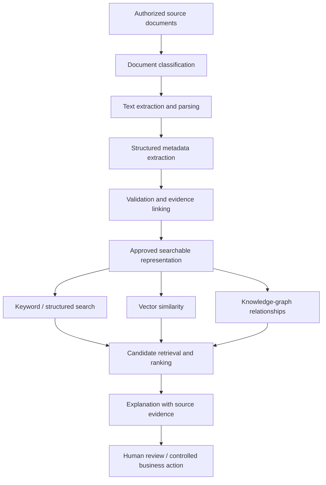

Every AI-generated fact keeps its **provenance**: source document, page or passage, extraction time, model or pipeline version, and review status.

### 15.3 AI safety and reliability requirements

- Never send confidential documents to an external AI provider without an approved data-processing and confidentiality arrangement (and, in China, a data-export assessment, see [08 §1](08-china-operating-model.md)).
- Enforce tenant and deal permissions **before** retrieving content for a model's context.
- Treat document text as untrusted data, never as instructions to the AI system (prompt-injection defence).
- Prevent retrieval from leaking confidential records across organizations.
- Store model-generated claims separately from verified facts.
- Measure retrieval precision, ranking quality and hallucination rates with evaluation datasets.
- Audit AI-assisted decisions that materially affect access, review or deal workflows.
- Keep human approval for ownership, legal status, technical certification and financial actions.

### 15.4 Do you need a graph database?

Not at the beginning. Start with relational entities and explicit relationship tables. Add graph traversal or a dedicated graph database only when real workloads need complex multi-hop queries that are otherwise hard to run efficiently. The technology graph in [04 §7](04-product-strategy.md) can be a logical model long before it becomes a separate database.

---

## 16. Security, privacy, legal and trust

A technology-transfer platform handles patent strategies, confidential research, trade secrets, source code, unpublished data, contract negotiations and cross-border transactions. Security is part of the initial architecture.

### 16.1 Security controls

- Strong authentication; MFA for privileged users and enterprise controls (SSO) where needed.
- RBAC/ABAC authorization with resource-level checks.
- Encryption in transit and at rest.
- Managed secrets and key rotation.
- Private object storage and short-lived access URLs.
- Malware scanning and controlled document processing.
- Rate limiting, abuse prevention and account protection.
- Append-only audit records and monitoring of privileged actions.
- Backups, tested recovery and incident response.
- Dependency scanning, patch management and secure releases.
- Separate production, test and development environments.
- Data minimization and explicit retention policies.

### 16.2 Legal and jurisdictional questions to resolve first

Before enabling real transactions, answer:

1. Which jurisdictions will the platform operate in?
2. Is it an information marketplace, a broker, a contractual intermediary or an officially recognized exchange?
3. What evidence is required to authorize an IP transfer or licence?
4. Who is responsible for legal review and the accuracy of listings?
5. Which electronic-signature rules apply?
6. Which privacy, data-localization, export-control, sanctions and technology-transfer rules apply?
7. Which payment services require regulated providers?
8. How are disputes, refunds, fraud and misrepresentation handled?
9. How are conflicts of interest disclosed?
10. What legal responsibilities apply to professional service providers?

These answers change product scope and data flows. Do not defer them until after the transaction engine is built. For the chosen China launch, see [08](08-china-operating-model.md).

---

## 17. Development roadmap

Build in stages, each with explicit exit criteria. The goal is a useful commercial platform early, without painting the system into an architectural corner.

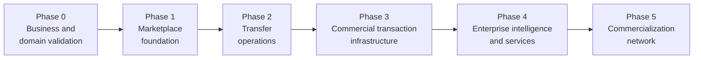

| Phase | Features / deliverables | Exit criteria |
| --- | --- | --- |
| **0 — Business and domain validation** (before development) | Business model and target market · Target jurisdictions and compliance boundaries · Stakeholder interviews and journey maps · Domain glossary and ER model · Workflow state machines · Information architecture and wireframes · Security and confidentiality requirements · Monetization experiments and cost model · PRD | The team can explain how a technology moves from submission to completed transfer, who is responsible at each stage, and what a completed deal is |
| **1 — Marketplace foundation** | Registration and authentication · Organizations, memberships, permissions · Technology registration and versioning · Publication review · Search, filters, detail pages · Demand registration · Basic matching and shortlists · Admin queues and audit logs · Private document storage and notifications | Suppliers publish reviewed technologies, buyers submit demands, and both sides discover and manage opportunities securely |
| **2 — Transfer operations** | Introduction requests · NDA workflow and controlled disclosure · Restricted deal rooms · Broker assignments and expert tasks · Due-diligence cases · Deal pipeline and negotiation records · Contract versions and approvals · Milestones, reminders and exception handling | A qualified opportunity can be managed through diligence and negotiation with a complete history |
| **3 — Commercial transaction infrastructure** | Configurable transaction types · Licensing and assignment workflows · Contract-execution integrations · Invoicing and reconciliation · Fee calculation and revenue reporting · Completion evidence · Disputes, refunds, audit controls · Auction or competitive bidding where legally permitted | The platform records and coordinates a transaction, including financial and contractual conditions, without confusing contract value with platform revenue |
| **4 — Enterprise intelligence and services** | Enterprise subscriptions · Managed scouting · Advanced multilingual search · AI-assisted matching and evidence extraction · Expert marketplace · Evaluation and valuation services · Enterprise reporting and API · CRM and procurement integrations | Repeatable paid services and recurring enterprise usage, not only sporadic transaction fees |
| **5 — Commercialization network** | PoC project management · Pilot milestones and validation evidence · Manufacturing and industrial partners · Financing and investment workflows · Regional and international networks · Post-transfer outcome tracking · Advanced analytics and benchmarking | The platform measures deployment and commercial impact, not just transactions |

### Practical initial scope

Do not attempt all five phases in the first release. The **minimum commercially meaningful product** is:

> Organization management + technology registry + demand management + discovery and matching + verification + confidential introduction + deal pipeline + administration.

Build contracts, finance and commercialization on that foundation as the first real transactions reveal the requirements. The first-release implementation plan is in [06 §13](06-implementation-design-v1.md).

---

## 18. Testing and quality assurance

The platform needs more than unit tests for CRUD endpoints.

| Test layer | What to validate |
| --- | --- |
| Unit tests | Domain rules, pricing, state transitions, permission decisions |
| Integration tests | PostgreSQL, object storage, search, queues and external APIs |
| API contract tests | Request validation, response schemas and error behaviour |
| Authorization tests | Cross-tenant access, role escalation and restricted documents |
| Workflow tests | Valid and invalid transitions, timeouts and recovery |
| Concurrency tests | Two users editing a record, duplicate submissions, simultaneous approvals |
| Security tests | Upload attacks, IDOR, injection, authentication abuse and data leakage |
| AI evaluation | Match relevance, evidence accuracy, multilingual behaviour and false positives |
| Financial tests | Decimal precision, duplicate payments, refunds and reconciliation |
| Recovery tests | Database restore, object recovery, event replay and failed integrations |
| User acceptance tests | Buyer, supplier, broker, expert and administrator scenarios |

### Release blockers (automate these)

1. A buyer from Organization A **cannot** retrieve Organization B's confidential document by guessing its identifier or URL.
2. A failed or repeated payment callback **cannot** create duplicate payment records or accounting effects.
3. A technology suspended for a rights dispute **cannot** stay discoverable through a stale search index or cached recommendation.

---

## 19. Operational dashboards and KPIs

Use separate dashboards for marketplace performance, transfer operations, finance and technology quality.

| Dashboard | Metrics |
| --- | --- |
| **Marketplace** | Verified active suppliers · Active published technologies · Active qualified demands · % of technologies with complete evidence · Search-to-inquiry conversion · Demand-to-qualified-match conversion · % of demands with at least one qualified candidate · Repeat buyer and supplier activity · Category coverage and supply–demand gaps |
| **Transfer** | Time from submission to review · Time from demand approval to first qualified match · Time from introduction to NDA · Time from qualification to contract execution · Time from execution to completion · Deal abandonment by stage and reason · Qualified candidates per demand · Dispute rate and resolution time · Pilot completion and deployment rates |
| **Financial** | Recognized platform revenue · Annual recurring revenue (ARR) · Revenue by subscription, service and transaction fee · Gross margin per stream · Customer acquisition cost (CAC) · Customer lifetime value (LTV) · Renewal and churn · Scouting project margin · Invoice collection time · Reconciliation exceptions and outstanding liabilities |
| **AI quality** | Precision of top-ranked matches · Recall against expert-identified candidates · % of recommendations accepted · Human rejection rate and reasons · Match-to-deal conversion · Unsupported-claim rate in generated summaries · Search latency and document-processing failure rate |

Do not optimize for the number of listings or nominal transaction value. A platform with a million low-quality listings and few qualified matches is worth less than a smaller, well-verified marketplace that consistently produces completed transfers.

---

## 20. Deployment and infrastructure

For the initial release, deploy a small number of clearly separated components:

```mermaid
flowchart TB
    U["Web and enterprise users"] --> EDGE["CDN / WAF / TLS"]
    EDGE --> FE["React frontend"]
    EDGE --> BE["Backend application"]
    FE --> BE
    BE --> PG[("PostgreSQL")]
    BE --> OS[("Private object storage")]
    BE --> RD[("Redis")]
    BE --> Q[["Background job queue"]]
    Q --> WK["Workers"]
    WK --> PG
    WK --> OS
    WK --> SI[("Search / vector index")]
    WK --> AI["AI providers or local models"]
    WK --> EM["Email / notification provider"]
    BE --> INT["Payment / signature integrations"]
    BE -.-> OBS["Logs / metrics / traces"]
    WK -.-> OBS
    PG -.-> BK["Backup and recovery"]
    OS -.-> BK
```

### Deployment rules

- Keep the primary database private.
- Use managed or controlled secrets; never store credentials in source code.
- Back up both database records and the required object-storage content.
- Test recovery; do not rely on "backup job succeeded".
- Use separate development, staging and production environments.
- Run schema migrations through the release process.
- Alert on queue backlog, failed jobs, indexing delays, authentication anomalies and database capacity.
- Document a recovery time objective (RTO) and recovery point objective (RPO).
- Track infrastructure costs per major subsystem.
- Never store confidential documents in public buckets or unprotected application logs.

For an early-stage system, one backend deployment plus separate workers is enough. Search and AI workloads can scale independently later. The self-hosted variant chosen for the first release is in [06 §11](06-implementation-design-v1.md).

---

## 21. Implementation work breakdown

| Workstream | Main deliverables | Depends on |
| --- | --- | --- |
| Product and UX | PRD, journeys, wireframes, design system | Business scope |
| Domain architecture | Entity model, states, permissions, event definitions | Business workflows |
| Platform foundation | Authentication, organizations, API conventions, audit | Domain architecture |
| Technology marketplace | Registration, versions, offers, review and search | Platform foundation |
| Demand and matching | Requirement schema, candidate retrieval, shortlist and feedback | Technology marketplace |
| Transfer operations | NDA, data room, broker tasks, deal management | Identity and documents |
| Contracts and finance | Execution integrations, invoicing, reconciliation | Deal workflows and legal review |
| AI and intelligence | Extraction, semantic search, ranking and evaluation | Approved data and permissions |
| Administration | Queues, escalation, policies, reporting | All business modules |
| DevOps and security | CI/CD, monitoring, backups, incident response, security tests | Platform foundation onward |
| Commercialization | Pilots, milestones, service providers, outcome reporting | Deal and service modules |

Every workstream delivers its own requirements and acceptance criteria, data model and migration, API contract, UI states and error handling, authorization policy, automated tests, and monitoring and operational documentation.

This avoids the common failure where the frontend is mostly finished before the team discovers that the backend cannot represent the real business workflow.

---

## 22. Decision record: platform design profile

Several business decisions change the detailed design. They were settled step by step in the follow-up documents:

| # | Decision | Options considered | Decision taken | Where |
| --- | --- | --- | --- | --- |
| 1 | Initial operating region | Global · China · Europe · one region first | One region first ([06](06-implementation-design-v1.md)), then **China** ([08](08-china-operating-model.md)) | 06 §1, 08 |
| 2 | Primary business model | Formal exchange · transfer and brokerage · hybrid exchange + services + SaaS | **Managed technology exchange** (marketplace + managed transfer) | 06 §1 |
| 3 | Initial users | Suppliers first · buyers first · both | **Both** suppliers and buyers | 06 §1 |
| 4 | Deployment | Cloud · self-hosted · hybrid · on-premises | **Self-hosted** Linux VMs with Docker Compose | 06 §3, §11 |
| 5 | Team size | 1–4 · 5–12 · multiple squads | **1–4 developers** | 06 §13 |
| 6 | Transactions at launch | Managed introductions and deal records · contracts and payments · formal exchange mechanisms | Managed introductions and deal tracking first ([06](06-implementation-design-v1.md)); later **all deal types with provider-backed conditional funds handling** ([08](08-china-operating-model.md)) | 06, 07, 08 |
| 7 | Technology scope | All industries · deep tech · specific industries | **Broad, cross-industry** | 06 §1 |

### Final architectural recommendation

Start with the hybrid model: a demand-driven marketplace, rigorous technology records, controlled verification, explainable matching and a complete transfer workflow.

Use a modular backend, PostgreSQL as the source of truth, dedicated search, private document storage, explicit state machines and strong resource-level permissions. Keep **transaction completion, financial records and legal status** as separate, auditable concepts.

Above all, design the business operations alongside the software. Verification staff, technology brokers, deal managers, finance operators and administrators are not secondary users. They are part of the service that makes the marketplace trustworthy.
