# 06 — Implementation-Level System Design (Version 1.0)

> **About this document**
>
> - **Purpose:** Turn the blueprint in [05](05-system-design-blueprint.md) into a concrete engineering baseline that a small team can use to write migrations, backend modules, frontend pages, tests, deployment scripts and operating procedures.
> - **Audience:** Engineers, tech lead, product owner and operations lead.
> - **Status:** Version 1.0 baseline for the first release. The China-specific legal, payment and deal-type rules in [08](08-china-operating-model.md) extend this baseline.
> - **Previous:** [05 — System design blueprint](05-system-design-blueprint.md) · **Next:** [07 — Roles, workflows and money movement](07-roles-workflows-and-money.md)

| Profile | Value |
| --- | --- |
| Launch | Regional (one country first; China selected later in [08](08-china-operating-model.md), Shanghai first) |
| Business model | Managed technology exchange: demand-driven matching and services with managed transfer workflows |
| Hosting | Self-hosted |
| Team | Small engineering team (1–4 developers) |
| Target runtime | **Node.js 12.4** + **MongoDB 4.4 / 5.0** replica set (see [11](11-target-runtime-node12-mongodb.md)) |
| Scope of this document | Architecture baseline · Domain model · Database · APIs · Workflows · UI · Permissions · Security · Search · Deployment · Testing · Delivery plan |

---

## Summary

Build a **demand-driven matching and service platform with managed transfer workflows**: neither a plain listing website nor a trading exchange. Formal listing, bidding, settlement and certificates are venue functions, performed through STEX or CTEX with the platform as a registered practising agent.

The platform brings technology suppliers and buyers together. It helps them discover relevant opportunities, verifies important claims, controls confidential disclosure, facilitates introductions and manages negotiations through to a recorded outcome. **Platform staff operate the review and exchange workflows; participating organizations keep control of their technologies and commercial decisions.**

Formal listing (挂牌), bidding and auctions, third-party settlement and transaction certificates are **venue functions**. The platform does not perform them itself: from release R3 it routes them to a licensed venue (STEX or CTEX) as that venue's registered practising agent (执业类交易服务机构). Money is held and released only by a licensed bank or payment institution; the platform coordinates the conditions. See [08](08-china-operating-model.md) and [10](10-product-requirements.md).

For the first release, deliberately avoid microservices, a separate graph database, a custom payment wallet and a complex AI platform. They add operational work without being needed to prove the core business.

The backend runs on the given target server: **Node.js 12.4 with MongoDB 4.4 / 5.0**. The database definitions, data-layer code and permission policy in §4 and §8.4 were **verified** on that stack (Node 12.4.0 with MongoDB 4.4.30 and 5.0.33) with the checks in [`draft-implementation/`](draft-implementation/README.md). HTTP routes are not part of the draft implementation yet, so the API contracts in §5 are a specification, not verified code. Doc [11](11-target-runtime-node12-mongodb.md) lists the approved library versions and the risks of the end-of-life runtime.

---

## 1. Product definition and design assumptions

### 1.1 Agreed product profile

| Decision | Design |
| --- | --- |
| Initial market | One regional market, expandable to other regions |
| Business model | Technology exchange marketplace |
| Initial participants | Technology suppliers and technology buyers |
| Hosting | Self-hosted servers or virtual machines |
| Engineering team | 1–4 developers |
| Transaction scope | Managed introductions, negotiation and deal tracking |
| Industry coverage | Broad, cross-industry |
| Revenue model | Exchange-related services first; subscriptions and other revenue later |
| Operating model | Platform staff support verification, matching and transaction coordination |

### 1.2 Remaining assumptions

Where a decision is still open, an explicit assumption lets engineering proceed without pretending it is settled:

| Open decision | Baseline assumption | Consequence |
| --- | --- | --- |
| Launch country | One country, chosen before production launch (later decided: China) | Country-specific legal, tax, privacy and e-signature review remains mandatory |
| Launch language | One primary language, translation-ready architecture (later decided: Chinese required, English optional) | User-visible strings and searchable text are language-aware |
| Currency | One settlement and reporting currency (CNY); records store ISO 4217 codes | Multi-currency later without redesign |
| Legal status | Private commercial platform, **not** a technology-trading venue. Venue functions (formal listing, bidding, settlement, certificates) go through a licensed venue, with the platform as its registered agent | Never imply official approval or legal certification |
| Transaction execution | Platform coordinates; parties sign independently or through an integrated signing provider | No proprietary escrow or custody service; funds stay with a licensed bank or payment institution |
| Verification | Human review supported by evidence and external registries | Verification claims are scoped and auditable |
| Infrastructure | Linux servers under the operator's control; Node.js 12.4 and MongoDB 4.4/5.0 already given | systemd + Nginx deployment; no Kubernetes; see [11](11-target-runtime-node12-mongodb.md) |
| Traffic | Early-stage, modest volume | Two API instances, one worker process, one MongoDB replica set |
| Technology ownership | Suppliers declare their authority to list and negotiate | Publication does not certify ownership |
| AI | Optional, later phases | Core flows work without AI |

A "regional launch" is not yet a precise legal jurisdiction. The domain model is therefore **jurisdiction-neutral**, but production launch requires a defined country, privacy regime, e-signature rules, export restrictions and legal treatment of brokerage and payments.

### 1.3 Scope of the first production release

| Included | Deferred until justified |
| --- | --- |
| Organization accounts and roles | Automated payment settlement or escrow |
| Technology listings and offers | Formal listing, auctions and bidding (venue functions, routed to a licensed venue in R3) |
| Buyer demands and search | Complex commission splitting |
| Managed review and matching | A microservice per domain |
| Controlled introductions | Custom AI model training, autonomous negotiation |
| Deal pipeline and audit trail | A separate graph database or event-streaming cluster |
| | Multi-region active-active deployment |

Doc [10 §9](10-product-requirements.md) splits this scope into releases: **R0** foundation, **R1** marketplace MVP (listings, review, demands, search, matching, introductions), **R2** managed transfer (deal workspace, negotiation, NDA and data rooms, e-signature) and **R3** venue-routed transactions and payment-partner integration. §13 maps the development phases to these releases.

---

## 2. Domain architecture

Model the platform around **technology assets, technology offers, buyer demands, matches, introductions and deals**. These are distinct concepts: a technology is not an offer, a demand is not a match, and a match is not a transaction.

### 2.1 Domain groups

| Group | Entities |
| --- | --- |
| Identity and organizations | User · Organization · Membership · Role · Verification case |
| Technology supply | Technology · Version · IP asset · Offer · Evidence · Documents |
| Buyer demand | Demand · Requirements · Budget · Constraints · Deadline |
| Exchange operations | Match · Shortlist · Introduction request · Review task · Communication |
| Deal management | Deal · Party · Proposal · Contract reference · Milestone · Outcome · Dispute |
| Cross-cutting services | Permissions · Documents · Workflow · Notifications · Audit · Reporting · Billing |

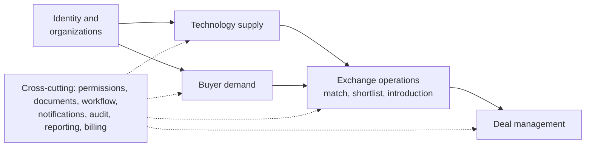

### 2.2 Business entities

| Entity | Meaning | Example |
| --- | --- | --- |
| Organization | Legal or institutional participant | University, manufacturer, startup |
| Technology | Stable identity of a technology asset | High-efficiency industrial coating |
| Technology version | A specific revision of its description and technical data | Revision 3, updated performance data |
| IP asset | A patent, application, copyright, know-how claim or other right | Patent application in one jurisdiction |
| Technology offer | A particular commercial opportunity involving the technology | Licence for a specified territory |
| Demand | A buyer's structured problem or need | Reduce inspection time by 30% |
| Match | A recorded relationship between a demand and a candidate offer | Demand D matched to Technology T |
| Introduction | A controlled request to connect two parties | Buyer requests contact with supplier |
| Deal | The managed commercial opportunity | Licence negotiation between two organizations |
| Evidence | Support for a claim or review decision | Patent register extract or test report |
| Review case | A controlled administrative process | Verify organization, review listing |
| Milestone | A deliverable or condition in a deal | Prototype delivery |
| Audit event | A record of a material system action | Listing approved by reviewer |

**Critical modeling rule:** one technology may have several offers, for example:

- A non-exclusive licence in Region A.
- An exclusive licence in Region B.
- An assignment offer.
- A development partnership.
- A time-limited pilot or evaluation arrangement.

Each offer defines its own transaction type, rights scope, territory, field of use, commercial terms and availability. The same technology can satisfy several demands, but not every offer is compatible with every demand. **Matching therefore happens at offer level.**

### 2.3 Internal modules

| # | Module | Responsibility |
| --- | --- | --- |
| 1 | `identity` | Users, sessions and authentication |
| 2 | `organizations` | Profiles, membership and verification |
| 3 | `taxonomy` | Industries, technology categories, applications and TRL |
| 4 | `technology` | Assets, versions, rights claims and evidence |
| 5 | `offers` | Licence, assignment and partnership opportunities |
| 6 | `demands` | Buyer requirements and constraints |
| 7 | `discovery` | Search, filters and candidate retrieval |
| 8 | `matching` | Candidate scores, explanations and feedback |
| 9 | `exchange` | Shortlists, introduction requests and broker assignments |
| 10 | `deals` | Negotiations, proposals, milestones and outcomes |
| 11 | `documents` | Private files, access grants and document versions |
| 12 | `workflow` | Review queues, tasks, deadlines and transitions |
| 13 | `notifications` | Email and in-app notifications |
| 14 | `audit` | Immutable business event history |
| 15 | `reporting` | Operational and commercial dashboards |
| 16 | `content` | Articles, events and event registrations (public content pages) |

Finance, subscriptions, e-signatures and AI start as **integration boundaries or later modules**, not as reasons to split the backend into services.

---

## 3. Technical architecture

The target server runs **Node.js 12.4** and **MongoDB 4.4 / 5.0** (the stated "4.5" is a development series). The detailed compatibility rules, verified library versions, risks and upgrade path are in [11 — Target runtime](11-target-runtime-node12-mongodb.md). This section summarizes the decisions that shape the design.

### 3.1 Technology stack

| Layer | Choice | Why |
| --- | --- | --- |
| Runtime | **Node.js 12.4** (upgrade to 12.22.12 strongly recommended) | Given target; see [11 §1](11-target-runtime-node12-mongodb.md) |
| Language | TypeScript, compiled on CI to **ES2019 / CommonJS** | Type safety; output runs on Node 12 |
| HTTP framework | **Express 4.22** + helmet, with an explicit module structure (§11.4) | Verified on 12.4; maintained; avoids end-of-life NestJS 8 |
| Validation | **zod 3.22**, schemas shared with the frontend | One definition for API input, UI forms and OpenAPI |
| Database | **MongoDB 4.4 / 5.0 replica set** | A replica set is required for transactions |
| Data access (ODM) | **Mongoose 5.13.23** (bundles driver 3.7.4): schemas, models, Document API, plugins | Mongoose 6+ needs driver 4 / Node ≥ 12.9; one schema per collection gives types, validation, defaults and indexes in one place |
| Schema control | Mongoose schemas (primary) + `$jsonSchema` validators and roles via **migrate-mongo** (safety net) + index sync from the schemas at release | Structure is enforced in the application **and** in the database, even though MongoDB is schemaless |
| Search | **Meilisearch** (Chinese word segmentation), fed from an outbox | MongoDB 4.4/5.0 cannot search Chinese text (verified) |
| Background work | One **worker** process: outbox relay, indexing, page pre-rendering, notifications, schedules | No Redis needed at launch |
| Authorization | **CASL 5** policies (RBAC + ABAC) | Verified on Node 12; policy shared by API checks and UI hints |
| Authentication | Phone + SMS code or password (**bcryptjs**), TOTP MFA for staff, sessions in MongoDB | China-friendly login; pure-JS hashing (no native build) |
| Files | Storage adapter: encrypted local volume, S3-compatible store or Aliyun OSS | Same code for a single server or object storage |
| Frontend | React 18 + Vite + **Ant Design 5**, built on CI, served by Nginx | Not bound to the server's Node version |
| Public SEO pages | **Pre-rendered static HTML** (EJS) on publication + sitemap | Server-side rendering frameworks need newer Node |
| Reverse proxy | Nginx (TLS, static files, rate limits) | Single public entry point |
| Process management | systemd: `tex-api@3001`, `tex-api@3002`, `tex-worker` | Simple, restart-on-failure, no extra tooling |
| Observability | pino logs, prom-client metrics, request IDs | Verified on Node 12 |

### 3.2 Logical deployment topology

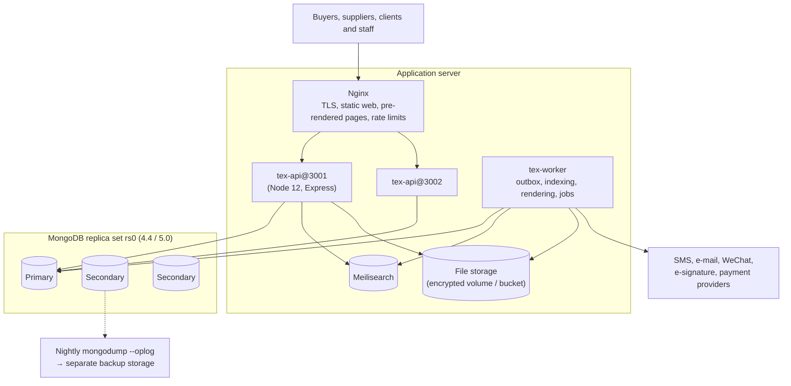

| Environment | Layout |
| --- | --- |
| **Production (recommended)** | 1 application server + a **3-member** MongoDB replica set (3 hosts, or 2 hosts + 1 member on the application server) |
| **Launch minimum** | 1 server with a **single-node replica set**, accepted only with tested nightly backups and an agreed recovery time |
| Staging | Mirrors production versions exactly (Node 12.4, same MongoDB version) |

---

## 4. Database design (MongoDB)

MongoDB is schemaless, but a technology exchange needs **auditable rights, versions, permissions and deal outcomes**. The design therefore adds discipline on top, in two layers:

- **Application layer: Mongoose 5.13.** One schema per collection defines types, enums, required fields, defaults, cross-field rules, indexes and plugins (tenant scope, immutability, optimistic concurrency). Services work with **models and documents**.
- **Database layer.** `$jsonSchema` validators on every core collection, unique and TTL indexes, a least-privilege application role, and transactions for every multi-document business change. This layer still holds when a script, a shell session or a bug bypasses Mongoose.

All schemas, plugins, migrations and services below are **verified** with Node 12.4.0 and Mongoose 5.13.23 on MongoDB 4.4.30 and 5.0.33: 166 database checks per MongoDB version (see [`draft-implementation/`](draft-implementation/README.md)). Its `src/` folder uses the same layout as the application (§11.4), so its files are the starting code.

### 4.1 Data model

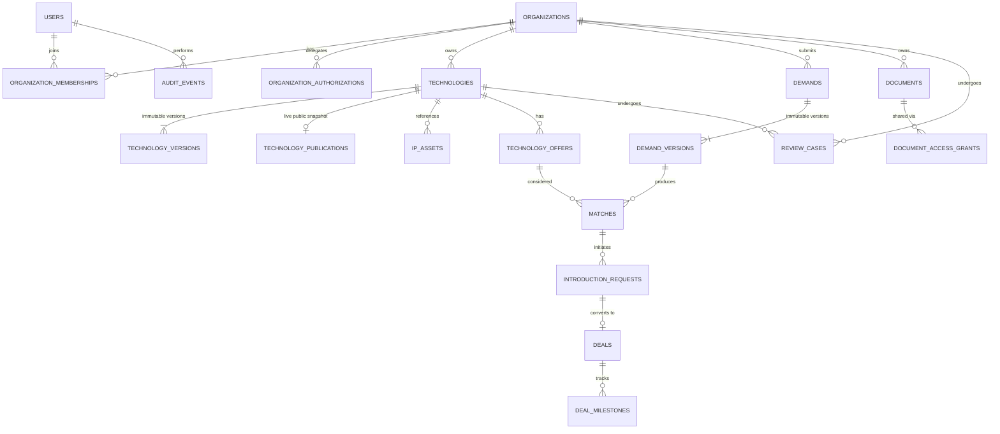

Embedded (not separate collections): deal **parties** (inside `deals`), document **links** (inside `documents`), bilingual text (`{ zh, en }`), money (`{ currency, amountMinor }`) and verification summaries.

### 4.2 Modeling conventions

| Topic | Rule |
| --- | --- |
| Identifiers | `_id` is an `ObjectId`. Every business object users talk about also gets a **human-readable reference** (`ref`): `TEC-000123` for technologies, `DEM-` demands, `DEAL-` deals, `CASE-` review cases, and `ORG-`, `OFR-` (offers), `INT-` (introductions). A reference is generated by an atomic counter (`Counter.nextRef`) and indexed as unique. The API sends `_id` as a 24-character hex string named `id` (§5.1). Support staff and users quote references, never raw IDs |
| Field names | camelCase, in the database **and** in API JSON; enums are lower-case snake_case strings declared once as `as const` arrays (TypeScript type + Mongoose `enum`), repeated in the database validator |
| Text | Bilingual objects `{ zh: string, en?: string }`: Chinese is required, English optional (machine-translated drafts must be reviewed) |
| Time | BSON `Date` in UTC; display in `Asia/Shanghai` |
| Money | `{ currency: 'CNY', amountMinor: Int64 }` (fen). Never floating point; percentages and royalty rates as `Decimal128`. Mongoose 5 has no 64-bit integer type, so the project registers a strict `Int64` schema type (§4.5) that rejects fractions and serializes to JSON as a decimal string |
| Concurrency | Every mutable document has `rev` (int): the Mongoose **version key** with `optimisticConcurrency: true`, so every `save()` filters on `rev` and increments it. `rev` is not the content version: `currentVersion` / `publishedVersion` number the reviewed content revisions, while `rev` counts every change to the document. The API returns `rev` (also as the `ETag` header), and the client sends it back in `If-Match`. The service compares it with `rev` before changing anything; a mismatch returns `409 VERSION_CONFLICT` |
| History | Content that is reviewed or published lives in **version collections** (`technology_versions`, `demand_versions`) that become immutable when frozen (`freezablePlugin`); state changes are appended to `workflow_transitions` (`appendOnlyPlugin`) |
| Embed vs reference | Embed small, bounded data that is always read with its parent (deal parties ≤ 10, document links). Reference anything with its own lifecycle, its own permissions, or unbounded growth (versions, milestones, messages, matches) |
| Arrays | No unbounded arrays. Conversations, audit events and matches are separate collections |
| Validation | Three layers: `zod` at the API boundary (user-friendly messages), the **Mongoose schema** on every `save()` and update query (`runValidators`), and the database validator (`validationLevel: strict`, `validationAction: error`) as the safety net. Unknown fields and unknown filter paths throw (`strict` and `strictQuery: 'throw'`) |
| Transactions | Every multi-document business change runs in one transaction with read concern `snapshot` and write concern `majority` (§4.7) |
| Tenancy | No row-level security in MongoDB: tenant-owned models use `tenantScopePlugin`, so every query must say whose data it may touch (§4.8) |
| Schema changes | Change the Mongoose schema and, in the same release, a `migrate-mongo` script for validators and data, run by `tex_migrator`; indexes are created from the schemas by `npm run db:indexes`. Expand-and-contract for breaking changes |
| Taxonomy codes | National standards where they exist: industry codes from **GB/T 4754-2017** (国民经济行业分类, e.g. `C384` battery manufacturing), strategic emerging industries (战略性新兴产业分类 2018), **IPC** for patents |

### 4.3 Collection catalogue

| Collection (Mongoose model) | Purpose | Key fields | Indexes (declared in the schema) |
| --- | --- | --- | --- |
| `users` (`User`) | People and login identities | `phoneE164`, `emailNormalized`, `passwordHash`, `status`, `realName.status`, `locale` | unique partial: phone, email, authSubject |
| `organizations` (`Organization`) | Legal or institutional participants | `ref`, `legalName`, `organizationType`, `jurisdictionCode`, `registrationNumber` (unified social credit code), `verification.{status,level,expiresAt}` | unique `ref`; unique partial (`jurisdictionCode`, `registrationNumber`) |
| `organization_memberships` (`OrganizationMembership`) | User ↔ organization, roles | `organizationId`, `userId`, `roleCodes[]`, `status` | unique (`organizationId`, `userId`); (`userId`, `status`) |
| `organization_authorizations` (`OrganizationAuthorization`) | Delegated authority: sign, approve payment, approve disclosure, submit to a venue; limits, expiry, evidence | `organizationId`, `userId`, `scope`, `limitMinor`, `validUntil`, `status` | (`organizationId`, `userId`, `scope`, `status`) |
| `platform_role_assignments` (`PlatformRoleAssignment`) | Staff roles, separate from organization roles | `userId`, `roleCode`, `expiresAt` | unique (`userId`, `roleCode`) |
| `technologies` (`Technology`) | Stable identity and lifecycle of a technology | `ref`, `ownerOrganizationId`, `technologyType`, `lifecycleStatus`, `visibility`, `currentVersion`, `publishedVersion`, `rev` | unique `ref`; (`ownerOrganizationId`, `lifecycleStatus`) |
| `technology_versions` (`TechnologyVersion`) | Immutable revisions (frozen on submission) | `technologyId`, `version`, `title`, `publicSummary`, `claimedTrl`, `assessedTrl`, `technicalAttributes`, `frozen` | unique (`technologyId`, `version`) |
| `technology_publications` (`TechnologyPublication`) | **Approved public snapshot**: the only technology data sent to search and public pages | `technologyId`, `version`, `ref`, `status`, owner summary, title, summary, codes, TRL, offer types, badges | unique partial `technologyId` where `status: 'live'` |
| `ip_assets` (`IpAsset`) | Patents, applications, software copyrights, know-how claims | `technologyId`, `ownerOrganizationId`, `assetType`, `jurisdictionCode`, `identifier`, `rightsStatus`, `legalStatusCheckedAt` | `technologyId`; (`jurisdictionCode`, `identifier`) |
| `technology_offers` (`TechnologyOffer`) | Licence, assignment, partnership, pilot, equity-investment offers (lifecycle §6.6) | `ref` (`OFR-`), `technologyId`, `technologyVersion`, `supplierOrganizationId`, `transactionType`, `offerStatus`, `exclusivity`, `price`, `validFrom/Until`, `reservation`, `closureReason` | unique `ref`; (`technologyId`, `offerStatus`); (`supplierOrganizationId`, `offerStatus`) |
| `demands`, `demand_versions` (`Demand`, `DemandVersion`) | Buyer needs and their immutable revisions | Demand: `ref`, `buyerOrganizationId`, `status`, `visibility`, `currentVersion`. Version: `title`, `problemStatement`, `hardConstraints`, `preferredAttributes`, `budget`, `frozen` | unique `ref`; (`buyerOrganizationId`, `status`); unique (`demandId`, `version`) |
| `matches` (`Match`) | Scored demand ↔ offer candidates, reproducible | `demandId`, `demandVersion`, `offerId`, `technologyVersion`, `rankingVersion`, `score`, `scoreComponents`, `explanation`, `eligibilityStatus`, `reviewStatus` | **unique** (`demandId`, `demandVersion`, `offerId`, `rankingVersion`) |
| `introduction_requests` (`IntroductionRequest`) | Consent-based introductions | `ref` (`INT-`), `matchId`, `buyerOrganizationId`, `supplierOrganizationId`, `status`, `disclosureScope` | unique `ref`; (`supplierOrganizationId`, `status`); (`buyerOrganizationId`, `status`); validator: buyer ≠ supplier |
| `deals` (`Deal`) | Managed negotiations and transactions (parties embedded) | `ref`, `dealType`, `status`, `parties[]`, `estimatedValue`, `assignedManagerId` | unique `ref`; unique partial `introductionRequestId`; (`parties.organizationId`, `status`) |
| `deal_milestones` (`DealMilestone`) | Deliverables, conditions and payment milestones | `dealId`, `kind`, `dueDate`, `amount`, `status`, `evidenceDocumentIds` | (`dealId`, `dueDate`); (`status`, `dueDate`) |
| `documents` (`DocumentFile`) | File metadata (the bytes are in file storage), classification, scan status, links | `ownerOrganizationId`, `storageKey`, `sha256`, `classification`, `scanStatus`, `lifecycleStatus`, `links[]` | unique `storageKey`; (`links.resourceType`, `links.resourceId`); (`ownerOrganizationId`, `createdAt`) |
| `document_access_grants` (`DocumentAccessGrant`) | Per-document access for another organization (view/download, watermark, expiry) | `documentId`, `dealId`, `granteeOrganizationId`, `permissions`, `watermark`, `expiresAt`, `revokedAt` | (`documentId`, `granteeOrganizationId`); `dealId` |
| `review_cases` (`ReviewCase`) | Verification, listing, IP, demand and introduction reviews (lifecycle §6.7) | `ref`, `caseType`, `resource.{type,id,version}`, `status`, `priority`, `assignedTo`, `dueAt`, `pausedAt`, `pausedWorkingDays`, `checkRequired`, `proposedDecision`, `proposedBy`, `checkedBy`, `previousCaseId`, `decision` | unique `ref`; (`status`, `priority`, `dueAt`); (`assignedTo`, `status`); (`resource.type`, `resource.id`) |
| `workflow_transitions` (`WorkflowTransition`) | Every state change with actor and reason | `resource`, `fromStatus`, `toStatus`, `action`, `actorUserId`, `correlationId` | (`resource.type`, `resource.id`, `occurredAt`) |
| `idempotency_keys` (`IdempotencyKey`) | Results of retriable commands | `actorUserId`, `key`, `requestHash`, `response*`, `expiresAt` | unique (`actorUserId`, `key`); **TTL** on `expiresAt` |
| `outbox_events` (`OutboxEvent`) | Events written in the business transaction, relayed by the worker (§6.9) | `eventType`, `aggregate`, `payload`, `status`, `attempts`, `lockedUntil`, `expireAt` | partial (`createdAt`) where `status: 'pending'`; **TTL** on `expireAt` |
| `jobs` (`Job`) | Leased background jobs: one per handler and event, scheduled run or command (§6.9) | `type`, `key`, `payload`, `status`, `priority`, `runAt`, `attempts`, `maxAttempts`, `leaseToken`, `lockedUntil`, `lastError`, `result`, `expireAt` | **unique** `key`; (`status`, `runAt`); (`status`, `lockedUntil`); (`type`, `status`); **TTL** on `expireAt` |
| `calendar_years`, `calendar_days` (`CalendarYear`, `CalendarDay`) | Official working-day calendar: published years and their exceptions (§6.10, FR-ADM-09) | Year: `_id`, `status`, `source`, `preparedBy`, `checkedBy`. Day: `_id` (`YYYY-MM-DD`), `year`, `kind`, `name` | (`year`, `_id`); validator: checker ≠ preparer |
| `counters` (`Counter`) | Atomic sequences for human-readable references | `_id` (prefix), `seq` | — |
| `tex_audit.audit_events` (`AuditEvent`) | Append-only audit trail, **separate database**, insert-only for the app | `actor`, `organizationId`, `action`, `resource`, `correlationId`, `reason`, `details` | (`resource.type`, `resource.id`, `occurredAt`); (`actor.userId`, `occurredAt`) |

### 4.4 Example documents

Illustrative values (shell notation):

```javascript
// technologies — identity and lifecycle (small, frequently updated)
{
  _id: ObjectId("6716f1c2a1b2c3d4e5f60001"),
  ref: "TEC-000123",
  ownerOrganizationId: ObjectId("6716f1c2a1b2c3d4e5f6aaaa"),
  technologyType: "process_technology",
  lifecycleStatus: "published",            // see state machine §6.1
  visibility: "public",
  currentVersion: 4,                        // version 4 may be in review…
  publishedVersion: 3,                      // …while version 3 stays public
  createdBy: ObjectId("6716f1c2a1b2c3d4e5f6bbbb"),
  createdAt: ISODate("2026-09-01T02:00:00Z"),
  updatedAt: ISODate("2026-10-12T06:30:00Z"),
  rev: 9
}

// technology_publications — approved public snapshot (source for search and public pages)
{
  _id: ObjectId("6716f1c2a1b2c3d4e5f60101"),
  technologyId: ObjectId("6716f1c2a1b2c3d4e5f60001"),
  version: 3,
  ref: "TEC-000123",
  status: "live",
  owner: { organizationId: ObjectId("6716f1c2a1b2c3d4e5f6aaaa"), displayName: "某某大学", type: "university", verified: true },
  title:   { zh: "锂电池极片缺陷在线检测技术", en: "Inline defect detection for lithium-battery electrodes" },
  summary: { zh: "基于机器视觉的电极缺陷实时检测，准确率超过99%。", en: "Machine-vision inspection of electrode defects in real time, >99% accuracy." },
  keywords: ["机器视觉", "锂电池", "缺陷检测"],
  industryCodes: ["C384"],                  // GB/T 4754-2017: battery manufacturing
  trl: { claimed: 6, assessed: null },
  offerTypes: ["license", "joint_development"],
  territories: ["CN"],
  ipSummary: { grantedPatents: 3, pendingApplications: 2 },
  badges: ["ownership_verified", "patent_verified"],
  price: { type: "negotiable" },
  publishedAt: ISODate("2026-10-01T03:00:00Z")
}

// deals — parties embedded, money in minor units
{
  _id: ObjectId("6716f1c2a1b2c3d4e5f60301"),
  ref: "DEAL-000042",
  introductionRequestId: ObjectId("6716f1c2a1b2c3d4e5f60201"),
  dealType: "ip_license",
  status: "negotiation",
  name: "电极缺陷检测技术 普通许可",
  parties: [
    { organizationId: ObjectId("6716f1c2a1b2c3d4e5f6aaaa"), role: "licensor", status: "active" },
    { organizationId: ObjectId("6716f1c2a1b2c3d4e5f6cccc"), role: "licensee", status: "active" }
  ],
  assignedManagerId: ObjectId("6716f1c2a1b2c3d4e5f6dddd"),
  estimatedValue: { currency: "CNY", amountMinor: NumberLong("30000000") },   // RMB 300,000.00
  createdBy: ObjectId("6716f1c2a1b2c3d4e5f6bbbb"),
  createdAt: ISODate("2026-10-05T01:00:00Z"),
  updatedAt: ISODate("2026-10-15T08:00:00Z"),
  rev: 6
}
```

### 4.5 Mongoose schemas, validators and indexes

Each module owns its models in `*.model.ts`: an interface for the stored fields, a schema with its indexes and plugins, and the compiled model. Services work with models and documents; no code outside the model files touches a raw collection. Verified models for all 27 collections are in [`draft-implementation/src/modules/`](draft-implementation/src/modules/technology/technology.model.ts).

#### Global settings

Mongoose reads some settings when a model is **compiled**. A connection created with `useDb()` before `connect()`, as the audit database's is, does not inherit the options passed to `connect()`. The verification run caught this: the audit model built its own indexes with the deprecated `ensureIndex`. In production that fails, because the application user may not create indexes. All settings are therefore global, and load before any model:

```typescript
// src/core/db/mongoose-settings.ts — imported by schema-helpers (so by every model) and by connection.ts
import mongoose from 'mongoose';

mongoose.set('useNewUrlParser', true);      // driver 3.x: current connection-string parser
mongoose.set('useUnifiedTopology', true);   // driver 3.x: current server discovery and monitoring
mongoose.set('useCreateIndex', true);       // createIndex instead of the deprecated ensureIndex
mongoose.set('useFindAndModify', false);    // native findOneAndUpdate instead of the deprecated findAndModify
mongoose.set('autoIndex', false);           // indexes are created by the release step (the app user cannot)
mongoose.set('autoCreate', false);          // collections and validators come from migrations
mongoose.set('bufferCommands', false);      // fail fast instead of queueing while the database is down
mongoose.set('strict', 'throw');            // unknown fields in documents are errors, not silently dropped
mongoose.set('strictQuery', 'throw');       // unknown filter paths are errors: { ownerOrgId: x } must not match all
mongoose.set('runValidators', true);        // schema validators also run on updateOne / findOneAndUpdate
mongoose.set('sanitizeProjection', true);   // user input cannot inject projections such as { password: 1 }

export default mongoose;
```

The connection itself is one call per process: `mongoose.connect(uri, { poolSize: 10, serverSelectionTimeoutMS: 10000 })`, where the URI names the database and carries `w=majority` ([11 §5.1](11-target-runtime-node12-mongodb.md)).

#### Shared field types and options

```typescript
// src/core/db/schema-helpers.ts (excerpt)
export interface I18nText { zh: string; en?: string }
export const i18nText = new Schema<I18nText>({
  zh: { type: String, required: true, trim: true },          // Chinese required
  en: { type: String, trim: true },
}, { _id: false, strict: 'throw' });

export interface Money { currency: string; amountMinor: Long }
export const money = new Schema<Money>({
  currency: { type: String, required: true, match: /^[A-Z]{3}$/, default: 'CNY' },
  amountMinor: { type: Int64, required: true },              // BSON Int64, never a double
}, { _id: false, strict: 'throw' });

/** Mutable business entities: createdAt/updatedAt, `rev` as version key, checked and incremented by every save(). */
export function entityOptions(collection: string): SchemaOptions {
  return { collection, timestamps: true, versionKey: 'rev', optimisticConcurrency: true, strict: 'throw' };
}

/** Records written once (versions, matches, events): createdAt only, no version key. */
export function recordOptions(collection: string, createdAt = 'createdAt'): SchemaOptions {
  return { collection, timestamps: { createdAt, updatedAt: false }, versionKey: false, strict: 'throw' };
}
```

Mongoose 5 has no 64-bit integer type and stores JavaScript numbers above 2³¹ as doubles. `Int64` ([`int64.schema-type.ts`](draft-implementation/src/core/db/int64.schema-type.ts), about 40 lines) accepts a `Long`, a safe integer or an integer string, and rejects anything else. A stored `Long` serializes to JSON as a decimal string (`"30000000"`), so API clients never lose precision (JavaScript numbers are exact only up to 2⁵³). The community package `mongoose-long` was not adopted: it silently truncates `300000.5` to `300000`.

The same file has small helpers used by every schema: `int()` (a `Number` that must be an integer, stored as BSON `int`), `enumOf()` (a string limited to an `as const` list), `ref()` (an `ObjectId` reference to another model), `refPattern('TEC')` (the `^TEC-[0-9]{6,}$` format) and `crossField()` (a validator that needs the whole document; see the table below).

#### A model: technologies and their versions

```typescript
// src/modules/technology/technology.model.ts (excerpt)
export const TECHNOLOGY_STATUSES = [
  'draft', 'submitted', 'in_review', 'changes_requested', 'approved',
  'rejected', 'published', 'update_pending', 'suspended', 'archived',
] as const;
export type TechnologyStatus = typeof TECHNOLOGY_STATUSES[number];
export const VISIBILITIES = ['private', 'public', 'restricted'] as const;

export interface TechnologyDoc extends Document {
  _id: Types.ObjectId;
  ref: string;
  ownerOrganizationId: Types.ObjectId;
  technologyType: string;                          // validated against the taxonomy by the service
  lifecycleStatus: TechnologyStatus;
  visibility: typeof VISIBILITIES[number];
  currentVersion: number;                          // version being edited or reviewed…
  publishedVersion: number | null;                 // …while this one stays public
  createdBy: Types.ObjectId;
  rev: number;
  createdAt: Date;
  updatedAt: Date;
}

const TechnologySchema = new Schema<TechnologyDoc>({
  ref: { type: String, required: true, immutable: true, match: refPattern('TEC') },
  ownerOrganizationId: ref('Organization', { required: true, immutable: true }),
  technologyType: { type: String, required: true },
  lifecycleStatus: enumOf(TECHNOLOGY_STATUSES, { required: true, default: 'draft' }),
  visibility: enumOf(VISIBILITIES, { required: true, default: 'private' }),
  currentVersion: int({ required: true, min: 1, default: 1 }),
  publishedVersion: int({ default: null }),
  createdBy: ref('User', { required: true, immutable: true }),
}, entityOptions('technologies'));

TechnologySchema.index({ ref: 1 }, { unique: true });
TechnologySchema.index({ ownerOrganizationId: 1, lifecycleStatus: 1 });
TechnologySchema.plugin(tenantScopePlugin, { fields: ['ownerOrganizationId'] });   // §4.8
TechnologySchema.plugin(accessibleRecordsPlugin);   // Technology.accessibleBy(ability, action), §8.4

export type TechnologyModel = AccessibleRecordModel<TechnologyDoc>;
export const Technology = model<TechnologyDoc, TechnologyModel>('Technology', TechnologySchema);

// technology_versions: content revisions, immutable once frozen (on submission)
const trl = () => int({ min: 1, max: 9, default: null });

const TechnologyVersionSchema = new Schema<TechnologyVersionDoc>({
  technologyId: ref('Technology', { required: true, immutable: true }),
  version: int({ required: true, min: 1, immutable: true }),
  title: { type: i18nText, required: true },
  publicSummary: i18nText,
  technicalDescription: i18nText,
  industryCodes: [{ type: String, match: /^[A-T][0-9]{0,4}$/ }],   // GB/T 4754-2017, e.g. C384
  applicationCodes: [String],
  claimedTrl: trl(),
  assessedTrl: trl(),
  technicalAttributes: Schema.Types.Mixed,          // sector-specific fields, validated per technologyType
  createdBy: ref('User', { required: true }),
}, recordOptions('technology_versions'));

TechnologyVersionSchema.index({ technologyId: 1, version: 1 }, { unique: true });
TechnologyVersionSchema.plugin(freezablePlugin);    // adds `frozen`; a frozen version can never change

export const TechnologyVersion = model<TechnologyVersionDoc>('TechnologyVersion', TechnologyVersionSchema);
```

#### Schema features and their purpose

| Need | Mongoose feature used |
| --- | --- |
| Types, enums, required fields, defaults | Schema type options; enum arrays declared once `as const` and reused as TypeScript types |
| Bilingual text, money, deal parties, document links | Reusable sub-schemas with `_id: false` (no stray `_id` in embedded objects) |
| Cross-field rules (offer validity, budget min ≤ max, buyer ≠ supplier) | `crossField()` validators on document saves; the database `$expr` validator covers update queries, where Mongoose does not pass the document |
| Optimistic concurrency | `versionKey: 'rev'` + `optimisticConcurrency: true`: a stale `save()` throws `VersionError` |
| Fields that never change (`ref`, owner, `createdBy`) | `immutable: true` |
| Secrets never returned by default | `select: false` (`users.passwordHash`) |
| Indexes, including partial unique and TTL | `schema.index()`; created at release (below) |
| Tenant isolation | `tenantScopePlugin` (§4.8) |
| History that cannot be rewritten | `freezablePlugin` (versions), `appendOnlyPlugin` (transitions, audit events) |
| Authorization as a query filter | `accessibleRecordsPlugin` from `@casl/mongoose@5.0.0` (§8.4) |
| Related data in read models | `ref` + `populate()` with a field list, on `lean()` queries |

#### Database validators (migrations)

Migrations create the core collections with `$jsonSchema` validators, define roles and fix data. They do not create the models' indexes; the one exception is the TTL index on the `sessions` collection, which belongs to `connect-mongo` rather than to a Mongoose model. The validators repeat the most important rules of the Mongoose schemas, so a write that bypasses Mongoose still cannot store an unknown state, money as a double, or a buyer that is also the supplier. The verified migration is [`001-core-schema.js`](draft-implementation/migrations/001-core-schema.js):

```javascript
// migrations/001-core-schema.js (excerpt) — run by migrate-mongo as tex_migrator
const OID = { bsonType: 'objectId' };
const DATE = { bsonType: 'date' };
const INT = { bsonType: 'int' };
const enumOf = (...values) => ({ bsonType: 'string', enum: values });

async function ensureCollection(db, name, jsonSchema, extraValidator) {
  const validator = extraValidator ? { $and: [{ $jsonSchema: jsonSchema }, extraValidator] } : { $jsonSchema: jsonSchema };
  const exists = await db.listCollections({ name }).hasNext();
  if (exists) {
    await db.command({ collMod: name, validator, validationLevel: 'strict', validationAction: 'error' });
  } else {
    await db.createCollection(name, { validator, validationLevel: 'strict', validationAction: 'error' });
  }
}

module.exports = {
  async up(db, client) {
    await ensureCollection(db, 'technologies', {
      bsonType: 'object',
      required: ['ref', 'ownerOrganizationId', 'technologyType', 'lifecycleStatus', 'visibility',
                 'currentVersion', 'createdBy', 'createdAt', 'updatedAt', 'rev'],
      properties: {
        ref: { bsonType: 'string', pattern: '^TEC-[0-9]{6,}$' },
        ownerOrganizationId: OID,
        lifecycleStatus: enumOf('draft', 'submitted', 'in_review', 'changes_requested', 'approved',
                                'rejected', 'published', 'update_pending', 'suspended', 'archived'),
        visibility: enumOf('private', 'public', 'restricted'),
        currentVersion: INT,
        publishedVersion: { bsonType: ['int', 'null'] },
        createdBy: OID,
        createdAt: DATE, updatedAt: DATE, rev: INT,
      },
    });

    // Cross-field rule with $expr: budget.minMinor <= budget.maxMinor
    await ensureCollection(db, 'demand_versions', { /* … */ }, {
      $expr: { $lte: [
        { $ifNull: ['$budget.minMinor', 0] },
        { $ifNull: ['$budget.maxMinor', { $ifNull: ['$budget.minMinor', 0] }] },
      ] },
    });
  },
};
```

#### Indexes at release

```bash
npm run db:migrate          # migrate-mongo up: validators, roles, data fixes (as tex_migrator)
npm run db:indexes          # create the indexes declared in the schemas that are missing (as tex_migrator)
npm run db:indexes:check    # CI and pre-release: list differences, change nothing
```

[`sync-indexes.ts`](draft-implementation/src/scripts/sync-indexes.ts) uses `Model.diffIndexes()` and `Model.createIndexes()`. It never calls `Model.syncIndexes()`, which drops every index that a schema does not declare. Removing an index is a deliberate migration.

#### What the verification run proves, per layer

| Layer | Rejected in the run (MongoDB 4.4 and 5.0) |
| --- | --- |
| Mongoose schema: nothing reaches the database | Phone not in E.164 form, TRL outside 1–9, title without Chinese, unknown lifecycle state, unknown field, unknown filter path, an update query that sets an unknown state, an offer whose validity ends before it starts, money with a fraction of a fen, budget min > max, buyer = supplier, a deal with one party |
| Unique indexes | Duplicate phone number, duplicate unified social credit code, duplicate match, second deal for the same introduction, reused idempotency key |
| Database validators (raw writes that bypass Mongoose) | Unknown state, money stored as a double, buyer = supplier (`$expr`) |
| Model plugins | Saving a frozen version, updating or deleting a transition record, any query on tenant data without a tenant scope |

### 4.6 Database roles and users

```javascript
// migrations/002-db-roles.js — least privilege for the application user
const privileges = [
  // CRUD on business collections; no drop, no createIndex, no collMod.
  { resource: { db: 'tex', collection: '' }, actions: ['find', 'insert', 'update', 'remove'] },
  // The audit trail is append-only for the application.
  { resource: { db: 'tex_audit', collection: 'audit_events' }, actions: ['find', 'insert'] },
];
await admin.command({ createRole: 'texApp', privileges, roles: [] });   // updateRole on re-run
```

| Database user | Role | Used by |
| --- | --- | --- |
| `tex_app` | `texApp` | API and worker processes |
| `tex_migrator` | `dbAdmin` + `readWrite` on `tex`, `tex_audit`; user-administration rights (`userAdmin` on `admin` and on the databases the role covers) only while a migration changes roles | Release pipeline (migrations and index sync) |
| `tex_backup` | `backup` / `restore` | Backup jobs |
| `tex_readonly` | `read` on `tex` (not on documents' storage) | Reporting, support investigations |

Because `texApp` cannot create indexes, the API and worker run with `autoIndex` off (§4.5); only the release step creates them.

### 4.7 Transactions and the Document API

Every multi-document business change is one transaction: the state change, the version freeze, the review case, the transition record, the outbox event and the audit event (in the separate audit database) commit together or not at all.

```typescript
// src/core/db/transaction.ts
export async function inTransaction<T>(work: (session: ClientSession) => Promise<T>): Promise<T> {
  const session = await mongoose.startSession();
  let result: T | undefined;
  try {
    // Driver 3.7 (Mongoose 5): withTransaction() resolves to the commit result, not the callback's value.
    await session.withTransaction(async () => {
      result = await work(session);
    }, { readConcern: { level: 'snapshot' }, writeConcern: { w: 'majority' } });
    return result as T;
  } finally {
    session.endSession();
  }
}
```

The submit use case, verified with the Document API ([`technology.service.ts`](draft-implementation/src/modules/technology/technology.service.ts) also has create, update, revise-after-publication, discard and list). The `Actor` is built from the session by the API middleware: the user's ID, the IDs of the organizations where the user is an active member (the tenant context of §4.8), the CASL ability (§8.4) and the request ID as `correlationId`. `expectedRev` is the `If-Match` value (§5.1).

```typescript
// src/modules/technology/technology.service.ts (excerpt)
// Allowed submissions (§6.1): a draft or a revised listing goes to review; a revision of a published
// listing goes to `update_pending` while the old snapshot stays public.
const SUBMIT_TARGET: Partial<Record<TechnologyStatus, TechnologyStatus>> = {
  draft: 'submitted', changes_requested: 'submitted', published: 'update_pending',
};

/** The tenant scope makes another organization's technology indistinguishable from a missing one. */
async function loadForChange(actor: Actor, id: Types.ObjectId, expectedRev: number, session: ClientSession): Promise<TechnologyDoc> {
  const tech = await Technology.findById(id).setOptions({ tenant: actor }).session(session);
  if (!tech) throw new NotFoundError('Technology not found');                                                  // 404
  if (tech.rev !== expectedRev) throw new VersionConflictError(`Technology changed since it was read (rev ${tech.rev})`);  // 409
  return tech;
}

export function submitTechnologyForReview(actor: Actor, id: Types.ObjectId, expectedRev: number) {
  return inTransaction(async (session) => {
    const tech = await loadForChange(actor, id, expectedRev, session);
    ForbiddenError.from(actor.ability).throwUnlessCan('submit', tech);    // CASL: role + state rules, 403
    const target = SUBMIT_TARGET[tech.lifecycleStatus];
    if (!target) throw new InvalidTransitionError(`Cannot submit a technology in status ${tech.lifecycleStatus}`);   // 409

    const version = await TechnologyVersion.findOne({ technologyId: tech._id, version: tech.currentVersion })
      .session(session)
      .orFail(() => new NotFoundError('Current version missing'));
    if (version.frozen) throw new InvalidTransitionError('No unsubmitted changes');                           // 409
    version.frozen = true;                         // immutable from now on (freezablePlugin)
    await version.save();                          // a document loaded in the session saves in it

    const fromStatus = tech.lifecycleStatus;
    tech.lifecycleStatus = target;
    await tech.save();                             // filters on rev and increments it: VersionError if changed meanwhile

    // One case per submitted version (§6.7): reference from the atomic counter, the exact version under
    // review, a link to the previous round's case, and a deadline of 5 working days (§6.10).
    const reviewCase = await openReviewCase(session, {
      caseType: 'technology_review', resource: { type: 'technology', id: tech._id, version: version.version },
    });
    await record(session, actor, tech, 'submitted', fromStatus, tech.lifecycleStatus, { reviewCaseRef: reviewCase.ref });
    return { reviewCaseRef: reviewCase.ref, status: tech.lifecycleStatus, rev: tech.rev };   // new ETag value
  });
}

/** Transition record, outbox event and audit event, in the same transaction as the change. */
async function record(session: ClientSession, actor: Actor, tech: TechnologyDoc, action: string,
                      fromStatus: string, toStatus: string, payload: Record<string, unknown> = {}) {
  const resource = { type: 'technology', id: tech._id };
  await new WorkflowTransition({ resource, fromStatus, toStatus, action, actorUserId: actor.userId,
                                 correlationId: actor.correlationId }).save({ session });
  await new OutboxEvent({ eventType: `technology.${action}`, aggregate: resource,
                          payload: { ref: tech.ref, version: tech.currentVersion, ...payload } }).save({ session });
  await new AuditEvent({ actor: { type: 'user', userId: actor.userId }, organizationId: tech.ownerOrganizationId,
                         action: `technology.${action}`, resource, correlationId: actor.correlationId }).save({ session });
}
```

`openReviewCase()` computes the deadline in working days with the published calendar (§6.10). If the year is not published, the deadline stays empty and the dashboard raises an alert; it is never guessed.

How the errors in this excerpt reach the client (full list in §5.6): `NotFoundError` → `404`, `VersionConflictError` and Mongoose's `VersionError` → `409 VERSION_CONFLICT`, CASL's `ForbiddenError` → `403`, `InvalidTransitionError` → `409 INVALID_STATE_TRANSITION`, and a Mongoose `ValidationError` → `422`. Because the policy check comes first, a request that the policy's state rules forbid (for example submitting a listing that is already in review) gets `403`; `409 INVALID_STATE_TRANSITION` covers what the policy cannot see, such as a published listing with no unsubmitted changes.

**Document API patterns** used throughout the backend:

| Operation | Pattern | Why |
| --- | --- | --- |
| Create | `new Model(data)` → policy check on the unsaved document → `await doc.validate()` → `await doc.save({ session })` | Defaults and validation run before a reference number is consumed; CASL recognises the document's model |
| Load for a change | `Model.findById(id).setOptions({ tenant }).session(session)` | Tenant scope; the document joins the transaction |
| Update | `doc.set(changes)` → `doc.isModified()` → `await doc.save()` | Checks and increments `rev`, runs validators, middleware and timestamps; sends only changed paths |
| Change related content only | `doc.increment()` before `save()` | The parent's `rev` changes when its content (another collection) changes |
| Delete | `await doc.deleteOne()` only for never-submitted drafts; everything else changes status (archive) | History is preserved |
| Lists and read models | `Model.accessibleBy(ability, 'read').setOptions({ tenant }).where(…).sort(…).limit(…).select(…).populate(…).lean()` | Policy as a filter; `lean()` returns plain objects, faster and ready for JSON |
| Counters, leases, bulk jobs | `Model.findOneAndUpdate(filter, update, { new: true, upsert, session })`, `updateMany(...)` | Atomic in one round trip; Mongoose returns the document, not the driver's `{ value }` |
| New documents in a transaction | `new Model(data).save({ session })`, or `Model.create([data], { session })` | `create()` takes a session only in the array form |

Rules:

- Keep transactions short and small. Never call external services (SMS, search, payment) inside one; they run from the outbox **after** commit.
- `withTransaction` retries the callback on transient errors (for example a primary election or a write conflict). Load documents **inside** the callback and never reuse a document loaded outside it: its in-memory state would be stale on a retry.
- Mongoose 5.13's `connection.transaction()` helper is not used: it never ends its session, and its typings accept no transaction options.
- The verification run proves that a stale `rev`, another tenant's attempt, a policy refusal, or a failure after several writes leaves **no partial writes**, in `tex` or in `tex_audit`. Two concurrent edits with the same `If-Match` value: exactly one succeeds, the other gets `409`.

### 4.8 Tenant isolation without row-level security

MongoDB has no row-level security. Isolation is enforced in the model layer by a Mongoose plugin. Every tenant-owned model declares which organization field(s) own a document, and **every query on it must say whose data it may touch**. Forgetting to do so throws an error; it never returns another tenant's data.

```typescript
// src/core/db/tenant-scope.plugin.ts (excerpt)
//   Technology.find(filter).setOptions({ tenant: ctx })                                  // organization users
//   Technology.find(filter).setOptions({ crossTenant: { reason: 'CASE-000123' } })       // staff, audited by the caller
//   Technology.aggregate(pipeline).option({ tenant: ctx })
const QUERY_HOOKS = ['count', 'countDocuments', 'distinct', 'estimatedDocumentCount', 'find', 'findOne', 'findOneAndDelete',
  'findOneAndRemove', 'findOneAndReplace', 'findOneAndUpdate', 'deleteOne', 'deleteMany', 'remove', 'replaceOne',
  'update', 'updateOne', 'updateMany'];

function scopeFilter(model: string, fields: string[], options: TenantScopeOptions) {
  if (options.crossTenant) {
    if (!options.crossTenant.reason) throw new TenantScopeError(`${model}: cross-tenant access needs a reason`);
    return null;
  }
  const ids = options.tenant && options.tenant.organizationIds;
  if (!ids || ids.length === 0) throw new TenantScopeError(`${model}: tenant scope is required`);
  const clauses = fields.map((field) => ({ [field]: { $in: ids } }));
  return clauses.length === 1 ? clauses[0] : { $or: clauses };
}

export function tenantScopePlugin(schema: Schema<any>, opts: { fields: string[] }): void {
  // One registration per hook: the 5.13 typings omit some query hooks (countDocuments, replaceOne).
  for (const hook of QUERY_HOOKS) schema.pre(hook, { document: false, query: true }, applyScope);

  function applyScope(this: Query<unknown, unknown> & { [SCOPED]?: boolean }) {
    if (this[SCOPED]) return;                     // re-executed query: already scoped
    const options = this.getOptions() as TenantScopeOptions;
    // estimatedDocumentCount() ignores filters, so it cannot be scoped: staff only (use countDocuments otherwise).
    if (this.op === 'estimatedDocumentCount' && !options.crossTenant) throw new TenantScopeError('… use countDocuments');
    const filter = scopeFilter(this.model.modelName, opts.fields, options);
    if (filter) this.and([filter]);               // added with $and: a caller's filter cannot widen it
    delete options.tenant;                        // never forwarded to the driver
    delete options.crossTenant;
    this[SCOPED] = true;
  }

  schema.pre('aggregate', function (this: Aggregate<unknown>) {   // the scope becomes the first pipeline stage
    const aggregate = this as Aggregate<unknown> & { options: TenantScopeOptions; model(): { modelName: string } };
    const options = aggregate.options || {};
    const filter = scopeFilter(aggregate.model().modelName, opts.fields, options);
    if (filter) aggregate.pipeline().unshift({ $match: filter });
    delete options.tenant;
    delete options.crossTenant;
  });
}

// Usage in the model files:
TechnologySchema.plugin(tenantScopePlugin, { fields: ['ownerOrganizationId'] });
IntroductionRequestSchema.plugin(tenantScopePlugin, { fields: ['buyerOrganizationId', 'supplierOrganizationId'] });
DealSchema.plugin(tenantScopePlugin, { fields: ['parties.organizationId'] });
```

| Model | Owner field(s) |
| --- | --- |
| `Technology`, `IpAsset`, `DocumentFile` | `ownerOrganizationId` |
| `TechnologyOffer` | `supplierOrganizationId` |
| `Demand` | `buyerOrganizationId` |
| `IntroductionRequest` | `buyerOrganizationId` or `supplierOrganizationId` (both sides see it) |
| `Deal` | `parties.organizationId` |
| Child records (`technology_versions`, `demand_versions`, `deal_milestones`, `matches`, `document_access_grants`) | No plugin: loaded only through their scoped parent's `_id` (technology, demand or offer, deal, document) |
| Identity records (`users`, `organizations`, `organization_memberships`, `organization_authorizations`, `platform_role_assignments`) | No plugin: loaded by the session's own user ID and organization IDs, or by staff modules |
| Public data (`technology_publications`) and platform records (`review_cases`, `workflow_transitions`, `outbox_events`, `jobs`, `calendar_*`, `counters`) | No plugin: public by design, or used only by services, the worker and staff modules |

A tenant-scoped query on another organization's document returns nothing, so the service reports `404`, never `403`. The API therefore does not reveal that the document exists (§5.6).

Controls around it:

1. Document methods (`doc.save()`, `doc.deleteOne()`) are not queries and are not scoped by the plugin. They are safe because the document was loaded through a scoped query, and services only change documents they loaded. One exception: `save()` of a document with **no changes** runs an existence query, which the plugin refuses because it carries no tenant options. Services therefore save only modified documents ([11 §5.2](11-target-runtime-node12-mongodb.md)). New documents take their owner from the actor's context, and the policy check on the unsaved document (`can('create', doc)`) rejects any other owner.
2. Staff access uses `crossTenant: { reason }` with a case reference. The calling service writes an audit event with that reason; a lint rule allows `crossTenant` only in staff modules.
3. Every list endpoint has an automated cross-tenant test (Organization A must never see Organization B's data). The draft implementation's tests check every query type, including `updateMany`, `deleteMany`, `distinct`, `aggregate` and `findOneAndReplace`. `findOneAndReplace` and `estimatedDocumentCount` were missing from the hook list until the Mongoose 6 spike found the gap (revision 6).
4. Access by grant is not covered by owner fields. A buyer that holds a `document_access_grants` entry for a supplier's document cannot load it through its own tenant scope. The planned path: the service finds an active, unexpired grant for the caller's organization, then loads the document through the audited cross-tenant path with the grant as the reason, and the policy (`accessGrants` in §8.4) allows `read`. This path is not yet in the draft implementation.
5. Highly sensitive fields (bank account numbers, ID-card numbers) are stored only with the payment or identity provider, or encrypted by the application before they are saved. Explicit client-side field-level encryption needs the native `mongodb-client-encryption` add-on, which has not been verified on Node 12.4; automatic encryption needs MongoDB Enterprise.

### 4.9 Additional collections before launch

| Group | Collections |
| --- | --- |
| Taxonomy | `taxonomy_terms` (industry, technology field, application, with `zh`/`en` labels, synonyms, parent, deprecation) |
| Rights and evidence | `ip_asset_evidence`, `rights_claims`, `verification_decisions` |
| Shortlists and feedback | `shortlists`, `match_feedback` |
| Communication | `conversations`, `messages` (contact details masked until an introduction is approved) |
| Negotiation and contracts | `proposal_versions`, `proposal_responses`, `approval_requests`, `contracts`, `contract_signatures`, `contract_registrations` (see [08 §9](08-china-operating-model.md)) |
| Workflow | `workflow_tasks` |
| Sessions and security | `sessions` (TTL), `login_attempts` (TTL), `sms_codes` (TTL, hashed codes) |
| Notifications | `notifications`, `notification_deliveries`, `notification_templates` |
| Content and events | `articles`, `events`, `event_registrations` (see [10](10-product-requirements.md)) |
| Commercial | `subscriptions`, `service_orders`, `invoices`; `payment_requests`, `payment_events` (R3, §6.11) |
| Public demands | `demand_publications` (anonymized public snapshot of a demand, §6.8, FR-DEM-04) |
| University tools | `public_notices`, `notice_objections`, `reward_notices` (FR-UNI-03, FR-UNI-06) |
| Challenges | `challenges`, `challenge_tracks`, `solutions`, `evaluations` (FR-DEM-07, FR-DEM-08) |
| Technology managers | `manager_profiles`, `manager_assignments`, `points_ledger` (FR-MAT-04 … FR-MAT-07) |
| Venue route | `venue_submissions`, `buyer_registrations`, `venue_certificates` (FR-VEN, R3) |
| Evidence | `evidence_chain` (hash chain over snapshots, notices, proposals and contracts, FR-CMP-02) |

---

## 5. API specifications

Expose a versioned REST API under `/api/v1` (Express 4). Request and response models are **zod schemas** in `packages/contracts`, shared with the frontend. The OpenAPI 3 document is generated from them on CI and published with each release.

Every request passes the same pipeline:

1. **Shared middleware**: session authentication, CSRF check, rate limits, request ID.
2. **Route**: parses the path, query and body with the zod schema, then builds the `Actor` (user ID, tenant context, CASL ability, request ID).
3. **Service** (`*.service.ts`): loads documents through the tenant scope, checks the policy on each loaded document, applies the change in one transaction (§4.7).
4. **Response serializer**: returns only the fields this caller may see (public, registered-user or NDA-covered, §8.4).
5. **Error middleware**: maps errors to the catalogue in §5.6.

Per-document policy checks run in the services, not in middleware, because they need the loaded document. A new route therefore cannot skip them.

### 5.1 Conventions

**Requests**

- JSON bodies for business operations, with the **same camelCase field names as the Mongoose models** (§4.2), for example `ownerOrganizationId`, `lifecycleStatus`.
- Documents: short-lived upload sessions to quarantine storage (§9.1), or multipart uploads for small files.
- **Identifiers**: the document's `_id` (an `ObjectId`), sent as a 24-character hex string, both in paths (`/technologies/6716f1c2a1b2c3d4e5f60001`) and in JSON (`id`, `ownerOrganizationId`). A path ID that is not a valid `ObjectId` returns `404`, like any unknown ID. Responses also carry the human-readable `ref` (`TEC-000123`); the UI shows the `ref`, never the raw ID.
- **Timestamps**: ISO 8601 in UTC (`2026-10-12T06:30:00Z`); the client displays them in `Asia/Shanghai`.
- **Money**: `{ "currency": "CNY", "amountMinor": "30000000" }`, the amount in minor units (fen) as a **decimal string**, in requests and responses. The `Int64` type serializes to a string (§4.5); a JSON number would lose precision above 2⁵³. Rates and percentages (`Decimal128`) are also sent as decimal strings; the response serializer converts them.
- **Pagination**: keyset pagination with a deterministic sort. Parameters `limit` (default 20, at most 100) and `after` (the cursor from the previous page); responses return `meta.nextCursor` (`null` on the last page).
- **Filters**: explicit, named query parameters, parsed by zod. Never pass `req.query` or `req.body` objects into a Mongoose filter: Mongoose 5 has no `sanitizeFilter`, so an object such as `{ "$ne": null }` would become a query operator ([11 §5.2](11-target-runtime-node12-mongodb.md)).
- **`Idempotency-Key`** header (a client-generated UUID) on retriable `POST` requests with business effects: creating records, submissions, introduction requests, deal creation. The server stores the key per user with a hash of the request in `idempotency_keys`. A retry with the same key and payload returns the stored response without repeating the change; the same key with a different payload returns `409 IDEMPOTENCY_KEY_REUSED`. Keys expire through a TTL index.
- **`If-Match`** header on every change to an existing resource that has a `rev` (`PATCH`, `DELETE` and action endpoints). Its value is the `rev` the client last read. A single-resource response returns `rev` in the body and as the `ETag` header (`ETag: "9"` → `If-Match: "9"`); list items carry `rev` in the body. A missing header returns `428 PRECONDITION_REQUIRED`; a stale value returns `409 VERSION_CONFLICT`, and the client must reload before trying again.
- **Authentication**: the browser sends the session cookie (`HttpOnly`, `Secure`, `SameSite=Lax`) and an `X-CSRF-Token` header on every state-changing request (§9.2). The web application does not use bearer tokens; API keys for enterprise integrations are a later phase (§13, phase 6).
- **Request ID**: Nginx sets `X-Request-Id` ([11 §9.3](11-target-runtime-node12-mongodb.md)). The API logs it, returns it as `meta.requestId`, and stores it as the `correlationId` of workflow transitions and audit events.

**Responses.** A normal resource response (headers `ETag: "0"`):

```json
{
  "data": {
    "id": "6716f1c2a1b2c3d4e5f60001",
    "ref": "TEC-000123",
    "lifecycleStatus": "draft",
    "currentVersion": 1,
    "rev": 0
  },
  "meta": {
    "requestId": "7b5f0f5c85f24f48b3cc8d5a15d8d0bb"
  }
}
```

An error response:

```json
{
  "error": {
    "code": "INVALID_STATE_TRANSITION",
    "message": "There are no unsubmitted changes to submit.",
    "requestId": "7b5f0f5c85f24f48b3cc8d5a15d8d0bb",
    "details": {
      "currentStatus": "published",
      "requestedAction": "submit"
    }
  }
}
```

Use stable error codes. For `422 VALIDATION_FAILED`, `details.fields` lists each invalid field with its path and a message. Never reveal another organization's confidential resource details in errors: a resource in another organization's tenant scope returns `404`, not `403`.

### 5.2 Endpoint catalogue

Detailed schemas live in OpenAPI and are validated in integration tests. Every `{id}` is the resource's `ObjectId` (§5.1). Where the table has no **Permission** column, the permission comes from the CASL policy (§8.4) and the tenant scope (§4.8).

**Authentication**

| Method | Endpoint | Permission | Purpose |
| --- | --- | --- | --- |
| `POST` | `/api/v1/auth/sms-codes` | Anonymous (rate-limited, CAPTCHA after repeated sends) | Send a login or registration code by SMS |
| `POST` | `/api/v1/auth/sessions` | Anonymous (rate-limited) | Log in with SMS code or password; staff also give a TOTP code |
| `DELETE` | `/api/v1/auth/sessions/current` | Authenticated | Log out |
| `GET` | `/api/v1/me/sessions` | Self | List own sessions (FR-ACC-08) |
| `DELETE` | `/api/v1/me/sessions/{sessionId}` | Self | Sign out another device |

**Identity and organizations**

| Method | Endpoint | Permission | Purpose |
| --- | --- | --- | --- |
| `GET` | `/api/v1/me` | Authenticated | Current user and memberships |
| `PATCH` | `/api/v1/me` | Self | Update permitted profile fields |
| `GET` | `/api/v1/organizations` | Authenticated | Organizations the user may access |
| `POST` | `/api/v1/organizations` | Authenticated | Create organization |
| `GET` | `/api/v1/organizations/{id}` | Member or public-profile policy | Read organization |
| `PATCH` | `/api/v1/organizations/{id}` | Organization admin | Update profile |
| `POST` | `/api/v1/organizations/{id}/members` | Organization admin | Invite member |
| `PATCH` | `/api/v1/organizations/{id}/members/{userId}` | Organization admin | Change permitted role or status |
| `POST` | `/api/v1/organizations/{id}/verification-submissions` | Authorized member | Submit verification evidence |

**Technology and offers**

| Method | Endpoint | Purpose |
| --- | --- | --- |
| `GET` | `/api/v1/technologies` | List the technologies of the caller's organizations (keyset pagination) |
| `POST` | `/api/v1/technologies` | Create a technology draft with version 1 (§5.3) |
| `GET` | `/api/v1/technologies/{id}` | Read an authorized technology, with its `rev` |
| `PATCH` | `/api/v1/technologies/{id}/draft` | Update the working version. If the current version is frozen (submitted or published), this starts the next version; the published one does not change |
| `DELETE` | `/api/v1/technologies/{id}` | Discard a never-submitted draft (anything else is archived instead) |
| `POST` | `/api/v1/technologies/{id}/submissions` | Submit the working version for review (§5.4) |
| `GET` | `/api/v1/technologies/{id}/review-status` | View submission progress |
| `POST` | `/api/v1/technologies/{id}/archivals` | Withdraw (archive) a published or suspended listing |
| `GET` | `/api/v1/technologies/{id}/history` | View authorized version history |
| `POST` | `/api/v1/technologies/{id}/offers` | Create offer |
| `PATCH` | `/api/v1/offers/{id}` | Update permitted offer fields |
| `POST` | `/api/v1/offers/{id}/submissions` | Submit offer for review |
| `POST` | `/api/v1/offers/{id}/withdrawals` | Withdraw offer |

Use dedicated **action endpoints** for submission, withdrawal and every other state change. The frontend never sets `lifecycleStatus` or `offerStatus` directly; the zod schemas of the general update endpoints do not contain those fields. Review work on a technology (claim, questions, approve, request changes, reject, approve or reject a revision) goes through `/api/v1/admin/review-cases/{id}/actions` (§6.7); suspension and reinstatement are staff actions (below).

**Demands and matching**

| Method | Endpoint | Purpose |
| --- | --- | --- |
| `POST` | `/api/v1/demands` | Create demand |
| `GET` | `/api/v1/demands/{id}` | Read authorized demand |
| `PATCH` | `/api/v1/demands/{id}/draft` | Update draft |
| `POST` | `/api/v1/demands/{id}/submissions` | Submit for review |
| `POST` | `/api/v1/demands/{id}/matching-jobs` | Request matching (returns `202 Accepted` + job ID) |
| `GET` | `/api/v1/demands/{id}/matches` | Read authorized matches |
| `POST` | `/api/v1/matches/{id}/shortlist-actions` | Shortlist or remove |
| `POST` | `/api/v1/matches/{id}/feedback` | Record structured feedback |
| `POST` | `/api/v1/matches/{id}/introduction-requests` | Request introduction |

**Exchange operations and deals**

| Method | Endpoint | Purpose |
| --- | --- | --- |
| `GET` | `/api/v1/introduction-requests` | List authorized requests |
| `POST` | `/api/v1/introduction-requests/{id}/decisions` | Record an authorized decision |
| `POST` | `/api/v1/introduction-requests/{id}/assignments` | Assign broker or case owner |
| `POST` | `/api/v1/deals` | Create a deal from an introduction (at most one deal per introduction, §6.3) |
| `GET` | `/api/v1/deals/{id}` | Read authorized deal |
| `POST` | `/api/v1/deals/{id}/proposals` | Create proposal |
| `POST` | `/api/v1/deals/{id}/stage-actions` | Request a stage transition by action name, e.g. `{ "action": "qualify" }` (§6.4, [05 §13](05-system-design-blueprint.md)) |
| `POST` | `/api/v1/deals/{id}/milestones` | Create milestone |
| `PATCH` | `/api/v1/deal-milestones/{id}` | Update permitted milestone fields |
| `POST` | `/api/v1/deals/{id}/completion-checks` | Evaluate completion prerequisites |
| `POST` | `/api/v1/deals/{id}/outcomes` | Record an authorized outcome |

**Documents and administration**

| Method | Endpoint | Purpose |
| --- | --- | --- |
| `POST` | `/api/v1/documents/upload-sessions` | Request an authorized upload |
| `POST` | `/api/v1/documents/{id}/finalization` | Complete upload and start validation |
| `POST` | `/api/v1/documents/{id}/access-requests` | Request restricted document access |
| `POST` | `/api/v1/documents/{id}/access-grants` | Owner grants another organization access (view or download, watermark, expiry) |
| `DELETE` | `/api/v1/document-access-grants/{id}` | Revoke a grant |
| `GET` | `/api/v1/documents/{id}/download` | Obtain short-lived authorized file access |
| `GET` | `/api/v1/admin/review-queues` | Retrieve review work |
| `POST` | `/api/v1/admin/review-cases/{id}/actions` | Apply a case action by name, e.g. `{ "action": "claim" }`, `{ "action": "ask", "reason": "…" }`, `{ "action": "propose", "decision": "approve" }`, `{ "action": "assign", "assigneeId": "…" }` (§6.7) |
| `POST` | `/api/v1/review-cases/{id}/answers` | The submitter answers a reviewer's question; the case clock resumes (§6.7) |
| `GET` | `/api/v1/admin/jobs?status=dead` | Dead letters and job backlog (§6.9) |
| `POST` | `/api/v1/admin/jobs/{id}/retries` | Retry a dead job from attempt 0 (audited) |
| `POST` | `/api/v1/admin/jobs/{id}/discards` | Discard a dead job with a reason (audited) |
| `PUT` | `/api/v1/admin/calendar-years/{year}` | Prepare a year's holidays and make-up working days (§6.10) |
| `POST` | `/api/v1/admin/calendar-years/{year}/publication` | Second administrator checks and publishes the year |
| `POST` | `/api/v1/admin/technologies/{id}/suspensions` | Suspend a published listing (compliance) |
| `POST` | `/api/v1/admin/technologies/{id}/reinstatements` | Reinstate a suspended listing |
| `GET` | `/api/v1/admin/audit-events` | Search authorized audit records |
| `GET` | `/api/v1/admin/reports/operations` | Read operational metrics |

### 5.3 Contract: create a technology

```http
POST /api/v1/technologies
Cookie: <session cookie>
X-CSRF-Token: <token>
Idempotency-Key: 4f0c2d9e-7a51-4b4e-9d1e-2f6b8c3a7e10
Content-Type: application/json
```

```json
{
  "ownerOrganizationId": "6716f1c2a1b2c3d4e5f6aaaa",
  "technologyType": "process_technology",
  "content": {
    "title": { "zh": "锂电池极片缺陷在线检测技术", "en": "Inline defect detection for lithium-battery electrodes" },
    "publicSummary": { "zh": "基于机器视觉的电极缺陷实时检测。" },
    "industryCodes": ["C384"],
    "claimedTrl": 6
  }
}
```

The backend must:

1. Authenticate the session and check the CSRF token.
2. Look up the `Idempotency-Key`: replay the stored response for a repeated request, or return `409 IDEMPOTENCY_KEY_REUSED` if the payload differs.
3. Parse the body with zod (`422` with field details on failure) and check `technologyType` and `industryCodes` against the taxonomy.
4. Run `createTechnologyDraft` **in one database transaction** (§4.7):
   - build the technology with the requested owner, and check the policy on the unsaved document: only a technology role (`org_owner`, `org_admin`, `technology_manager`) in an **active membership** of that organization may create (`403` otherwise);
   - validate version 1 **before** taking a `TEC-` reference number, so a rejected request consumes no number;
   - save the technology and version 1, with the workflow transition, the `technology.created` outbox event and the audit event.
5. Store the response under the idempotency key.
6. Return `201 Created` with `Location: /api/v1/technologies/{id}` and `ETag: "0"`.

```json
{
  "data": {
    "id": "6716f1c2a1b2c3d4e5f60001",
    "ref": "TEC-000123",
    "lifecycleStatus": "draft",
    "currentVersion": 1,
    "rev": 0
  },
  "meta": { "requestId": "7b5f0f5c85f24f48b3cc8d5a15d8d0bb" }
}
```

### 5.4 Contract: submit for review

```http
POST /api/v1/technologies/6716f1c2a1b2c3d4e5f60001/submissions
Cookie: <session cookie>
X-CSRF-Token: <token>
Idempotency-Key: 0b9e6c55-3f0e-4d7a-8a3c-5d2f1e9b7a64
If-Match: "3"
Content-Type: application/json
```

```json
{
  "declarationAccepted": true,
  "requestedVisibility": "public"
}
```

The request has no version number: the server always submits the technology's current working version, and `If-Match` proves the caller has seen it. The backend checks, in this order:

| Check | Failure |
| --- | --- |
| The technology belongs to one of the caller's organizations (tenant scope) | `404 RESOURCE_NOT_FOUND` |
| `rev` equals the `If-Match` value | `409 VERSION_CONFLICT` |
| The policy allows `submit`: a technology role in the owning organization, and status `draft`, `changes_requested` or `published` | `403 PERMISSION_DENIED` |
| The working version has unsubmitted changes (it is not frozen) | `409 INVALID_STATE_TRANSITION` |
| Required fields complete, holder declaration accepted (FR-TEC-09), evidence files scanned clean | `422 VALIDATION_FAILED` |

The draft implementation covers the first four checks; the completeness, declaration and evidence checks are still to be written.

On success, one transaction freezes the version, moves the status (`draft` or `changes_requested` → `submitted`; `published` → `update_pending`), opens a `CASE-` review case for that exact version with its due date, and writes the transition, the `technology.submitted` outbox event and the audit event. A retry with the same `Idempotency-Key` returns the same response. A retry without it fails with `409 VERSION_CONFLICT`, because `rev` has changed, so a second review case is never opened.

```json
{
  "data": { "status": "submitted", "reviewCaseRef": "CASE-000042", "rev": 4 },
  "meta": { "requestId": "c41d7e0a9b3f4e6c8d2a1b5f7e9c0d3a" }
}
```

The public listing does not change until approval and publication. For a revision (`update_pending`), the previous snapshot stays public until the revision is approved.

### 5.5 Contract: retrieve matches

```http
GET /api/v1/demands/6716f1c2a1b2c3d4e5f60601/matches?limit=20&sort=score_desc
```

```json
{
  "data": [
    {
      "id": "6716f1c2a1b2c3d4e5f60501",
      "offerId": "6716f1c2a1b2c3d4e5f60401",
      "offerRef": "OFR-000057",
      "technologyRef": "TEC-000123",
      "demandVersion": 2,
      "rankingVersion": "ranking-v1",
      "score": 84.5,
      "eligibilityStatus": "eligible",
      "explanation": {
        "technicalFit": "strong",
        "maturity": "meets_requirement",
        "rightsCompatibility": "requires_confirmation",
        "commercialFit": "indicative_only"
      },
      "nextAction": "request_introduction"
    }
  ],
  "meta": {
    "limit": 20,
    "nextCursor": null,
    "requestId": "7b5f0f5c85f24f48b3cc8d5a15d8d0bb"
  }
}
```

An example, not a real match. The API returns only data the buyer is authorized to see. A score of `84.5` is **not** an 84.5% probability of success.

### 5.6 Error catalogue

The error middleware maps each error class to one code. Services throw the classes; they never build HTTP responses themselves.

| HTTP status | Error code | Meaning | Raised by |
| --- | --- | --- | --- |
| `400` | `INVALID_REQUEST` | The request cannot be parsed: invalid JSON, wrong content type | Body parser |
| `401` | `AUTHENTICATION_REQUIRED` | No valid session | Session middleware |
| `403` | `CSRF_CHECK_FAILED` | Missing or wrong CSRF token on a state-changing request | CSRF middleware |
| `403` | `PERMISSION_DENIED` | The policy forbids this action for this caller on this resource **in its current state**: a missing role, or a state rule such as "no edits while in review" | CASL `ForbiddenError` (§8.4) |
| `404` | `RESOURCE_NOT_FOUND` | The resource does not exist, **or belongs to another organization** (the tenant scope makes both cases identical), or the path ID is not a valid `ObjectId` | `NotFoundError`; tenant scope (§4.8) |
| `409` | `VERSION_CONFLICT` | `If-Match` differs from the current `rev`, or another request changed the document during this one | `VersionConflictError`; Mongoose `VersionError` |
| `409` | `INVALID_STATE_TRANSITION` | The workflow has no such transition from the current state, or a transition precondition fails | `InvalidTransitionError` |
| `409` | `DUPLICATE_RESOURCE` | A unique rule would break: same phone number or unified social credit code, a second deal for the same introduction | MongoDB duplicate-key error (code 11000) |
| `409` | `IDEMPOTENCY_KEY_REUSED` | Same key sent with a different payload | Idempotency middleware |
| `422` | `VALIDATION_FAILED` | The request parsed, but a field is missing or breaks a rule (TRL outside 1–9, money with a fraction of a fen, budget min > max, buyer = supplier); `details.fields` lists each field | zod schema; Mongoose `ValidationError` (including cast errors) |
| `428` | `PRECONDITION_REQUIRED` | `If-Match` missing on a change to a resource with a `rev` | Route middleware |
| `429` | `RATE_LIMITED` | Request rate exceeded | Nginx `limit_req`, `express-rate-limit` |
| `500` | `INTERNAL_ERROR` | Unexpected failure, including programming errors stopped by the model layer (`TenantScopeError`, `ImmutableRecordError`, Mongoose `StrictModeError`). Details go to the log only | Any |
| `503` | `DEPENDENCY_UNAVAILABLE` | MongoDB or another required service is unreachable (`bufferCommands` is off, so requests fail fast instead of queueing) | Driver and integration errors |

Use the same error envelope everywhere. A `500` caused by `TenantScopeError` is a bug (a query without a tenant scope), never a reason to retry with `crossTenant`.

---

## 6. Workflow state machines and business rules

Each workflow has an explicit state machine, permitted transitions, responsible roles, preconditions and failure paths. Diagram states are written in CamelCase; the stored values are the snake_case enums of the models (`ChangesRequested` is stored as `changes_requested`). A state change always goes through a service that checks the policy, applies the transition, and writes the `workflow_transitions` record, the outbox event and the audit event in the same transaction (§4.7, §6.5).

### 6.1 Technology publication lifecycle

Stored in `technologies.lifecycleStatus` (`TECHNOLOGY_STATUSES`, §4.5): `draft`, `submitted`, `in_review`, `changes_requested`, `approved`, `rejected`, `published`, `update_pending`, `suspended`, `archived`.

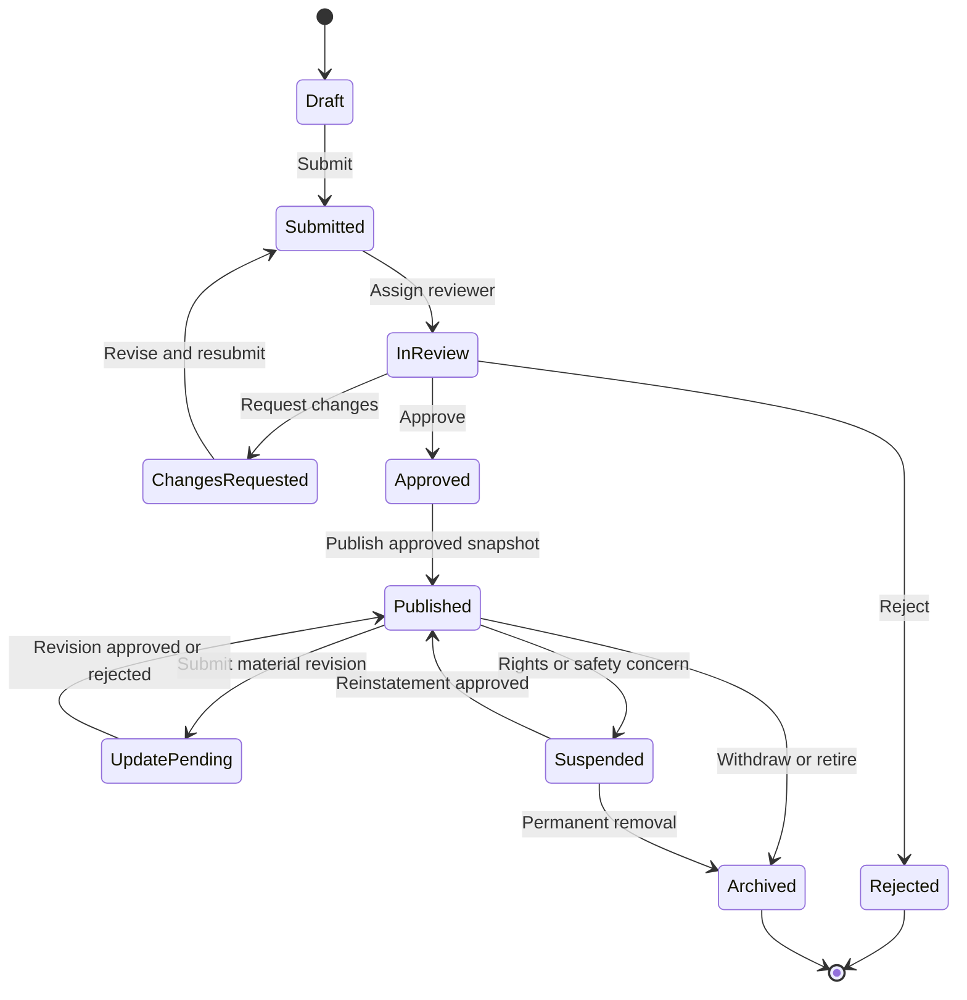

**Status and content versions.** The status lives on the small `technologies` document; the content lives in `technology_versions`. `currentVersion` is the version being edited or reviewed, and `publishedVersion` is the version behind the live public snapshot (`technology_publications`, status `live`). Submitting freezes the current version. Editing after that (in `changes_requested`, or while `published`) starts the next version as a copy, so frozen content never changes. While a published listing is being edited, its status stays `published` and the old snapshot stays public; the edit is submitted with the same `submit` action, which leads to `update_pending`.

| From | Action | To | Who (role code) | Preconditions / effects |
| --- | --- | --- | --- | --- |
| `draft` | submit | `submitted` | Organization technology role (`org_owner`, `org_admin`, `technology_manager`) | Required fields, holder declaration, evidence scanned clean; version frozen; review case opened |
| `submitted` | assign | `in_review` | A reviewer claims the review case, or `operations_manager` assigns it (§6.7) | Reviewer has no conflict of interest |
| `in_review` | request_changes | `changes_requested` | Reviewer (`listing_reviewer`) | Reason per field |
| `changes_requested` | submit | `submitted` | Organization technology role | The first edit after the request started a new version; that version is frozen and reviewed |
| `in_review` | approve | `approved` | Reviewer | Checklist complete; approved field scope recorded |
| `in_review` | reject | `rejected` | Reviewer | Reason recorded; appeal handled outside the state machine |
| `approved` | publish | `published` | System | Snapshot created (`publishedVersion` set); outbox event for indexing and page rendering |
| `published` | submit | `update_pending` | Organization technology role | A new version with unsubmitted changes exists; old snapshot stays public |
| `update_pending` | approve_revision | `published` | Reviewer | New snapshot goes `live`, the old one becomes `superseded` |
| `update_pending` | reject_revision | `published` | Reviewer | Reason recorded; old snapshot stays `live`; the owner may edit and submit again |
| `published` | suspend | `suspended` | Compliance (`compliance_officer`) | Reason; removed from search and public pages within 5 minutes (FR-TEC-12); new introductions blocked |
| `suspended` | reinstate | `published` | Authorized reviewer | Issue resolved with evidence |
| `published` or `suspended` | archive | `archived` | Owner or admin | Snapshot `withdrawn`; history preserved |

A never-submitted draft (still at version 1) can be discarded (deleted) instead; every other technology is archived, never deleted.

Rules:

- A draft is visible only to authorized organization members and to platform staff with a case-related need.
- Submission freezes the version under review; review decisions reference that exact version (`review_cases.resource.version`).
- Publication creates an approved public snapshot. Editing a published technology creates a new version.
- Material changes to technical claims, rights or commercial scope require re-review.
- Suspension immediately disables new discovery and new introductions, while preserving history.
- No edits while `submitted`, `in_review`, `approved`, `update_pending`, `rejected`, `suspended` or `archived` (the policy's state rule, §8.4). `approved` is the short step before the system publishes the snapshot.

### 6.2 Buyer demand lifecycle

Stored in `demands.status` (`DEMAND_STATUSES` in `demand.model.ts`): `draft`, `submitted`, `clarification`, `approved`, `rejected`, `matching`, `shortlisted`, `no_candidates`, `introduction`, `in_evaluation`, `negotiation`, `fulfilled`, `withdrawn`, `expired`.

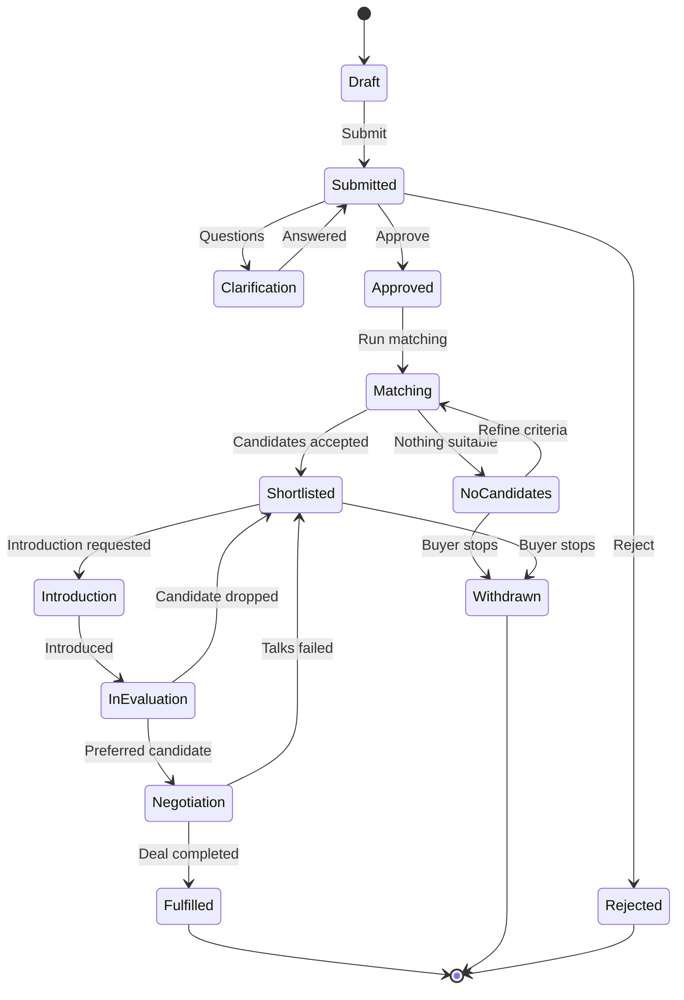

Like a technology, a demand's content is versioned: submission freezes the current `demand_versions` entry, and matches always record the `demandVersion` they were computed for. A demand's `visibility` is `private`, `broker_only`, `verified_users` or `anonymous_public`; the buyer chooses the disclosure level. Public discovery must never automatically reveal the buyer's identity, budget or confidential technical problem. Demands that pass their target date move to `expired` through a scheduled job (not drawn above); every closure (`fulfilled`, `withdrawn`, `expired`, `rejected`) records a `closureReason`.

### 6.3 Introduction lifecycle

Stored in `introduction_requests.status` (`INTRODUCTION_STATUSES`): `requested`, `under_review`, `supplier_pending`, `approved`, `rejected`, `withdrawn`, `introduced`, `converted_to_deal`. Both the buyer and the supplier organization can see the request (§4.8).

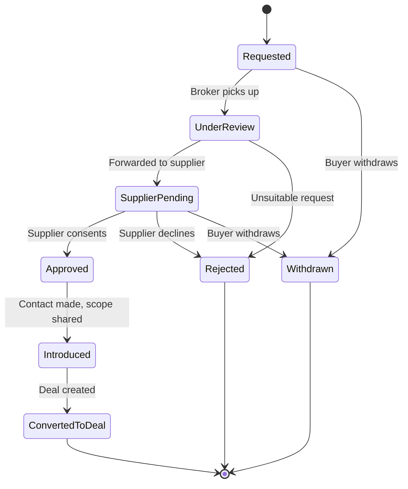

Business rules:

1. Only a buyer with access to the match can request an introduction.
2. The supplier's disclosure preferences and the offer status are checked.
3. The broker may ask for clarification or reject an unsuitable request.
4. **Supplier approval is required**, unless a documented policy or existing agreement explicitly authorizes otherwise.
5. The platform records the date, parties, disclosure scope and communication channel used.
6. Creating a deal from an introduction is **idempotent**: a partial unique index on `deals.introductionRequestId` allows at most one deal per introduction, so a retried request gets `409 DUPLICATE_RESOURCE` (or the stored response, if it repeats its `Idempotency-Key`).
7. Buyer and supplier must be different organizations (Mongoose `crossField` validator and database `$expr` validator).

### 6.4 Deal lifecycle

Stored in `deals.status` (`DEAL_STATUSES` in `deal.model.ts`): `opportunity`, `qualified`, `due_diligence`, `negotiation`, `contract_draft`, `approval`, `signed`, `conditions_pending`, `ready_to_complete`, `completed`, `on_hold`, `lost`, `disputed`. This is the same state machine as [05 §7.5](05-system-design-blueprint.md); its transition table (actions, allowed actors, preconditions) is in [05 §13](05-system-design-blueprint.md).

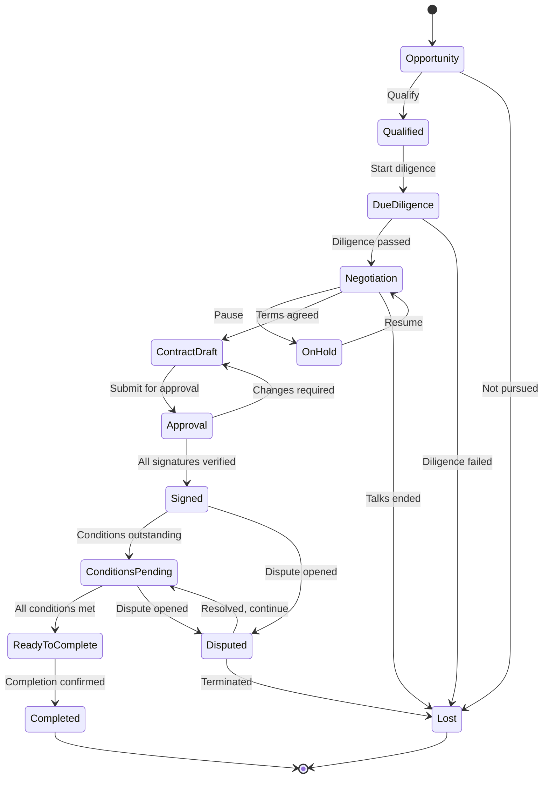

`ready_to_complete` means every completion condition of the deal type is satisfied with evidence (for example licence effective and initial payment confirmed by the payment provider). The deal owner then confirms completion as a separate, audited action. Completion is never automatic and has no "force complete" shortcut ([05 §9.5](05-system-design-blueprint.md)).

**Deal status on the venue route (R3).** The deal stays `negotiation` while the venue lists and discloses the technology and runs buyer registration and price discovery. It moves to `contract_draft` when the venue confirms the buyer and price, then through `approval` to `signed` (contract within the period the listing sets), and stays `conditions_pending` until settlement is confirmed and the transaction certificate (交易凭证) is recorded: both are completion conditions of a venue-routed deal. Settlement means the venue's confirmation for on-exchange settlement, or the seller's evidenced receipt of the price for off-exchange settlement (场外结算, the usual case in 2026 STEX listings, [09 §2.3](09-reference-platform-features.md)). The venue's own steps are tracked on `venue_submissions` (FR-VEN), not as extra deal statuses.

The stage is only **one dimension** of a deal. Store separate fields or records for:

- Contract execution status.
- Required completion conditions.
- Payment status, if applicable.
- IP transfer or licensing evidence.
- Delivery obligations.
- Dispute status.
- Final outcome and loss reason.

This prevents the system from treating "contract signed" as "technology transferred successfully". [07 §8](07-roles-workflows-and-money.md) and [08 §4](08-china-operating-model.md) extend this into fully separate state machines for proposals, contracts, milestones and payments.

### 6.5 Workflow engine requirements

Build one reusable workflow layer with:

- Allowed transition definitions.
- Permission checks.
- Domain-specific preconditions.
- Atomic state update plus transition history (`workflow_transitions`).
- Idempotency for retried commands (`idempotency_keys`).
- Assignment and reassignment.
- Due dates, reminders and escalation.
- Retryable asynchronous actions.
- Correlation IDs across related operations.
- Structured exception reasons.

An approval transition updates the resource status **and** appends its transition record in the same database transaction. Notifications are queued through the transactional outbox (`outbox_events`) and sent **after** the business transaction commits.

Keep the allowed transitions as **data**, next to the service that applies them: `SUBMIT_TARGET` in the technology service (§4.7) is the first example, and [05 §13](05-system-design-blueprint.md) shows the same pattern for deals. State rules that decide who may act in which state belong in the CASL policy (§8.4); preconditions that need other records (evidence, signatures, conditions) belong in the transition's check.

The worker relays outbox events: it leases pending events (`status: 'pending'`, `lockedUntil`), performs the side effect (search index, page rendering, notification), then marks them `published`, or increments `attempts` and records `lastError`. Side effects can therefore run more than once, so every consumer must be idempotent (an index upsert, a notification keyed by event ID). §6.9 gives the full design of the relay, the leased jobs, retries and dead letters.

### 6.6 Offer lifecycle

Stored in `technology_offers.offerStatus` (`OFFER_STATUSES` in `offer.model.ts`): `draft`, `submitted`, `active`, `paused`, `under_negotiation`, `closed`, `expired`, `rejected`. An offer is one commercial opportunity for a technology, such as a non-exclusive licence for mainland China, an assignment or a pilot. A technology can have several offers.

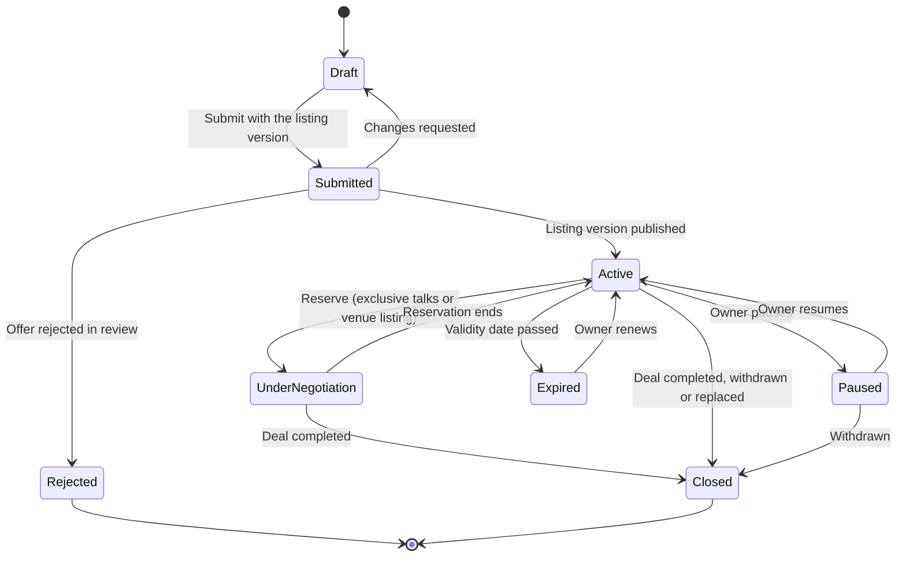

**Offers are part of the listing.** The owner writes offers in step 4 of the listing wizard (§7.2). An offer is submitted with a technology version (`technologyVersion`) and reviewed in the same review case (§6.7). The publishing service makes it `active` when that version goes live (§6.8). Adding an offer to a published technology is a material change, so the owner submits a revision (`update_pending`), and the new offer goes live with it. Active offers are never edited in place. To change the terms (price structure, exclusivity, territory or field of use), the owner adds a new offer through a revision and closes the old one (`replaced`) once the new one is active. Introductions and deals keep a reference to the offer they started from.

| From | Action | To | Who | Rules and effects |
| --- | --- | --- | --- | --- |
| `draft` | submit | `submitted` | Organization technology role | Submitted with the listing version; required fields per transaction type; valid price structure (FR-TEC-07) |
| `submitted` | publish | `active` | System (publishing service) | The listing version it was submitted with (or a later one) goes live |
| `submitted` | request_changes | `draft` | Reviewer, through the review case | Reason per field |
| `submitted` | reject | `rejected` | Reviewer | A rejected offer does not block the rest of the listing |
| `active` | pause / resume | `paused` / `active` | Owner | A paused offer is hidden from matching and from search facets; open introductions and deals continue |
| `active` | reserve | `under_negotiation` | Owner or deal manager; system for venue listings | `reservation.reason` is `exclusive_talks` (exclusivity of negotiation granted to one buyer, with `until` and `dealId`) or `venue_listing` (formally listed on STEX or CTEX, so it must not be sold elsewhere during disclosure; FR-VEN-01) |
| `under_negotiation` | release | `active` | Owner, deal manager or system | `until` passed (daily job), the talks ended, or the venue listing ended without a buyer |
| `active`, `under_negotiation` | close | `closed` | System when a deal completes; owner otherwise | `closureReason`: `deal_completed` (assignment, or exclusive or sole licence for the same territory and field), `withdrawn`, `replaced`, or `technology_archived` |
| `active` | expire | `expired` | System (daily job) | `validUntil` passed; the owner is reminded 30 and 7 days before |
| `expired` | renew | `active` | Owner | New `validUntil`. Dates are not material, so there is no review |

Rules:

- Matching (§10) and new introduction requests use only `active` offers of technologies with a live snapshot. In every other status, existing introductions and deals continue.
- A non-exclusive licence offer stays `active` after a deal, because the same technology can be licensed again.
- When a technology is suspended, its offers keep their status but are not discoverable (the snapshot is withdrawn) and accept no new introductions (§6.1). Archiving a technology closes all its open offers (`technology_archived`).
- The public snapshot shows only offer types, territories and the price type. Amounts are never shown in search results (FR-SRC-04).

*Implementation status:* the statuses, `reservation` and `closureReason` are in the model and the database validator (migration 003); the publishing service activates offers (verified in `tests/test-workflow.js`). The owner actions are a specification.

### 6.7 Review-case lifecycle

A review case is the unit of staff work: **one case per submitted version** of an organization verification, technology listing, IP verification, demand, introduction or dispute. Stored in `review_cases.status` (`CASE_STATUSES`): `open`, `assigned`, `in_review`, `waiting_for_submitter`, `awaiting_check`, `approved`, `rejected`, `escalated`, `closed`.

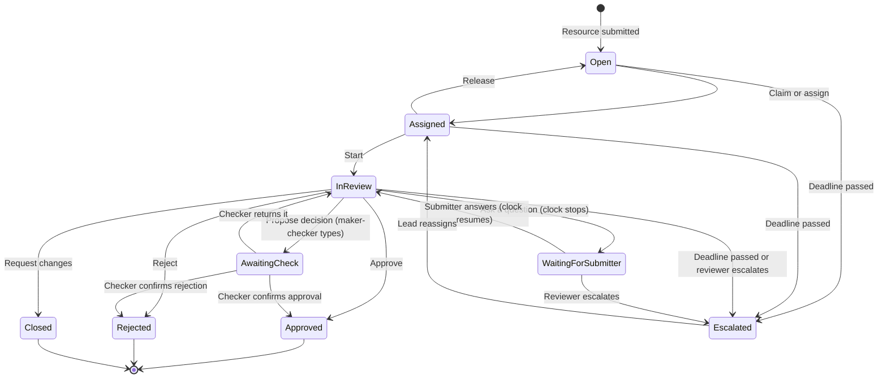

The allowed transitions are data (`CASE_TRANSITIONS` in `review-case.service.ts`). One service method (`actOnCase`) applies an action, its effect on the reviewed resource, and the transition, outbox and audit records, all in one transaction.

| Action | From | To | Who | Rules and effects |
| --- | --- | --- | --- | --- |
| claim | `open` | `assigned` | Reviewer with the case type's role | Sets `assignedTo`; conflict-of-interest check |
| assign | `open`, `assigned`, `escalated` | `assigned` | `operations_manager` | Names the assignee |
| release | `assigned` | `open` | Assigned reviewer | Back to the queue |
| start | `assigned` | `in_review` | Assigned reviewer | — |
| ask | `in_review` | `waiting_for_submitter` | Assigned reviewer | The question is required; the SLA clock stops (`pausedAt`) |
| answer | `waiting_for_submitter` | `in_review` | Submitter (a member with the `respond` permission) | The deadline moves by the working days waited |
| propose | `in_review` | `awaiting_check` | Assigned reviewer (maker) | Only for maker-checker case types; records `proposedDecision` and `proposedBy` |
| return | `awaiting_check` | `in_review` | Checker | Reason required; clears the proposal |
| approve / reject | `in_review` (single-person types) or `awaiting_check` | `approved` / `rejected` | Assigned reviewer, or the checker | The checker must be a different person and can only confirm the proposed decision; reject needs a reason |
| request_changes | `in_review` | `closed` (`decision: request_changes`) | Assigned reviewer | Reason required; the resubmission opens a new case linked by `previousCaseId` |
| escalate | `open`, `assigned`, `in_review`, `waiting_for_submitter` | `escalated` | System when the deadline passes; assigned reviewer with a reason | The lead is notified and reassigns |

Rules:

1. **Exact version.** A case names the version under review (`resource.version`), so a decision always applies to the content the reviewer saw. A decision on a case whose version is no longer current is refused.
2. **Roles per case type** (CASL `review` on `ReviewCase`, §8.4): `listing_reviewer` for technology, IP and demand reviews; `verification_reviewer` for organization verification; `operations_manager` assigns. Only the assigned reviewer acts on an assigned case.
3. **Conflict of interest.** A reviewer who is a member of the organization that owns the resource cannot act on the case.
4. **Service level.** The deadline (`dueAt`) is N working days after the case opens, computed with the working-day calendar (§6.10). The initial targets come from §14: organization verification 3 WD, technology 5 WD, IP 5 WD, demand 3 WD, introduction 2 WD and dispute first response 5 WD. Targets are configurable. Time spent waiting for the submitter does not count: when the submitter answers, the deadline moves by the working days waited, not counting the day the question was asked. `pausedWorkingDays` keeps the total, so reports can separate staff time from waiting time (§14).
5. **Escalation.** A job escalates `open`, `assigned` and `in_review` cases every 15 minutes once their deadline has passed. Cases waiting for the submitter are not escalated. The transition is recorded with the system actor, and the lead is notified. The operations dashboard also flags cases unclaimed for more than 4 business hours ([10 §5.2](10-product-requirements.md)).
6. **Maker-checker** (FR-ADM-02) for the case types in `CHECK_REQUIRED`: organization verification now, and venue submissions and certificate records in R3. The maker proposes approve or reject; a different person confirms it or returns it with a reason. The checker cannot reverse the decision silently. Both people are recorded (`proposedBy`, `checkedBy`).
7. **No calendar, no deadline.** If the calendar year is not published, the case gets `dueAt: null` and the dashboard raises an alert. The deadline is filled in when the year is published (§6.10). It is never guessed.

Effect of a case decision on the resource (same transaction):

| Case type | Action | Resource status change |
| --- | --- | --- |
| Technology | claim, assign | `submitted` → `in_review` (a revision stays `update_pending`) |
| Technology | approve | `in_review` → `approved`, then the publishing service publishes (§6.8); a revision goes `update_pending` → `published` (`approve_revision`) |
| Technology | reject | `in_review` → `rejected`; a revision goes `update_pending` → `published` (`reject_revision`, the old snapshot stays live) |
| Technology | request_changes | `in_review` → `changes_requested`; for a revision, `reject_revision` with the reason |
| Organization verification | claim, assign / approve / reject / request_changes | `pending` → `in_review` / `verified` (level 3) / `rejected` / `pending` |

*Implementation status:* verified in [`draft-implementation/`](draft-implementation/README.md) (`review-case.service.ts`, `tests/test-workflow.js`) for technology and organization cases. Other case types record their decisions on the case; their resource effects are added with their modules.

### 6.8 Publishing service: snapshots, search and public pages

The publishing service turns an approved listing version into the **publication snapshot** (`technology_publications`). Search, public pages and matching read only this snapshot (§4.3). The service runs in the worker.

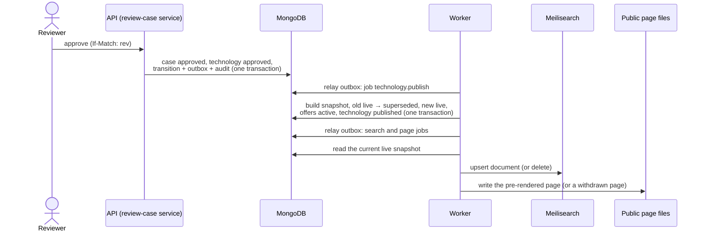

Rules:

- **Preconditions.** Before the publish job publishes a version, it checks four things:
  - an approved review case exists for exactly that version;
  - the version is frozen;
  - it has a public summary;
  - the owner organization is verified.

  Production adds three more: public attachments are scanned clean (§9.1), the public text has passed content moderation (FR-ADM-08), and no export-control block applies (FR-CMP-05). If a precondition fails, the job ends as a dead letter (§6.9). The technology stays `approved` and appears on the operations dashboard. Nothing is half-published.
- **Idempotent.** The job does nothing if this version or a newer one is already live, or if the technology was suspended or archived in the meantime.
- **One transaction for the swap.** The old live snapshot becomes `superseded` before the new one is inserted. So the unique partial index (one `live` snapshot per technology) holds at every moment, and readers see either the old or the new snapshot.
- **Consumers read the current state.** The search and page jobs ignore what the event says. They load the current live snapshot, and delete the entry or page if there is none. So jobs that arrive late, twice or out of order still converge on the right result. The search document is built only from snapshot fields.
- **Visibility** (the owner's disclosure setting):
  - `public`: indexed, with a public page;
  - `restricted`: indexed with `visibility: restricted`, which the API filters out for anonymous visitors; no page and no sitemap entry;
  - `private`: the snapshot exists only for broker-led matching.
- **Suspension** withdraws the snapshot in the suspension transaction. Search results are re-checked against the current status (FR-SRC-08), so the listing disappears from results at once. Jobs then delete the index entry and replace the page with a "withdrawn" page (HTTP 410). **Reinstatement** publishes the latest approved version again.
- **Timing** (FR-TEC-12, ≤ 5 minutes): the worker polls the outbox and the job queue every second. `publication_lag_seconds` (from approval to the index update) is a metric, and an alert fires at 5 minutes (§11.6).
- **Reconciliation.** A daily job compares live snapshots, search-index IDs and page files. Any drift gets sync jobs and a log entry.
- **Public demands** (`anonymous_public`) use the same pattern with a `demand_publications` collection built from the anonymized public version (FR-DEM-04). This collection is added with the demand module.
- **Sitemap and Baidu push.** The sitemap is rebuilt hourly. New or changed public pages are pushed in batches within the daily push quota ([11 §7](11-target-runtime-node12-mongodb.md)).

*Implementation status:* verified in `publishing.service.ts` and `tests/test-workflow.js`: snapshot swap, offer activation, idempotent re-run, suspension, reinstatement, a dead letter for an unapproved version, and search and page sync with in-memory stand-ins for Meilisearch and the page files.

### 6.9 Background work: outbox, leased jobs, retries and dead letters

All asynchronous work runs in the worker process (`tex-worker`) on two MongoDB collections, with no Redis ([05 §3.2](05-system-design-blueprint.md)):

| Collection | Holds | Written by |
| --- | --- | --- |
| `outbox_events` | Facts that happened, such as `technology.published` | Services, in the same transaction as the change |
| `jobs` | Work to do, such as `search.sync_technology` for event X, with lease, attempts and result | The outbox relay, the scheduler, and services for commands (bulk import, re-index) |

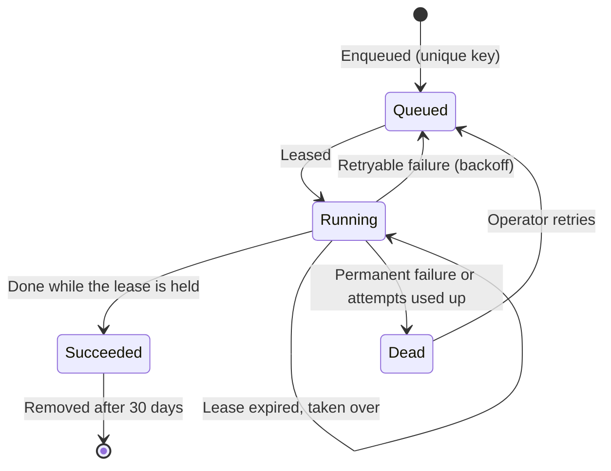

1. **Outbox relay.** The relay leases the oldest pending event (60 s lease). It creates one job per subscribed handler, with the key `<eventId>:<handler>`, then marks the event `published`. No transaction is needed: unique job keys make a second relay after a crash harmless. Relayed events are kept for 30 days (TTL index on `expireAt`). An event that fails to relay 10 times is marked `failed` and raises an alert.
2. **Fan-out.** Each handler gets its own job, so retries are independent: a failing SMS does not re-run search indexing.
3. **Leasing.** One atomic `findOneAndUpdate` takes the job and marks it `running`. Eligible jobs are queued jobs whose `runAt` has passed, and running jobs whose lease has expired. The highest priority goes first, then the earliest `runAt`. The update sets a new random lease token and `lockedUntil`, and increments `attempts`. Two workers can never hold the same lease.
4. **Long jobs** renew their lease every third of its length (default lease 5 minutes). A worker whose renewal or completion is refused has lost the lease: it stops and discards its result.
5. **Completion and failure** are accepted only from the holder of the current lease token.
   - **Retryable failures** go back to `queued` with exponential backoff: 30 s × 2^(attempt − 1), capped at 1 hour, plus up to 10% jitter. The default is 8 attempts, about one hour in total.
   - **Permanent failures** (`PermanentJobError`: invalid payload, missing record, failed precondition) go to `dead` at once.
   - **Crash loops:** a job whose lease expired more often than its attempt limit is treated as a crash loop and dies.
6. **Dead letters.** A dead job keeps `lastError` and appears on the operations dashboard (FR-ADM-01). Operators can retry it from attempt 0 or discard it with a reason; both actions are audited. An alert fires whenever a job dies.
7. **Idempotent handlers.** Every handler must give the right result when it runs twice:
   - upsert rather than insert;
   - send the job key as the request ID to providers that support one;
   - read the current state instead of trusting the payload.
8. **Jobs in transactions.** `enqueueJob(spec, session)` can join a business transaction, so scheduling commits or rolls back with the change.
9. **Scheduling.** `node-cron` in the worker enqueues scheduled jobs with keys derived from the time slot (for example `review.escalate:2026-10-19T09:15`). A restart or a second worker therefore never schedules the same run twice.
10. **Scaling.** One worker at launch. A second worker can run without code changes. Production runs a small pool (for example 4 concurrent jobs) with a limit of one at a time for heavy types (imports, re-index).
11. **Retention and content.** Succeeded jobs are kept for 30 days (TTL index on `expireAt`); dead jobs are kept until handled. Payloads hold references, never secrets or confidential document content.

Scheduled jobs:

| Job | When | Purpose |
| --- | --- | --- |
| `review.escalate_overdue` | Every 15 minutes | Escalate overdue cases (§6.7) |
| `review.fill_due_dates` | After a calendar year is published | Fill deadlines that could not be computed (§6.10) |
| `demand.expire` | Daily 01:00 | Expire demands past their target date (§6.2) |
| `offer.expire`, `offer.release_reservations` | Daily 01:10 | Offer validity and reservations (§6.6) |
| `technology.stale_check` | Daily 02:00 | Re-confirmation reminders, hiding and archiving (FR-TEC-13) |
| `ip.legal_status_due` | Daily 02:30 | IP assets due for their 6-monthly legal-status check (FR-TEC-05) |
| `publication.reconcile` | Daily 03:00 | Snapshot, index and page consistency (§6.8) |
| `sitemap.rebuild` | Hourly | Sitemap and Baidu push (§6.8) |
| `calendar.next_year_check` | Daily from 1 November | Alert while next year's calendar is not published (§6.10) |
| `payment.reconcile` (R3) | Daily 06:00 | Compare the provider statement with payment records (§6.11) |

*Implementation status:* the job queue (`core/jobs/`), the outbox relay and the publishing handlers are verified in `tests/test-workflow.js`, on MongoDB 4.4 and 5.0. The checks cover: idempotent enqueue; five workers racing for one lease; expired-lease takeover; refused completion after a lost lease; backoff; dead letters and operator retry; rollback with the business transaction; and relaying again after a crash. The scheduler and the worker's polling loop are a specification.

### 6.10 Working-day calendar

Venue rules, university notices and the platform's own service levels count time in working days (WD) on the official China calendar (FR-ADM-09). China moves working days around public holidays (调休): some Saturdays and Sundays become working days. A plain Monday-to-Friday rule is therefore wrong several times a year.

**Data.** Only the exceptions to the Monday-to-Friday week are stored:

| Collection | Fields |
| --- | --- |
| `calendar_years` | `_id` (the year), `status` (`draft` or `published`), `source` (the notice number), `preparedBy`, `checkedBy`, `publishedAt` |
| `calendar_days` | `_id` (`YYYY-MM-DD`), `year`, `kind` (`holiday` or `makeup_workday`), `name` |

**Maintenance.** Each year's arrangement comes from the State Council General Office notice (国务院办公厅关于××年部分节假日安排的通知), published towards the end of the previous year. The 2026 notice is 国办发明电〔2025〕7号 ([official text](references/official-texts/gov-holidays-2026-guobanfamingdian-2025-7.txt)).
1. An administrator enters the holidays and make-up working days, with the notice number.
2. A second administrator checks them against the notice and publishes the year. The code and a database validator both enforce that the checker is a different person.
3. From 1 November, a daily check raises an alert until next year's calendar is published.

Corrections to a published year follow the same two-person step. A recompute job then updates open deadlines and records each change in the audit trail.

**Algorithm** (`core/calendar/working-days.ts`):

1. A day is a working day if it is a make-up working day. Otherwise it is not a working day if it is a holiday. Otherwise it is a working day from Monday to Friday.
2. A period starts on the day after the event (Civil Code Art. 201). An event at 09:00 and one at 23:30 on the same day give the same deadline.
3. "N working days after an event" ends at 24:00 Asia/Shanghai on the N-th working day after the event's local date. Where a rule uses business hours, it ends at a configured cut-off time instead (Civil Code Art. 203).
4. Calendar-day periods (for example the ≥ 15-day public notice) count every day. If the last day is not a working day, the period ends on the next working day (Art. 203).
5. A pause moves a deadline by the working days waited (§6.7).
6. If a computation needs a day in a year that is not published, it fails (`CalendarMissingError`). The caller stores no deadline and raises an alert; it never guesses. Instants are stored in UTC; local dates use Asia/Shanghai (UTC+8, no daylight saving).

| Kind of rule | Examples | Computation |
| --- | --- | --- |
| At most N WD | Review ≤ 3 WD, contract within 5 WD, corrections ≤ 3 WD | `addWorkingDays`: the act is due by the deadline |
| At least N WD | Disclosure ≥ 5 WD, tender preparation ≥ 10 WD, procurement listing ≥ 20 WD | `addWorkingDays` gives the earliest end; the platform never ends the period sooner |
| At least N calendar days | Public notice ≥ 15 days, ownership-grant notice ≥ 15 days | `addCalendarDays`, extended to a working day |
| Business hours | Review unclaimed ≤ 4 business hours | Working days, 09:00–18:00 by default (configurable) |

Worked example (2025 National Day under 国办发明电〔2024〕12号: 1–8 October off; Sunday 28 September and Saturday 11 October worked):

| Event | Rule | Deadline |
| --- | --- | --- |
| Review case opened Tue 30 Sep 2025, 10:00 | 5 WD | End of Tue 14 Oct (9, 10, 11 make-up, 13, 14 Oct) |
| Public notice published Sat 20 Sep 2025 | ≥ 15 days | Day 15 is Sun 5 Oct, a holiday, so the notice runs to the end of Thu 9 Oct |
| Clock paused 30 Sep 10:00, answered 10 Oct 09:00 | Pause | Deadline + 2 WD (9 and 10 Oct) |

For venue periods, the venue is the authority. STEX closes on exactly the State Council holiday days and reopens on the next working day ([09 §2.7](09-reference-platform-features.md)), so the same calendar applies. The platform's computation drives tracking and reminders, and the venue's announced dates are stored when they differ.

*Implementation status:* verified (`working-days.ts`, `calendar.model.ts`). The tests use the 2025 National Day arrangement and check the maker-checker publication of a year, including the database validator.

### 6.11 Payments: one adapter, kept simple

**Owner decision (2026-10-19, D-02 in [12](12-decision-record.md)):** payments go through the owner's own payment testing platform, behind one adapter, and the payment design stays shallow. The platform still never holds client money ([08 §1.2](08-china-operating-model.md)). For live money, a bank or licensed payment institution plugs into the same adapter, after the confirmation in [08 §10 B](08-china-operating-model.md).

| Piece | Design |
| --- | --- |
| `PaymentGateway` adapter | `createPayment(request)` returns the provider payment ID plus a pay URL or QR code. Other operations: `queryPayment(id)`; `refund(id, amount, reason)`; `verifyNotification(headers, rawBody)`, which returns a verified event or throws; `fetchStatement(date)`. One implementation, `owner_test`, for the owner's testing platform; its endpoint and keys come from environment variables. Mapping these five operations to that platform's API is the whole integration |
| `payment_requests` | `ref` (`PAY-000123`); purpose (`deal_milestone` or `platform_fee`); payer and payee organizations; amount `{ currency, amountMinor }`; deal and milestone references; status; provider payment ID; idempotency key; `expiresAt` |
| `payment_events` | Append-only verified provider events, unique per provider event ID, with a hash of the raw body and the time received |

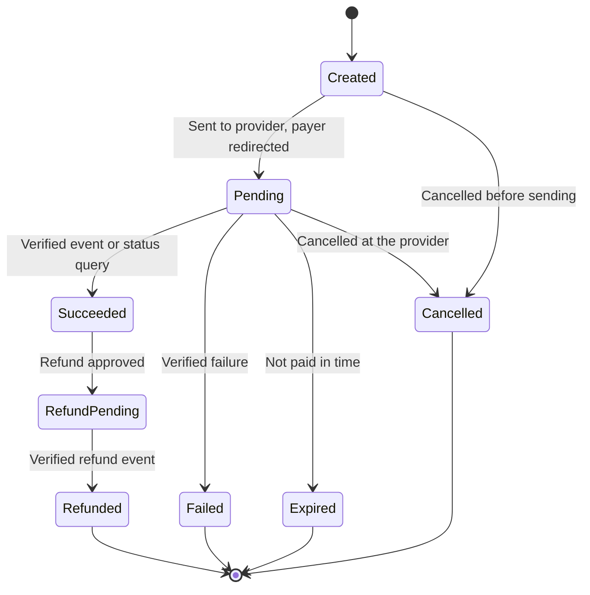

Rules:

1. Only a verified provider event, or a status query from the server, changes a payment's status. The payer's browser redirect never does.
2. Duplicate notifications are ignored (unique provider event ID). Out-of-order notifications cannot move a payment backwards.
3. Create and refund calls carry the payment request's idempotency key. They run as jobs, never inside a database transaction, and retry with the job backoff (§6.9).
4. A succeeded payment linked to a milestone satisfies that milestone's payment condition. The deal still reaches `ready_to_complete` only through its normal completion check (§6.4).
5. Finance requests a refund with a reason, and a second finance user approves it (maker-checker). A refund never exceeds the amount paid.
6. A daily job reconciles the provider statement with `payment_requests`. Any difference (missing payment, amount or status) opens a finance case and raises an alert.
7. Out of scope by the owner's decision: conditional holding, split payouts, wallets and provider-side commission splits. The provider models in [07 §6](07-roles-workflows-and-money.md) and [08 §6](08-china-operating-model.md) remain background for a later production provider.
8. Venue-routed deals settle through the venue (FR-VEN-08), not through this adapter.

*Implementation status:* specification (R3); requirements FR-PAY-01 … FR-PAY-04 in [10 §3.18](10-product-requirements.md).

---

## 7. User interface and user experience

Organize the interface around **tasks**, not just data records. The three primary experiences are:

1. Supplier workspace.
2. Buyer workspace.
3. Exchange operations workspace for platform staff.

### 7.1 Main navigation

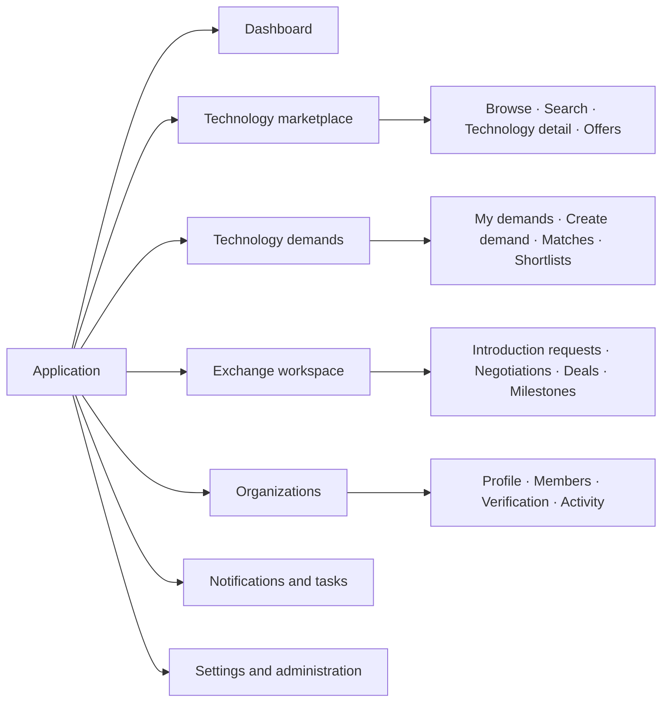

Menu items are permission-aware. Hiding a menu item is a **usability feature, not an authorization mechanism**; the backend enforces access independently.

### 7.2 Supplier journeys

**Supplier dashboard** shows: verification status and outstanding evidence requests · draft technologies · technologies awaiting review · published technologies and active offers · incoming introduction requests · active negotiations and milestones · recent activity and notifications.

Primary actions: `Add technology` · `Create offer` · `Complete organization verification` · `Review introduction request`. The dashboard prioritizes the **next required action**, not just counts.

**Technology creation wizard** (multi-step, with autosave):

| Step | Content | Validation highlights |
| --- | --- | --- |
| 1. Basic information | Title, summary, category, industry, application | Taxonomy codes validated |
| 2. Technical profile | Problem solved, operating principles, advantages, limitations, specifications, TRL | TRL claim needs evidence for levels ≥ 4 |
| 3. Rights and evidence | Patent references, ownership claims, rights holders, supporting documents | Patent number format per jurisdiction; uploads quarantined |
| 4. Commercial offer | Licence, assignment, partnership, pilot; territories; exclusivity; indicative terms | Offer must be consistent with the rights claimed |
| 5. Disclosure settings | Public fields, registered-user fields, restricted documents | Preview of the exact public view |
| 6. Review and submit | Completeness report, declarations, final submission | Declarations mandatory |

UX requirements:

- Save drafts automatically.
- Show completion percentage, but never block saving a draft.
- Distinguish required, recommended and optional evidence, and explain why each field is requested.
- **Preview exactly what public users will see.**
- Flag inconsistent information without rewriting it automatically.
- Show reviewer feedback next to the relevant field.

**Supplier technology detail** sections: Overview · Technical specifications · Applications and industries · Rights and evidence · Commercial offers · Review history · Documents and access · Activity and analytics. Supplier-only information must never leak into public HTML, API payloads or search snippets.

### 7.3 Buyer journeys

**Buyer dashboard** shows: active demands · demands awaiting clarification or approval · new qualified matches · shortlisted technologies · pending introductions · active evaluations and negotiations · recently completed opportunities. Primary actions: `Create technology demand` · `Explore technologies` · `Review new matches` · `Manage introductions`.

**Demand creation wizard**

| Step | Content |
| --- | --- |
| 1. Business problem | The problem and the desired result |
| 2. Technical requirements | Mandatory capabilities, acceptable alternatives, excluded approaches |
| 3. Maturity and deployment | Minimum readiness, integration, production and regulatory requirements |
| 4. Commercial conditions | Indicative budget, licensing preference, territory, timeline |
| 5. Disclosure | Public summary, anonymous publication, verified-user access, or private broker-led search |
| 6. Review and submit | Validation, confidentiality review, approval |

The wizard distinguishes hard constraints from preferences: "TRL 7 is mandatory" versus "TRL 5 is acceptable if a funded development plan exists".

**Search and discovery page** (wireframe, not live data):

```text
+--------------------------------------------------------------------------+
| Search technologies: [ keywords or natural-language question      ] (Go) |
+----------------------+---------------------------------------------------+
| FILTERS              | Technology title                                  |
|  Industry        [v] | Summary · maturity (TRL) · application            |
|  Technology type [v] | Verified claims · available offer types           |
|  TRL           [5-9] | [View details]  [Shortlist]                       |
|  Transaction type[v] +---------------------------------------------------+
|  Territory       [v] | Technology title                                  |
|  Rights status   [v] | Summary · maturity (TRL) · application            |
|                      | Evidence status · commercial availability         |
|                      | [View details]  [Shortlist]                       |
+----------------------+---------------------------------------------------+
```

Result cards communicate: what the technology does · which problem it solves · maturity and evidence status · which commercial arrangements are available · which compatibility questions remain open. Never show confidential price ranges or rights details to unauthorized users.

**Match review page.** Each match shows:

1. Technical fit and evidence.
2. Hard constraints satisfied or failed.
3. Readiness and deployment gaps.
4. Rights and offer compatibility.
5. Indicative commercial fit, if disclosed.
6. An explanation of the ranking.
7. Actions: shortlist, reject, request clarification, request introduction.

Feedback is structured: not technically relevant · wrong maturity · incompatible rights · unsuitable commercial terms · insufficient evidence · already known to the buyer · interested in evaluation. This feedback becomes the training and evaluation dataset for matching.

### 7.4 Deal workspace

One consistent structure for buyers, suppliers and assigned brokers, with different permissions for each:

```text
+------------------------------------------------------------------------+
| DEAL-000042 · Parties: Buyer Co., Example University · Manager: Lee     |
+------------------------------------------------------------------------+
| [Overview] [Negotiation] [Documents] [Milestones] [Completion]          |
+------------------------------------------------------------------------+
| Overview      Commercial summary, transaction type, objectives,         |
|               expected milestones                                       |
| Negotiation   Dated proposals, responses, decisions, approvals and      |
|               authorized communications (timeline)                      |
| Documents     Restricted documents, contract versions, approval         |
|               evidence, access history                                  |
| Milestones    Deliverables, due dates, owners, evidence, status         |
| Completion    Required approvals, executed contract evidence,           |
|               outstanding conditions, final outcome                     |
+------------------------------------------------------------------------+
```

A stage change requires a **specific action** and, where appropriate, supporting evidence. The UI never offers a generic editable status drop-down.

### 7.5 Administrator screens

| Screen | Main functions |
| --- | --- |
| Operations dashboard | Review workload, overdue cases, stalled deals, escalations |
| Organization verification | Legal identity, authority, evidence and appeals |
| Technology review queue | Claim cases, inspect submissions, request corrections, approve publication |
| Rights and evidence review | Examine IP claims, scope verification, record disputes |
| Demand review | Validate requirements and publication scope |
| Match review | Inspect ranking rationale, reject false positives, assign manual scouting |
| Introduction management | Review requests, assign broker, coordinate disclosures |
| Deal operations | Monitor negotiations, approvals, milestones and exceptions |
| Document access audit | Investigate access, permissions and download events |
| Finance operations | Reserved for the later finance integration |
| Taxonomy administration | Categories, translations, aliases, deprecated codes |
| User and organization administration | Suspend accounts, revoke memberships, process appeals |
| Audit and reporting | Search events, export permitted reports, investigate incidents |
| System configuration | Controlled settings, notification templates, policies |

**Review case detail screen** shows: case ID and type · resource and version under review · status and priority · assigned reviewer and deadline · evidence and checklist · conflict-of-interest declaration · previous decisions and requested corrections · decision controls with a mandatory reason · audit history. Reviewers can save work without deciding; approve and reject are distinct, deliberate actions.

---

## 8. Permission matrix

A technology exchange needs more than role-based menus. Combine role-based permissions with resource ownership, organization membership, deal participation and document-specific access.

### 8.1 Platform-level roles

| Capability | Anonymous | Registered user | Organization member | Broker | Reviewer | Admin |
| --- | --- | --- | --- | --- | --- | --- |
| Browse public listings | Yes | Yes | Yes | Yes | Yes | Yes |
| Create personal profile | No | Yes | Yes | Yes | Yes | Yes |
| Create organization | No | Yes | Policy | Policy | Policy | Yes |
| Create technology | No | No | With role | Authorized only | Authorized only | Exception only |
| Create demand | No | No | With role | Authorized only | Authorized only | Exception only |
| Submit technology for review | No | No | With role | Authorized only | No by default | Exception |
| Review technology | No | No | No | No by default | Assigned scope | Authorized scope |
| View confidential deal room | No | No | If permitted | Assigned deals | Case-related need | Exceptional authorized need |
| Assign brokers | No | No | No | No | No | Authorized operations role |
| Suspend public listing | No | No | Request only | Escalate | Within policy | Authorized role |
| Manage global policies | No | No | No | No | No | Security administrator |

A platform administrator is **not** automatically entitled to browse every confidential document. Privileged access is granted through a separate, audited permission.

The columns are groups of platform staff roles, stored in `platform_role_assignments.roleCode` (`PLATFORM_ROLES` in `user.model.ts`). A temporary assignment has an `expiresAt` (FR-ADM-10).

| Column | Role codes |
| --- | --- |
| Broker | `platform_technology_manager` (a platform-employed technology manager, 技术经理人) |
| Reviewer | `listing_reviewer`, `verification_reviewer`, `compliance_officer` |
| Admin | `operations_manager`, `system_admin`, `security_admin` |
| Other staff roles | `finance_officer`, `support_agent` |

### 8.2 Organization-level roles

| Permission | Owner | Org admin | Technology manager | Demand manager | Deal manager | Viewer |
| --- | --- | --- | --- | --- | --- | --- |
| View organization profile | Yes | Yes | Yes | Yes | Yes | Yes |
| Edit organization profile | Yes | Yes | Limited | Limited | Limited | No |
| Invite and revoke members | Yes | Delegated | No | No | No | No |
| Manage technologies | Yes | Yes | Yes | No | Limited | Read only |
| Manage offers | Yes | Yes | Yes | No | Limited | Read only |
| Manage demands | Yes | Yes | No | Yes | Limited | Read only |
| View authorized matches | Yes | Yes | Relevant scope | Yes | Relevant scope | Read only |
| Request introductions | Yes | Yes | Relevant scope | Yes | Yes | Policy |
| Manage assigned deals | Yes | Yes | Limited | Limited | Yes | Read only |
| Export organization records | Yes | Policy | Policy | Policy | Policy | No |

The columns are the role codes in `organization_memberships.roleCodes`: `org_owner`, `org_admin`, `technology_manager`, `demand_manager`, `deal_manager`, `viewer`. A member may hold several roles, and only memberships with status `active` count.

**Terminology.** The organization role `technology_manager` means "manages this organization's technology listings". It is **not** the 技术经理人 (technology manager in the sense of a technology-transfer broker) of [10](10-product-requirements.md), who works on demands and deals for others. A platform-employed broker holds the staff role `platform_technology_manager` (§8.1).

`Limited` and `Policy` must resolve to **explicit permissions in code** (for example `technology.edit_offer_terms`), never to undocumented assumptions.

### 8.3 Authorization model

Every request evaluates four dimensions:

| Dimension | Question |
| --- | --- |
| Identity | Who is making the request? |
| Role | What actions may that role perform? |
| Relationship | Does the user belong to the relevant organization or deal? |
| Resource policy | Is this particular version, field, document or action accessible in the current state? |

Being a `technology_manager` does not grant access to another organization's unpublished technology. Being assigned as broker to one deal does not grant access to every deal.

### 8.4 Implementation

Policies are written once with **CASL 5** (verified on Node 12.4). For each request the API builds the caller's ability from the session (`SessionUser`: active memberships, platform roles, explicit access grants), and the services check it on every document they load or create. The frontend uses the same rules only to hide unavailable actions.

```typescript
// src/modules/identity/abilities.ts — RBAC + ABAC policy with CASL 5 (verified on Node 12.4).
// CASL recognises a Mongoose document by its model name, so services check loaded documents directly:
//   ForbiddenError.from(ability).throwUnlessCan('submit', tech)
// and list endpoints turn the same rules into a MongoDB filter:
//   Technology.accessibleBy(ability, 'update')
import { Ability, AbilityBuilder, AbilityClass, ForcedSubject } from '@casl/ability';
import { Types } from 'mongoose';
import type { DealDoc } from '../deals/deal.model';
import type { DemandDoc } from '../demands/demand.model';
import type { DocumentFileDoc } from '../documents/document.model';
import type { TechnologyDoc } from '../technology/technology.model';
import type { ReviewCaseDoc } from '../workflow/workflow.model';

export type Action =
  | 'create' | 'read' | 'update' | 'submit' | 'review' | 'suspend' | 'reinstate' | 'delete'
  | 'respond'                                        // answer a reviewer's question (§6.7)
  | 'assign';                                        // assign or reassign a review case
export type SubjectName = 'Technology' | 'Demand' | 'Deal' | 'DocumentFile' | 'ReviewCase';

// Plain objects (e.g. API payloads, tests) can be checked with subject('Technology', obj).
type PlainSubject = ForcedSubject<SubjectName> & Record<string, unknown>;
export type AppSubject = SubjectName | TechnologyDoc | DemandDoc | DealDoc | DocumentFileDoc | ReviewCaseDoc | PlainSubject;
export type AppAbility = Ability<[Action, AppSubject]>;
const AppAbility = Ability as AbilityClass<AppAbility>;

export interface SessionUser {
  userId: Types.ObjectId;
  memberships: { organizationId: Types.ObjectId; roleCodes: string[]; status: 'active' | 'invited' | 'revoked' }[];
  platformRoles: string[];                                            // from platform_role_assignments
  accessGrants: { resourceType: SubjectName; resourceId: Types.ObjectId }[];   // explicit grants (e.g. NDA-covered)
}

const MANAGES_TECHNOLOGY = ['org_owner', 'org_admin', 'technology_manager'];
// 06 §6.1: drafts and revised listings are submitted for review; a published listing submits a revision.
const SUBMITTABLE: string[] = ['draft', 'changes_requested', 'published'];
const LOCKED: string[] = ['submitted', 'in_review', 'approved', 'update_pending', 'rejected', 'suspended', 'archived'];

export function defineAbilityFor(user: SessionUser | null): AppAbility {
  const { can, cannot, build } = new AbilityBuilder(AppAbility);

  // Everyone, including anonymous visitors: published public listings only.
  can('read', 'Technology', { lifecycleStatus: 'published', visibility: 'public' });

  if (user) {
    for (const m of user.memberships.filter((x) => x.status === 'active')) {
      can('read', 'Technology', { ownerOrganizationId: m.organizationId });
      if (m.roleCodes.some((r) => MANAGES_TECHNOLOGY.includes(r))) {
        can(['create', 'update', 'submit'], 'Technology', { ownerOrganizationId: m.organizationId });
        can('respond', 'Technology', { ownerOrganizationId: m.organizationId, lifecycleStatus: { $in: ['in_review', 'update_pending'] } });
        can('delete', 'Technology', { ownerOrganizationId: m.organizationId, lifecycleStatus: 'draft', currentVersion: 1 });
      }
    }
    for (const g of user.accessGrants) {
      can('read', g.resourceType, { _id: g.resourceId });
    }
    if (user.platformRoles.includes('listing_reviewer')) {
      can('review', 'Technology', { lifecycleStatus: { $in: ['submitted', 'in_review', 'update_pending'] } });
      can('review', 'ReviewCase', { caseType: { $in: ['technology_review', 'ip_verification', 'demand_review'] } });
      can('reinstate', 'Technology', { lifecycleStatus: 'suspended' });
    }
    if (user.platformRoles.includes('verification_reviewer')) {
      can('review', 'ReviewCase', { caseType: 'organization_verification' });
    }
    if (user.platformRoles.includes('operations_manager')) {
      can('assign', 'ReviewCase');
    }
    if (user.platformRoles.includes('compliance_officer')) {
      can('suspend', 'Technology', { lifecycleStatus: 'published' });
    }
  }

  // State rules apply on top of role rules ("cannot" wins over "can").
  cannot('submit', 'Technology', { lifecycleStatus: { $nin: SUBMITTABLE } });
  cannot('update', 'Technology', { lifecycleStatus: { $in: LOCKED } });
  return build();
}
```

The same rules are used in two ways:

```typescript
// 1. Check one loaded (or unsaved) Mongoose document: CASL recognises it by its model name.
ForbiddenError.from(ability).throwUnlessCan('submit', tech);              // 403 if not allowed

// 2. Turn the rules into a MongoDB filter for lists (@casl/mongoose accessibleRecordsPlugin).
const editable = await Technology.accessibleBy(ability, 'update')
  .setOptions({ tenant: actor })                                            // tenant scope still applies
  .sort({ updatedAt: -1 })
  .lean();
const reviewQueue = await Technology.accessibleBy(reviewerAbility, 'review')
  .setOptions({ crossTenant: { reason: 'review-queue' } });               // staff queue spans organizations
```

The verification run checks this policy on plain objects and on Mongoose documents. A technology manager can submit their own draft and a revision of a published listing, but not a listing already in review, and cannot edit another organization's technology or a listing with a pending update. A viewer can read but not submit. Anonymous visitors see only published public listings. A reviewer can review submitted listings but not drafts, and the reviewer queue spans organizations. A role without a matching rule gets a `ForbiddenError` from `accessibleBy`, not an empty list; the error middleware turns it into `403 PERMISSION_DENIED`, like every other `ForbiddenError` (§5.6).

The draft policy covers technologies and review cases (who may act on which case type, §6.7). Demands, deals and documents follow the same pattern: their subject types are already declared, and their rules are added with their services. Public pages and public search do not use this policy at all: they read only the approved snapshots in `technology_publications` (§10).

The policy decides **what** an actor may do. The tenant-scope plugin (§4.8) decides **which documents can be loaded at all**. Both are required. Field-level visibility (public, registered-user, NDA-covered fields) is applied by the response serializer of each endpoint. Test authorization at the **service layer and the API boundary**; never rely on the frontend.

---

## 9. Security and confidentiality design

### 9.1 Document upload and access sequence

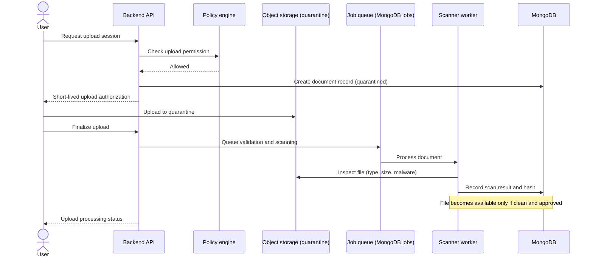

Required controls:

- Private storage by default.
- File size and permitted-type limits.
- Malware scanning (for example ClamAV in an isolated worker).
- Cryptographic file hashes.
- Metadata extraction in a restricted worker.
- No indexing of unapproved confidential text.
- Per-resource access grants.
- Short-lived download authorization.
- Audit events for sensitive access.
- Retention and deletion policies.
- Encrypted, access-restricted backups.

If the scanner is unavailable, files **stay quarantined**. Never make documents available just because a timeout elapsed.

**Malware scanning design.** The scanner is ClamAV's `clamd` daemon on the application server, listening only on `127.0.0.1:3310`. The worker streams each file to it with the `INSTREAM` command: a short client on Node's `net` module, so no extra dependency. The flow uses the states already in the `documents` model (`scanStatus`, `lifecycleStatus`):

| Step | What happens | `scanStatus` / `lifecycleStatus` |
| --- | --- | --- |
| Upload finalized | File in the quarantine directory; a `document.scan` job is enqueued (§6.9) | `pending` / `quarantined` |
| Type check | Magic bytes are checked against the allow-list and the declared extension (NFR-04: PDF, Office, images, ZIP) | A mismatch is rejected: `failed` |
| Scan clean | The SHA-256 hash is recorded, the file moves to private storage, and the document becomes available to the grants that apply | `clean` / `available` |
| Malware found | The file stays in quarantine for 30 days for incident review, then is deleted. The uploader is told; a security alert is raised; an audit event is written | `infected` / `quarantined` |
| Scanner error or timeout | The job retries with backoff (§6.9). After the last attempt it becomes a dead letter and raises an alert. The file stays quarantined | `pending`, then `failed` / `quarantined` |

`clamd.conf` must allow the NFR-04 size limit: `StreamMaxLength`, `MaxFileSize` and `MaxScanSize` of at least 210 MB (the defaults are much lower and would reject large files), and `MaxRecursion` and `MaxFiles` limits for archives. Password-protected archives and documents cannot be scanned, so they are rejected (`AlertEncrypted yes`). `freshclam` updates the signatures several times a day. Check that the server can reach the update mirrors from mainland China; if it cannot, run a private mirror on a host that can. A signature database older than 3 days raises an alert (§11.6). Release tests upload the EICAR test file and expect `infected` (NFR-04).

### 9.2 Authentication and sessions

| Topic | Design |
| --- | --- |
| Login methods | **Mobile number + SMS code** (the norm for Chinese users), or e-mail / mobile + password. WeChat QR login can be added later through WeChat Open Platform OAuth |
| Passwords | `bcryptjs`, cost 12; at least 10 characters; checked against a common-password list |
| SMS codes | 6 digits, valid 5 minutes, stored hashed in `sms_codes` (TTL); at most 1 send per 60 s and 10 per day per number; image CAPTCHA after repeated sends; SMS templates registered with the SMS provider |
| MFA | TOTP (`otplib`) **mandatory for platform staff**; optional for other users; mandatory for organization owners and signatories from R2 (FR-ACC-03) |
| Sessions | Opaque random session ID in a `Secure`, `HttpOnly`, `SameSite=Lax` cookie; session data in the MongoDB `sessions` collection through `express-session` + `connect-mongo` 3.2.0 on the Mongoose connection (TTL index from a migration; 8 h idle, 7 days absolute); rotate the ID on login and on privilege change; revoke all sessions on suspension or password change |
| CSRF | `SameSite` cookies plus a CSRF token header (`X-CSRF-Token`) on every state-changing request |
| Brute force | Nginx `limit_req` on `/api/v1/auth/` plus per-account lockout: 15 minutes after 5 failed attempts (`login_attempts`, TTL; FR-ACC-02) |
| Real-name and enterprise verification | Through provider APIs (see [10](10-product-requirements.md)); results stored as verification levels, never raw ID-card images in the main database |

### 9.3 Audit and incident response

Audit at least:

- Authentication and privileged access.
- Membership and role changes.
- Verification decisions.
- Publication and suspension.
- Confidential document access and permission changes.
- Introduction approvals and rejections.
- Deal stage transitions.
- Contract evidence and completion decisions.
- Financial adjustments (when finance is introduced).
- Policy and configuration changes.

Never put full confidential document contents, passwords, tokens or other secrets in audit logs.

---

## 10. Search and matching implementation

MongoDB 4.4/5.0 cannot search Chinese text: its text index splits words on spaces, so `缺陷检测` returns nothing (verified). Search therefore uses **Meilisearch**, which segments Chinese words. Structured eligibility filtering stays in MongoDB, and scoring runs in the Node worker. Details: [11 §6](11-target-runtime-node12-mongodb.md).

### 10.1 Retrieval and matching pipeline

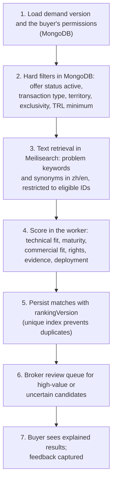

Never rely on a single similarity score to decide legal or commercial eligibility. Hard constraints are filters (step 2), not score components.

### 10.2 Search index setup

```bash
# Run once per environment (and after a full rebuild). Master key only in admin tooling.
curl -X PATCH "$MEILI_URL/indexes/publications/settings" \
  -H "Authorization: Bearer $MEILI_MASTER_KEY" -H 'Content-Type: application/json' \
  --data '{
    "searchableAttributes": ["title.zh", "title.en", "keywords", "summary.zh", "summary.en", "owner.displayName"],
    "filterableAttributes": ["status", "industryCodes", "trl.claimed", "offerTypes", "territories", "badges", "owner.type"],
    "sortableAttributes": ["publishedAt"],
    "synonyms": { "锂电": ["锂电池", "锂离子电池"], "锂电池": ["锂电", "lithium battery"] },
    "pagination": { "maxTotalHits": 1000 }
  }'
```

- Only `technology_publications` (and anonymized public demands, in a second index) are sent to Meilisearch; never drafts, restricted fields or document text.
- The worker upserts or deletes documents when it relays `technology.published`, `technology.updated`, `technology.suspended` and `technology.archived` outbox events. A nightly job reconciles counts and `publishedAt`, and `npm run search:rebuild` recreates the index from MongoDB.
- The API uses a **search-only key**, and re-checks status and permissions in MongoDB before returning results.

### 10.3 Initial ranking model

```text
S = 0.35·T + 0.20·M + 0.15·C + 0.15·R + 0.10·E + 0.05·G
```

T, M, C, R, E and G are normalized (0–100) technical fit, maturity, commercial fit, rights compatibility, evidence quality and geographic compatibility (see [05 §7.3](05-system-design-blueprint.md)).

- The weights are **hypotheses to test**, not benchmarks. Store them under a `rankingVersion` in configuration.
- Mandatory constraints apply **before** ranking. A rights incompatibility makes a candidate ineligible or sends it to manual review; it does not just lower the score.

### 10.4 Matching quality loop

For every recommendation, keep: demand version · offer and technology version · retrieval method · ranking version · score components · evidence · broker decision · buyer feedback · eventual deal outcome. This lets the team test whether a ranking change actually improves introductions and deals.

---

## 11. Self-hosted infrastructure and deployment

Full configuration (systemd units, Nginx, release procedure, backups) is in [11 §5 and §9](11-target-runtime-node12-mongodb.md). This section gives the layout and the repository structure.

### 11.1 Hosts

| Host | Components | Exposure |
| --- | --- | --- |
| Application server | Nginx · `tex-api@3001`, `tex-api@3002` · `tex-worker` · Meilisearch · file storage volume | Only Nginx on 80/443 |
| MongoDB hosts (3 recommended) | `mongod` replica set `rs0` (4.4 or 5.0), authentication on | Private network only |
| Backup target | Nightly `mongodump --oplog` archives, file-storage copies | Separate credentials and failure domain |

### 11.2 Network layout

| Zone | Contents | Exposure |
| --- | --- | --- |
| Public internet | Nginx only (HTTP → HTTPS redirect, HTTPS) | Public |
| Application | API instances on `127.0.0.1:3001-3002`, worker, Meilisearch on `127.0.0.1:7700` | Localhost / private |
| Data | MongoDB on `27017`, reachable only from the application server and other members | Private, firewall-restricted |
| Administration | SSH, monitoring | Approved addresses or VPN only |

Never expose MongoDB, Meilisearch, the API ports or monitoring endpoints to the internet.

### 11.3 Initial resource planning

Planning estimates, not measured capacity:

| Component | Starting allocation |
| --- | --- |
| Application server | 4 vCPU, 8 GB RAM (two API instances at ≤ 1 GB heap each, worker, Meilisearch ≈ 1–2 GB) |
| Each MongoDB member | 2–4 vCPU, 8 GB RAM (WiredTiger cache ≈ 50% of RAM), SSD sized for data, indexes and oplog (≥ 24 h of writes) |
| File storage | Separate volume or bucket with lifecycle and backup policy |
| Backup storage | Separate failure domain, ≥ 30 daily + 12 monthly archives |

Measure CPU, memory, disk latency, connection counts, slow queries (MongoDB profiler at 100 ms), outbox backlog and response times before adding capacity.

### 11.4 Repository structure

```text
technology-exchange/
├── apps/
│   ├── api/                       # Express 4 + TypeScript → dist/ (ES2019, CommonJS), runs on Node 12
│   │   ├── src/
│   │   │   ├── main.ts            # HTTP server bootstrap, graceful shutdown
│   │   │   ├── worker.ts          # outbox relay, search indexer, page renderer, notifications, cron jobs
│   │   │   ├── core/              # config, db/ (Mongoose settings, connection, Int64, plugins, transactions),
│   │   │   │                      # jobs/ (leased jobs, outbox relay), calendar/ (working days),
│   │   │   │                      # errors, auth middleware, logging
│   │   │   ├── scripts/           # sync-indexes (release step), search rebuild
│   │   │   └── modules/
│   │   │       ├── identity/      ├── organizations/  ├── taxonomy/   ├── technology/
│   │   │       ├── offers/        ├── demands/        ├── discovery/  ├── matching/
│   │   │       ├── exchange/      ├── deals/          ├── documents/  ├── workflow/
│   │   │       ├── notifications/ ├── content/        ├── audit/      └── reporting/
│   │   ├── migrations/            # migrate-mongo: validators, roles, data fixes (indexes come from the schemas)
│   │   ├── templates/             # EJS: public technology pages, sitemap, e-mails
│   │   ├── test/                  # jest 27 (runs on node:12.4.0 + MongoDB 4.4 container)
│   │   └── package.json           # engines.node = 12.4.0; lockfile readable by npm 6
│   └── web/                       # React 18 + Vite + Ant Design 5 (built on CI only)
├── packages/
│   └── contracts/                 # zod schemas and types shared by api and web (compiled into both)
├── deploy/
│   ├── nginx/                     # tex.conf, proxy_params.inc
│   ├── systemd/                   # tex-api@.service, tex-worker.service
│   ├── scripts/                   # release.sh, rollback.sh, backup.sh, restore.sh, search-rebuild.sh
│   └── env.example
├── compat/                       # Node 12 compatibility checks (from draft-implementation/run.sh, doc 11)
└── docs/
```

Each module folder contains `*.routes.ts` (HTTP and zod validation), `*.service.ts` (business rules and transactions, using the Document API), `*.model.ts` (Mongoose schemas and models: the only place that defines collections), `*.policy.ts` (CASL rules) and `*.test.ts`. Keep business logic out of route handlers, so it can be tested without HTTP. The [`src/`](draft-implementation/src/models.ts) folder of the draft implementation follows this layout.

### 11.5 Release and recovery process

Follow the release procedure in [11 §9.4](11-target-runtime-node12-mongodb.md): build and test on CI (unit tests on `node:12.4.0`) → back up the database → run migrations, then index sync (`npm run db:migrate`, `npm run db:indexes`, as `tex_migrator`) → switch the release symlink → restart API instances one at a time with health checks → restart the worker → smoke tests. Migrations are **expand-and-contract**, so rollback is a symlink switch. A database restore is the last resort and is rehearsed monthly.

### 11.6 Monitoring and alerting

NFR-15 requires alerts on the on-call channel within 5 minutes. All components are self-hosted, next to the application, and none of them depends on Node.js. They are standard open-source tools, but they have not yet been installed on the target servers.

| Component | Role |
| --- | --- |
| `prom-client` in each API instance and in the worker | Application metrics on a localhost-only `/metrics` endpoint (Nginx does not expose it) |
| Prometheus (systemd service) | Scrapes the application, `node_exporter` (host), a MongoDB exporter and the probes every 15 s; evaluates the alert rules |
| Alertmanager | Groups and routes alerts: WeCom (企业微信) through its built-in WeChat receiver or a group-robot webhook, and e-mail as the second channel; SMS through the SMS provider for critical alerts |
| `blackbox_exporter` on a second host, plus an external dial-test service | Uptime checks every 60 s from two locations (NFR-01) |
| Grafana (optional) | Dashboards for operations and capacity. The business queues (reviews, deals) are on the operations dashboard in the admin console (FR-ADM-01), which reads MongoDB |
| `pino` logs | JSON to the systemd journal with request IDs; rotated; searched with `journalctl` at launch |

Alert rules (initial values; tune after the pilot):

| Alert | Condition | Severity |
| --- | --- | --- |
| API errors | 5xx responses > 2% for 5 min | Critical |
| API latency | p95 > 1 s for 10 min (NFR-02) | Warning |
| Site down | Uptime probe fails from both locations for 2 min | Critical |
| Outbox stuck | Oldest pending event > 2 min, or any `failed` event | Critical |
| Job backlog | Oldest due job > 10 min, by type | Warning |
| Dead letters | Any job became `dead` | Warning (critical for `technology.publish`, `payment.*`) |
| Publication lag | Approval to index update > 5 min (FR-TEC-12) | Warning |
| Search out of sync | Daily reconciliation found drift, or Meilisearch health check fails | Warning / Critical |
| MongoDB | No primary; replication lag > 30 s; connections > 80% of the limit | Critical / Warning |
| Disk | > 80% used on database, file-storage or backup volumes | Warning (critical at 90%) |
| Backups | Newest backup older than 26 h, or a restore drill failed | Critical |
| TLS | Certificate expires in < 14 days | Warning |
| Malware scanning | `clamd` down, or signatures older than 3 days | Critical / Warning |
| Calendar | Next year's working-day calendar not published by 1 December (§6.10) | Warning |
| Security | Failed logins > 10× the normal rate; staff login from a new country | Warning |

Each alert links to a runbook entry: what it means, how to check, how to fix and when to escalate. Alerts are tested in each release (NFR-15).

---

## 12. Testing and acceptance criteria

Test business rules, not only whether endpoints return HTTP 200.

| Layer | Tooling | Runs on |
| --- | --- | --- |
| Unit and service tests | `jest@27.5.1` | `node:12.4.0` container (the real runtime) |
| Integration tests | jest + a **MongoDB single-node replica set** container, 4.4 and 5.0 until the server survey fixes one version (transactions need a replica set) + Meilisearch container; migrations and `db:indexes` run first, as in `draft-implementation/run.sh` | CI |
| Compatibility gate | `run.sh` (from `draft-implementation/`) on every dependency change | CI |
| End-to-end tests | Playwright against a staging deployment | CI (modern Node) |

### 12.1 Critical end-to-end scenarios

| Scenario | Expected result |
| --- | --- |
| Supplier submits a technology | A review case is created; the draft is not publicly visible |
| Reviewer requests corrections | Supplier sees the required changes; nothing is published |
| Reviewer approves a version | Only approved fields are published and indexed |
| Buyer submits a demand | Demand version and review state are recorded |
| Matching runs twice | No duplicate side effects; ranking results are versioned |
| Buyer requests an introduction | The request enters the appropriate review workflow |
| Supplier rejects an introduction | No deal is created |
| Introduction is approved | Only the authorized disclosure scope is shared |
| Unauthorized user guesses a document ID | `404`, exactly as for a missing document; the attempt is logged |
| Technology is suspended | New discovery and introductions are blocked |
| Two reviewers decide simultaneously | Exactly one valid transition succeeds; the other gets `409 VERSION_CONFLICT` |
| Notification delivery fails | The business operation stays committed; delivery retries |
| Deal reaches completion | Deal-type-specific completion conditions are satisfied |
| Backup is restored | Database and document references remain consistent |

### 12.2 Security release blockers

Automate tests proving that:

- Organization A cannot read Organization B's private technology, demand or documents.
- Revoked members lose access.
- Public search never exposes unpublished or suspended listings.
- Confidential text does not leak through search snippets or AI-generated explanations.
- Users cannot change protected statuses through general-purpose update endpoints.
- Retried requests cannot duplicate introductions or deals.
- Reviewer permissions cannot be escalated by modifying client payloads.
- Administrative actions require authorization and produce audit records.

---

## 13. Phased development plan for a small team

Deliver working **vertical slices**. The schedule depends on team experience, design readiness, integrations and compliance requirements.

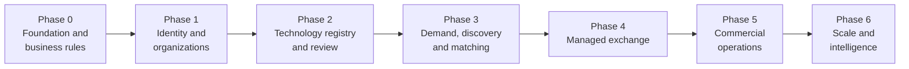

| Phase | Deliverables | Exit gate | Release ([10 §9](10-product-requirements.md)) |
| --- | --- | --- | --- |
| **0 — Foundation and business rules** (specification) | Confirm launch jurisdiction and legal model · Finalize taxonomy and core entities · Define state machines and permissions · Create migrations and API conventions · Build design system and wireframes · Define backup, security and release requirements | Business owners approve the core workflows and completion criteria | R0 |
| **1 — Identity and organizations** | Authentication and account recovery · Organization creation and membership · Organization profiles · Role and permission enforcement · Basic admin console · Audit events · Initial deployment pipeline | Several organizations operate independently with no cross-tenant data access | R0 |
| **2 — Technology registry and review** | Technology wizard · Version history · Offers and rights claims · Document upload and quarantine · Organization and technology verification queues · Publication snapshots · Public catalogue | A supplier can submit, revise and publish a reviewed listing without leaking restricted information | R1 |
| **3 — Demand, discovery and matching** | Demand wizard · Structured requirements · Search and filters · Candidate retrieval and ranking · Match explanations · Shortlists and feedback · Matching admin workspace | Buyers submit demands and review useful, permission-safe candidates | R1 |
| **4 — Managed exchange** | Introduction requests · Broker assignments · Controlled supplier responses · Confidentiality workflow · Deal creation and participant permissions · Negotiation history · Milestones and outcome tracking | The platform coordinates a complete opportunity from demand through introduction and managed negotiation | R1 (introductions), R2 (deals, negotiation, milestones) |
| **5 — Commercial operations** | Enterprise service packages · Contract-management integration · E-signature integration · Invoicing and reconciliation (if the model needs them) · Payment-partner integration · Venue-routed listing and bidding through a licensed venue · Commercial reporting · Service-level monitoring and support | The team supports paid services and transactions with auditable financial and contractual records | R2 (contracts, e-signature, invoices), R3 (payments, venue route) |
| **6 — Scale and intelligence** | Dedicated search if needed · Semantic matching · Document extraction and AI-assisted review · Enterprise APIs · More languages and currencies · Advanced analytics · More regional deployments | New capabilities measurably improve match quality, commercial performance or efficiency | After R3 |

### Suggested team allocation (four people)

| Role | Primary responsibility |
| --- | --- |
| Engineer 1 | Backend architecture, database and workflows |
| Engineer 2 | Frontend, UX implementation and API integration |
| Engineer 3 | Backend modules, documents, search and integrations |
| Engineer 4 | Full-stack delivery, testing, DevOps and operational tooling |

With one or two developers, combine roles and reduce scope. Shared acceptance checklists and API contracts keep frontend and backend aligned.

A **domain expert or product owner** is necessary, even part-time, to decide verification policies, commercial terms, legal requirements and exceptional cases. Developers alone cannot safely make those decisions.

---

## 14. Operational service-level targets

A managed exchange needs defined service standards from the start. These are **proposed initial targets**, not industry benchmarks:

| Process | Initial target | Escalation |
| --- | --- | --- |
| Organization verification | First review within 3 business days | Escalate overdue cases |
| Technology review | First review within 5 business days | Notify the reviewer's manager |
| Correction request | Acknowledged within 2 business days | Escalate unanswered cases |
| Introduction request | Initial response within 2 business days | Reassign stalled cases |
| Match review | High-priority candidates reviewed within 2 business days | Escalate urgent buyer demands |
| Deal milestone | Reminder before the due date | Escalate overdue milestones |
| Security incident | Immediate triage by severity | Follow the incident response plan |

Use configurable targets and business calendars (including public holidays). Measure **time to first response** separately from **total resolution time**, and exclude time spent waiting for the user. The operations dashboard shows each case's age, owner, next action and deadline.

---

## 15. Launch readiness checklist

Before the first real suppliers and buyers enter the system:

**Business and governance**

- [ ] Launch jurisdiction and legal operating model approved
- [ ] Supplier declarations and publication terms approved
- [ ] Verification policies and appeal process documented
- [ ] Transaction completion criteria defined

**Application**

- [ ] Organization registration and membership flows tested
- [ ] Technology and demand workflows tested end to end
- [ ] Search and matching explanations validated
- [ ] Introduction and deal permissions tested

**Security**

- [ ] MFA enabled for privileged accounts
- [ ] Cross-organization authorization tests passing
- [ ] Document quarantine and scanning operational
- [ ] Secrets, backups and audit logs protected

**Operations**

- [ ] Review queues have named owners
- [ ] Monitoring and error alerts operational
- [ ] Database and document recovery tested
- [ ] Release and rollback procedures documented

Passing this checklist does not by itself establish legal compliance or certify security. For the China launch, also complete [08 §10](08-china-operating-model.md).

---

## 16. Business metrics to instrument from day one

Record the events needed to measure whether the exchange creates real value:

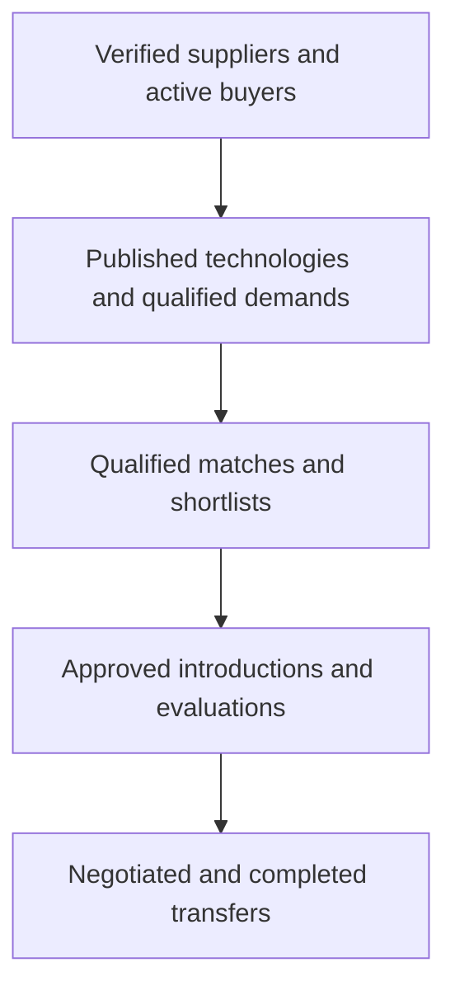

Track conversion and time between stages, and the **reasons for failure**. These show whether the bottleneck is insufficient supply, poor matching, weak evidence, slow reviews, incompatible terms or difficult negotiations.

For commercial reporting, separate completed transactions from estimated deal values, and platform-earned revenue from money paid directly between counterparties.

---

## 17. The first implementation sprint

Start with these concrete tasks rather than the full marketplace UI:

| Order | Task | Definition of done |
| --- | --- | --- |
| 1 | Establish repository, TypeScript ES2019 build and lint rules | Reproducible build; ESLint blocks ES2020+ APIs; CI runs tests on `node:12.4.0` |
| 2 | Create deployment baseline | Staging server with the same Node 12.4 and MongoDB version, a replica set, Nginx and systemd units; release script works |
| 3 | Add the data layer | Mongoose settings, connection, plugins and the core models (copied from `draft-implementation/`); `migrate-mongo` creates validators and roles and `db:indexes` creates indexes on an empty database; `db:indexes:check` runs in CI |
| 4 | Implement authentication | Protected API routes and secure sessions work |
| 5 | Implement organization membership | Role checks operate in the backend |
| 6 | Implement audit events | Sensitive actions produce structured records |
| 7 | Build authorization test suite | Cross-organization access tests pass |
| 8 | Create the UI shell | Navigation and permission-aware pages exist |
| 9 | Implement technology drafts | Members can create and edit authorized drafts |
| 10 | Implement review cases | A reviewer can inspect a submission and request corrections |
| 11 | Add publication snapshots | Only approved fields become public |
| 12 | Run end-to-end tests | The full submission-to-publication journey passes |

The first vertical slice is small but complete:

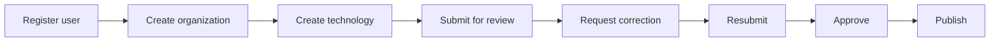

It validates the most important foundations: identity, tenant isolation, versioning, state transitions, review operations, audit history and public disclosure. Once it works reliably, add demand management and matching on top.

---

## Final engineering decision

| Area | Baseline |
| --- | --- |
| Runtime | Node.js 12.4 (upgrade to 12.22.12 recommended); TypeScript compiled to ES2019/CommonJS |
| Frontend | React 18, Vite and Ant Design 5, built on CI and served by Nginx; public pages pre-rendered |
| Backend | Express 4 modular monolith: API instances + one worker |
| Database | MongoDB 4.4 / 5.0 replica set; **Mongoose 5.13** models and Document API (driver 3.7.4); validators and roles via migrations; indexes from the schemas |
| Search | Meilisearch (Chinese segmentation), fed by the outbox; rebuildable from MongoDB |
| Documents | Private storage with quarantine, scanning, per-document grants and watermarks |
| Workflow | Explicit state machines, transactions, transition history, outbox |
| Deployment | systemd + Nginx on the target server; nightly `mongodump --oplog` |
| Business model | Managed exchange: offers, demands, introductions, deal management; venue functions through a licensed venue as its registered agent (R3) |
| Security | Organization roles + CASL policies (`accessibleBy` for lists) + tenant-scope plugin on every tenant-owned model |
| Delivery | One complete vertical workflow at a time |

The biggest risk is not choosing the wrong framework. It is failing to distinguish **claims from verified facts, listings from offers, matches from introductions, and signed contracts from completed transfers**. Enforce those distinctions in the database, API, workflow engine, admin console and reporting from the beginning.

The one business decision to settle before the production build was the **exact launch country**, because it determines organization-verification sources, IP evidence requirements, privacy controls, contract processes and transaction restrictions. That decision is China; see [08](08-china-operating-model.md).
