# 06 — Implementation-Level System Design (Version 1.0)

> **About this document**
>
> - **Purpose:** Turn the blueprint in [05](05-system-design-blueprint.md) into a concrete engineering baseline that a small team can use to write migrations, backend modules, frontend pages, tests, deployment scripts and operating procedures.
> - **Audience:** Engineers, tech lead, product owner and operations lead.
> - **Status:** Version 1.0 baseline for the first release. The China-specific legal, payment and deal-type rules in [08](08-china-operating-model.md) extend this baseline.
> - **Previous:** [05 — System design blueprint](05-system-design-blueprint.md) · **Next:** [07 — Roles, workflows and money movement](07-roles-workflows-and-money.md)

| Profile | Value |
| --- | --- |
| Launch | Regional (one country first; China selected later in [08](08-china-operating-model.md)) |
| Business model | Managed technology exchange marketplace |
| Hosting | Self-hosted |
| Team | Small engineering team (1–4 developers) |
| Target runtime | **Node.js 12.4** + **MongoDB 4.4 / 5.0** replica set (see [11](11-target-runtime-node12-mongodb.md)) |
| Scope of this document | Architecture baseline · Domain model · Database · APIs · Workflows · UI · Permissions · Security · Search · Deployment · Testing · Delivery plan |

---

## Summary

Build a **managed technology exchange**: neither a plain listing website nor a fully automated trading exchange.

The platform brings technology suppliers and buyers together. It helps them discover relevant opportunities, verifies important claims, controls confidential disclosure, facilitates introductions and manages negotiations through to a recorded outcome. **Platform staff operate the review and exchange workflows; participating organizations keep control of their technologies and commercial decisions.**

For the first release, deliberately avoid microservices, a separate graph database, a custom payment wallet and a complex AI platform. They add operational work without being needed to prove the core business.

The backend runs on the given target server: **Node.js 12.4 with MongoDB 4.4 / 5.0**. Every database definition and code sample in this document was **verified** on that stack (Node 12.4.0 with MongoDB 4.4.30 and 5.0.33) with the kit in [`verification/node12-mongodb/`](verification/node12-mongodb/README.md). Doc [11](11-target-runtime-node12-mongodb.md) lists the approved library versions and the risks of the end-of-life runtime.

---

## 1. Product definition and design assumptions

### 1.1 Agreed product profile

| Decision | Design |
| --- | --- |
| Initial market | One regional market, expandable to other regions |
| Business model | Technology exchange marketplace |
| Initial participants | Technology suppliers and technology buyers |
| Hosting | Self-hosted servers or virtual machines |
| Engineering team | 1–4 developers |
| Transaction scope | Managed introductions, negotiation and deal tracking |
| Industry coverage | Broad, cross-industry |
| Revenue model | Exchange-related services first; subscriptions and other revenue later |
| Operating model | Platform staff support verification, matching and transaction coordination |

### 1.2 Remaining assumptions

Where a decision is still open, an explicit assumption lets engineering proceed without pretending it is settled:

| Open decision | Baseline assumption | Consequence |
| --- | --- | --- |
| Launch country | One country, chosen before production launch (later decided: China) | Country-specific legal, tax, privacy and e-signature review remains mandatory |
| Launch language | One primary language, translation-ready architecture | User-visible strings and searchable text are language-aware |
| Currency | One settlement and reporting currency; records store ISO 4217 codes | Multi-currency later without redesign |
| Legal status | Private commercial platform, **not** a statutory exchange unless later authorized | Never imply official approval or legal certification |
| Transaction execution | Platform coordinates; parties sign independently or through an integrated signing provider | No proprietary escrow or custody service |
| Verification | Human review supported by evidence and external registries | Verification claims are scoped and auditable |
| Infrastructure | Linux servers under the operator's control; Node.js 12.4 and MongoDB 4.4/5.0 already given | systemd + Nginx deployment; no Kubernetes; see [11](11-target-runtime-node12-mongodb.md) |
| Traffic | Early-stage, modest volume | Two API instances, one worker process, one MongoDB replica set |
| Technology ownership | Suppliers declare their authority to list and negotiate | Publication does not certify ownership |
| AI | Optional, later phases | Core flows work without AI |

A "regional launch" is not yet a precise legal jurisdiction. The domain model is therefore **jurisdiction-neutral**, but production launch requires a defined country, privacy regime, e-signature rules, export restrictions and legal treatment of brokerage and payments.

### 1.3 Scope of the first production release

| Included | Deferred until justified |
| --- | --- |
| Organization accounts and roles | Automated payment settlement or escrow |
| Technology listings and offers | Public auctions and automated bidding |
| Buyer demands and search | Complex commission splitting |
| Managed review and matching | A microservice per domain |
| Controlled introductions | Custom AI model training, autonomous negotiation |
| Deal pipeline and audit trail | A separate graph database or event-streaming cluster |
| | Multi-region active-active deployment |

---

## 2. Domain architecture

Model the platform around **technology assets, technology offers, buyer demands, matches, introductions and deals**. These are distinct concepts: a technology is not an offer, a demand is not a match, and a match is not a transaction.

### 2.1 Domain groups

| Group | Entities |
| --- | --- |
| Identity and organizations | User · Organization · Membership · Role · Verification case |
| Technology supply | Technology · Version · IP asset · Offer · Evidence · Documents |
| Buyer demand | Demand · Requirements · Budget · Constraints · Deadline |
| Exchange operations | Match · Shortlist · Introduction request · Review task · Communication |
| Deal management | Deal · Party · Proposal · Contract reference · Milestone · Outcome · Dispute |
| Cross-cutting services | Permissions · Documents · Workflow · Notifications · Audit · Reporting · Billing |

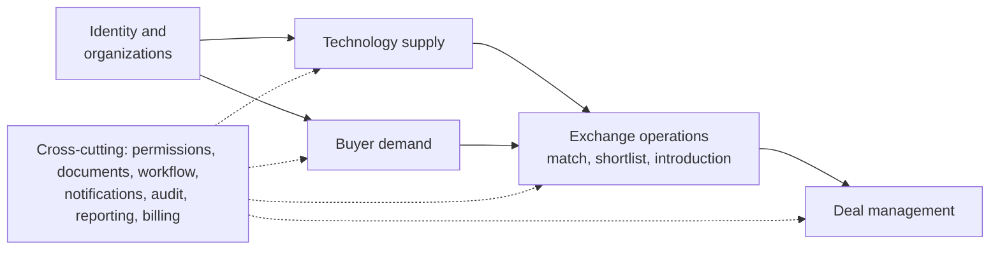

### 2.2 Business entities

| Entity | Meaning | Example |
| --- | --- | --- |
| Organization | Legal or institutional participant | University, manufacturer, startup |
| Technology | Stable identity of a technology asset | High-efficiency industrial coating |
| Technology version | A specific revision of its description and technical data | Revision 3, updated performance data |
| IP asset | A patent, application, copyright, know-how claim or other right | Patent application in one jurisdiction |
| Technology offer | A particular commercial opportunity involving the technology | Licence for a specified territory |
| Demand | A buyer's structured problem or need | Reduce inspection time by 30% |
| Match | A recorded relationship between a demand and a candidate offer | Demand D matched to Technology T |
| Introduction | A controlled request to connect two parties | Buyer requests contact with supplier |
| Deal | The managed commercial opportunity | Licence negotiation between two organizations |
| Evidence | Support for a claim or review decision | Patent register extract or test report |
| Review case | A controlled administrative process | Verify organization, review listing |
| Milestone | A deliverable or condition in a deal | Prototype delivery |
| Audit event | A record of a material system action | Listing approved by reviewer |

**Critical modeling rule:** one technology may have several offers, for example:

- A non-exclusive licence in Region A.
- An exclusive licence in Region B.
- An assignment offer.
- A development partnership.
- A time-limited pilot or evaluation arrangement.

Each offer defines its own transaction type, rights scope, territory, field of use, commercial terms and availability. The same technology can satisfy several demands, but not every offer is compatible with every demand. **Matching therefore happens at offer level.**

### 2.3 Internal modules

| # | Module | Responsibility |
| --- | --- | --- |
| 1 | `identity` | Users, sessions and authentication |
| 2 | `organizations` | Profiles, membership and verification |
| 3 | `taxonomy` | Industries, technology categories, applications and TRL |
| 4 | `technology` | Assets, versions, rights claims and evidence |
| 5 | `offers` | Licence, assignment and partnership opportunities |
| 6 | `demands` | Buyer requirements and constraints |
| 7 | `discovery` | Search, filters and candidate retrieval |
| 8 | `matching` | Candidate scores, explanations and feedback |
| 9 | `exchange` | Shortlists, introduction requests and broker assignments |
| 10 | `deals` | Negotiations, proposals, milestones and outcomes |
| 11 | `documents` | Private files, access grants and document versions |
| 12 | `workflow` | Review queues, tasks, deadlines and transitions |
| 13 | `notifications` | Email and in-app notifications |
| 14 | `audit` | Immutable business event history |
| 15 | `reporting` | Operational and commercial dashboards |

Finance, subscriptions, e-signatures and AI start as **integration boundaries or later modules**, not as reasons to split the backend into services.

---

## 3. Technical architecture

The target server runs **Node.js 12.4** and **MongoDB 4.4 / 5.0** (the stated "4.5" is a development series). The detailed compatibility rules, verified library versions, risks and upgrade path are in [11 — Target runtime](11-target-runtime-node12-mongodb.md). This section summarizes the decisions that shape the design.

### 3.1 Technology stack

| Layer | Choice | Why |
| --- | --- | --- |
| Runtime | **Node.js 12.4** (upgrade to 12.22.12 strongly recommended) | Given target; see [11 §1](11-target-runtime-node12-mongodb.md) |
| Language | TypeScript, compiled on CI to **ES2019 / CommonJS** | Type safety; output runs on Node 12 |
| HTTP framework | **Express 4.22** + helmet, with an explicit module structure (§11.4) | Verified on 12.4; maintained; avoids end-of-life NestJS 8 |
| Validation | **zod 3.22**, schemas shared with the frontend | One definition for API input, UI forms and OpenAPI |
| Database | **MongoDB 4.4 / 5.0 replica set**, native driver **3.7.4** | Driver 4.x needs Node ≥ 12.9; a replica set is required for transactions |
| Schema control | `$jsonSchema` validators + indexes + roles via **migrate-mongo** | The database enforces structure even though MongoDB is schemaless |
| Search | **Meilisearch** (Chinese word segmentation), fed from an outbox | MongoDB 4.4/5.0 cannot search Chinese text (verified) |
| Background work | One **worker** process: outbox relay, indexing, page pre-rendering, notifications, schedules | No Redis needed at launch |
| Authorization | **CASL 5** policies (RBAC + ABAC) | Verified on Node 12; policy shared by API checks and UI hints |
| Authentication | Phone + SMS code or password (**bcryptjs**), TOTP MFA for staff, sessions in MongoDB | China-friendly login; pure-JS hashing (no native build) |
| Files | Storage adapter: encrypted local volume, S3-compatible store or Aliyun OSS | Same code for a single server or object storage |
| Frontend | React 18 + Vite + **Ant Design 5**, built on CI, served by Nginx | Not bound to the server's Node version |
| Public SEO pages | **Pre-rendered static HTML** (EJS) on publication + sitemap | Server-side rendering frameworks need newer Node |
| Reverse proxy | Nginx (TLS, static files, rate limits) | Single public entry point |
| Process management | systemd: `tex-api@3001`, `tex-api@3002`, `tex-worker` | Simple, restart-on-failure, no extra tooling |
| Observability | pino logs, prom-client metrics, request IDs | Verified on Node 12 |

### 3.2 Logical deployment topology

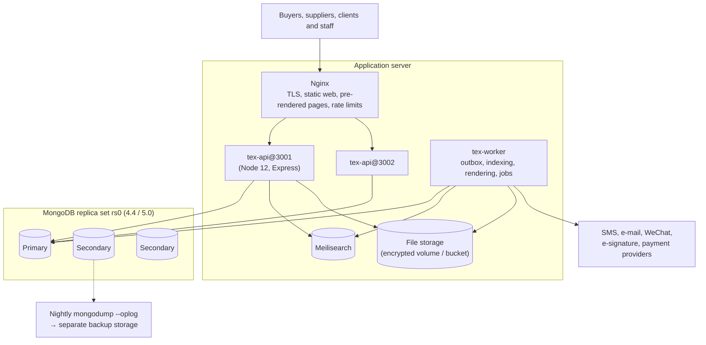

| Environment | Layout |
| --- | --- |
| **Production (recommended)** | 1 application server + a **3-member** MongoDB replica set (3 hosts, or 2 hosts + 1 member on the application server) |
| **Launch minimum** | 1 server with a **single-node replica set**, accepted only with tested nightly backups and an agreed recovery time |
| Staging | Mirrors production versions exactly (Node 12.4, same MongoDB version) |

---

## 4. Database design (MongoDB)

MongoDB is schemaless, but a technology exchange needs **auditable rights, versions, permissions and deal outcomes**. The design therefore adds discipline on top: validators on every core collection, explicit indexes, immutable version collections, a least-privilege application role, and transactions for every multi-document business change.

All definitions below are **verified** on MongoDB 4.4.30 and 5.0.33 with Node 12.4.0 (see [`verification/node12-mongodb/`](verification/node12-mongodb/README.md)).

### 4.1 Data model

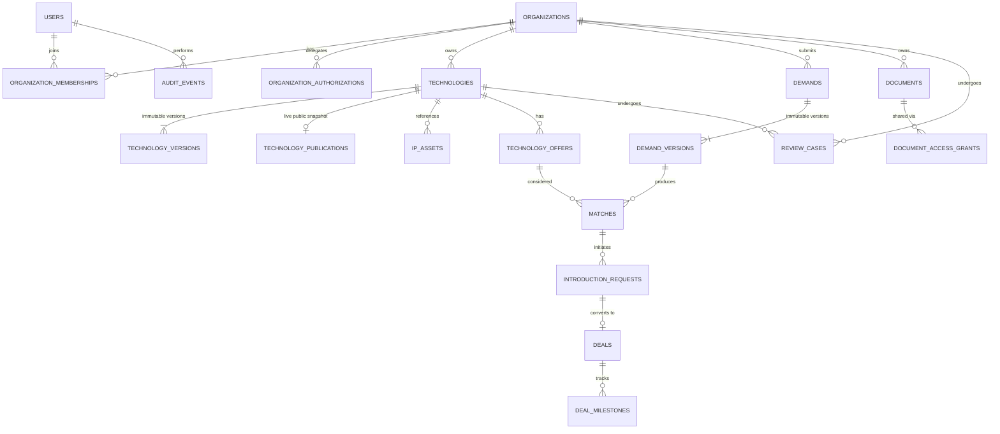

Embedded (not separate collections): deal **parties** (inside `deals`), document **links** (inside `documents`), bilingual text (`{ zh, en }`), money (`{ currency, amountMinor }`) and verification summaries.

### 4.2 Modeling conventions

| Topic | Rule |
| --- | --- |
| Identifiers | `_id` is an `ObjectId`. Every business object users talk about also gets a **human-readable reference** (`TEC-000123`, `DEM-…`, `DEAL-…`, `CASE-…`), generated by an atomic counter and indexed as unique. Support staff and users quote references, never raw IDs |
| Field names | camelCase; enums are lower-case strings validated by `$jsonSchema` |
| Text | Bilingual objects `{ zh: string, en?: string }`: Chinese is required, English optional (machine-translated drafts must be reviewed) |
| Time | BSON `Date` in UTC; display in `Asia/Shanghai` |
| Money | `{ currency: 'CNY', amountMinor: Int64 }` (fen). Never floating point; percentages and royalty rates as `Decimal128` |
| Concurrency | Every mutable document has `rev` (int). Updates filter on `rev` and `$inc` it; a mismatch returns `409 VERSION_CONFLICT` |
| History | Content that is reviewed or published lives in **immutable version collections** (`technology_versions`, `demand_versions`); state changes are appended to `workflow_transitions` |
| Embed vs reference | Embed small, bounded data that is always read with its parent (deal parties ≤ 10, document links). Reference anything with its own lifecycle, its own permissions, or unbounded growth (versions, milestones, messages, matches) |
| Arrays | No unbounded arrays. Conversations, audit events and matches are separate collections |
| Validation | `validationLevel: strict`, `validationAction: error`. The API validates first with `zod` (user-friendly messages); the database validator is the safety net |
| Transactions | Every multi-document business change runs in one transaction with read concern `snapshot` and write concern `majority` (§4.7) |
| Tenancy | No row-level security in MongoDB: all tenant data is accessed through `TenantScopedRepository` (§4.8) |
| Schema changes | Only through `migrate-mongo` scripts run by the `tex_migrator` user; expand-and-contract for breaking changes |
| Taxonomy codes | National standards where they exist: industry codes from **GB/T 4754-2017** (国民经济行业分类, e.g. `C384` battery manufacturing), strategic emerging industries (战略性新兴产业分类 2018), **IPC** for patents |

### 4.3 Collection catalogue

| Collection | Purpose | Key fields | Indexes |
| --- | --- | --- | --- |
| `users` | People and login identities | `phoneE164`, `emailNormalized`, `passwordHash`, `status`, `realName.status`, `locale` | unique partial: phone, email, authSubject |
| `organizations` | Legal or institutional participants | `ref`, `legalName`, `organizationType`, `jurisdictionCode`, `registrationNumber` (unified social credit code), `verification.{status,level,expiresAt}` | unique `ref`; unique partial (`jurisdictionCode`, `registrationNumber`) |
| `organization_memberships` | User ↔ organization, roles | `organizationId`, `userId`, `roleCodes[]`, `status` | unique (`organizationId`, `userId`); (`userId`, `status`) |
| `organization_authorizations` | Delegated authority: sign, approve payment, approve disclosure; limits, expiry, evidence | `organizationId`, `userId`, `scope`, `limitMinor`, `validUntil`, `status` | (`organizationId`, `userId`, `scope`, `status`) |
| `platform_role_assignments` | Staff roles, separate from organization roles | `userId`, `roleCode`, `expiresAt` | unique (`userId`, `roleCode`) |
| `technologies` | Stable identity and lifecycle of a technology | `ref`, `ownerOrganizationId`, `technologyType`, `lifecycleStatus`, `visibility`, `currentVersion`, `publishedVersion`, `rev` | unique `ref`; (`ownerOrganizationId`, `lifecycleStatus`) |
| `technology_versions` | Immutable revisions (frozen on submission) | `technologyId`, `version`, `title`, `publicSummary`, `claimedTrl`, `assessedTrl`, `technicalAttributes`, `frozen` | unique (`technologyId`, `version`) |
| `technology_publications` | **Approved public snapshot**: the only technology data sent to search and public pages | `technologyId`, `version`, `ref`, `status`, owner summary, title, summary, codes, TRL, offer types, badges | unique partial `technologyId` where `status: 'live'` |
| `ip_assets` | Patents, applications, software copyrights, know-how claims | `technologyId`, `assetType`, `jurisdictionCode`, `identifier`, `rightsStatus`, `legalStatusCheckedAt` | `technologyId`; (`jurisdictionCode`, `identifier`) |
| `technology_offers` | Licence, assignment, partnership, pilot, equity-investment offers | `ref`, `technologyId`, `technologyVersion`, `transactionType`, `offerStatus`, `exclusivity`, `price`, `validFrom/Until` | unique `ref`; (`technologyId`, `offerStatus`) |
| `demands`, `demand_versions` | Buyer needs and their immutable revisions | status, visibility, `hardConstraints`, `preferredAttributes`, `budget` | unique `ref`; unique (`demandId`, `version`) |
| `matches` | Scored demand ↔ offer candidates, reproducible | `demandId`, `demandVersion`, `offerId`, `technologyVersion`, `rankingVersion`, `score`, `scoreComponents`, `explanation` | **unique** (`demandId`, `demandVersion`, `offerId`, `rankingVersion`) |
| `introduction_requests` | Consent-based introductions | `ref`, `matchId`, `buyerOrganizationId`, `supplierOrganizationId`, `status`, `disclosureScope` | (`supplierOrganizationId`, `status`); validator: buyer ≠ supplier |
| `deals` | Managed negotiations and transactions (parties embedded) | `ref`, `dealType`, `status`, `parties[]`, `estimatedValue`, `assignedManagerId` | unique partial `introductionRequestId`; (`parties.organizationId`, `status`) |
| `deal_milestones` | Deliverables and conditions | `dealId`, `dueDate`, `status`, evidence | (`dealId`, `dueDate`); (`status`, `dueDate`) |
| `documents` | File metadata, classification, scan status, links | `storageKey`, `sha256`, `classification`, `scanStatus`, `lifecycleStatus`, `links[]` | unique `storageKey`; (`links.resourceType`, `links.resourceId`) |
| `document_access_grants` | Per-document access for a grantee (view/download, watermark, expiry) | `documentId`, `granteeOrganizationId`, `permissions`, `expiresAt`, `revokedAt` | (`documentId`, `granteeOrganizationId`) |
| `review_cases` | Verification, listing, IP, demand and introduction reviews | `ref`, `caseType`, `resource.{type,id,version}`, `status`, `priority`, `assignedTo`, `dueAt` | (`status`, `priority`, `dueAt`); (`assignedTo`, `status`) |
| `workflow_transitions` | Every state change with actor and reason | `resource`, `fromStatus`, `toStatus`, `action`, `actorUserId`, `correlationId` | (`resource.type`, `resource.id`, `occurredAt`) |
| `idempotency_keys` | Results of retriable commands | `actorUserId`, `key`, `requestHash`, `response*`, `expiresAt` | unique (`actorUserId`, `key`); **TTL** on `expiresAt` |
| `outbox_events` | Events written in the business transaction, relayed by the worker | `eventType`, `aggregate`, `payload`, `status`, `attempts`, `lockedUntil` | partial (`createdAt`) where `status: 'pending'` |
| `counters` | Atomic sequences for human-readable references | `_id` (prefix), `seq` | — |
| `tex_audit.audit_events` | Append-only audit trail, **separate database**, insert-only for the app | `actor`, `organizationId`, `action`, `resource`, `correlationId`, `reason`, `details` | (`resource.type`, `resource.id`, `occurredAt`); (`actor.userId`, `occurredAt`) |

### 4.4 Example documents

Illustrative values (shell notation):

```javascript
// technologies — identity and lifecycle (small, frequently updated)
{
  _id: ObjectId("6716f1c2a1b2c3d4e5f60001"),
  ref: "TEC-000123",
  ownerOrganizationId: ObjectId("6716f1c2a1b2c3d4e5f6aaaa"),
  technologyType: "process_technology",
  lifecycleStatus: "published",            // see state machine §6.1
  visibility: "public",
  currentVersion: 4,                        // version 4 may be in review…
  publishedVersion: 3,                      // …while version 3 stays public
  createdBy: ObjectId("6716f1c2a1b2c3d4e5f6bbbb"),
  createdAt: ISODate("2026-09-01T02:00:00Z"),
  updatedAt: ISODate("2026-10-12T06:30:00Z"),
  rev: 9
}

// technology_publications — approved public snapshot (source for search and public pages)
{
  _id: ObjectId("6716f1c2a1b2c3d4e5f60101"),
  technologyId: ObjectId("6716f1c2a1b2c3d4e5f60001"),
  version: 3,
  ref: "TEC-000123",
  status: "live",
  owner: { organizationId: ObjectId("6716f1c2a1b2c3d4e5f6aaaa"), displayName: "某某大学", type: "university", verified: true },
  title:   { zh: "锂电池极片缺陷在线检测技术", en: "Inline defect detection for lithium-battery electrodes" },
  summary: { zh: "基于机器视觉的电极缺陷实时检测，准确率超过99%。", en: "Machine-vision inspection of electrode defects in real time, >99% accuracy." },
  keywords: ["机器视觉", "锂电池", "缺陷检测"],
  industryCodes: ["C384"],                  // GB/T 4754-2017: battery manufacturing
  trl: { claimed: 6, assessed: null },
  offerTypes: ["license", "joint_development"],
  territories: ["CN"],
  ipSummary: { grantedPatents: 3, pendingApplications: 2 },
  badges: ["ownership_verified", "patent_verified"],
  price: { type: "negotiable" },
  publishedAt: ISODate("2026-10-01T03:00:00Z")
}

// deals — parties embedded, money in minor units
{
  _id: ObjectId("6716f1c2a1b2c3d4e5f60301"),
  ref: "DEAL-000042",
  introductionRequestId: ObjectId("6716f1c2a1b2c3d4e5f60201"),
  dealType: "ip_license",
  status: "negotiation",
  name: "电极缺陷检测技术 普通许可",
  parties: [
    { organizationId: ObjectId("6716f1c2a1b2c3d4e5f6aaaa"), role: "licensor", status: "active" },
    { organizationId: ObjectId("6716f1c2a1b2c3d4e5f6cccc"), role: "licensee", status: "active" }
  ],
  assignedManagerId: ObjectId("6716f1c2a1b2c3d4e5f6dddd"),
  estimatedValue: { currency: "CNY", amountMinor: NumberLong("30000000") },   // RMB 300,000.00
  createdBy: ObjectId("6716f1c2a1b2c3d4e5f6bbbb"),
  createdAt: ISODate("2026-10-05T01:00:00Z"),
  updatedAt: ISODate("2026-10-15T08:00:00Z"),
  rev: 6
}
```

### 4.5 Migrations: validators and indexes

The complete, verified migration is [`verification/node12-mongodb/migrations/001-core-schema.js`](verification/node12-mongodb/migrations/001-core-schema.js) (all collections above). An excerpt showing the pattern:

```javascript
// migrations/001-core-schema.js (excerpt) — run by migrate-mongo as tex_migrator
const STR = { bsonType: 'string' };
const OID = { bsonType: 'objectId' };
const DATE = { bsonType: 'date' };
const INT = { bsonType: 'int' };
const enumOf = (...values) => ({ bsonType: 'string', enum: values });
const i18nText = { bsonType: 'object', required: ['zh'], properties: { zh: STR, en: STR } };
const audit = { createdAt: DATE, updatedAt: DATE, rev: INT };

async function ensureCollection(db, name, jsonSchema, extraValidator) {
  const validator = extraValidator ? { $and: [{ $jsonSchema: jsonSchema }, extraValidator] } : { $jsonSchema: jsonSchema };
  const exists = await db.listCollections({ name }).hasNext();
  if (exists) {
    await db.command({ collMod: name, validator, validationLevel: 'strict', validationAction: 'error' });
  } else {
    await db.createCollection(name, { validator, validationLevel: 'strict', validationAction: 'error' });
  }
}

module.exports = {
  async up(db, client) {
    await ensureCollection(db, 'technologies', {
      bsonType: 'object',
      required: ['ref', 'ownerOrganizationId', 'technologyType', 'lifecycleStatus', 'visibility',
                 'currentVersion', 'createdBy', 'createdAt', 'updatedAt', 'rev'],
      properties: {
        ref: { bsonType: 'string', pattern: '^TEC-[0-9]{6,}$' },
        ownerOrganizationId: OID,
        technologyType: STR,
        lifecycleStatus: enumOf('draft', 'submitted', 'in_review', 'changes_requested', 'approved',
                                'rejected', 'published', 'update_pending', 'suspended', 'archived'),
        visibility: enumOf('private', 'public', 'restricted'),
        currentVersion: INT,
        publishedVersion: { bsonType: ['int', 'null'] },
        createdBy: OID,
        ...audit,
      },
    });
    await db.collection('technologies').createIndexes([
      { key: { ref: 1 }, unique: true },
      { key: { ownerOrganizationId: 1, lifecycleStatus: 1 } },
    ]);

    // Cross-field rule with $expr: budget.minMinor <= budget.maxMinor
    await ensureCollection(db, 'demand_versions', { /* … */ }, {
      $expr: { $lte: [
        { $ifNull: ['$budget.minMinor', 0] },
        { $ifNull: ['$budget.maxMinor', { $ifNull: ['$budget.minMinor', 0] }] },
      ] },
    });

    // Re-running a matching job must not create duplicates.
    await db.collection('matches').createIndexes([
      { key: { demandId: 1, demandVersion: 1, offerId: 1, rankingVersion: 1 }, unique: true },
      { key: { demandId: 1, demandVersion: 1, score: -1 } },
    ]);

    // Idempotency keys expire automatically (TTL index).
    await db.collection('idempotency_keys').createIndexes([
      { key: { actorUserId: 1, key: 1 }, unique: true },
      { key: { expiresAt: 1 }, expireAfterSeconds: 0 },
    ]);
  },
};
```

What the verification run proves the validators reject: phone numbers not in E.164 form, duplicate unified social credit codes, TRL outside 1–9, titles without Chinese text, unknown lifecycle states, money stored as a floating-point number, offers whose validity ends before it starts, budgets with min > max, duplicate matches, introductions where buyer = supplier, a second deal for the same introduction, deals with fewer than two parties, and reused idempotency keys.

### 4.6 Database roles and users

```javascript
// migrations/002-db-roles.js — least privilege for the application user
const privileges = [
  // CRUD on business collections; no drop, no createIndex, no collMod.
  { resource: { db: 'tex', collection: '' }, actions: ['find', 'insert', 'update', 'remove'] },
  // The audit trail is append-only for the application.
  { resource: { db: 'tex_audit', collection: 'audit_events' }, actions: ['find', 'insert'] },
];
await admin.command({ createRole: 'texApp', privileges, roles: [] });   // updateRole on re-run
```

| Database user | Role | Used by |
| --- | --- | --- |
| `tex_app` | `texApp` | API and worker processes |
| `tex_migrator` | `dbAdmin` + `readWrite` on `tex`, `tex_audit`; `userAdmin` only when changing roles | Release pipeline (migrations) |
| `tex_backup` | `backup` / `restore` | Backup jobs |
| `tex_readonly` | `read` on `tex` (not on documents' storage) | Reporting, support investigations |

### 4.7 Transactions

Every multi-document business change is one transaction: the state change, the immutable version freeze, the review case, the transition record, the outbox event and the audit event (in the separate audit database) commit together or not at all. Verified example (driver 3.7 style):

```typescript
// src/modules/technology/submit-technology.service.ts
// Target runtime: Node.js 12.x, MongoDB Node driver 3.7.x, MongoDB server 4.4 / 5.0 replica set.
import { MongoClient, ObjectId, ClientSession } from 'mongodb';

export class InvalidTransitionError extends Error {}
export interface Actor { userId: ObjectId; organizationIds: ObjectId[] }

export async function submitTechnologyForReview(
  client: MongoClient, actor: Actor, technologyId: ObjectId, expectedRev: number, correlationId: string,
): Promise<{ reviewCaseRef: string }> {
  const db = client.db('tex');
  const auditDb = client.db('tex_audit');
  const session: ClientSession = client.startSession();
  // Driver 3.x: withTransaction() resolves to the commit result, NOT the callback's value.
  let reviewCaseRef = '';
  try {
    await session.withTransaction(async () => {
      const now = new Date();

      // 1. Tenant scope + allowed state + optimistic concurrency in ONE filter.
      const res = await db.collection('technologies').findOneAndUpdate(
        { _id: technologyId, ownerOrganizationId: { $in: actor.organizationIds },
          lifecycleStatus: { $in: ['draft', 'changes_requested'] }, rev: expectedRev },
        { $set: { lifecycleStatus: 'submitted', updatedAt: now }, $inc: { rev: 1 } },
        { session, returnOriginal: false },
      );
      const tech = res.value;
      if (!tech) {
        // Same error for "not yours" and "not found": never reveal other tenants' data.
        throw new InvalidTransitionError('Technology not found, not submittable, or changed since read');
      }

      // 2. Freeze the submitted version.
      await db.collection('technology_versions').updateOne(
        { technologyId, version: tech.currentVersion }, { $set: { frozen: true } }, { session });

      // 3. Human-readable case reference.
      const counter = await db.collection('counters').findOneAndUpdate(
        { _id: 'review_case' }, { $inc: { seq: 1 } }, { session, upsert: true, returnOriginal: false });
      reviewCaseRef = 'CASE-' + String(counter.value.seq).padStart(6, '0');

      // 4. Review case, transition, outbox and audit event in the same transaction.
      await db.collection('review_cases').insertOne({
        ref: reviewCaseRef, caseType: 'technology_review',
        resource: { type: 'technology', id: technologyId, version: tech.currentVersion },
        status: 'open', priority: 'normal', createdAt: now,
        dueAt: new Date(now.getTime() + 5 * 24 * 3600 * 1000),      // SLA: first review within 5 days
      }, { session });
      await db.collection('workflow_transitions').insertOne({
        resource: { type: 'technology', id: technologyId }, fromStatus: 'draft', toStatus: 'submitted',
        action: 'submit', actorUserId: actor.userId, correlationId, occurredAt: now,
      }, { session });
      await db.collection('outbox_events').insertOne({
        eventType: 'technology.submitted', aggregate: { type: 'technology', id: technologyId },
        payload: { version: tech.currentVersion, reviewCaseRef }, status: 'pending', attempts: 0, createdAt: now,
      }, { session });
      await auditDb.collection('audit_events').insertOne({
        actor: { type: 'user', userId: actor.userId }, organizationId: tech.ownerOrganizationId,
        action: 'technology.submit', resource: { type: 'technology', id: technologyId }, correlationId, occurredAt: now,
      }, { session });
    }, { readConcern: { level: 'snapshot' }, writeConcern: { w: 'majority' } });
    return { reviewCaseRef };
  } finally {
    session.endSession();
  }
}
```

Rules:

- Keep transactions short and small; never call external services (SMS, search, payment) inside one. Those run from the outbox **after** commit.
- `withTransaction` retries on transient errors (for example a primary election), so the callback must be safe to re-run: no side effects outside the database.
- The verification run proves that a stale `rev`, or another tenant's attempt, leaves **no partial writes**.

### 4.8 Tenant isolation without row-level security

MongoDB has no row-level security. Isolation is enforced in code, and the code paths are deliberately narrow:

```typescript
// src/core/data/tenant-scoped.repository.ts — services never receive raw collections.
import { ClientSession, Collection, FilterQuery, ObjectId, UpdateQuery } from 'mongodb';

export interface TenantContext { organizationIds: ObjectId[] }
export class TenantScopeError extends Error {}

export class TenantScopedRepository<T extends { _id: ObjectId }> {
  constructor(private readonly col: Collection<T>, private readonly tenantField: keyof T & string) {}

  private scoped(ctx: TenantContext, filter: FilterQuery<T>): FilterQuery<T> {
    if (!ctx.organizationIds.length) throw new TenantScopeError('Tenant scope is required');
    return { $and: [filter, { [this.tenantField]: { $in: ctx.organizationIds } }] } as FilterQuery<T>;
  }

  findOne(ctx: TenantContext, filter: FilterQuery<T>, session?: ClientSession) {
    return this.col.findOne(this.scoped(ctx, filter), { session });
  }

  findPage(ctx: TenantContext, filter: FilterQuery<T>, limit: number, afterId?: ObjectId) {
    const page = afterId ? { $and: [filter, { _id: { $gt: afterId } }] } as FilterQuery<T> : filter;
    return this.col.find(this.scoped(ctx, page)).sort({ _id: 1 }).limit(Math.min(limit, 100)).toArray();
  }

  /** Optimistic concurrency: the update only applies if `rev` still matches. */
  async updateWithRev(ctx: TenantContext, id: ObjectId, rev: number, update: UpdateQuery<T>, session?: ClientSession) {
    const res = await this.col.updateOne(
      this.scoped(ctx, { _id: id, rev } as FilterQuery<T>),
      ({ ...update, $inc: { ...(update.$inc || {}), rev: 1 } } as unknown) as UpdateQuery<T>,
      { session },
    );
    return res.modifiedCount === 1;   // false -> 409 VERSION_CONFLICT (or 404 if not visible)
  }
}
```

Controls around it:

1. A lint rule forbids importing the raw `Db` or `Collection` outside `src/core/data`.
2. Staff access goes through a separate `StaffRepository` that requires a case-related reason and writes an audit event.
3. Every list endpoint has an automated cross-tenant test (Organization A must never see Organization B's data).
4. Highly sensitive fields (bank account numbers, ID-card numbers) use **explicit client-side field-level encryption** through the driver, or are stored only with the payment or identity provider. Automatic encryption needs MongoDB Enterprise.

### 4.9 Additional collections before launch

| Group | Collections |
| --- | --- |
| Taxonomy | `taxonomy_terms` (industry, technology field, application, with `zh`/`en` labels, synonyms, parent, deprecation) |
| Rights and evidence | `ip_asset_evidence`, `rights_claims`, `verification_decisions` |
| Shortlists and feedback | `shortlists`, `match_feedback` |
| Communication | `conversations`, `messages` (contact details masked until an introduction is approved) |
| Negotiation and contracts | `proposal_versions`, `proposal_responses`, `approval_requests`, `contracts`, `contract_signatures`, `contract_registrations` (see [08 §9](08-china-operating-model.md)) |
| Workflow | `workflow_tasks`, `jobs` (leased background jobs) |
| Sessions and security | `sessions` (TTL), `login_attempts` (TTL), `sms_codes` (TTL, hashed codes) |
| Notifications | `notifications`, `notification_deliveries`, `notification_templates` |
| Content and events | `articles`, `events`, `event_registrations` (see [10](10-product-requirements.md)) |
| Commercial | `subscriptions`, `service_orders`, `invoices` (finance tables from [08 §9](08-china-operating-model.md) when payments start) |
| Calendar | `calendar_days` (official holidays and make-up working days per year; all working-day timers use it, FR-ADM-09) |
| University tools | `public_notices`, `notice_objections`, `reward_notices` (FR-UNI-03, FR-UNI-06) |
| Challenges | `challenges`, `challenge_tracks`, `solutions`, `evaluations` (FR-DEM-07, FR-DEM-08) |
| Technology managers | `manager_profiles`, `manager_assignments`, `points_ledger` (FR-MAT-04 … FR-MAT-07) |
| Venue route | `venue_submissions`, `buyer_registrations`, `venue_certificates` (FR-VEN, R3) |
| Evidence | `evidence_chain` (hash chain over snapshots, notices, proposals and contracts, FR-CMP-02) |

---

## 5. API specifications

Expose a versioned REST API under `/api/v1` (Express 4). Request and response models are **zod schemas** in `packages/contracts`, shared with the frontend. The OpenAPI 3 document is generated from them on CI and published with each release. Authentication and authorization run as shared Express middleware, never inside individual handlers.

### 5.1 Conventions

**Requests**

- JSON for business operations.
- Multipart uploads or short-lived object-storage upload URLs for documents.
- ISO 8601 timestamps with time zone.
- UUIDs for resource identifiers.
- Cursor (or limit/offset) pagination with deterministic sorting.
- Explicit filters rather than opaque query strings.
- `Idempotency-Key` header on retriable operations with business effects.
- `If-Match` header (or an explicit `version` field) for conflict-sensitive edits.

**Responses.** A normal resource response:

```json
{
  "data": {
    "id": "d6efc3d0-9d10-4b0b-a7f8-0dfe39a7f1c1",
    "status": "draft",
    "version": 1
  },
  "meta": {
    "request_id": "7b5f0f5c-85f2-4f48-b3cc-8d5a15d8d0bb"
  }
}
```

An error response:

```json
{
  "error": {
    "code": "INVALID_STATE_TRANSITION",
    "message": "The requested action is not allowed.",
    "request_id": "7b5f0f5c-85f2-4f48-b3cc-8d5a15d8d0bb",
    "details": {
      "current_status": "draft",
      "requested_action": "publish"
    }
  }
}
```

Use stable error codes. Never reveal another organization's confidential resource details in authorization errors.

### 5.2 Endpoint catalogue

Detailed schemas live in OpenAPI and are validated in integration tests.

**Identity and organizations**

| Method | Endpoint | Permission | Purpose |
| --- | --- | --- | --- |
| `GET` | `/api/v1/me` | Authenticated | Current user and memberships |
| `PATCH` | `/api/v1/me` | Self | Update permitted profile fields |
| `GET` | `/api/v1/organizations` | Authenticated | Organizations the user may access |
| `POST` | `/api/v1/organizations` | Authenticated | Create organization |
| `GET` | `/api/v1/organizations/{id}` | Member or public-profile policy | Read organization |
| `PATCH` | `/api/v1/organizations/{id}` | Organization admin | Update profile |
| `POST` | `/api/v1/organizations/{id}/members` | Organization admin | Invite member |
| `PATCH` | `/api/v1/organizations/{id}/members/{userId}` | Organization admin | Change permitted role or status |
| `POST` | `/api/v1/organizations/{id}/verification-submissions` | Authorized member | Submit verification evidence |

**Technology and offers**

| Method | Endpoint | Purpose |
| --- | --- | --- |
| `POST` | `/api/v1/technologies` | Create technology draft |
| `GET` | `/api/v1/technologies/{id}` | Read authorized technology |
| `PATCH` | `/api/v1/technologies/{id}/draft` | Update editable draft |
| `POST` | `/api/v1/technologies/{id}/versions` | Create revision |
| `POST` | `/api/v1/technologies/{id}/submissions` | Submit revision for review |
| `GET` | `/api/v1/technologies/{id}/review-status` | View submission progress |
| `POST` | `/api/v1/technologies/{id}/offers` | Create offer |
| `PATCH` | `/api/v1/offers/{id}` | Update permitted offer fields |
| `POST` | `/api/v1/offers/{id}/submissions` | Submit offer for review |
| `POST` | `/api/v1/offers/{id}/withdrawals` | Withdraw offer |
| `GET` | `/api/v1/technologies/{id}/history` | View authorized version history |

Use dedicated **action endpoints** for submission and withdrawal. The frontend never sets `lifecycle_status` or `offer_status` directly.

**Demands and matching**

| Method | Endpoint | Purpose |
| --- | --- | --- |
| `POST` | `/api/v1/demands` | Create demand |
| `GET` | `/api/v1/demands/{id}` | Read authorized demand |
| `PATCH` | `/api/v1/demands/{id}/draft` | Update draft |
| `POST` | `/api/v1/demands/{id}/submissions` | Submit for review |
| `POST` | `/api/v1/demands/{id}/matching-jobs` | Request matching (returns `202 Accepted` + job ID) |
| `GET` | `/api/v1/demands/{id}/matches` | Read authorized matches |
| `POST` | `/api/v1/matches/{id}/shortlist-actions` | Shortlist or remove |
| `POST` | `/api/v1/matches/{id}/feedback` | Record structured feedback |
| `POST` | `/api/v1/matches/{id}/introduction-requests` | Request introduction |

**Exchange operations and deals**

| Method | Endpoint | Purpose |
| --- | --- | --- |
| `GET` | `/api/v1/introduction-requests` | List authorized requests |
| `POST` | `/api/v1/introduction-requests/{id}/decisions` | Record an authorized decision |
| `POST` | `/api/v1/introduction-requests/{id}/assignments` | Assign broker or case owner |
| `POST` | `/api/v1/deals` | Create deal |
| `GET` | `/api/v1/deals/{id}` | Read authorized deal |
| `POST` | `/api/v1/deals/{id}/proposals` | Create proposal |
| `POST` | `/api/v1/deals/{id}/stage-actions` | Request an allowed stage transition |
| `POST` | `/api/v1/deals/{id}/milestones` | Create milestone |
| `PATCH` | `/api/v1/deal-milestones/{id}` | Update permitted milestone fields |
| `POST` | `/api/v1/deals/{id}/completion-checks` | Evaluate completion prerequisites |
| `POST` | `/api/v1/deals/{id}/outcomes` | Record an authorized outcome |

**Documents and administration**

| Method | Endpoint | Purpose |
| --- | --- | --- |
| `POST` | `/api/v1/documents/upload-sessions` | Request an authorized upload |
| `POST` | `/api/v1/documents/{id}/finalization` | Complete upload and start validation |
| `POST` | `/api/v1/documents/{id}/access-requests` | Request restricted document access |
| `GET` | `/api/v1/documents/{id}/download` | Obtain short-lived authorized file access |
| `GET` | `/api/v1/admin/review-queues` | Retrieve review work |
| `POST` | `/api/v1/admin/review-cases/{id}/assignments` | Assign a case |
| `POST` | `/api/v1/admin/review-cases/{id}/decisions` | Record a review decision |
| `GET` | `/api/v1/admin/audit-events` | Search authorized audit records |
| `GET` | `/api/v1/admin/reports/operations` | Read operational metrics |

### 5.3 Contract: create a technology

```http
POST /api/v1/technologies
Authorization: Bearer <token>
Idempotency-Key: 9b3f-example
Content-Type: application/json
```

```json
{
  "owner_organization_id": "5f73e2d4-31c4-44d4-970e-73d3a9b7e9d2",
  "title": "Industrial optical inspection technology",
  "technology_type": "process_technology",
  "public_summary": "Draft summary for a new inspection process.",
  "industry_codes": ["manufacturing"],
  "claimed_trl": 6
}
```

The backend must:

1. Authenticate the caller.
2. Verify active membership in the requested organization.
3. Verify permission to create technology records.
4. Validate the payload and the taxonomy codes (`technology_type`, `industry_codes`).
5. Create the technology and its first version **in one database transaction**.
6. Write an audit event.
7. Return the identifier and version.

```json
{
  "data": {
    "id": "d6efc3d0-9d10-4b0b-a7f8-0dfe39a7f1c1",
    "current_version": 1,
    "lifecycle_status": "draft"
  }
}
```

### 5.4 Contract: submit for review

```http
POST /api/v1/technologies/{id}/submissions
Idempotency-Key: <unique-key>
Content-Type: application/json
```

```json
{
  "version": 1,
  "requested_visibility": "public",
  "declaration_accepted": true
}
```

The backend verifies that:

- The caller can manage this technology.
- The submitted version exists and has not changed unexpectedly.
- Required fields are complete.
- Rights declarations are present.
- The evidence files passed the safety checks.
- The version is eligible for submission.
- An equivalent submission does not already exist.

The response includes the submission ID and review status. The public listing does not change until approval and publication.

### 5.5 Contract: retrieve matches

```http
GET /api/v1/demands/{id}/matches?limit=20&sort=score_desc
```

```json
{
  "data": [
    {
      "match_id": "a0d4e5ce-4e6e-42c9-8a0d-cc85b6cfc0d1",
      "offer_id": "9a9a5f19-0c0a-4f23-9848-7dc0cdeee3d1",
      "score": 84.5,
      "eligibility_status": "eligible",
      "explanation": {
        "technical_fit": "strong",
        "maturity": "meets_requirement",
        "rights_compatibility": "requires_confirmation",
        "commercial_fit": "indicative_only"
      },
      "next_action": "request_introduction"
    }
  ],
  "meta": {
    "limit": 20,
    "next_cursor": null
  }
}
```

An example, not a real match. The API returns only data the buyer is authorized to see. A score of `84.5` is **not** an 84.5% probability of success.

### 5.6 Error catalogue

| HTTP status | Error code | Meaning |
| --- | --- | --- |
| `400` | `INVALID_REQUEST` | Invalid request structure |
| `401` | `AUTHENTICATION_REQUIRED` | Authentication missing or invalid |
| `403` | `PERMISSION_DENIED` | Caller lacks the required permission |
| `404` | `RESOURCE_NOT_FOUND` | Resource not found **or not disclosed** to this caller |
| `409` | `STATE_CONFLICT` / `INVALID_STATE_TRANSITION` | Current state prevents the action |
| `409` | `VERSION_CONFLICT` | Record changed since it was read |
| `409` | `IDEMPOTENCY_KEY_REUSED` | Same key sent with a different payload |
| `422` | `VALIDATION_FAILED` | Business input is invalid |
| `429` | `RATE_LIMITED` | Request rate exceeded |
| `500` | `INTERNAL_ERROR` | Unexpected server failure |
| `503` | `DEPENDENCY_UNAVAILABLE` | Required subsystem unavailable |

Use the same error envelope everywhere.

---

## 6. Workflow state machines and business rules

Each workflow has an explicit state machine, permitted transitions, responsible roles, preconditions and failure paths.

### 6.1 Technology publication lifecycle

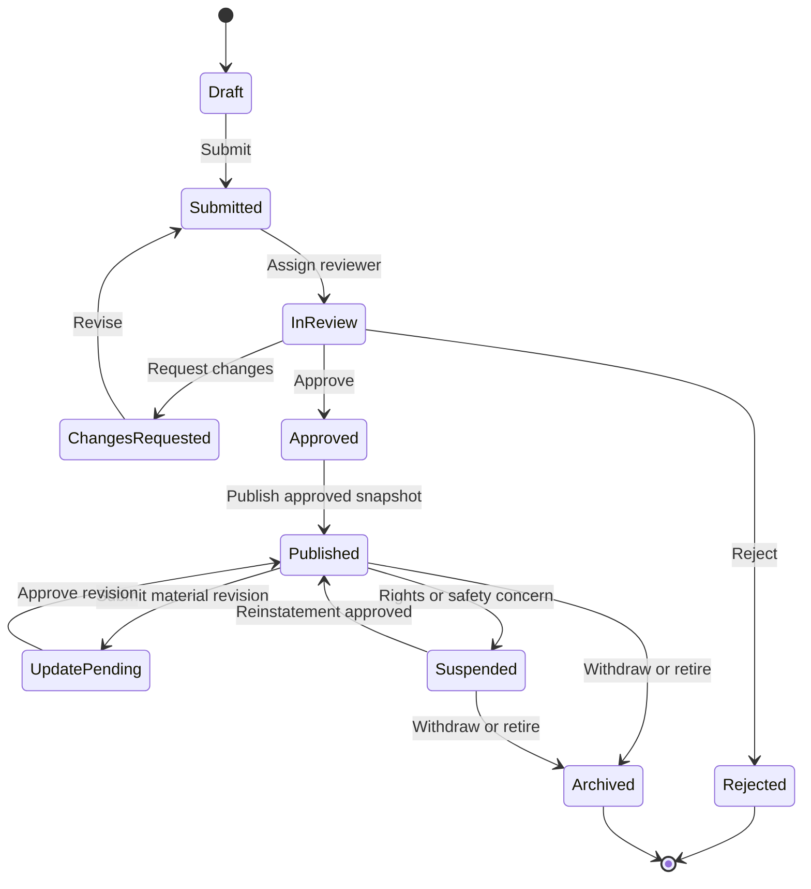

| From | Action | To | Who | Preconditions / effects |
| --- | --- | --- | --- | --- |
| `draft` | submit | `submitted` | Technology manager | Required fields, rights declaration, evidence scanned clean; version frozen |
| `submitted` | assign | `in_review` | Ops manager / auto-assignment | Reviewer has no conflict of interest |
| `in_review` | request_changes | `changes_requested` | Reviewer | Reason per field |
| `changes_requested` | revise | `submitted` | Technology manager | New version created |
| `in_review` | approve | `approved` | Reviewer | Checklist complete; approved field scope recorded |
| `in_review` | reject | `rejected` | Reviewer | Reason recorded; appeal possible |
| `approved` | publish | `published` | System | Snapshot created; outbox event for indexing |
| `published` | submit_revision | `update_pending` | Technology manager | Old snapshot stays public |
| `update_pending` | approve_revision | `published` | Reviewer | New snapshot replaces old |
| `published` | suspend | `suspended` | Reviewer / compliance | Reason; de-indexing within minutes; new introductions blocked |
| `suspended` | reinstate | `published` | Authorized reviewer | Issue resolved with evidence |
| `published` or `suspended` | archive | `archived` | Owner or admin | History preserved |

Rules:

- A draft is visible only to authorized organization members and to platform staff with a case-related need.
- Submission freezes the version under review; review decisions reference that exact version.
- Publication creates an approved public snapshot. Editing a published technology creates a new revision.
- Material changes to technical claims, rights or commercial scope require re-review.
- Suspension immediately disables new discovery and new introductions, while preserving history.

### 6.2 Buyer demand lifecycle

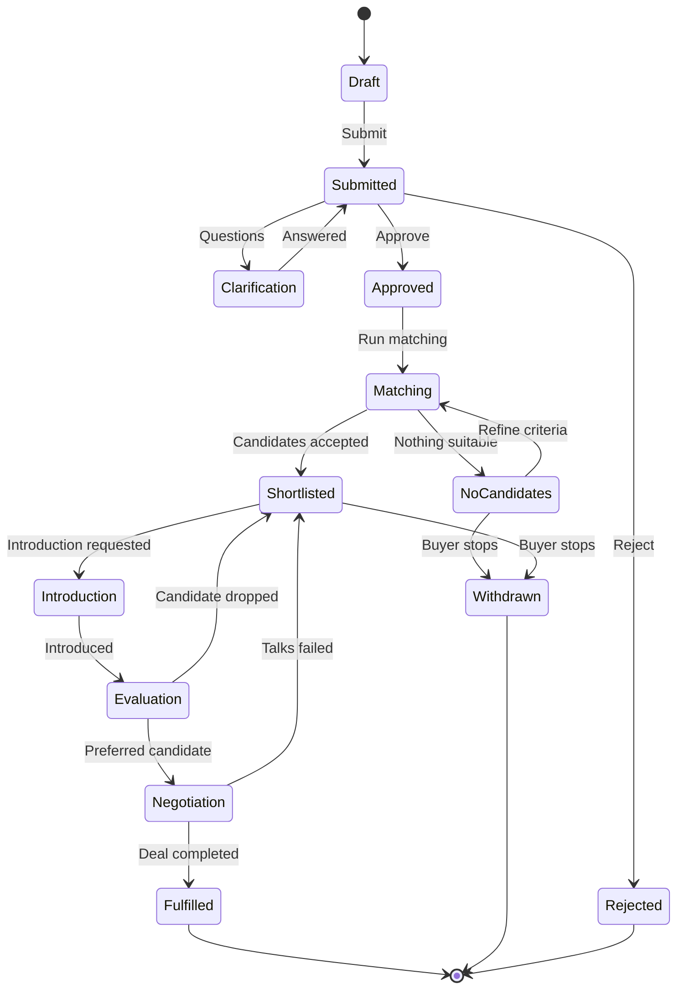

A demand may be **private, broker-assisted or publicly discoverable**; the buyer chooses the disclosure level. Public discovery must never automatically reveal the buyer's identity, budget or confidential technical problem. Demands that pass their target date move to `expired` through a scheduled job.

### 6.3 Introduction lifecycle

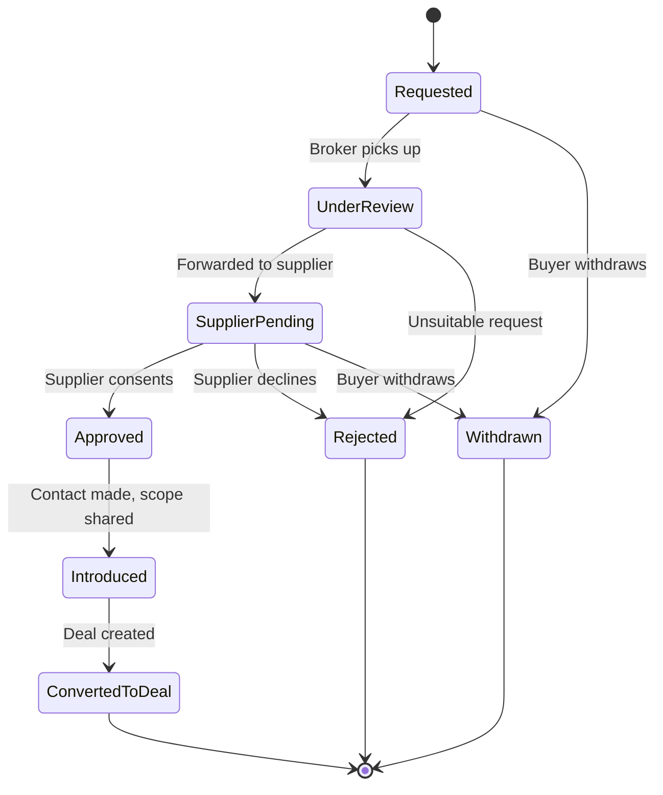

Business rules:

1. Only a buyer with access to the match can request an introduction.
2. The supplier's disclosure preferences and the offer status are checked.
3. The broker may ask for clarification or reject an unsuitable request.
4. **Supplier approval is required**, unless a documented policy or existing agreement explicitly authorizes otherwise.
5. The platform records the date, parties, disclosure scope and communication channel used.
6. Creating a deal from an introduction is **idempotent** (enforced by the unique `deals.introduction_request_id`).

### 6.4 Deal lifecycle

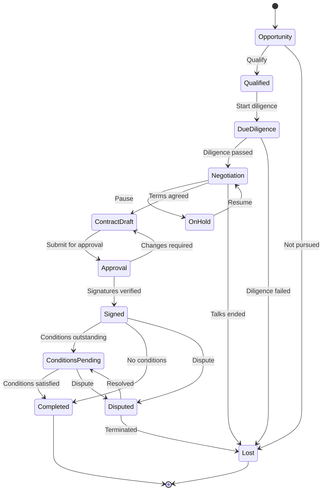

The stage is only **one dimension** of a deal. Store separate fields or records for:

- Contract execution status.
- Required completion conditions.
- Payment status, if applicable.
- IP transfer or licensing evidence.
- Delivery obligations.
- Dispute status.
- Final outcome and loss reason.

This prevents the system from treating "contract signed" as "technology transferred successfully". [07 §8](07-roles-workflows-and-money.md) and [08 §4](08-china-operating-model.md) extend this into fully separate state machines for proposals, contracts, milestones and payments.

### 6.5 Workflow engine requirements

Build one reusable workflow layer with:

- Allowed transition definitions.
- Permission checks.
- Domain-specific preconditions.
- Atomic state update plus transition history (`workflow_transitions`).
- Idempotency for retried commands (`idempotency_keys`).
- Assignment and reassignment.
- Due dates, reminders and escalation.
- Retryable asynchronous actions.
- Correlation IDs across related operations.
- Structured exception reasons.

An approval transition updates the resource status **and** appends its transition record in the same database transaction. Notifications are queued through the transactional outbox (`outbox_events`) and sent **after** the business transaction commits.

---

## 7. User interface and user experience

Organize the interface around **tasks**, not just data records. The three primary experiences are:

1. Supplier workspace.
2. Buyer workspace.
3. Exchange operations workspace for platform staff.

### 7.1 Main navigation

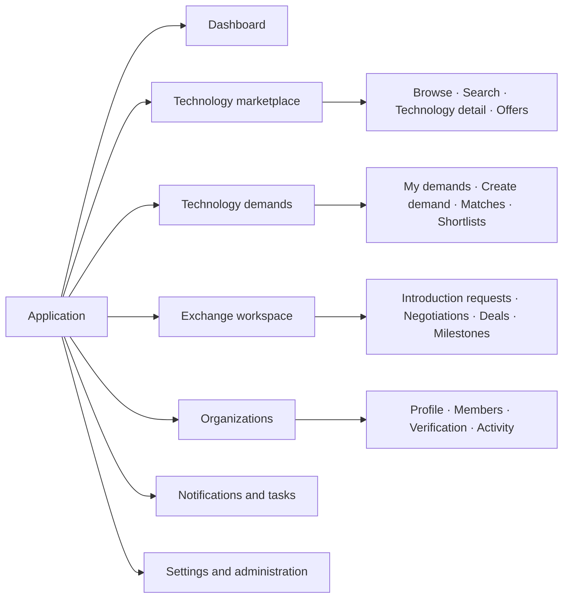

Menu items are permission-aware. Hiding a menu item is a **usability feature, not an authorization mechanism**; the backend enforces access independently.

### 7.2 Supplier journeys

**Supplier dashboard** shows: verification status and outstanding evidence requests · draft technologies · technologies awaiting review · published technologies and active offers · incoming introduction requests · active negotiations and milestones · recent activity and notifications.

Primary actions: `Add technology` · `Create offer` · `Complete organization verification` · `Review introduction request`. The dashboard prioritizes the **next required action**, not just counts.

**Technology creation wizard** (multi-step, with autosave):

| Step | Content | Validation highlights |
| --- | --- | --- |
| 1. Basic information | Title, summary, category, industry, application | Taxonomy codes validated |
| 2. Technical profile | Problem solved, operating principles, advantages, limitations, specifications, TRL | TRL claim needs evidence for levels ≥ 4 |
| 3. Rights and evidence | Patent references, ownership claims, rights holders, supporting documents | Patent number format per jurisdiction; uploads quarantined |
| 4. Commercial offer | Licence, assignment, partnership, pilot; territories; exclusivity; indicative terms | Offer must be consistent with the rights claimed |
| 5. Disclosure settings | Public fields, registered-user fields, restricted documents | Preview of the exact public view |
| 6. Review and submit | Completeness report, declarations, final submission | Declarations mandatory |

UX requirements:

- Save drafts automatically.
- Show completion percentage, but never block saving a draft.
- Distinguish required, recommended and optional evidence, and explain why each field is requested.
- **Preview exactly what public users will see.**
- Flag inconsistent information without rewriting it automatically.
- Show reviewer feedback next to the relevant field.

**Supplier technology detail** sections: Overview · Technical specifications · Applications and industries · Rights and evidence · Commercial offers · Review history · Documents and access · Activity and analytics. Supplier-only information must never leak into public HTML, API payloads or search snippets.

### 7.3 Buyer journeys

**Buyer dashboard** shows: active demands · demands awaiting clarification or approval · new qualified matches · shortlisted technologies · pending introductions · active evaluations and negotiations · recently completed opportunities. Primary actions: `Create technology demand` · `Explore technologies` · `Review new matches` · `Manage introductions`.

**Demand creation wizard**

| Step | Content |
| --- | --- |
| 1. Business problem | The problem and the desired result |
| 2. Technical requirements | Mandatory capabilities, acceptable alternatives, excluded approaches |
| 3. Maturity and deployment | Minimum readiness, integration, production and regulatory requirements |
| 4. Commercial conditions | Indicative budget, licensing preference, territory, timeline |
| 5. Disclosure | Public summary, anonymous publication, verified-user access, or private broker-led search |
| 6. Review and submit | Validation, confidentiality review, approval |

The wizard distinguishes hard constraints from preferences: "TRL 7 is mandatory" versus "TRL 5 is acceptable if a funded development plan exists".

**Search and discovery page** (wireframe, not live data):

```text
+--------------------------------------------------------------------------+
| Search technologies: [ keywords or natural-language question      ] (Go) |
+----------------------+---------------------------------------------------+
| FILTERS              | Technology title                                  |
|  Industry        [v] | Summary · maturity (TRL) · application            |
|  Technology type [v] | Verified claims · available offer types           |
|  TRL           [5-9] | [View details]  [Shortlist]                       |
|  Transaction type[v] +---------------------------------------------------+
|  Territory       [v] | Technology title                                  |
|  Rights status   [v] | Summary · maturity (TRL) · application            |
|                      | Evidence status · commercial availability         |
|                      | [View details]  [Shortlist]                       |
+----------------------+---------------------------------------------------+
```

Result cards communicate: what the technology does · which problem it solves · maturity and evidence status · which commercial arrangements are available · which compatibility questions remain open. Never show confidential price ranges or rights details to unauthorized users.

**Match review page.** Each match shows:

1. Technical fit and evidence.
2. Hard constraints satisfied or failed.
3. Readiness and deployment gaps.
4. Rights and offer compatibility.
5. Indicative commercial fit, if disclosed.
6. An explanation of the ranking.
7. Actions: shortlist, reject, request clarification, request introduction.

Feedback is structured: not technically relevant · wrong maturity · incompatible rights · unsuitable commercial terms · insufficient evidence · already known to the buyer · interested in evaluation. This feedback becomes the training and evaluation dataset for matching.

### 7.4 Deal workspace

One consistent structure for buyers, suppliers and assigned brokers, with different permissions for each:

```text
+------------------------------------------------------------------------+
| DEAL  D-2025-0042 · Parties: Buyer Co., Example University · Mgr: Lee   |
+------------------------------------------------------------------------+
| [Overview] [Negotiation] [Documents] [Milestones] [Completion]          |
+------------------------------------------------------------------------+
| Overview      Commercial summary, transaction type, objectives,         |
|               expected milestones                                       |
| Negotiation   Dated proposals, responses, decisions, approvals and      |
|               authorized communications (timeline)                      |
| Documents     Restricted documents, contract versions, approval         |
|               evidence, access history                                  |
| Milestones    Deliverables, due dates, owners, evidence, status         |
| Completion    Required approvals, executed contract evidence,           |
|               outstanding conditions, final outcome                     |
+------------------------------------------------------------------------+
```

A stage change requires a **specific action** and, where appropriate, supporting evidence. The UI never offers a generic editable status drop-down.

### 7.5 Administrator screens

| Screen | Main functions |
| --- | --- |
| Operations dashboard | Review workload, overdue cases, stalled deals, escalations |
| Organization verification | Legal identity, authority, evidence and appeals |
| Technology review queue | Claim cases, inspect submissions, request corrections, approve publication |
| Rights and evidence review | Examine IP claims, scope verification, record disputes |
| Demand review | Validate requirements and publication scope |
| Match review | Inspect ranking rationale, reject false positives, assign manual scouting |
| Introduction management | Review requests, assign broker, coordinate disclosures |
| Deal operations | Monitor negotiations, approvals, milestones and exceptions |
| Document access audit | Investigate access, permissions and download events |
| Finance operations | Reserved for the later finance integration |
| Taxonomy administration | Categories, translations, aliases, deprecated codes |
| User and organization administration | Suspend accounts, revoke memberships, process appeals |
| Audit and reporting | Search events, export permitted reports, investigate incidents |
| System configuration | Controlled settings, notification templates, policies |

**Review case detail screen** shows: case ID and type · resource and version under review · status and priority · assigned reviewer and deadline · evidence and checklist · conflict-of-interest declaration · previous decisions and requested corrections · decision controls with a mandatory reason · audit history. Reviewers can save work without deciding; approve and reject are distinct, deliberate actions.

---

## 8. Permission matrix

A technology exchange needs more than role-based menus. Combine role-based permissions with resource ownership, organization membership, deal participation and document-specific access.

### 8.1 Platform-level roles

| Capability | Anonymous | Registered user | Organization member | Broker | Reviewer | Admin |
| --- | --- | --- | --- | --- | --- | --- |
| Browse public listings | Yes | Yes | Yes | Yes | Yes | Yes |
| Create personal profile | No | Yes | Yes | Yes | Yes | Yes |
| Create organization | No | Yes | Policy | Policy | Policy | Yes |
| Create technology | No | No | With role | Authorized only | Authorized only | Exception only |
| Create demand | No | No | With role | Authorized only | Authorized only | Exception only |
| Submit technology for review | No | No | With role | Authorized only | No by default | Exception |
| Review technology | No | No | No | No by default | Assigned scope | Authorized scope |
| View confidential deal room | No | No | If permitted | Assigned deals | Case-related need | Exceptional authorized need |
| Assign brokers | No | No | No | No | No | Authorized operations role |
| Suspend public listing | No | No | Request only | Escalate | Within policy | Authorized role |
| Manage global policies | No | No | No | No | No | Security administrator |

A platform administrator is **not** automatically entitled to browse every confidential document. Privileged access is granted through a separate, audited permission.

### 8.2 Organization-level roles

| Permission | Owner | Org admin | Technology manager | Demand manager | Deal manager | Viewer |
| --- | --- | --- | --- | --- | --- | --- |
| View organization profile | Yes | Yes | Yes | Yes | Yes | Yes |
| Edit organization profile | Yes | Yes | Limited | Limited | Limited | No |
| Invite and revoke members | Yes | Delegated | No | No | No | No |
| Manage technologies | Yes | Yes | Yes | No | Limited | Read only |
| Manage offers | Yes | Yes | Yes | No | Limited | Read only |
| Manage demands | Yes | Yes | No | Yes | Limited | Read only |
| View authorized matches | Yes | Yes | Relevant scope | Yes | Relevant scope | Read only |
| Request introductions | Yes | Yes | Relevant scope | Yes | Yes | Policy |
| Manage assigned deals | Yes | Yes | Limited | Limited | Yes | Read only |
| Export organization records | Yes | Policy | Policy | Policy | Policy | No |

`Limited` and `Policy` must resolve to **explicit permissions in code** (for example `technology.edit_offer_terms`), never to undocumented assumptions.

### 8.3 Authorization model

Every request evaluates four dimensions:

| Dimension | Question |
| --- | --- |
| Identity | Who is making the request? |
| Role | What actions may that role perform? |
| Relationship | Does the user belong to the relevant organization or deal? |
| Resource policy | Is this particular version, field, document or action accessible in the current state? |

Being a `technology_manager` does not grant access to another organization's unpublished technology. Being assigned as broker to one deal does not grant access to every deal.

### 8.4 Implementation

Policies are written once with **CASL 5** (verified on Node 12.4). The API checks them on every request; the frontend uses the same rules only to hide unavailable actions.

```typescript
// src/modules/identity/abilities.ts — RBAC + ABAC policy with CASL 5 (verified on Node 12.4).
import { Ability, AbilityBuilder, AbilityClass, ForcedSubject } from '@casl/ability';
import { ObjectId } from 'mongodb';

type Action = 'read' | 'update' | 'submit' | 'review' | 'suspend';
type SubjectName = 'Technology' | 'Demand' | 'Deal' | 'Document';

// Fields that permission conditions may refer to. Documents are wrapped with
// subject('Technology', doc) when checked, so TypeScript can verify the condition objects.
interface TechnologySubject extends ForcedSubject<'Technology'> {
  _id: ObjectId;
  ownerOrganizationId: ObjectId;
  lifecycleStatus: string;
  visibility: string;
}
interface GenericSubject extends ForcedSubject<Exclude<SubjectName, 'Technology'>> { _id: ObjectId }

export type AppAbility = Ability<[Action, SubjectName | TechnologySubject | GenericSubject]>;
const AppAbility = Ability as AbilityClass<AppAbility>;

export interface SessionUser {
  userId: ObjectId;
  memberships: { organizationId: ObjectId; roleCodes: string[]; status: 'active' | 'invited' | 'revoked' }[];
  platformRoles: string[];                                            // from platform_role_assignments
  accessGrants: { resourceType: SubjectName; resourceId: ObjectId }[]; // explicit grants (e.g. NDA-covered)
}

const MANAGES_TECHNOLOGY = ['org_owner', 'org_admin', 'technology_manager'];

export function defineAbilityFor(user: SessionUser | null): AppAbility {
  const { can, cannot, build } = new AbilityBuilder(AppAbility);

  // Everyone, including anonymous visitors: published public listings only.
  can('read', 'Technology', { lifecycleStatus: 'published', visibility: 'public' });

  if (user) {
    for (const m of user.memberships.filter((x) => x.status === 'active')) {
      can('read', 'Technology', { ownerOrganizationId: m.organizationId });
      if (m.roleCodes.some((r) => MANAGES_TECHNOLOGY.includes(r))) {
        can(['update', 'submit'], 'Technology', { ownerOrganizationId: m.organizationId });
      }
    }
    for (const g of user.accessGrants) {
      can('read', g.resourceType, { _id: g.resourceId });
    }
    if (user.platformRoles.includes('listing_reviewer')) {
      can('review', 'Technology', { lifecycleStatus: { $in: ['submitted', 'in_review'] } });
    }
    if (user.platformRoles.includes('compliance_officer')) {
      can('suspend', 'Technology', { lifecycleStatus: 'published' });
    }
  }

  // State rules apply on top of role rules ("cannot" wins over "can").
  cannot('submit', 'Technology', { lifecycleStatus: { $nin: ['draft', 'changes_requested'] } });
  cannot('update', 'Technology', { lifecycleStatus: { $in: ['submitted', 'in_review', 'suspended', 'archived'] } });
  return build();
}

// In a route handler, after loading the document through the tenant-scoped repository:
//   if (!ability.can('submit', subject('Technology', tech))) throw new ForbiddenError();
```

The verification run checks this policy: a technology manager can submit their own draft but not a submitted one, nor another organization's technology. A viewer can read but not submit. Anonymous visitors see only published public listings. A reviewer can review submitted listings but not drafts.

The policy decides **what** an actor may do. The tenant-scoped repository (§4.8) decides **which documents can be loaded at all**. Both are required. Field-level visibility (public, registered-user, NDA-covered fields) is applied by the response serializer of each endpoint. Test authorization at the **service layer and the API boundary**; never rely on the frontend.

---

## 9. Security and confidentiality design

### 9.1 Document upload and access sequence

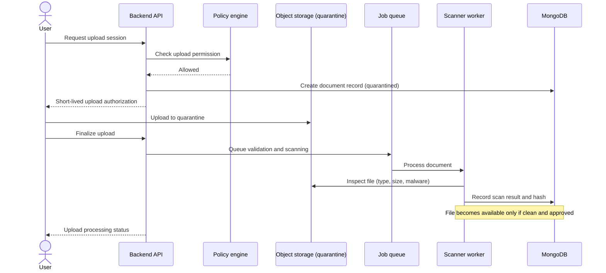

Required controls:

- Private storage by default.
- File size and permitted-type limits.
- Malware scanning (for example ClamAV in an isolated worker).
- Cryptographic file hashes.
- Metadata extraction in a restricted worker.
- No indexing of unapproved confidential text.
- Per-resource access grants.
- Short-lived download authorization.
- Audit events for sensitive access.
- Retention and deletion policies.
- Encrypted, access-restricted backups.

If the scanner is unavailable, files **stay quarantined**. Never make documents available just because a timeout elapsed.

### 9.2 Authentication and sessions

| Topic | Design |
| --- | --- |
| Login methods | **Mobile number + SMS code** (the norm for Chinese users), or e-mail / mobile + password. WeChat QR login can be added later through WeChat Open Platform OAuth |
| Passwords | `bcryptjs`, cost 12; at least 10 characters; checked against a common-password list |
| SMS codes | 6 digits, valid 5 minutes, stored hashed in `sms_codes` (TTL); at most 1 send per 60 s and 10 per day per number; image CAPTCHA after repeated sends; SMS templates registered with the SMS provider |
| MFA | TOTP (`otplib`) **mandatory for platform staff**, strongly encouraged for organization owners and signatories |
| Sessions | Opaque random session ID in a `Secure`, `HttpOnly`, `SameSite=Lax` cookie; session data in the MongoDB `sessions` collection (TTL 8 h idle, 7 days absolute); rotate the ID on login and on privilege change; revoke all sessions on suspension or password change |
| CSRF | `SameSite` cookies plus a CSRF token header on every state-changing request |
| Brute force | Nginx `limit_req` on `/api/v1/auth/` plus per-account lockout (`login_attempts`, TTL) |
| Real-name and enterprise verification | Through provider APIs (see [10](10-product-requirements.md)); results stored as verification levels, never raw ID-card images in the main database |

### 9.3 Audit and incident response

Audit at least:

- Authentication and privileged access.
- Membership and role changes.
- Verification decisions.
- Publication and suspension.
- Confidential document access and permission changes.
- Introduction approvals and rejections.
- Deal stage transitions.
- Contract evidence and completion decisions.
- Financial adjustments (when finance is introduced).
- Policy and configuration changes.

Never put full confidential document contents, passwords, tokens or other secrets in audit logs.

---

## 10. Search and matching implementation

MongoDB 4.4/5.0 cannot search Chinese text: its text index splits words on spaces, so `缺陷检测` returns nothing (verified). Search therefore uses **Meilisearch**, which segments Chinese words. Structured eligibility filtering stays in MongoDB, and scoring runs in the Node worker. Details: [11 §6](11-target-runtime-node12-mongodb.md).

### 10.1 Retrieval and matching pipeline

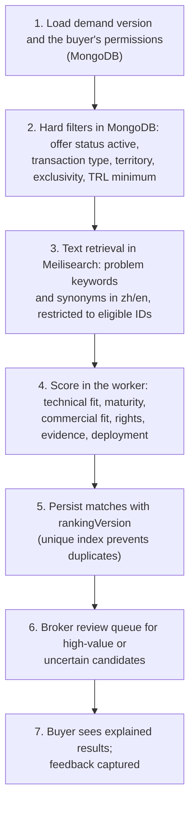

Never rely on a single similarity score to decide legal or commercial eligibility. Hard constraints are filters (step 2), not score components.

### 10.2 Search index setup

```bash
# Run once per environment (and after a full rebuild). Master key only in admin tooling.
curl -X PATCH "$MEILI_URL/indexes/publications/settings" \
  -H "Authorization: Bearer $MEILI_MASTER_KEY" -H 'Content-Type: application/json' \
  --data '{
    "searchableAttributes": ["title.zh", "title.en", "keywords", "summary.zh", "summary.en", "owner.displayName"],
    "filterableAttributes": ["status", "industryCodes", "trl.claimed", "offerTypes", "territories", "badges", "owner.type"],
    "sortableAttributes": ["publishedAt"],
    "synonyms": { "锂电": ["锂电池", "锂离子电池"], "锂电池": ["锂电", "lithium battery"] },
    "pagination": { "maxTotalHits": 1000 }
  }'
```

- Only `technology_publications` (and anonymized public demands, in a second index) are sent to Meilisearch; never drafts, restricted fields or document text.
- The worker upserts or deletes documents when it relays `technology.published`, `technology.updated`, `technology.suspended` and `technology.archived` outbox events. A nightly job reconciles counts and `publishedAt`, and `npm run search:rebuild` recreates the index from MongoDB.
- The API uses a **search-only key**, and re-checks status and permissions in MongoDB before returning results.

### 10.3 Initial ranking model

```text
S = 0.35·T + 0.20·M + 0.15·C + 0.15·R + 0.10·E + 0.05·G
```

T, M, C, R, E and G are normalized (0–100) technical fit, maturity, commercial fit, rights compatibility, evidence quality and geographic compatibility (see [05 §7.3](05-system-design-blueprint.md)).

- The weights are **hypotheses to test**, not benchmarks. Store them under a `rankingVersion` in configuration.
- Mandatory constraints apply **before** ranking. A rights incompatibility makes a candidate ineligible or sends it to manual review; it does not just lower the score.

### 10.4 Matching quality loop

For every recommendation, keep: demand version · offer and technology version · retrieval method · ranking version · score components · evidence · broker decision · buyer feedback · eventual deal outcome. This lets the team test whether a ranking change actually improves introductions and deals.

---

## 11. Self-hosted infrastructure and deployment

Full configuration (systemd units, Nginx, release procedure, backups) is in [11 §5 and §9](11-target-runtime-node12-mongodb.md). This section gives the layout and the repository structure.

### 11.1 Hosts

| Host | Components | Exposure |
| --- | --- | --- |
| Application server | Nginx · `tex-api@3001`, `tex-api@3002` · `tex-worker` · Meilisearch · file storage volume | Only Nginx on 80/443 |
| MongoDB hosts (3 recommended) | `mongod` replica set `rs0` (4.4 or 5.0), authentication on | Private network only |
| Backup target | Nightly `mongodump --oplog` archives, file-storage copies | Separate credentials and failure domain |

### 11.2 Network layout

| Zone | Contents | Exposure |
| --- | --- | --- |
| Public internet | Nginx only (HTTP → HTTPS redirect, HTTPS) | Public |
| Application | API instances on `127.0.0.1:3001-3002`, worker, Meilisearch on `127.0.0.1:7700` | Localhost / private |
| Data | MongoDB on `27017`, reachable only from the application server and other members | Private, firewall-restricted |
| Administration | SSH, monitoring | Approved addresses or VPN only |

Never expose MongoDB, Meilisearch, the API ports or monitoring endpoints to the internet.

### 11.3 Initial resource planning

Planning estimates, not measured capacity:

| Component | Starting allocation |
| --- | --- |
| Application server | 4 vCPU, 8 GB RAM (two API instances at ≤ 1 GB heap each, worker, Meilisearch ≈ 1–2 GB) |
| Each MongoDB member | 2–4 vCPU, 8 GB RAM (WiredTiger cache ≈ 50% of RAM), SSD sized for data, indexes and oplog (≥ 24 h of writes) |
| File storage | Separate volume or bucket with lifecycle and backup policy |
| Backup storage | Separate failure domain, ≥ 30 daily + 12 monthly archives |

Measure CPU, memory, disk latency, connection counts, slow queries (MongoDB profiler at 100 ms), outbox backlog and response times before adding capacity.

### 11.4 Repository structure

```text
technology-exchange/
├── apps/
│   ├── api/                       # Express 4 + TypeScript → dist/ (ES2019, CommonJS), runs on Node 12
│   │   ├── src/
│   │   │   ├── main.ts            # HTTP server bootstrap, graceful shutdown
│   │   │   ├── worker.ts          # outbox relay, search indexer, page renderer, notifications, cron jobs
│   │   │   ├── core/              # config, Mongo client, repositories, errors, auth middleware, logging
│   │   │   └── modules/
│   │   │       ├── identity/      ├── organizations/  ├── taxonomy/   ├── technology/
│   │   │       ├── offers/        ├── demands/        ├── discovery/  ├── matching/
│   │   │       ├── exchange/      ├── deals/          ├── documents/  ├── workflow/
│   │   │       ├── notifications/ ├── content/        ├── audit/      └── reporting/
│   │   ├── migrations/            # migrate-mongo: validators, indexes, roles, data fixes
│   │   ├── templates/             # EJS: public technology pages, sitemap, e-mails
│   │   ├── test/                  # jest 27 (runs on node:12.4.0 + MongoDB 4.4 container)
│   │   └── package.json           # engines.node = 12.4.0; lockfile readable by npm 6
│   └── web/                       # React 18 + Vite + Ant Design 5 (built on CI only)
├── packages/
│   └── contracts/                 # zod schemas and types shared by api and web (compiled into both)
├── deploy/
│   ├── nginx/                     # tex.conf, proxy_params.inc
│   ├── systemd/                   # tex-api@.service, tex-worker.service
│   ├── scripts/                   # release.sh, rollback.sh, backup.sh, restore.sh, search-rebuild.sh
│   └── env.example
├── verification/node12-mongodb/   # compatibility kit (doc 11)
└── docs/
```

Each module folder contains `*.routes.ts` (HTTP and zod validation), `*.service.ts` (business rules, transactions), `*.repository.ts` (data access only through `core/data`), `*.policy.ts` (CASL rules) and `*.test.ts`. Keep business logic out of route handlers, so it can be tested without HTTP.

### 11.5 Release and recovery process

Follow the release procedure in [11 §9.4](11-target-runtime-node12-mongodb.md): build and test on CI (unit tests on `node:12.4.0`) → back up the database → run migrations → switch the release symlink → restart API instances one at a time with health checks → restart the worker → smoke tests. Migrations are **expand-and-contract**, so rollback is a symlink switch. A database restore is the last resort and is rehearsed monthly.

---

## 12. Testing and acceptance criteria

Test business rules, not only whether endpoints return HTTP 200.

| Layer | Tooling | Runs on |
| --- | --- | --- |
| Unit and service tests | `jest@27.5.1` | `node:12.4.0` container (the real runtime) |
| Integration tests | jest + a **MongoDB 4.4 single-node replica set** container (transactions need a replica set) + Meilisearch container | CI |
| Compatibility gate | `verification/node12-mongodb/run.sh` on every dependency change | CI |
| End-to-end tests | Playwright against a staging deployment | CI (modern Node) |

### 12.1 Critical end-to-end scenarios

| Scenario | Expected result |
| --- | --- |
| Supplier submits a technology | A review case is created; the draft is not publicly visible |
| Reviewer requests corrections | Supplier sees the required changes; nothing is published |
| Reviewer approves a version | Only approved fields are published and indexed |
| Buyer submits a demand | Demand version and review state are recorded |
| Matching runs twice | No duplicate side effects; ranking results are versioned |
| Buyer requests an introduction | The request enters the appropriate review workflow |
| Supplier rejects an introduction | No deal is created |
| Introduction is approved | Only the authorized disclosure scope is shared |
| Unauthorized user guesses a document ID | Access is denied (and audited) |
| Technology is suspended | New discovery and introductions are blocked |
| Two reviewers decide simultaneously | Exactly one valid transition succeeds |
| Notification delivery fails | The business operation stays committed; delivery retries |
| Deal reaches completion | Deal-type-specific completion conditions are satisfied |
| Backup is restored | Database and document references remain consistent |

### 12.2 Security release blockers

Automate tests proving that:

- Organization A cannot read Organization B's private technology, demand or documents.
- Revoked members lose access.
- Public search never exposes unpublished or suspended listings.
- Confidential text does not leak through search snippets or AI-generated explanations.
- Users cannot change protected statuses through general-purpose update endpoints.
- Retried requests cannot duplicate introductions or deals.
- Reviewer permissions cannot be escalated by modifying client payloads.
- Administrative actions require authorization and produce audit records.

---

## 13. Phased development plan for a small team

Deliver working **vertical slices**. The schedule depends on team experience, design readiness, integrations and compliance requirements.

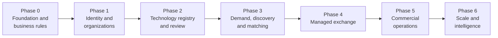

| Phase | Deliverables | Exit gate |
| --- | --- | --- |
| **0 — Foundation and business rules** (specification) | Confirm launch jurisdiction and legal model · Finalize taxonomy and core entities · Define state machines and permissions · Create migrations and API conventions · Build design system and wireframes · Define backup, security and release requirements | Business owners approve the core workflows and completion criteria |
| **1 — Identity and organizations** | Authentication and account recovery · Organization creation and membership · Organization profiles · Role and permission enforcement · Basic admin console · Audit events · Initial deployment pipeline | Several organizations operate independently with no cross-tenant data access |
| **2 — Technology registry and review** | Technology wizard · Version history · Offers and rights claims · Document upload and quarantine · Organization and technology verification queues · Publication snapshots · Public catalogue | A supplier can submit, revise and publish a reviewed listing without leaking restricted information |
| **3 — Demand, discovery and matching** | Demand wizard · Structured requirements · Search and filters · Candidate retrieval and ranking · Match explanations · Shortlists and feedback · Matching admin workspace | Buyers submit demands and review useful, permission-safe candidates |
| **4 — Managed exchange** | Introduction requests · Broker assignments · Controlled supplier responses · Confidentiality workflow · Deal creation and participant permissions · Negotiation history · Milestones and outcome tracking | The platform coordinates a complete opportunity from demand through introduction and managed negotiation |
| **5 — Commercial operations** | Enterprise service packages · Contract-management integration · E-signature integration · Invoicing and reconciliation (if the model needs them) · Commercial reporting · Service-level monitoring and support | The team supports paid services and transactions with auditable financial and contractual records |
| **6 — Scale and intelligence** | Dedicated search if needed · Semantic matching · Document extraction and AI-assisted review · Enterprise APIs · More languages and currencies · Advanced analytics · More regional deployments | New capabilities measurably improve match quality, commercial performance or efficiency |

### Suggested team allocation (four people)

| Role | Primary responsibility |
| --- | --- |
| Engineer 1 | Backend architecture, database and workflows |
| Engineer 2 | Frontend, UX implementation and API integration |
| Engineer 3 | Backend modules, documents, search and integrations |
| Engineer 4 | Full-stack delivery, testing, DevOps and operational tooling |

With one or two developers, combine roles and reduce scope. Shared acceptance checklists and API contracts keep frontend and backend aligned.

A **domain expert or product owner** is necessary, even part-time, to decide verification policies, commercial terms, legal requirements and exceptional cases. Developers alone cannot safely make those decisions.

---

## 14. Operational service-level targets

A managed exchange needs defined service standards from the start. These are **proposed initial targets**, not industry benchmarks:

| Process | Initial target | Escalation |
| --- | --- | --- |
| Organization verification | First review within 3 business days | Escalate overdue cases |
| Technology review | First review within 5 business days | Notify the reviewer's manager |
| Correction request | Acknowledged within 2 business days | Escalate unanswered cases |
| Introduction request | Initial response within 2 business days | Reassign stalled cases |
| Match review | High-priority candidates reviewed within 2 business days | Escalate urgent buyer demands |
| Deal milestone | Reminder before the due date | Escalate overdue milestones |
| Security incident | Immediate triage by severity | Follow the incident response plan |

Use configurable targets and business calendars (including public holidays). Measure **time to first response** separately from **total resolution time**, and exclude time spent waiting for the user. The operations dashboard shows each case's age, owner, next action and deadline.

---

## 15. Launch readiness checklist

Before the first real suppliers and buyers enter the system:

**Business and governance**

- [ ] Launch jurisdiction and legal operating model approved
- [ ] Supplier declarations and publication terms approved
- [ ] Verification policies and appeal process documented
- [ ] Transaction completion criteria defined

**Application**

- [ ] Organization registration and membership flows tested
- [ ] Technology and demand workflows tested end to end
- [ ] Search and matching explanations validated
- [ ] Introduction and deal permissions tested

**Security**

- [ ] MFA enabled for privileged accounts
- [ ] Cross-organization authorization tests passing
- [ ] Document quarantine and scanning operational
- [ ] Secrets, backups and audit logs protected

**Operations**

- [ ] Review queues have named owners
- [ ] Monitoring and error alerts operational
- [ ] Database and document recovery tested
- [ ] Release and rollback procedures documented

Passing this checklist does not by itself establish legal compliance or certify security. For the China launch, also complete [08 §10](08-china-operating-model.md).

---

## 16. Business metrics to instrument from day one

Record the events needed to measure whether the exchange creates real value:

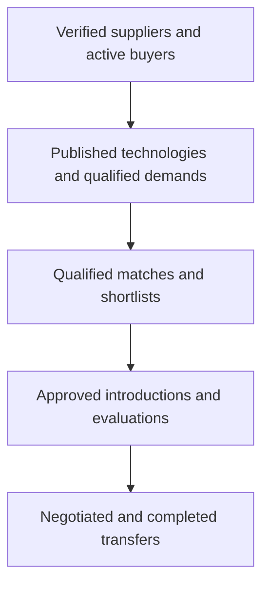

Track conversion and time between stages, and the **reasons for failure**. These show whether the bottleneck is insufficient supply, poor matching, weak evidence, slow reviews, incompatible terms or difficult negotiations.

For commercial reporting, separate completed transactions from estimated deal values, and platform-earned revenue from money paid directly between counterparties.

---

## 17. The first implementation sprint

Start with these concrete tasks rather than the full marketplace UI:

| Order | Task | Definition of done |
| --- | --- | --- |
| 1 | Establish repository, TypeScript ES2019 build and lint rules | Reproducible build; ESLint blocks ES2020+ APIs; CI runs tests on `node:12.4.0` |
| 2 | Create deployment baseline | Staging server with the same Node 12.4 and MongoDB version, a replica set, Nginx and systemd units; release script works |
| 3 | Add database migrations | `migrate-mongo` creates validators, indexes and roles on an empty database (based on the verified migration) |
| 4 | Implement authentication | Protected API routes and secure sessions work |
| 5 | Implement organization membership | Role checks operate in the backend |
| 6 | Implement audit events | Sensitive actions produce structured records |
| 7 | Build authorization test suite | Cross-organization access tests pass |
| 8 | Create the UI shell | Navigation and permission-aware pages exist |
| 9 | Implement technology drafts | Members can create and edit authorized drafts |
| 10 | Implement review cases | A reviewer can inspect a submission and request corrections |
| 11 | Add publication snapshots | Only approved fields become public |
| 12 | Run end-to-end tests | The full submission-to-publication journey passes |

The first vertical slice is small but complete:


It validates the most important foundations: identity, tenant isolation, versioning, state transitions, review operations, audit history and public disclosure. Once it works reliably, add demand management and matching on top.

---

## Final engineering decision

| Area | Baseline |
| --- | --- |
| Runtime | Node.js 12.4 (upgrade to 12.22.12 recommended); TypeScript compiled to ES2019/CommonJS |
| Frontend | React 18, Vite and Ant Design 5, built on CI and served by Nginx; public pages pre-rendered |
| Backend | Express 4 modular monolith: API instances + one worker |
| Database | MongoDB 4.4 / 5.0 replica set, driver 3.7.4, validators, indexes and roles via migrations |
| Search | Meilisearch (Chinese segmentation), fed by the outbox; rebuildable from MongoDB |
| Documents | Private storage with quarantine, scanning, per-document grants and watermarks |
| Workflow | Explicit state machines, transactions, transition history, outbox |
| Deployment | systemd + Nginx on the target server; nightly `mongodump --oplog` |
| Business model | Managed exchange: offers, demands, introductions, deal management |
| Security | Organization roles + CASL policies + tenant-scoped repositories |
| Delivery | One complete vertical workflow at a time |

The biggest risk is not choosing the wrong framework. It is failing to distinguish **claims from verified facts, listings from offers, matches from introductions, and signed contracts from completed transfers**. Enforce those distinctions in the database, API, workflow engine, admin console and reporting from the beginning.

The one business decision to settle before the production build was the **exact launch country**, because it determines organization-verification sources, IP evidence requirements, privacy controls, contract processes and transaction restrictions. That decision is China; see [08](08-china-operating-model.md).
