# 06 — Implementation-Level System Design (Version 1.0)

> **About this document**
>
> - **Purpose:** Turn the blueprint in [05](05-system-design-blueprint.md) into a concrete engineering baseline that a small team can use to write migrations, backend modules, frontend pages, tests, deployment scripts and operating procedures.
> - **Audience:** Engineers, tech lead, product owner and operations lead.
> - **Status:** Version 1.0 baseline for the first release. The China-specific legal, payment and deal-type rules in [08](08-china-operating-model.md) extend this baseline.
> - **Previous:** [05 — System design blueprint](05-system-design-blueprint.md) · **Next:** [07 — Roles, workflows and money movement](07-roles-workflows-and-money.md)

| Profile | Value |
| --- | --- |
| Launch | Regional (one country first; China selected later in [08](08-china-operating-model.md)) |
| Business model | Managed technology exchange marketplace |
| Hosting | Self-hosted |
| Team | Small engineering team (1–4 developers) |
| Scope of this document | Architecture baseline · Domain model · Database · APIs · Workflows · UI · Permissions · Security · Search · Deployment · Testing · Delivery plan |

---

## Summary

Build a **managed technology exchange**: neither a plain listing website nor a fully automated trading exchange.

The platform brings technology suppliers and buyers together. It helps them discover relevant opportunities, verifies important claims, controls confidential disclosure, facilitates introductions and manages negotiations through to a recorded outcome. **Platform staff operate the review and exchange workflows; participating organizations keep control of their technologies and commercial decisions.**

For the first release, deliberately avoid microservices, a separate graph database, a custom payment wallet and a complex AI platform. They add operational work without being needed to prove the core business.

---

## 1. Product definition and design assumptions

### 1.1 Agreed product profile

| Decision | Design |
| --- | --- |
| Initial market | One regional market, expandable to other regions |
| Business model | Technology exchange marketplace |
| Initial participants | Technology suppliers and technology buyers |
| Hosting | Self-hosted servers or virtual machines |
| Engineering team | 1–4 developers |
| Transaction scope | Managed introductions, negotiation and deal tracking |
| Industry coverage | Broad, cross-industry |
| Revenue model | Exchange-related services first; subscriptions and other revenue later |
| Operating model | Platform staff support verification, matching and transaction coordination |

### 1.2 Remaining assumptions

Where a decision is still open, an explicit assumption lets engineering proceed without pretending it is settled:

| Open decision | Baseline assumption | Consequence |
| --- | --- | --- |
| Launch country | One country, chosen before production launch (later decided: China) | Country-specific legal, tax, privacy and e-signature review remains mandatory |
| Launch language | One primary language, translation-ready architecture | User-visible strings and searchable text are language-aware |
| Currency | One settlement and reporting currency; records store ISO 4217 codes | Multi-currency later without redesign |
| Legal status | Private commercial platform, **not** a statutory exchange unless later authorized | Never imply official approval or legal certification |
| Transaction execution | Platform coordinates; parties sign independently or through an integrated signing provider | No proprietary escrow or custody service |
| Verification | Human review supported by evidence and external registries | Verification claims are scoped and auditable |
| Infrastructure | Linux servers or VMs under the operator's control | Containers and scripted deployment; no Kubernetes initially |
| Traffic | Early-stage, modest volume | One application deployment, a worker process, one primary database |
| Technology ownership | Suppliers declare their authority to list and negotiate | Publication does not certify ownership |
| AI | Optional, later phases | Core flows work without AI |

A "regional launch" is not yet a precise legal jurisdiction. The domain model is therefore **jurisdiction-neutral**, but production launch requires a defined country, privacy regime, e-signature rules, export restrictions and legal treatment of brokerage and payments.

### 1.3 Scope of the first production release

| Included | Deferred until justified |
| --- | --- |
| Organization accounts and roles | Automated payment settlement or escrow |
| Technology listings and offers | Public auctions and automated bidding |
| Buyer demands and search | Complex commission splitting |
| Managed review and matching | A microservice per domain |
| Controlled introductions | Custom AI model training, autonomous negotiation |
| Deal pipeline and audit trail | A separate graph database or event-streaming cluster |
| | Multi-region active-active deployment |

---

## 2. Domain architecture

Model the platform around **technology assets, technology offers, buyer demands, matches, introductions and deals**. These are distinct concepts: a technology is not an offer, a demand is not a match, and a match is not a transaction.

### 2.1 Domain groups

| Group | Entities |
| --- | --- |
| Identity and organizations | User · Organization · Membership · Role · Verification case |
| Technology supply | Technology · Version · IP asset · Offer · Evidence · Documents |
| Buyer demand | Demand · Requirements · Budget · Constraints · Deadline |
| Exchange operations | Match · Shortlist · Introduction request · Review task · Communication |
| Deal management | Deal · Party · Proposal · Contract reference · Milestone · Outcome · Dispute |
| Cross-cutting services | Permissions · Documents · Workflow · Notifications · Audit · Reporting · Billing |

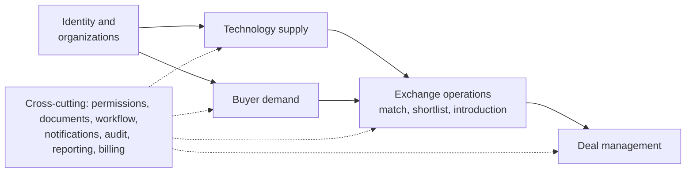

### 2.2 Business entities

| Entity | Meaning | Example |
| --- | --- | --- |
| Organization | Legal or institutional participant | University, manufacturer, startup |
| Technology | Stable identity of a technology asset | High-efficiency industrial coating |
| Technology version | A specific revision of its description and technical data | Revision 3, updated performance data |
| IP asset | A patent, application, copyright, know-how claim or other right | Patent application in one jurisdiction |
| Technology offer | A particular commercial opportunity involving the technology | Licence for a specified territory |
| Demand | A buyer's structured problem or need | Reduce inspection time by 30% |
| Match | A recorded relationship between a demand and a candidate offer | Demand D matched to Technology T |
| Introduction | A controlled request to connect two parties | Buyer requests contact with supplier |
| Deal | The managed commercial opportunity | Licence negotiation between two organizations |
| Evidence | Support for a claim or review decision | Patent register extract or test report |
| Review case | A controlled administrative process | Verify organization, review listing |
| Milestone | A deliverable or condition in a deal | Prototype delivery |
| Audit event | A record of a material system action | Listing approved by reviewer |

**Critical modeling rule:** one technology may have several offers, for example:

- A non-exclusive licence in Region A.
- An exclusive licence in Region B.
- An assignment offer.
- A development partnership.
- A time-limited pilot or evaluation arrangement.

Each offer defines its own transaction type, rights scope, territory, field of use, commercial terms and availability. The same technology can satisfy several demands, but not every offer is compatible with every demand. **Matching therefore happens at offer level.**

### 2.3 Internal modules

| # | Module | Responsibility |
| --- | --- | --- |
| 1 | `identity` | Users, sessions and authentication |
| 2 | `organizations` | Profiles, membership and verification |
| 3 | `taxonomy` | Industries, technology categories, applications and TRL |
| 4 | `technology` | Assets, versions, rights claims and evidence |
| 5 | `offers` | Licence, assignment and partnership opportunities |
| 6 | `demands` | Buyer requirements and constraints |
| 7 | `discovery` | Search, filters and candidate retrieval |
| 8 | `matching` | Candidate scores, explanations and feedback |
| 9 | `exchange` | Shortlists, introduction requests and broker assignments |
| 10 | `deals` | Negotiations, proposals, milestones and outcomes |
| 11 | `documents` | Private files, access grants and document versions |
| 12 | `workflow` | Review queues, tasks, deadlines and transitions |
| 13 | `notifications` | Email and in-app notifications |
| 14 | `audit` | Immutable business event history |
| 15 | `reporting` | Operational and commercial dashboards |

Finance, subscriptions, e-signatures and AI start as **integration boundaries or later modules**, not as reasons to split the backend into services.

---

## 3. Technical architecture

### 3.1 Technology stack

| Layer | Recommendation | Reason |
| --- | --- | --- |
| Frontend | React + TypeScript + Vite | Straightforward SPA development |
| UI | One component library and shared design tokens | Faster, consistent screens |
| Backend | Python + FastAPI | Typed APIs, validation, OpenAPI generation |
| Domain validation | Pydantic plus explicit domain services | Consistent input and business validation |
| Primary database | PostgreSQL 15+ | Transactions, relational integrity, JSONB, row-level security |
| Search (initial) | PostgreSQL full-text search and trigram indexes | No extra datastore early on |
| Search (later) | OpenSearch or another dedicated search service | Advanced multilingual search and facets |
| Cache | Redis, only when justified | Rate limits, caching, short-lived coordination |
| Background jobs | Durable, database-backed job queue initially | Simple operations for a small team |
| File storage | Private S3-compatible object storage (e.g. MinIO) or protected local storage | Controlled document lifecycle |
| Authentication | OIDC-compatible identity provider (e.g. Keycloak) or a secure application auth library | MFA, sessions, integration flexibility |
| Reverse proxy | Nginx or Caddy | TLS termination and routing |
| Deployment | Docker Compose on Linux | Repeatable self-hosted deployment |
| Observability | Structured logs, metrics, error reporting | Operational visibility |
| CI/CD | Git workflow, automated tests, image builds | Controlled releases |

Start **without Redis and without a search cluster**. PostgreSQL can carry the first version's search and matching workloads. Add infrastructure when measured performance or product requirements justify it.

Background jobs need durable persistence, retry rules, deduplication and failure visibility. A database-backed queue is fine at low volume; move to a broker when volume or delivery guarantees require it.

### 3.2 Logical deployment topology

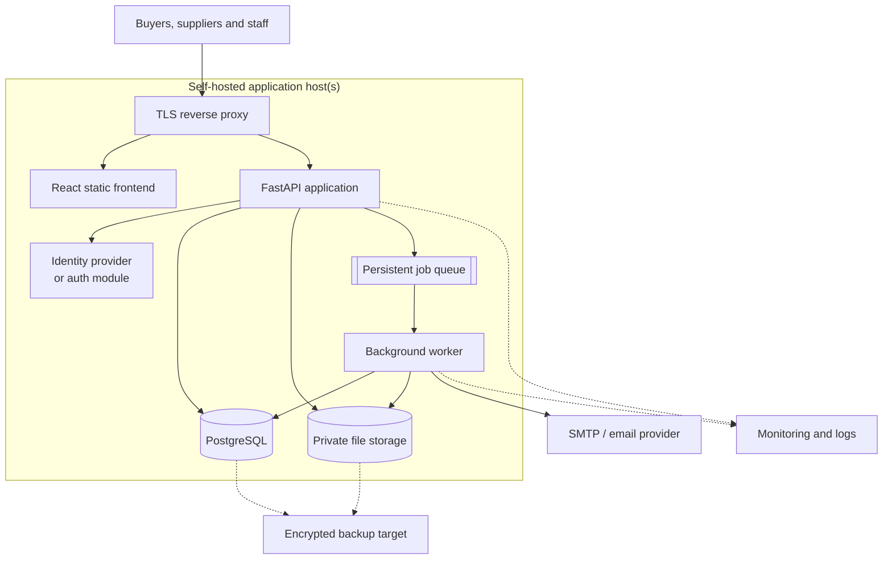

For production, separate the public-facing application from the database host, even if the first environment has only two or three VMs:

| VM | Role |
| --- | --- |
| VM 1 — Edge and application | Reverse proxy, frontend assets, API |
| VM 2 — Data | PostgreSQL, plus private object storage if no dedicated storage server exists |
| VM 3 — Optional worker | Background jobs and document processing, when load or isolation requires |

With only one physical server, keep the same **logical** separation through containers, network rules, separate credentials and persistent volumes.

---

## 4. Database design

The initial PostgreSQL model: tables, relationships, indexes, constraints and transaction rules. It is more normalized than a typical listing site, because rights, version history, permissions and deal outcomes must stay independently auditable.

### 4.1 Entity relationship diagram

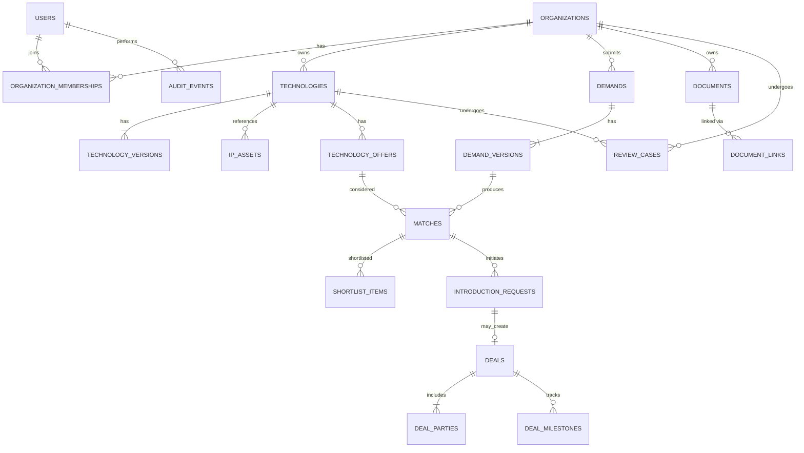

The diagram is conceptual. A document may belong to a technology, demand, organization or deal through `document_links`, but its ownership and access rules must be explicit in the implementation.

### 4.2 Database-wide conventions

- UUID primary keys for business entities.
- `TIMESTAMPTZ` for timestamps; store UTC, localize in the frontend.
- ISO 4217 currency codes for monetary amounts.
- `NUMERIC` or integer minor units for money, never floating point.
- Foreign keys for stable relational references.
- Uniqueness constraints for invariants that must hold under concurrency.
- Separate immutable revision records for important published content.
- Separate state-transition records from mutable current-state columns.
- Soft deletion only where justified; preserve legally and operationally necessary history.
- Explicit tenant and resource access checks.
- Migrations committed to source control (for example Alembic).

Do not use free-form status text. Use constrained values, reference tables or PostgreSQL enums where the state set is stable. For workflows that evolve often, a `CHECK`-constrained text column plus a centralized domain state machine is easier to change than an enum. **The `CHECK` lists below must match the state machines in §6 exactly.**

### 4.3 Identity and organizations

Executable starting point. Assumes PostgreSQL 15+ and migrations applied in dependency order.

```sql
-- gen_random_uuid() is built into PostgreSQL 13+; no extension is needed.

-- Keeps updated_at current on every UPDATE.
CREATE OR REPLACE FUNCTION set_updated_at() RETURNS trigger AS $$
BEGIN
    NEW.updated_at := now();
    RETURN NEW;
END;
$$ LANGUAGE plpgsql;

CREATE TABLE users (
    id                UUID PRIMARY KEY DEFAULT gen_random_uuid(),
    email             TEXT NOT NULL,
    display_name      TEXT NOT NULL,
    auth_subject      TEXT UNIQUE,              -- subject id at the identity provider
    status            TEXT NOT NULL DEFAULT 'pending',
    email_verified_at TIMESTAMPTZ,
    created_at        TIMESTAMPTZ NOT NULL DEFAULT now(),
    updated_at        TIMESTAMPTZ NOT NULL DEFAULT now(),
    CONSTRAINT users_status_chk
        CHECK (status IN ('pending', 'active', 'suspended', 'closed'))
);

CREATE UNIQUE INDEX users_email_lower_uq ON users (lower(email));

CREATE TABLE organizations (
    id                  UUID PRIMARY KEY DEFAULT gen_random_uuid(),
    legal_name          TEXT NOT NULL,
    display_name        TEXT NOT NULL,
    organization_type   TEXT NOT NULL,          -- university, company, institute, ...
    jurisdiction_code   CHAR(2) NOT NULL,       -- ISO 3166-1 alpha-2
    registration_number TEXT,                   -- e.g. unified social credit code in China
    website_url         TEXT,
    description         TEXT,
    verification_status TEXT NOT NULL DEFAULT 'pending',
    status              TEXT NOT NULL DEFAULT 'active',
    created_at          TIMESTAMPTZ NOT NULL DEFAULT now(),
    updated_at          TIMESTAMPTZ NOT NULL DEFAULT now(),
    CONSTRAINT organization_verification_chk
        CHECK (verification_status IN (
            'pending', 'in_review', 'verified',
            'rejected', 'expired', 'suspended'
        )),
    CONSTRAINT organization_status_chk
        CHECK (status IN ('active', 'suspended', 'closed'))
);

CREATE UNIQUE INDEX organizations_registration_uq
    ON organizations (jurisdiction_code, registration_number)
    WHERE registration_number IS NOT NULL;

CREATE TABLE organization_memberships (
    id              UUID PRIMARY KEY DEFAULT gen_random_uuid(),
    organization_id UUID NOT NULL REFERENCES organizations(id),
    user_id         UUID NOT NULL REFERENCES users(id),
    role_code       TEXT NOT NULL,
    status          TEXT NOT NULL DEFAULT 'invited',
    invited_by      UUID REFERENCES users(id),
    accepted_at     TIMESTAMPTZ,
    created_at      TIMESTAMPTZ NOT NULL DEFAULT now(),
    UNIQUE (organization_id, user_id, role_code),
    CONSTRAINT membership_role_chk
        CHECK (role_code IN (
            'org_owner', 'org_admin',
            'technology_manager', 'demand_manager',
            'deal_manager', 'viewer'
        )),
    CONSTRAINT membership_status_chk
        CHECK (status IN ('invited', 'active', 'revoked'))
);

CREATE INDEX memberships_user_status_idx ON organization_memberships (user_id, status);
CREATE INDEX memberships_org_status_idx  ON organization_memberships (organization_id, status);

-- Platform staff roles are separate from organization roles, so an organization
-- admin can never acquire platform-wide privileges by accident.
CREATE TABLE platform_role_assignments (
    user_id     UUID NOT NULL REFERENCES users(id),
    role_code   TEXT NOT NULL,
    granted_by  UUID NOT NULL REFERENCES users(id),
    granted_at  TIMESTAMPTZ NOT NULL DEFAULT now(),
    expires_at  TIMESTAMPTZ,
    PRIMARY KEY (user_id, role_code),
    CHECK (role_code IN (
        'platform_admin', 'verification_officer', 'listing_reviewer',
        'ip_specialist', 'case_manager', 'finance_officer',
        'compliance_officer', 'dispute_reviewer', 'security_admin', 'auditor'
    ))
);

CREATE TRIGGER users_updated_at BEFORE UPDATE ON users
    FOR EACH ROW EXECUTE FUNCTION set_updated_at();
CREATE TRIGGER organizations_updated_at BEFORE UPDATE ON organizations
    FOR EACH ROW EXECUTE FUNCTION set_updated_at();
```

Implementation notes:

1. `auth_subject` identifies the user at the identity provider. It is **not** a password field.
2. If authentication is internal, store password hashes with a proper password-hashing library (Argon2id or bcrypt). Never store plaintext passwords.
3. The registration-number uniqueness constraint helps detect duplicates. It does not replace verification.
4. A user may belong to several organizations, with different roles in each.
5. Membership revocation must affect the very next authorization decision (no long-lived cached permissions).

### 4.4 Technology registry, versions, offers and IP assets

```sql
CREATE TABLE technologies (
    id                    UUID PRIMARY KEY DEFAULT gen_random_uuid(),
    owner_organization_id UUID NOT NULL REFERENCES organizations(id),
    technology_type       TEXT NOT NULL,        -- validated against the taxonomy
    created_by            UUID NOT NULL REFERENCES users(id),
    current_version       INTEGER NOT NULL DEFAULT 1,
    published_version     INTEGER,              -- version currently visible to the public
    lifecycle_status      TEXT NOT NULL DEFAULT 'draft',
    visibility            TEXT NOT NULL DEFAULT 'private',
    created_at            TIMESTAMPTZ NOT NULL DEFAULT now(),
    updated_at            TIMESTAMPTZ NOT NULL DEFAULT now(),
    CONSTRAINT technology_lifecycle_chk
        CHECK (lifecycle_status IN (
            'draft', 'submitted', 'in_review', 'changes_requested',
            'approved', 'rejected', 'published', 'update_pending',
            'suspended', 'archived'
        )),
    CONSTRAINT technology_visibility_chk
        CHECK (visibility IN ('private', 'public', 'restricted'))
);

CREATE INDEX technologies_owner_idx
    ON technologies (owner_organization_id, lifecycle_status);

CREATE TABLE technology_versions (
    technology_id         UUID NOT NULL REFERENCES technologies(id),
    version               INTEGER NOT NULL,
    title                 TEXT NOT NULL,
    public_summary        TEXT,
    technical_description TEXT,
    industry_codes        TEXT[] NOT NULL DEFAULT '{}',
    application_codes     TEXT[] NOT NULL DEFAULT '{}',
    claimed_trl           SMALLINT,
    development_stage     TEXT,
    technical_attributes  JSONB NOT NULL DEFAULT '{}',
    created_by            UUID NOT NULL REFERENCES users(id),
    created_at            TIMESTAMPTZ NOT NULL DEFAULT now(),
    PRIMARY KEY (technology_id, version),
    CHECK (claimed_trl IS NULL OR claimed_trl BETWEEN 1 AND 9)
);

CREATE TABLE ip_assets (
    id                   UUID PRIMARY KEY DEFAULT gen_random_uuid(),
    technology_id        UUID NOT NULL REFERENCES technologies(id),
    asset_type           TEXT NOT NULL,         -- patent, application, software_copyright, know_how, ...
    jurisdiction_code    CHAR(2),
    identifier           TEXT,                  -- patent or registration number
    title                TEXT,
    rights_holder_name   TEXT,
    rights_status        TEXT NOT NULL DEFAULT 'unverified',
    evidence_document_id UUID,                  -- FK added after documents exists (§4.7)
    verified_at          TIMESTAMPTZ,
    verified_by          UUID REFERENCES users(id),
    created_at           TIMESTAMPTZ NOT NULL DEFAULT now(),
    CHECK (rights_status IN (
        'unverified', 'under_review', 'supported',
        'disputed', 'expired', 'not_applicable'
    ))
);

CREATE INDEX ip_assets_technology_idx ON ip_assets (technology_id);

CREATE TABLE technology_offers (
    id                       UUID PRIMARY KEY DEFAULT gen_random_uuid(),
    technology_id            UUID NOT NULL REFERENCES technologies(id),
    technology_version       INTEGER NOT NULL,
    supplier_organization_id UUID NOT NULL REFERENCES organizations(id),
    transaction_type         TEXT NOT NULL,
    offer_status             TEXT NOT NULL DEFAULT 'draft',
    rights_scope             JSONB NOT NULL DEFAULT '{}',
    territory_codes          TEXT[] NOT NULL DEFAULT '{}',
    field_of_use             TEXT,
    exclusivity              TEXT NOT NULL DEFAULT 'unspecified',
    currency_code            CHAR(3),
    price_type               TEXT NOT NULL DEFAULT 'negotiable',
    indicative_amount        NUMERIC(18,2),
    valid_from               TIMESTAMPTZ,
    valid_until              TIMESTAMPTZ,
    created_by               UUID NOT NULL REFERENCES users(id),
    created_at               TIMESTAMPTZ NOT NULL DEFAULT now(),
    updated_at               TIMESTAMPTZ NOT NULL DEFAULT now(),
    FOREIGN KEY (technology_id, technology_version)
        REFERENCES technology_versions (technology_id, version),
    CHECK (transaction_type IN (
        'license', 'assignment', 'partnership',
        'joint_development', 'pilot', 'evaluation'
    )),
    CHECK (offer_status IN (
        'draft', 'submitted', 'active', 'paused',
        'under_negotiation', 'closed', 'expired', 'rejected'
    )),
    CHECK (exclusivity IN ('exclusive', 'non_exclusive', 'unspecified')),
    CHECK (price_type IN (
        'fixed', 'indicative', 'negotiable',
        'royalty_based', 'milestone_based', 'undisclosed'
    )),
    CHECK (indicative_amount IS NULL OR indicative_amount >= 0),
    CHECK (valid_until IS NULL OR valid_from IS NULL OR valid_until > valid_from)
);

CREATE INDEX offers_technology_status_idx ON technology_offers (technology_id, offer_status);
CREATE INDEX offers_supplier_status_idx   ON technology_offers (supplier_organization_id, offer_status);
```

Notes:

- `technical_attributes` and `rights_scope` (JSONB) hold flexible, sector-specific information. **Never** keep mandatory access rules, offer state, legal ownership relationships or financial amounts only inside JSON.
- `published_version` lets a revision be reviewed (`update_pending`) while the previously approved version stays public.
- For cross-industry support, introduce controlled **taxonomy tables** before the catalogue grows. Use reference IDs for industry and application categories so administrators can manage synonyms, translations, hierarchies and deprecation.

### 4.5 Demand and matching

```sql
CREATE TABLE demands (
    id                    UUID PRIMARY KEY DEFAULT gen_random_uuid(),
    buyer_organization_id UUID NOT NULL REFERENCES organizations(id),
    created_by            UUID NOT NULL REFERENCES users(id),
    current_version       INTEGER NOT NULL DEFAULT 1,
    status                TEXT NOT NULL DEFAULT 'draft',
    visibility            TEXT NOT NULL DEFAULT 'private',
    assigned_manager_id   UUID REFERENCES users(id),
    closure_reason        TEXT,
    created_at            TIMESTAMPTZ NOT NULL DEFAULT now(),
    updated_at            TIMESTAMPTZ NOT NULL DEFAULT now(),
    CHECK (status IN (
        'draft', 'submitted', 'clarification', 'approved', 'rejected',
        'matching', 'shortlisted', 'no_candidates', 'introduction',
        'in_evaluation', 'negotiation', 'fulfilled', 'withdrawn', 'expired'
    )),
    CHECK (visibility IN ('private', 'anonymous_public', 'verified_users', 'broker_only'))
);

CREATE TABLE demand_versions (
    demand_id             UUID NOT NULL REFERENCES demands(id),
    version               INTEGER NOT NULL,
    title                 TEXT NOT NULL,
    problem_statement     TEXT NOT NULL,
    desired_outcome       TEXT,
    required_capabilities JSONB NOT NULL DEFAULT '{}',
    hard_constraints      JSONB NOT NULL DEFAULT '{}',   -- filters (must be met)
    preferred_attributes  JSONB NOT NULL DEFAULT '{}',   -- ranking preferences
    industry_codes        TEXT[] NOT NULL DEFAULT '{}',
    transaction_types     TEXT[] NOT NULL DEFAULT '{}',
    currency_code         CHAR(3),
    budget_min            NUMERIC(18,2),
    budget_max            NUMERIC(18,2),
    target_date           DATE,
    created_by            UUID NOT NULL REFERENCES users(id),
    created_at            TIMESTAMPTZ NOT NULL DEFAULT now(),
    PRIMARY KEY (demand_id, version),
    CHECK (budget_min IS NULL OR budget_min >= 0),
    CHECK (budget_max IS NULL OR budget_max >= 0),
    CHECK (budget_min IS NULL OR budget_max IS NULL OR budget_min <= budget_max)
);

CREATE TABLE matches (
    id                 UUID PRIMARY KEY DEFAULT gen_random_uuid(),
    demand_id          UUID NOT NULL,
    demand_version     INTEGER NOT NULL,
    offer_id           UUID NOT NULL REFERENCES technology_offers(id),
    technology_version INTEGER NOT NULL,        -- version that was scored
    retrieval_method   TEXT NOT NULL,           -- structured, full_text, semantic, manual
    ranking_version    TEXT NOT NULL,           -- algorithm and weights version
    score              NUMERIC(5,2),
    score_components   JSONB NOT NULL DEFAULT '{}',
    explanation        JSONB NOT NULL DEFAULT '{}',
    eligibility_status TEXT NOT NULL DEFAULT 'eligible',
    review_status      TEXT NOT NULL DEFAULT 'pending',
    rejection_reason   TEXT,
    created_at         TIMESTAMPTZ NOT NULL DEFAULT now(),
    FOREIGN KEY (demand_id, demand_version)
        REFERENCES demand_versions (demand_id, version),
    -- Re-running the same matching job must not create duplicates.
    UNIQUE (demand_id, demand_version, offer_id, ranking_version),
    CHECK (score IS NULL OR score BETWEEN 0 AND 100),
    CHECK (eligibility_status IN ('eligible', 'ineligible', 'needs_review')),
    CHECK (review_status IN ('pending', 'accepted', 'rejected', 'shortlisted'))
);

CREATE INDEX matches_demand_version_idx ON matches (demand_id, demand_version, score DESC);
CREATE INDEX matches_offer_idx          ON matches (offer_id);
```

Matching results must be **reproducible**. Record the demand version, technology version, retrieval method, ranking version, score components and evidence. When a demand changes, create new match records; never silently rewrite historical results.

### 4.6 Introductions and deals

```sql
CREATE TABLE introduction_requests (
    id                       UUID PRIMARY KEY DEFAULT gen_random_uuid(),
    match_id                 UUID NOT NULL REFERENCES matches(id),
    buyer_organization_id    UUID NOT NULL REFERENCES organizations(id),
    supplier_organization_id UUID NOT NULL REFERENCES organizations(id),
    requested_by             UUID NOT NULL REFERENCES users(id),
    status                   TEXT NOT NULL DEFAULT 'requested',
    buyer_message            TEXT,
    supplier_response        TEXT,
    disclosure_scope         JSONB NOT NULL DEFAULT '{}',
    assigned_manager_id      UUID REFERENCES users(id),
    created_at               TIMESTAMPTZ NOT NULL DEFAULT now(),
    updated_at               TIMESTAMPTZ NOT NULL DEFAULT now(),
    CHECK (status IN (
        'requested', 'under_review', 'supplier_pending',
        'approved', 'rejected', 'withdrawn',
        'introduced', 'converted_to_deal'
    )),
    CHECK (buyer_organization_id <> supplier_organization_id)
);

CREATE INDEX introductions_supplier_status_idx
    ON introduction_requests (supplier_organization_id, status);

CREATE TABLE deals (
    id                      UUID PRIMARY KEY DEFAULT gen_random_uuid(),
    introduction_request_id UUID UNIQUE REFERENCES introduction_requests(id),  -- one deal per introduction
    deal_type               TEXT NOT NULL,
    status                  TEXT NOT NULL DEFAULT 'opportunity',
    deal_name               TEXT NOT NULL,
    assigned_manager_id     UUID REFERENCES users(id),
    expected_close_date     DATE,
    estimated_value         NUMERIC(18,2),
    currency_code           CHAR(3),
    loss_reason             TEXT,
    created_by              UUID NOT NULL REFERENCES users(id),
    created_at              TIMESTAMPTZ NOT NULL DEFAULT now(),
    updated_at              TIMESTAMPTZ NOT NULL DEFAULT now(),
    CHECK (estimated_value IS NULL OR estimated_value >= 0),
    CHECK (status IN (
        'opportunity', 'qualified', 'due_diligence',
        'negotiation', 'contract_draft', 'approval',
        'signed', 'conditions_pending', 'completed',
        'on_hold', 'lost', 'disputed'
    ))
);

CREATE TABLE deal_parties (
    deal_id              UUID NOT NULL REFERENCES deals(id),
    organization_id      UUID NOT NULL REFERENCES organizations(id),
    party_role           TEXT NOT NULL,
    participation_status TEXT NOT NULL DEFAULT 'active',
    created_at           TIMESTAMPTZ NOT NULL DEFAULT now(),
    PRIMARY KEY (deal_id, organization_id, party_role),
    CHECK (party_role IN ('buyer', 'supplier', 'broker', 'licensor', 'licensee', 'other'))
);

CREATE TABLE deal_milestones (
    id           UUID PRIMARY KEY DEFAULT gen_random_uuid(),
    deal_id      UUID NOT NULL REFERENCES deals(id),
    title        TEXT NOT NULL,
    description  TEXT,
    due_date     DATE,
    status       TEXT NOT NULL DEFAULT 'pending',
    completed_at TIMESTAMPTZ,
    completed_by UUID REFERENCES users(id),
    created_at   TIMESTAMPTZ NOT NULL DEFAULT now(),
    CHECK (status IN ('pending', 'in_progress', 'completed', 'blocked', 'cancelled'))
);

CREATE INDEX deals_manager_status_idx ON deals (assigned_manager_id, status);
CREATE INDEX deal_milestones_due_idx  ON deal_milestones (due_date, status);
```

- A deal can have several parties, including several licensors or licensees. Never hard-code a single buyer–supplier pair.
- Keep proposal versions, contract references and completion evidence in dedicated tables or well-defined document records (see §4.9 and [07 §8](07-roles-workflows-and-money.md)). Never store signed contract files as free text in the deal record.

### 4.7 Documents, review cases and audit

```sql
CREATE TABLE documents (
    id                    UUID PRIMARY KEY DEFAULT gen_random_uuid(),
    owner_organization_id UUID NOT NULL REFERENCES organizations(id),
    uploaded_by           UUID NOT NULL REFERENCES users(id),
    storage_key           TEXT NOT NULL UNIQUE,
    original_filename     TEXT NOT NULL,
    media_type            TEXT NOT NULL,
    byte_size             BIGINT NOT NULL,
    sha256_hex            CHAR(64),
    classification        TEXT NOT NULL DEFAULT 'organization_only',
    scan_status           TEXT NOT NULL DEFAULT 'pending',
    lifecycle_status      TEXT NOT NULL DEFAULT 'quarantined',
    created_at            TIMESTAMPTZ NOT NULL DEFAULT now(),
    CHECK (byte_size >= 0),
    CHECK (classification IN (
        'public', 'organization_only', 'deal_restricted', 'highly_confidential'
    )),
    CHECK (scan_status IN ('pending', 'clean', 'infected', 'failed')),
    CHECK (lifecycle_status IN ('quarantined', 'available', 'suspended', 'deleted'))
);

ALTER TABLE ip_assets
    ADD CONSTRAINT ip_assets_evidence_fk
    FOREIGN KEY (evidence_document_id) REFERENCES documents(id);

CREATE TABLE document_links (
    document_id   UUID NOT NULL REFERENCES documents(id),
    resource_type TEXT NOT NULL,     -- technology, demand, deal, organization
    resource_id   UUID NOT NULL,
    purpose       TEXT NOT NULL,     -- evidence, data_room, contract, ...
    created_at    TIMESTAMPTZ NOT NULL DEFAULT now(),
    PRIMARY KEY (document_id, resource_type, resource_id, purpose)
);

CREATE TABLE review_cases (
    id              UUID PRIMARY KEY DEFAULT gen_random_uuid(),
    case_type       TEXT NOT NULL,   -- organization_verification, technology_review, ...
    resource_type   TEXT NOT NULL,
    resource_id     UUID NOT NULL,
    resource_version INTEGER,        -- exact version under review
    status          TEXT NOT NULL DEFAULT 'open',
    priority        TEXT NOT NULL DEFAULT 'normal',
    assigned_to     UUID REFERENCES users(id),
    decision        TEXT,
    decision_reason TEXT,
    due_at          TIMESTAMPTZ,
    created_at      TIMESTAMPTZ NOT NULL DEFAULT now(),
    closed_at       TIMESTAMPTZ,
    CHECK (status IN (
        'open', 'assigned', 'in_review', 'waiting_for_submitter',
        'approved', 'rejected', 'escalated', 'closed'
    )),
    CHECK (priority IN ('low', 'normal', 'high', 'urgent'))
);

CREATE INDEX review_cases_queue_idx ON review_cases (status, priority, due_at);

CREATE TABLE audit_events (
    id              UUID PRIMARY KEY DEFAULT gen_random_uuid(),
    actor_user_id   UUID REFERENCES users(id),
    actor_type      TEXT NOT NULL DEFAULT 'user',   -- user, system, integration
    organization_id UUID REFERENCES organizations(id),
    action          TEXT NOT NULL,
    resource_type   TEXT NOT NULL,
    resource_id     UUID NOT NULL,
    correlation_id  UUID,
    reason          TEXT,
    details         JSONB NOT NULL DEFAULT '{}',
    occurred_at     TIMESTAMPTZ NOT NULL DEFAULT now()
);

CREATE INDEX audit_resource_time_idx ON audit_events (resource_type, resource_id, occurred_at DESC);
CREATE INDEX audit_actor_time_idx    ON audit_events (actor_user_id, occurred_at DESC);
```

- The generic `document_links` table is convenient but has no foreign key to each linked resource. The application must validate every link. For stronger referential integrity, use explicit link tables per resource type.
- A normal table is not tamper-proof. Revoke `UPDATE`/`DELETE` on `audit_events` from the application role, and consider shipping audit logs to external storage or signing audit batches for higher assurance.

### 4.8 Workflow infrastructure tables

These three tables make transitions auditable, retries safe and events reliable:

```sql
-- Every state change, with who, why and from which command.
CREATE TABLE workflow_transitions (
    id            UUID PRIMARY KEY DEFAULT gen_random_uuid(),
    resource_type TEXT NOT NULL,
    resource_id   UUID NOT NULL,
    from_status   TEXT,
    to_status     TEXT NOT NULL,
    action        TEXT NOT NULL,
    actor_user_id UUID REFERENCES users(id),
    reason        TEXT,
    evidence      JSONB NOT NULL DEFAULT '{}',
    occurred_at   TIMESTAMPTZ NOT NULL DEFAULT now()
);
CREATE INDEX workflow_transitions_resource_idx
    ON workflow_transitions (resource_type, resource_id, occurred_at);

-- Stores the result of retriable commands (Idempotency-Key header).
CREATE TABLE idempotency_keys (
    key           TEXT NOT NULL,
    actor_user_id UUID NOT NULL REFERENCES users(id),
    request_hash  CHAR(64) NOT NULL,      -- detects key reuse with a different payload
    response_code INTEGER,
    response_body JSONB,
    created_at    TIMESTAMPTZ NOT NULL DEFAULT now(),
    expires_at    TIMESTAMPTZ NOT NULL,
    PRIMARY KEY (actor_user_id, key)
);

-- Transactional outbox: written in the same transaction as the business change,
-- then published by a worker (indexing, notifications, integrations).
CREATE TABLE outbox_events (
    id             BIGSERIAL PRIMARY KEY,
    event_type     TEXT NOT NULL,          -- e.g. technology.published
    aggregate_type TEXT NOT NULL,
    aggregate_id   UUID NOT NULL,
    payload        JSONB NOT NULL,
    created_at     TIMESTAMPTZ NOT NULL DEFAULT now(),
    published_at   TIMESTAMPTZ,
    attempts       INTEGER NOT NULL DEFAULT 0,
    last_error     TEXT
);
CREATE INDEX outbox_unpublished_idx ON outbox_events (id) WHERE published_at IS NULL;
```

### 4.9 Additional tables required before launch

| Table group | Required tables |
| --- | --- |
| Taxonomy | `industry_categories`, `technology_categories`, `applications`, `taxonomy_translations` |
| Rights and evidence | `ip_asset_evidence`, `rights_claims`, `verification_decisions` |
| Publication | `technology_publication_snapshots`, `publication_review_items` |
| Demands | `demand_constraints`, or validated versioned structured fields |
| Shortlists | `shortlists`, `shortlist_items` |
| Communication | `conversations`, `conversation_participants`, `messages` |
| Workflow | `workflow_tasks` (plus the §4.8 tables) |
| Deals | `deal_proposals`, `proposal_versions`, `deal_contracts`, `deal_completion_checks` |
| Access | `document_access_grants`, `document_access_events` |
| Notifications | `notifications`, `notification_deliveries` |
| Finance (when introduced) | `invoices`, `payment_records`, `refunds`, `reconciliation_items` (see [08 §9](08-china-operating-model.md)) |

Build the schema with migrations in dependency order, with rollback procedures where practical. The application must never depend on manually created, production-only tables.

---

## 5. API specifications

Expose a versioned REST API under `/api/v1`, with generated OpenAPI documentation, typed request and response models, and centralized authentication and authorization dependencies.

### 5.1 Conventions

**Requests**

- JSON for business operations.
- Multipart uploads or short-lived object-storage upload URLs for documents.
- ISO 8601 timestamps with time zone.
- UUIDs for resource identifiers.
- Cursor (or limit/offset) pagination with deterministic sorting.
- Explicit filters rather than opaque query strings.
- `Idempotency-Key` header on retriable operations with business effects.
- `If-Match` header (or an explicit `version` field) for conflict-sensitive edits.

**Responses.** A normal resource response:

```json
{
  "data": {
    "id": "d6efc3d0-9d10-4b0b-a7f8-0dfe39a7f1c1",
    "status": "draft",
    "version": 1
  },
  "meta": {
    "request_id": "7b5f0f5c-85f2-4f48-b3cc-8d5a15d8d0bb"
  }
}
```

An error response:

```json
{
  "error": {
    "code": "INVALID_STATE_TRANSITION",
    "message": "The requested action is not allowed.",
    "request_id": "7b5f0f5c-85f2-4f48-b3cc-8d5a15d8d0bb",
    "details": {
      "current_status": "draft",
      "requested_action": "publish"
    }
  }
}
```

Use stable error codes. Never reveal another organization's confidential resource details in authorization errors.

### 5.2 Endpoint catalogue

Detailed schemas live in OpenAPI and are validated in integration tests.

**Identity and organizations**

| Method | Endpoint | Permission | Purpose |
| --- | --- | --- | --- |
| `GET` | `/api/v1/me` | Authenticated | Current user and memberships |
| `PATCH` | `/api/v1/me` | Self | Update permitted profile fields |
| `GET` | `/api/v1/organizations` | Authenticated | Organizations the user may access |
| `POST` | `/api/v1/organizations` | Authenticated | Create organization |
| `GET` | `/api/v1/organizations/{id}` | Member or public-profile policy | Read organization |
| `PATCH` | `/api/v1/organizations/{id}` | Organization admin | Update profile |
| `POST` | `/api/v1/organizations/{id}/members` | Organization admin | Invite member |
| `PATCH` | `/api/v1/organizations/{id}/members/{userId}` | Organization admin | Change permitted role or status |
| `POST` | `/api/v1/organizations/{id}/verification-submissions` | Authorized member | Submit verification evidence |

**Technology and offers**

| Method | Endpoint | Purpose |
| --- | --- | --- |
| `POST` | `/api/v1/technologies` | Create technology draft |
| `GET` | `/api/v1/technologies/{id}` | Read authorized technology |
| `PATCH` | `/api/v1/technologies/{id}/draft` | Update editable draft |
| `POST` | `/api/v1/technologies/{id}/versions` | Create revision |
| `POST` | `/api/v1/technologies/{id}/submissions` | Submit revision for review |
| `GET` | `/api/v1/technologies/{id}/review-status` | View submission progress |
| `POST` | `/api/v1/technologies/{id}/offers` | Create offer |
| `PATCH` | `/api/v1/offers/{id}` | Update permitted offer fields |
| `POST` | `/api/v1/offers/{id}/submissions` | Submit offer for review |
| `POST` | `/api/v1/offers/{id}/withdrawals` | Withdraw offer |
| `GET` | `/api/v1/technologies/{id}/history` | View authorized version history |

Use dedicated **action endpoints** for submission and withdrawal. The frontend never sets `lifecycle_status` or `offer_status` directly.

**Demands and matching**

| Method | Endpoint | Purpose |
| --- | --- | --- |
| `POST` | `/api/v1/demands` | Create demand |
| `GET` | `/api/v1/demands/{id}` | Read authorized demand |
| `PATCH` | `/api/v1/demands/{id}/draft` | Update draft |
| `POST` | `/api/v1/demands/{id}/submissions` | Submit for review |
| `POST` | `/api/v1/demands/{id}/matching-jobs` | Request matching (returns `202 Accepted` + job ID) |
| `GET` | `/api/v1/demands/{id}/matches` | Read authorized matches |
| `POST` | `/api/v1/matches/{id}/shortlist-actions` | Shortlist or remove |
| `POST` | `/api/v1/matches/{id}/feedback` | Record structured feedback |
| `POST` | `/api/v1/matches/{id}/introduction-requests` | Request introduction |

**Exchange operations and deals**

| Method | Endpoint | Purpose |
| --- | --- | --- |
| `GET` | `/api/v1/introduction-requests` | List authorized requests |
| `POST` | `/api/v1/introduction-requests/{id}/decisions` | Record an authorized decision |
| `POST` | `/api/v1/introduction-requests/{id}/assignments` | Assign broker or case owner |
| `POST` | `/api/v1/deals` | Create deal |
| `GET` | `/api/v1/deals/{id}` | Read authorized deal |
| `POST` | `/api/v1/deals/{id}/proposals` | Create proposal |
| `POST` | `/api/v1/deals/{id}/stage-actions` | Request an allowed stage transition |
| `POST` | `/api/v1/deals/{id}/milestones` | Create milestone |
| `PATCH` | `/api/v1/deal-milestones/{id}` | Update permitted milestone fields |
| `POST` | `/api/v1/deals/{id}/completion-checks` | Evaluate completion prerequisites |
| `POST` | `/api/v1/deals/{id}/outcomes` | Record an authorized outcome |

**Documents and administration**

| Method | Endpoint | Purpose |
| --- | --- | --- |
| `POST` | `/api/v1/documents/upload-sessions` | Request an authorized upload |
| `POST` | `/api/v1/documents/{id}/finalization` | Complete upload and start validation |
| `POST` | `/api/v1/documents/{id}/access-requests` | Request restricted document access |
| `GET` | `/api/v1/documents/{id}/download` | Obtain short-lived authorized file access |
| `GET` | `/api/v1/admin/review-queues` | Retrieve review work |
| `POST` | `/api/v1/admin/review-cases/{id}/assignments` | Assign a case |
| `POST` | `/api/v1/admin/review-cases/{id}/decisions` | Record a review decision |
| `GET` | `/api/v1/admin/audit-events` | Search authorized audit records |
| `GET` | `/api/v1/admin/reports/operations` | Read operational metrics |

### 5.3 Contract: create a technology

```http
POST /api/v1/technologies
Authorization: Bearer <token>
Idempotency-Key: 9b3f-example
Content-Type: application/json
```

```json
{
  "owner_organization_id": "5f73e2d4-31c4-44d4-970e-73d3a9b7e9d2",
  "title": "Industrial optical inspection technology",
  "technology_type": "process_technology",
  "public_summary": "Draft summary for a new inspection process.",
  "industry_codes": ["manufacturing"],
  "claimed_trl": 6
}
```

The backend must:

1. Authenticate the caller.
2. Verify active membership in the requested organization.
3. Verify permission to create technology records.
4. Validate the payload and the taxonomy codes (`technology_type`, `industry_codes`).
5. Create the technology and its first version **in one database transaction**.
6. Write an audit event.
7. Return the identifier and version.

```json
{
  "data": {
    "id": "d6efc3d0-9d10-4b0b-a7f8-0dfe39a7f1c1",
    "current_version": 1,
    "lifecycle_status": "draft"
  }
}
```

### 5.4 Contract: submit for review

```http
POST /api/v1/technologies/{id}/submissions
Idempotency-Key: <unique-key>
Content-Type: application/json
```

```json
{
  "version": 1,
  "requested_visibility": "public",
  "declaration_accepted": true
}
```

The backend verifies that:

- The caller can manage this technology.
- The submitted version exists and has not changed unexpectedly.
- Required fields are complete.
- Rights declarations are present.
- The evidence files passed the safety checks.
- The version is eligible for submission.
- An equivalent submission does not already exist.

The response includes the submission ID and review status. The public listing does not change until approval and publication.

### 5.5 Contract: retrieve matches

```http
GET /api/v1/demands/{id}/matches?limit=20&sort=score_desc
```

```json
{
  "data": [
    {
      "match_id": "a0d4e5ce-4e6e-42c9-8a0d-cc85b6cfc0d1",
      "offer_id": "9a9a5f19-0c0a-4f23-9848-7dc0cdeee3d1",
      "score": 84.5,
      "eligibility_status": "eligible",
      "explanation": {
        "technical_fit": "strong",
        "maturity": "meets_requirement",
        "rights_compatibility": "requires_confirmation",
        "commercial_fit": "indicative_only"
      },
      "next_action": "request_introduction"
    }
  ],
  "meta": {
    "limit": 20,
    "next_cursor": null
  }
}
```

An example, not a real match. The API returns only data the buyer is authorized to see. A score of `84.5` is **not** an 84.5% probability of success.

### 5.6 Error catalogue

| HTTP status | Error code | Meaning |
| --- | --- | --- |
| `400` | `INVALID_REQUEST` | Invalid request structure |
| `401` | `AUTHENTICATION_REQUIRED` | Authentication missing or invalid |
| `403` | `PERMISSION_DENIED` | Caller lacks the required permission |
| `404` | `RESOURCE_NOT_FOUND` | Resource not found **or not disclosed** to this caller |
| `409` | `STATE_CONFLICT` / `INVALID_STATE_TRANSITION` | Current state prevents the action |
| `409` | `VERSION_CONFLICT` | Record changed since it was read |
| `409` | `IDEMPOTENCY_KEY_REUSED` | Same key sent with a different payload |
| `422` | `VALIDATION_FAILED` | Business input is invalid |
| `429` | `RATE_LIMITED` | Request rate exceeded |
| `500` | `INTERNAL_ERROR` | Unexpected server failure |
| `503` | `DEPENDENCY_UNAVAILABLE` | Required subsystem unavailable |

Use the same error envelope everywhere.

---

## 6. Workflow state machines and business rules

Each workflow has an explicit state machine, permitted transitions, responsible roles, preconditions and failure paths.

### 6.1 Technology publication lifecycle

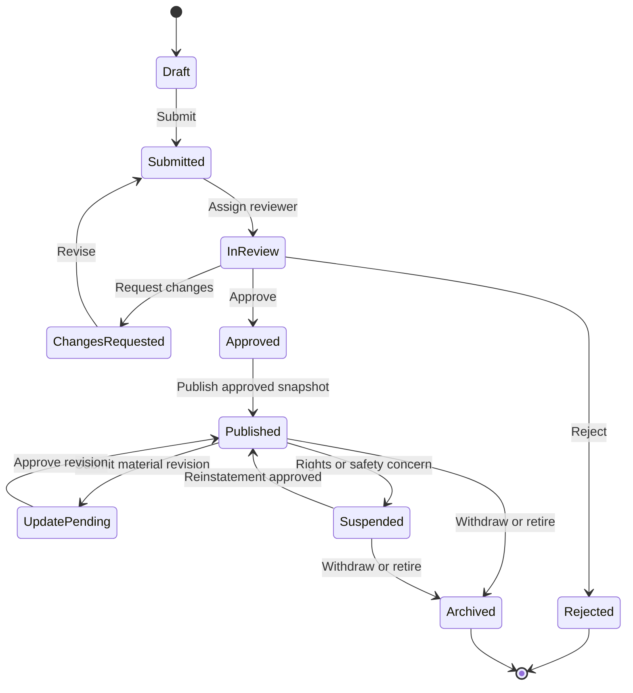

| From | Action | To | Who | Preconditions / effects |
| --- | --- | --- | --- | --- |
| `draft` | submit | `submitted` | Technology manager | Required fields, rights declaration, evidence scanned clean; version frozen |
| `submitted` | assign | `in_review` | Ops manager / auto-assignment | Reviewer has no conflict of interest |
| `in_review` | request_changes | `changes_requested` | Reviewer | Reason per field |
| `changes_requested` | revise | `submitted` | Technology manager | New version created |
| `in_review` | approve | `approved` | Reviewer | Checklist complete; approved field scope recorded |
| `in_review` | reject | `rejected` | Reviewer | Reason recorded; appeal possible |
| `approved` | publish | `published` | System | Snapshot created; outbox event for indexing |
| `published` | submit_revision | `update_pending` | Technology manager | Old snapshot stays public |
| `update_pending` | approve_revision | `published` | Reviewer | New snapshot replaces old |
| `published` | suspend | `suspended` | Reviewer / compliance | Reason; de-indexing within minutes; new introductions blocked |
| `suspended` | reinstate | `published` | Authorized reviewer | Issue resolved with evidence |
| `published` or `suspended` | archive | `archived` | Owner or admin | History preserved |

Rules:

- A draft is visible only to authorized organization members and to platform staff with a case-related need.
- Submission freezes the version under review; review decisions reference that exact version.
- Publication creates an approved public snapshot. Editing a published technology creates a new revision.
- Material changes to technical claims, rights or commercial scope require re-review.
- Suspension immediately disables new discovery and new introductions, while preserving history.

### 6.2 Buyer demand lifecycle

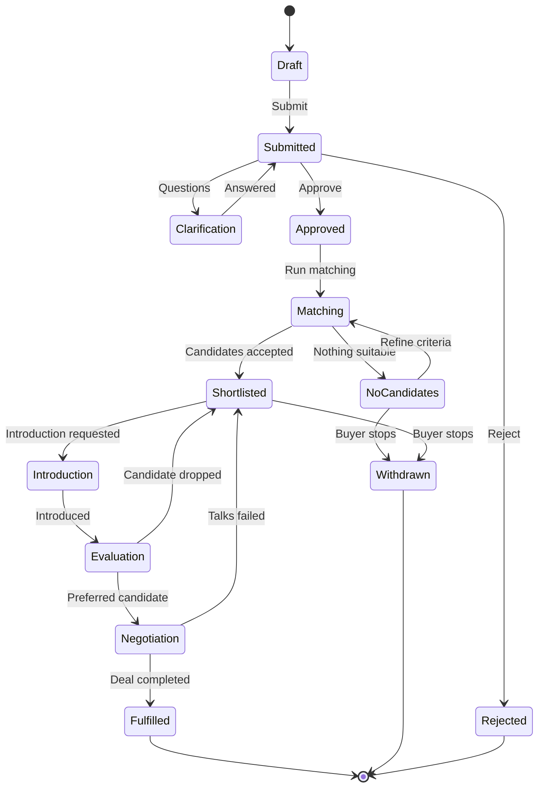

A demand may be **private, broker-assisted or publicly discoverable**; the buyer chooses the disclosure level. Public discovery must never automatically reveal the buyer's identity, budget or confidential technical problem. Demands that pass their target date move to `expired` through a scheduled job.

### 6.3 Introduction lifecycle

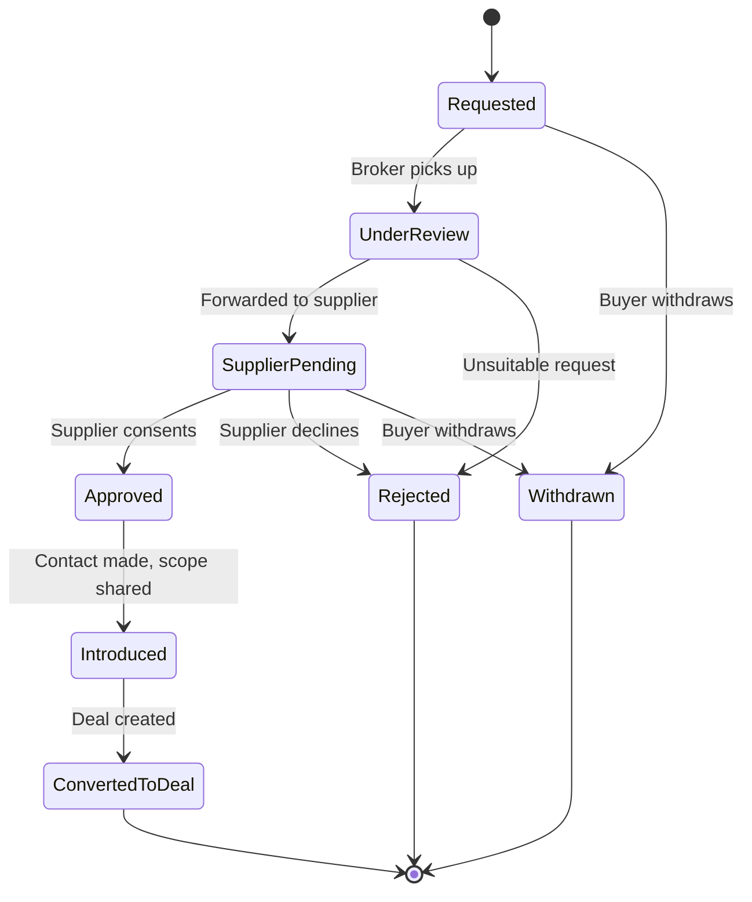

Business rules:

1. Only a buyer with access to the match can request an introduction.
2. The supplier's disclosure preferences and the offer status are checked.
3. The broker may ask for clarification or reject an unsuitable request.
4. **Supplier approval is required**, unless a documented policy or existing agreement explicitly authorizes otherwise.
5. The platform records the date, parties, disclosure scope and communication channel used.
6. Creating a deal from an introduction is **idempotent** (enforced by the unique `deals.introduction_request_id`).

### 6.4 Deal lifecycle

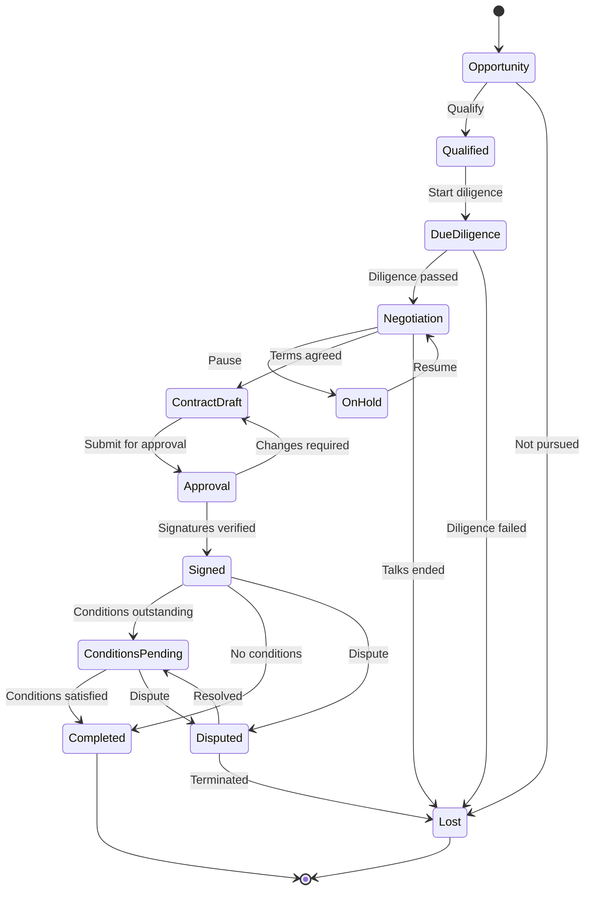

The stage is only **one dimension** of a deal. Store separate fields or records for:

- Contract execution status.
- Required completion conditions.
- Payment status, if applicable.
- IP transfer or licensing evidence.
- Delivery obligations.
- Dispute status.
- Final outcome and loss reason.

This prevents the system from treating "contract signed" as "technology transferred successfully". [07 §8](07-roles-workflows-and-money.md) and [08 §4](08-china-operating-model.md) extend this into fully separate state machines for proposals, contracts, milestones and payments.

### 6.5 Workflow engine requirements

Build one reusable workflow layer with:

- Allowed transition definitions.
- Permission checks.
- Domain-specific preconditions.
- Atomic state update plus transition history (`workflow_transitions`).
- Idempotency for retried commands (`idempotency_keys`).
- Assignment and reassignment.
- Due dates, reminders and escalation.
- Retryable asynchronous actions.
- Correlation IDs across related operations.
- Structured exception reasons.

An approval transition updates the resource status **and** appends its transition record in the same database transaction. Notifications are queued through the transactional outbox (`outbox_events`) and sent **after** the business transaction commits.

---

## 7. User interface and user experience

Organize the interface around **tasks**, not just data records. The three primary experiences are:

1. Supplier workspace.
2. Buyer workspace.
3. Exchange operations workspace for platform staff.

### 7.1 Main navigation

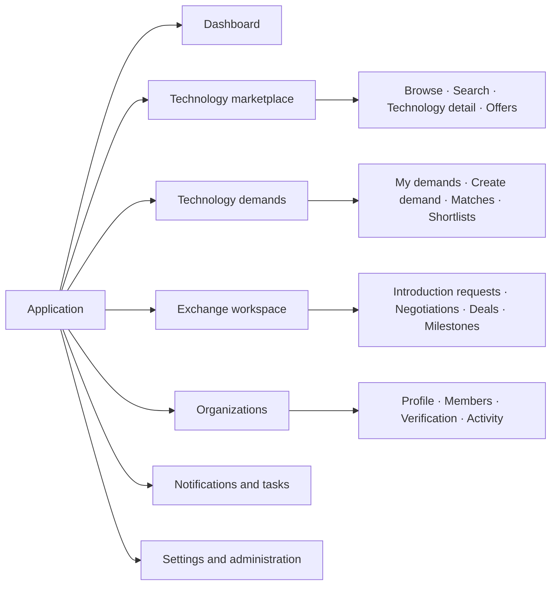

Menu items are permission-aware. Hiding a menu item is a **usability feature, not an authorization mechanism**; the backend enforces access independently.

### 7.2 Supplier journeys

**Supplier dashboard** shows: verification status and outstanding evidence requests · draft technologies · technologies awaiting review · published technologies and active offers · incoming introduction requests · active negotiations and milestones · recent activity and notifications.

Primary actions: `Add technology` · `Create offer` · `Complete organization verification` · `Review introduction request`. The dashboard prioritizes the **next required action**, not just counts.

**Technology creation wizard** (multi-step, with autosave):

| Step | Content | Validation highlights |
| --- | --- | --- |
| 1. Basic information | Title, summary, category, industry, application | Taxonomy codes validated |
| 2. Technical profile | Problem solved, operating principles, advantages, limitations, specifications, TRL | TRL claim needs evidence for levels ≥ 4 |
| 3. Rights and evidence | Patent references, ownership claims, rights holders, supporting documents | Patent number format per jurisdiction; uploads quarantined |
| 4. Commercial offer | Licence, assignment, partnership, pilot; territories; exclusivity; indicative terms | Offer must be consistent with the rights claimed |
| 5. Disclosure settings | Public fields, registered-user fields, restricted documents | Preview of the exact public view |
| 6. Review and submit | Completeness report, declarations, final submission | Declarations mandatory |

UX requirements:

- Save drafts automatically.
- Show completion percentage, but never block saving a draft.
- Distinguish required, recommended and optional evidence, and explain why each field is requested.
- **Preview exactly what public users will see.**
- Flag inconsistent information without rewriting it automatically.
- Show reviewer feedback next to the relevant field.

**Supplier technology detail** sections: Overview · Technical specifications · Applications and industries · Rights and evidence · Commercial offers · Review history · Documents and access · Activity and analytics. Supplier-only information must never leak into public HTML, API payloads or search snippets.

### 7.3 Buyer journeys

**Buyer dashboard** shows: active demands · demands awaiting clarification or approval · new qualified matches · shortlisted technologies · pending introductions · active evaluations and negotiations · recently completed opportunities. Primary actions: `Create technology demand` · `Explore technologies` · `Review new matches` · `Manage introductions`.

**Demand creation wizard**

| Step | Content |
| --- | --- |
| 1. Business problem | The problem and the desired result |
| 2. Technical requirements | Mandatory capabilities, acceptable alternatives, excluded approaches |
| 3. Maturity and deployment | Minimum readiness, integration, production and regulatory requirements |
| 4. Commercial conditions | Indicative budget, licensing preference, territory, timeline |
| 5. Disclosure | Public summary, anonymous publication, verified-user access, or private broker-led search |
| 6. Review and submit | Validation, confidentiality review, approval |

The wizard distinguishes hard constraints from preferences: "TRL 7 is mandatory" versus "TRL 5 is acceptable if a funded development plan exists".

**Search and discovery page** (wireframe, not live data):

```text
+--------------------------------------------------------------------------+
| Search technologies: [ keywords or natural-language question      ] (Go) |
+----------------------+---------------------------------------------------+
| FILTERS              | Technology title                                  |
|  Industry        [v] | Summary · maturity (TRL) · application            |
|  Technology type [v] | Verified claims · available offer types           |
|  TRL           [5-9] | [View details]  [Shortlist]                       |
|  Transaction type[v] +---------------------------------------------------+
|  Territory       [v] | Technology title                                  |
|  Rights status   [v] | Summary · maturity (TRL) · application            |
|                      | Evidence status · commercial availability         |
|                      | [View details]  [Shortlist]                       |
+----------------------+---------------------------------------------------+
```

Result cards communicate: what the technology does · which problem it solves · maturity and evidence status · which commercial arrangements are available · which compatibility questions remain open. Never show confidential price ranges or rights details to unauthorized users.

**Match review page.** Each match shows:

1. Technical fit and evidence.
2. Hard constraints satisfied or failed.
3. Readiness and deployment gaps.
4. Rights and offer compatibility.
5. Indicative commercial fit, if disclosed.
6. An explanation of the ranking.
7. Actions: shortlist, reject, request clarification, request introduction.

Feedback is structured: not technically relevant · wrong maturity · incompatible rights · unsuitable commercial terms · insufficient evidence · already known to the buyer · interested in evaluation. This feedback becomes the training and evaluation dataset for matching.

### 7.4 Deal workspace

One consistent structure for buyers, suppliers and assigned brokers, with different permissions for each:

```text
+------------------------------------------------------------------------+
| DEAL  D-2025-0042 · Parties: Buyer Co., Example University · Mgr: Lee   |
+------------------------------------------------------------------------+
| [Overview] [Negotiation] [Documents] [Milestones] [Completion]          |
+------------------------------------------------------------------------+
| Overview      Commercial summary, transaction type, objectives,         |
|               expected milestones                                       |
| Negotiation   Dated proposals, responses, decisions, approvals and      |
|               authorized communications (timeline)                      |
| Documents     Restricted documents, contract versions, approval         |
|               evidence, access history                                  |
| Milestones    Deliverables, due dates, owners, evidence, status         |
| Completion    Required approvals, executed contract evidence,           |
|               outstanding conditions, final outcome                     |
+------------------------------------------------------------------------+
```

A stage change requires a **specific action** and, where appropriate, supporting evidence. The UI never offers a generic editable status drop-down.

### 7.5 Administrator screens

| Screen | Main functions |
| --- | --- |
| Operations dashboard | Review workload, overdue cases, stalled deals, escalations |
| Organization verification | Legal identity, authority, evidence and appeals |
| Technology review queue | Claim cases, inspect submissions, request corrections, approve publication |
| Rights and evidence review | Examine IP claims, scope verification, record disputes |
| Demand review | Validate requirements and publication scope |
| Match review | Inspect ranking rationale, reject false positives, assign manual scouting |
| Introduction management | Review requests, assign broker, coordinate disclosures |
| Deal operations | Monitor negotiations, approvals, milestones and exceptions |
| Document access audit | Investigate access, permissions and download events |
| Finance operations | Reserved for the later finance integration |
| Taxonomy administration | Categories, translations, aliases, deprecated codes |
| User and organization administration | Suspend accounts, revoke memberships, process appeals |
| Audit and reporting | Search events, export permitted reports, investigate incidents |
| System configuration | Controlled settings, notification templates, policies |

**Review case detail screen** shows: case ID and type · resource and version under review · status and priority · assigned reviewer and deadline · evidence and checklist · conflict-of-interest declaration · previous decisions and requested corrections · decision controls with a mandatory reason · audit history. Reviewers can save work without deciding; approve and reject are distinct, deliberate actions.

---

## 8. Permission matrix

A technology exchange needs more than role-based menus. Combine role-based permissions with resource ownership, organization membership, deal participation and document-specific access.

### 8.1 Platform-level roles

| Capability | Anonymous | Registered user | Organization member | Broker | Reviewer | Admin |
| --- | --- | --- | --- | --- | --- | --- |
| Browse public listings | Yes | Yes | Yes | Yes | Yes | Yes |
| Create personal profile | No | Yes | Yes | Yes | Yes | Yes |
| Create organization | No | Yes | Policy | Policy | Policy | Yes |
| Create technology | No | No | With role | Authorized only | Authorized only | Exception only |
| Create demand | No | No | With role | Authorized only | Authorized only | Exception only |
| Submit technology for review | No | No | With role | Authorized only | No by default | Exception |
| Review technology | No | No | No | No by default | Assigned scope | Authorized scope |
| View confidential deal room | No | No | If permitted | Assigned deals | Case-related need | Exceptional authorized need |
| Assign brokers | No | No | No | No | No | Authorized operations role |
| Suspend public listing | No | No | Request only | Escalate | Within policy | Authorized role |
| Manage global policies | No | No | No | No | No | Security administrator |

A platform administrator is **not** automatically entitled to browse every confidential document. Privileged access is granted through a separate, audited permission.

### 8.2 Organization-level roles

| Permission | Owner | Org admin | Technology manager | Demand manager | Deal manager | Viewer |
| --- | --- | --- | --- | --- | --- | --- |
| View organization profile | Yes | Yes | Yes | Yes | Yes | Yes |
| Edit organization profile | Yes | Yes | Limited | Limited | Limited | No |
| Invite and revoke members | Yes | Delegated | No | No | No | No |
| Manage technologies | Yes | Yes | Yes | No | Limited | Read only |
| Manage offers | Yes | Yes | Yes | No | Limited | Read only |
| Manage demands | Yes | Yes | No | Yes | Limited | Read only |
| View authorized matches | Yes | Yes | Relevant scope | Yes | Relevant scope | Read only |
| Request introductions | Yes | Yes | Relevant scope | Yes | Yes | Policy |
| Manage assigned deals | Yes | Yes | Limited | Limited | Yes | Read only |
| Export organization records | Yes | Policy | Policy | Policy | Policy | No |

`Limited` and `Policy` must resolve to **explicit permissions in code** (for example `technology.edit_offer_terms`), never to undocumented assumptions.

### 8.3 Authorization model

Every request evaluates four dimensions:

| Dimension | Question |
| --- | --- |
| Identity | Who is making the request? |
| Role | What actions may that role perform? |
| Relationship | Does the user belong to the relevant organization or deal? |
| Resource policy | Is this particular version, field, document or action accessible in the current state? |

Being a `technology_manager` does not grant access to another organization's unpublished technology. Being assigned as broker to one deal does not grant access to every deal.

### 8.4 Implementation

Use centralized policy functions with resource-specific checks:

```python
def can_view_technology(actor, technology, context) -> bool:
    # Platform reviewers with a case-related need.
    if actor.is_authorized_platform_reviewer(context):
        return True

    # Members of the owning organization.
    if actor.is_active_member(technology.owner_organization_id):
        return True

    # Everyone else: only published, non-suspended technologies.
    if technology.lifecycle_status != "published":
        return False

    # Restricted listings need an explicit grant.
    if technology.visibility != "public":
        return context.has_explicit_access_grant(
            actor=actor,
            resource=technology,
        )

    return True
```

*Illustrative pseudocode.* Production code must also enforce approved publication snapshots, field-level visibility and restrictions on the relevant offer. Test authorization at the **service layer and the API boundary**; never rely on the frontend.

---

## 9. Security and confidentiality design

### 9.1 Document upload and access sequence


Required controls:

- Private storage by default.
- File size and permitted-type limits.
- Malware scanning (for example ClamAV in an isolated worker).
- Cryptographic file hashes.
- Metadata extraction in a restricted worker.
- No indexing of unapproved confidential text.
- Per-resource access grants.
- Short-lived download authorization.
- Audit events for sensitive access.
- Retention and deletion policies.
- Encrypted, access-restricted backups.

If the scanner is unavailable, files **stay quarantined**. Never make documents available just because a timeout elapsed.

### 9.2 Authentication and sessions

- Use an OIDC identity provider if feasible, or a well-maintained authentication library.
- Require MFA for platform staff; strongly encourage it for organization owners.
- In the browser, prefer secure, `HttpOnly`, `SameSite` cookies or a correctly implemented OIDC flow.
- Protect state-changing requests against CSRF when cookies are used.
- Rotate session identifiers on login and privilege changes; revoke sessions on suspension.

### 9.3 Audit and incident response

Audit at least:

- Authentication and privileged access.
- Membership and role changes.
- Verification decisions.
- Publication and suspension.
- Confidential document access and permission changes.
- Introduction approvals and rejections.
- Deal stage transitions.
- Contract evidence and completion decisions.
- Financial adjustments (when finance is introduced).
- Policy and configuration changes.

Never put full confidential document contents, passwords, tokens or other secrets in audit logs.

---

## 10. Search and matching implementation

For the first version, combine **structured filtering with PostgreSQL full-text search**.

### 10.1 Retrieval pipeline

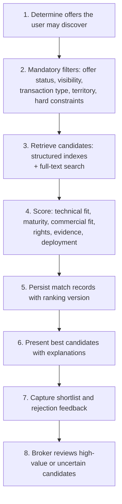

Never rely on a single embedding-similarity score to decide legal or commercial eligibility.

### 10.2 Full-text search starting point

```sql
-- Search document per published technology version (approved fields only).
ALTER TABLE technology_versions
    ADD COLUMN search_vector tsvector
    GENERATED ALWAYS AS (
        setweight(to_tsvector('simple', coalesce(title, '')), 'A') ||
        setweight(to_tsvector('simple', coalesce(public_summary, '')), 'B')
    ) STORED;

CREATE INDEX technology_versions_search_idx
    ON technology_versions USING GIN (search_vector);

-- Fuzzy title matching for typos and partial words.
CREATE EXTENSION IF NOT EXISTS pg_trgm;
CREATE INDEX technology_versions_title_trgm_idx
    ON technology_versions USING GIN (title gin_trgm_ops);
```

> **Chinese-language note:** PostgreSQL's built-in parsers do not segment Chinese words. For a China launch, add a Chinese text-search parser extension (for example `zhparser` or `pg_jieba`) and a matching text-search configuration, or move search to OpenSearch with a Chinese analyzer (for example IK). Test recall on real Chinese technology titles before launch.

Only fields from **approved publication snapshots** go into the public search document. Restricted fields need a separate, permission-filtered search path.

### 10.3 Initial ranking model

```text
S = 0.35·T + 0.20·M + 0.15·C + 0.15·R + 0.10·E + 0.05·G
```

T, M, C, R, E and G are normalized (0–100) technical fit, maturity, commercial fit, rights compatibility, evidence quality and geographic compatibility (see [05 §7.3](05-system-design-blueprint.md)).

- The weights are **hypotheses for testing**, not industry benchmarks. Store them with a `ranking_version`.
- Mandatory constraints apply **before** ranking. A rights incompatibility makes a candidate ineligible or sends it to manual review; it does not just lower the score.

### 10.4 Matching quality loop

For every recommendation, keep: demand version · offer and technology version · retrieval method · ranking version · score components · evidence · broker decision · buyer feedback · eventual deal outcome.

This allows evaluation against expert decisions and completed transactions. Without it, nobody can tell whether a matching change actually improves deal conversion.

---

## 11. Self-hosted infrastructure and deployment

### 11.1 Starting topology

For a small team: Linux VMs with Docker Compose, not Kubernetes.

| Host | Components | Notes |
| --- | --- | --- |
| VM 1 — Edge and application | Reverse proxy · TLS · React frontend · FastAPI · authentication integration | Only host exposed to the internet |
| VM 2 — Data services | PostgreSQL · private object storage · persistent job storage | Reachable only from VM 1 and VM 3 |
| VM 3 — Optional worker and operations | Background worker · document scanner · scheduled tasks · metrics and log forwarding | Introduce when load or security isolation justifies it |
| Separate backup target | Encrypted database and object-storage backups, recovery credentials, restore tests | Separate failure domain and credentials |

### 11.2 Network layout

| Zone | Contents | Exposure |
| --- | --- | --- |
| Public internet | Reverse proxy only, on HTTP/HTTPS | Public |
| Application network | API, worker, internal services | Private |
| Data network | PostgreSQL, object storage | Authorized hosts only |
| Administration network | SSH and management access | Approved addresses or VPN only |
| Backup network / target | Backup storage | Separate credentials, restricted access |

Never expose PostgreSQL, Redis, object-storage administration or worker ports to the internet.

### 11.3 Initial resource planning

Planning estimates, not measured capacity guarantees:

| Component | Starting allocation |
| --- | --- |
| Application VM | 2–4 vCPU, 4–8 GB RAM |
| Data VM | 4–8 vCPU, 8–16 GB RAM |
| Optional worker VM | 2–4 vCPU, 4–8 GB RAM |
| Database storage | SSD/NVMe sized for data, indexes, WAL and growth |
| Document storage | Separate capacity budget with lifecycle and backup policy |
| Backup storage | Separate failure domain where practical |

Actual sizing depends on document volume, search load, number of organizations, indexing, concurrency and retention. Measure CPU, memory, I/O latency, database connections, queue backlog and response times before adding capacity.

### 11.4 Repository structure

```text
technology-exchange/
├── frontend/
│   ├── src/
│   │   ├── app/
│   │   ├── features/
│   │   │   ├── organizations/
│   │   │   ├── technologies/
│   │   │   ├── offers/
│   │   │   ├── demands/
│   │   │   ├── matching/
│   │   │   ├── exchange/
│   │   │   ├── deals/
│   │   │   └── admin/
│   │   ├── components/
│   │   └── api/
│   └── tests/
├── backend/
│   ├── app/
│   │   ├── api/
│   │   ├── core/
│   │   ├── identity/
│   │   ├── organizations/
│   │   ├── technology/
│   │   ├── offers/
│   │   ├── demands/
│   │   ├── matching/
│   │   ├── exchange/
│   │   ├── deals/
│   │   ├── documents/
│   │   ├── workflow/
│   │   ├── notifications/
│   │   ├── audit/
│   │   └── reporting/
│   ├── migrations/
│   └── tests/
├── deploy/
│   ├── compose.yaml
│   ├── nginx/
│   ├── env.example
│   ├── backup/
│   └── scripts/
├── docs/
│   ├── architecture/
│   ├── api/
│   ├── workflows/
│   ├── security/
│   └── operations/
└── README.md
```

Keep domain logic outside the HTTP controllers so business rules can be tested without a running web server.

### 11.5 Release and recovery process

```mermaid
flowchart LR
    A["Build and test<br/>release artifact"] --> B["Unit, integration and<br/>authorization tests"]
    B --> C["Back up database,<br/>verify backup"]
    C --> D["Apply backward-compatible<br/>migrations"]
    D --> E["Deploy API and<br/>worker versions"]
    E --> F["Health checks<br/>and smoke tests"]
    F --> G["Verify queues, file<br/>access and search"]
    G --> H["Monitor errors<br/>and performance"]
    H -->|"Problem"| R["Roll back application;<br/>tested DB recovery if needed"]
```

Do not rely on automatic database rollback for every schema change. Prefer **expand-and-contract** migrations for changes that span several releases.

---

## 12. Testing and acceptance criteria

Test business rules, not only whether endpoints return HTTP 200.

### 12.1 Critical end-to-end scenarios

| Scenario | Expected result |
| --- | --- |
| Supplier submits a technology | A review case is created; the draft is not publicly visible |
| Reviewer requests corrections | Supplier sees the required changes; nothing is published |
| Reviewer approves a version | Only approved fields are published and indexed |
| Buyer submits a demand | Demand version and review state are recorded |
| Matching runs twice | No duplicate side effects; ranking results are versioned |
| Buyer requests an introduction | The request enters the appropriate review workflow |
| Supplier rejects an introduction | No deal is created |
| Introduction is approved | Only the authorized disclosure scope is shared |
| Unauthorized user guesses a document ID | Access is denied (and audited) |
| Technology is suspended | New discovery and introductions are blocked |
| Two reviewers decide simultaneously | Exactly one valid transition succeeds |
| Notification delivery fails | The business operation stays committed; delivery retries |
| Deal reaches completion | Deal-type-specific completion conditions are satisfied |
| Backup is restored | Database and document references remain consistent |

### 12.2 Security release blockers

Automate tests proving that:

- Organization A cannot read Organization B's private technology, demand or documents.
- Revoked members lose access.
- Public search never exposes unpublished or suspended listings.
- Confidential text does not leak through search snippets or AI-generated explanations.
- Users cannot change protected statuses through general-purpose update endpoints.
- Retried requests cannot duplicate introductions or deals.
- Reviewer permissions cannot be escalated by modifying client payloads.
- Administrative actions require authorization and produce audit records.

---

## 13. Phased development plan for a small team

Deliver working **vertical slices**. The schedule depends on team experience, design readiness, integrations and compliance requirements.

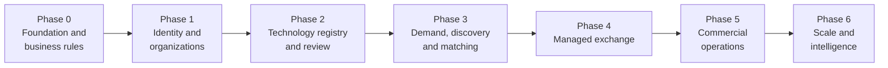

| Phase | Deliverables | Exit gate |
| --- | --- | --- |
| **0 — Foundation and business rules** (specification) | Confirm launch jurisdiction and legal model · Finalize taxonomy and core entities · Define state machines and permissions · Create migrations and API conventions · Build design system and wireframes · Define backup, security and release requirements | Business owners approve the core workflows and completion criteria |
| **1 — Identity and organizations** | Authentication and account recovery · Organization creation and membership · Organization profiles · Role and permission enforcement · Basic admin console · Audit events · Initial deployment pipeline | Several organizations operate independently with no cross-tenant data access |
| **2 — Technology registry and review** | Technology wizard · Version history · Offers and rights claims · Document upload and quarantine · Organization and technology verification queues · Publication snapshots · Public catalogue | A supplier can submit, revise and publish a reviewed listing without leaking restricted information |
| **3 — Demand, discovery and matching** | Demand wizard · Structured requirements · Search and filters · Candidate retrieval and ranking · Match explanations · Shortlists and feedback · Matching admin workspace | Buyers submit demands and review useful, permission-safe candidates |
| **4 — Managed exchange** | Introduction requests · Broker assignments · Controlled supplier responses · Confidentiality workflow · Deal creation and participant permissions · Negotiation history · Milestones and outcome tracking | The platform coordinates a complete opportunity from demand through introduction and managed negotiation |
| **5 — Commercial operations** | Enterprise service packages · Contract-management integration · E-signature integration · Invoicing and reconciliation (if the model needs them) · Commercial reporting · Service-level monitoring and support | The team supports paid services and transactions with auditable financial and contractual records |
| **6 — Scale and intelligence** | Dedicated search if needed · Semantic matching · Document extraction and AI-assisted review · Enterprise APIs · More languages and currencies · Advanced analytics · More regional deployments | New capabilities measurably improve match quality, commercial performance or efficiency |

### Suggested team allocation (four people)

| Role | Primary responsibility |
| --- | --- |
| Engineer 1 | Backend architecture, database and workflows |
| Engineer 2 | Frontend, UX implementation and API integration |
| Engineer 3 | Backend modules, documents, search and integrations |
| Engineer 4 | Full-stack delivery, testing, DevOps and operational tooling |

With one or two developers, combine roles and reduce scope. Shared acceptance checklists and API contracts keep frontend and backend aligned.

A **domain expert or product owner** is necessary, even part-time, to decide verification policies, commercial terms, legal requirements and exceptional cases. Developers alone cannot safely make those decisions.

---

## 14. Operational service-level targets

A managed exchange needs defined service standards from the start. These are **proposed initial targets**, not industry benchmarks:

| Process | Initial target | Escalation |
| --- | --- | --- |
| Organization verification | First review within 3 business days | Escalate overdue cases |
| Technology review | First review within 5 business days | Notify the reviewer's manager |
| Correction request | Acknowledged within 2 business days | Escalate unanswered cases |
| Introduction request | Initial response within 2 business days | Reassign stalled cases |
| Match review | High-priority candidates reviewed within 2 business days | Escalate urgent buyer demands |
| Deal milestone | Reminder before the due date | Escalate overdue milestones |
| Security incident | Immediate triage by severity | Follow the incident response plan |

Use configurable targets and business calendars (including public holidays). Measure **time to first response** separately from **total resolution time**, and exclude time spent waiting for the user. The operations dashboard shows each case's age, owner, next action and deadline.

---

## 15. Launch readiness checklist

Before the first real suppliers and buyers enter the system:

**Business and governance**

- [ ] Launch jurisdiction and legal operating model approved
- [ ] Supplier declarations and publication terms approved
- [ ] Verification policies and appeal process documented
- [ ] Transaction completion criteria defined

**Application**

- [ ] Organization registration and membership flows tested
- [ ] Technology and demand workflows tested end to end
- [ ] Search and matching explanations validated
- [ ] Introduction and deal permissions tested

**Security**

- [ ] MFA enabled for privileged accounts
- [ ] Cross-organization authorization tests passing
- [ ] Document quarantine and scanning operational
- [ ] Secrets, backups and audit logs protected

**Operations**

- [ ] Review queues have named owners
- [ ] Monitoring and error alerts operational
- [ ] Database and document recovery tested
- [ ] Release and rollback procedures documented

Passing this checklist does not by itself establish legal compliance or certify security. For the China launch, also complete [08 §10](08-china-operating-model.md).

---

## 16. Business metrics to instrument from day one

Record the events needed to measure whether the exchange creates real value:

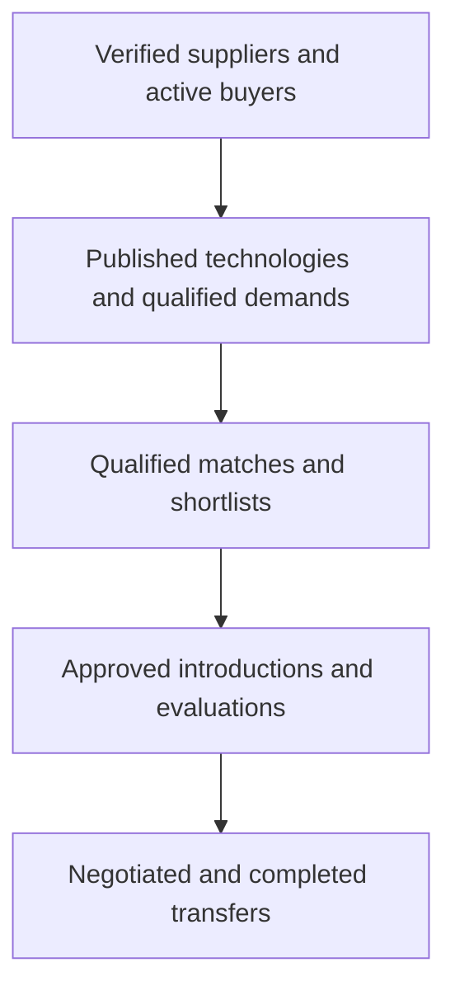

Track conversion and time between stages, and the **reasons for failure**. These show whether the bottleneck is insufficient supply, poor matching, weak evidence, slow reviews, incompatible terms or difficult negotiations.

For commercial reporting, separate completed transactions from estimated deal values, and platform-earned revenue from money paid directly between counterparties.

---

## 17. The first implementation sprint

Start with these concrete tasks rather than the full marketplace UI:

| Order | Task | Definition of done |
| --- | --- | --- |
| 1 | Establish repository and coding standards | Reproducible frontend and backend development environment |
| 2 | Create deployment baseline | Application starts in a repeatable self-hosted environment |
| 3 | Add database migrations | Identity and organization schema builds from an empty database |
| 4 | Implement authentication | Protected API routes and secure sessions work |
| 5 | Implement organization membership | Role checks operate in the backend |
| 6 | Implement audit events | Sensitive actions produce structured records |
| 7 | Build authorization test suite | Cross-organization access tests pass |
| 8 | Create the UI shell | Navigation and permission-aware pages exist |
| 9 | Implement technology drafts | Members can create and edit authorized drafts |
| 10 | Implement review cases | A reviewer can inspect a submission and request corrections |
| 11 | Add publication snapshots | Only approved fields become public |
| 12 | Run end-to-end tests | The full submission-to-publication journey passes |

The first vertical slice is small but complete:


It validates the most important foundations: identity, tenant isolation, versioning, state transitions, review operations, audit history and public disclosure. Once it works reliably, add demand management and matching on top.

---

## Final engineering decision

| Area | Baseline |
| --- | --- |
| Frontend | React and TypeScript |
| Backend | FastAPI modular monolith |
| Database | PostgreSQL with explicit constraints and migrations |
| Search | PostgreSQL full-text search initially (Chinese segmentation for China) |
| Documents | Private object storage with quarantine and access grants |
| Workflow | Explicit state machines, persisted tasks, audit trail, outbox |
| Deployment | Linux VMs and Docker Compose |
| Business model | Managed exchange: offers, demands, introductions, deal management |
| Security | Organization roles + resource-level permissions |
| Delivery | One complete vertical workflow at a time |

The biggest risk is not choosing the wrong framework. It is failing to distinguish **claims from verified facts, listings from offers, matches from introductions, and signed contracts from completed transfers**. Enforce those distinctions in the database, API, workflow engine, admin console and reporting from the beginning.

The one business decision to settle before the production build was the **exact launch country**, because it determines organization-verification sources, IP evidence requirements, privacy controls, contract processes and transaction restrictions. That decision is China; see [08](08-china-operating-model.md).
