# 07 — Real-World Roles, Workflows, Approvals and Money Movement

> **About this document**
>
> - **Purpose:** Derive the platform's user groups, workflows, approval rules and payment lifecycle from how real technology-transfer organizations operate, instead of inventing a few roles and CRUD screens.
> - **Audience:** Product owners, business analysts, architects and the operations lead.
> - **Status:** Operating-model design. It refines [05](05-system-design-blueprint.md) and [06](06-implementation-design-v1.md). It was written before the launch country was chosen, so some examples use EUR and international providers; they are illustrative. The China-specific legal and payment model that is binding for the launch is in [08](08-china-operating-model.md); the numbered requirements and releases (R0–R3) are in [10](10-product-requirements.md).
> - **Previous:** [06 — Implementation design](06-implementation-design-v1.md) · **Next:** [08 — China operating model](08-china-operating-model.md)

---

## Summary

- A technology exchange is **not** "someone posts a technology and someone else buys it". It may coordinate identity and organization verification, discovery, confidential disclosure, technical evaluation, IP due diligence, negotiation, contracting, payment milestones, delivery, acceptance and dispute resolution.
- Real organizations each cover **different parts** of that chain. Their models are complementary, not interchangeable templates.
- Design rule: use a searchable exchange for discovery, but run every serious opportunity through a **separate, managed transaction workflow**. Payment, confidential disclosure and deal closure must never be automatic consequences of a single "Accept" button.
- Position: the platform is a **matching and service platform** with managed transfer workflows. Formal listing (挂牌), competitive bidding, third-party settlement and transaction certificates run through a licensed venue (STEX or CTEX), with the platform acting as a **registered practising agent** (执业类交易服务机构) (§3.5).
- Money: only a licensed bank or payment institution, or the venue's third-party settlement account, holds and releases client funds. The platform records obligations, sends authorized instructions and reconciles verified events. **It never holds client money** (§6).
- Contents: user groups §2, workflows per group §3, what each action means §4, confidential disclosure §5, payments and fees §6, deal types §7, records and state machines §8, the first working version §9, decisions taken §10.

---

## 1. What real-world models tell us

| Model | What it does | What we learn |
| --- | --- | --- |
| **WIPO GREEN** (WIPO, green-technology matching) | Organizations submit technologies and needs, update them and contact partners. Submissions are reviewed for completeness, clarity and relevance. WIPO states that it does not independently verify every claim (for example environmental impact). Supports licensing, collaboration, joint ventures and sales. | A connection platform with **light review**, not an escrow service. Be explicit about what review does and does not verify. |
| **Enterprise Europe Network (EEN)** (EU partner search) | The database distinguishes technology offers, technology requests, business offers, business requests and R&D requests. An interested party submits an enquiry (company, contact, intended collaboration, reasons for interest, information requested). A regional EEN partner handles it before forwarding it to the profile owner. | **Typed opportunities** and **assisted introductions** through an intermediary. |
| **MIT Technology Licensing Office** (university TTO) | Starts with an invention disclosure and assessment, then IP protection and commercialization. Licensing revenue is shared with inventors under institutional policy. | For university-owned inventions, the **researcher may not have authority** to sell or license. The institution decides. |
| **yet2** (commercial scouting and licensing) | Defines the buyer's need, scouts and filters candidates, does outreach and introductions, NDAs, samples and evaluations, and supports licensing negotiations. | A **managed exchange** with hands-on facilitation is a paid business. |
| **STEX** (Shanghai, see [01](01-shanghai-landscape.md)) | Rights registration, tiered disclosure, auction, tender and bidding, third-party settlement, transaction certificates. | The **trusted transaction layer**. These are licensed venue functions; we use them as a registered practising agent (§3.5). |
| **NETC / InnoMatch** (Shanghai, see [01](01-shanghai-landscape.md)) | Demand collection, technology managers, online + offline matching, events. | The **demand-driven network layer**. |

> **Conclusion:** use a searchable exchange for discovery, but build a separate managed transaction workflow for every serious opportunity.

---

## 2. The user groups the platform needs

Do not model everyone as "buyer" or "seller". One organization can be a supplier in one deal and a buyer in another, and within an organization different people hold different authority. Use five layers:

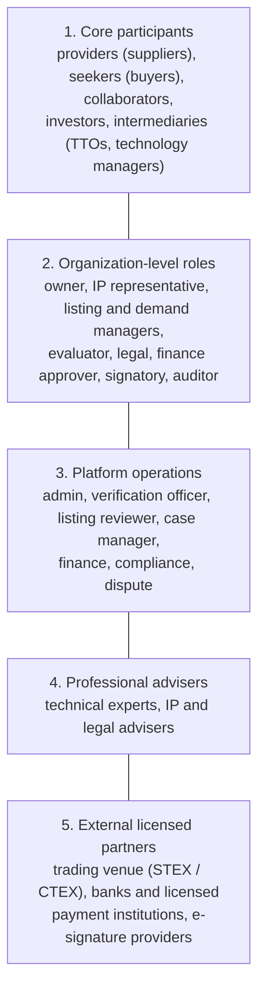

[10 §2](10-product-requirements.md) groups the same people into three audiences, each with its own interface and service level:

| Audience (10 §2) | Who | Layers above |
| --- | --- | --- |
| **Users** | Individual people acting for an organization: researchers, TTO staff, R&D managers, technology managers, experts | 1, 2 and 4 |
| **Clients** | Organizations with a contract: enterprises (scouting subscriptions), universities and institutes (TTO workspace), parks and governments (programme operation), service providers | The organizations in layer 1 |
| **Administrators** | Platform staff: operations, reviewers, platform-employed technology managers, finance, compliance, support, system administrators | 3 |
| External licensed partners | Not platform users; connected by contract and integration | 5 |

### 2.1 Core participants

| User group | Who they are | What they do |
| --- | --- | --- |
| Technology provider (supplier) | Company, startup, inventor, research institution | Publishes technology, supplies evidence, answers questions, negotiates rights and commercial terms |
| Technology seeker (buyer) | Company, manufacturer, public agency, research institution | Describes a technical problem, searches, evaluates candidates, negotiates and acquires rights or services |
| R&D collaborator | Company, university, lab, research consortium | Proposes joint research, contributes staff, data, equipment or funding, agrees ownership of new results |
| Investor or commercialization partner | Investor, corporate venture team, accelerator | Evaluates opportunities and may finance development or commercialization |
| Technology intermediary | TTO, broker, technology manager (技术经理人), innovation consultant | Represents a party within delegated authority (agent of record, FR-ORG-06), finds partners, supports introductions and negotiations |

These categories mirror real offer/request databases (EEN), provider/seeker platforms (WIPO GREEN) and university licensing practice. Docs 05, 06 and 10 call the provider the **supplier** and the seeker the **buyer**. A **technology manager (技术经理人)** is a professional broker accredited on the platform (FR-MAT-04, R2) who takes on demands, finds and qualifies candidates and brokers deals.

### 2.2 Organization-level roles

Every organization supports multiple members with different permissions:

| Role | Typical permissions | Must **not** automatically be allowed to… |
| --- | --- | --- |
| Organization owner | Manage profile, membership and settings | Sign every contract merely because they created the account |
| Technology / IP owner representative | Submit technologies, confirm rights ownership or authority | Claim rights belonging to another institution without authorization |
| Technology manager (organization role: manages listings) | Edit listings, respond to enquiries, upload evidence | Commit the organization to a binding deal unless authorized |
| Buyer / demand manager | Create demands, shortlist, coordinate evaluation | Approve funding or execute a contract without the relevant authority |
| Technical evaluator | Review specifications, run tests, submit reports | See unrelated confidential deals or authorize payments |
| Legal / IP reviewer | Review NDAs, IP ownership, licence scope and contracts | Release funds unless separately authorized |
| Finance approver | Approve budgets, invoices, payments and refunds | Change technical acceptance criteria unilaterally |
| Contract signatory | Execute agreements within delegated authority | Sign for another organization |
| Read-only auditor | Inspect permitted deal records and financial history | Edit, approve or delete records |

> **Key rule:** account ownership, organizational authority and deal approval are **separate concepts**. The person who submits a technology may not own the IP, and the person who discusses a price may not have the authority to commit the organization.

In the system these roles are built from two separate records ([06 §8.2](06-implementation-design-v1.md), FR-ORG-03, FR-ORG-04):

| Record | Decides | Values |
| --- | --- | --- |
| Membership role (`organization_memberships.roleCodes`) | What a user may see and edit for the organization | `org_owner`, `org_admin`, `technology_manager`, `demand_manager`, `deal_manager`, `viewer` |
| Delegated authority (`organization_authorizations`, R2) | Who may commit the organization, with amount limits, validity and evidence | `approve_disclosure`, `sign_contract`, `approve_payment`, `submit_to_venue` |

The organization role `technology_manager` manages the organization's own listings. It is **not** the same as a technology manager (技术经理人) broker in §2.1. Technical evaluators, legal reviewers and auditors get access per deal or per document (deal participation and document grants, [06 §8](06-implementation-design-v1.md)), or read-only access through the `viewer` role.

### 2.3 Platform operations and external specialists

| Group | Responsibility |
| --- | --- |
| Platform administrator | Configuration, user support, access management |
| Verification / review officer | Organization evidence, listing completeness, identity checks |
| Case manager (deal operations) | Introductions, meetings, deadlines and follow-ups (§3.4) |
| Technology manager (技术经理人), employed by the platform (staff role `platform_technology_manager`, [06 §8.1](06-implementation-design-v1.md)) or accredited on it | Works assigned demands: outreach, shortlists, introductions and deal brokerage (FR-MAT-04 … FR-MAT-06) |
| Financial operations officer | Reconciles payment-provider transactions, investigates failures, prepares payout actions; cannot create provider confirmations ([08 §2.2](08-china-operating-model.md)) |
| Technical expert | Independent assessment, testing, validation or feasibility report |
| IP / legal adviser | Rights checks, licence terms, agreement review |
| Dispute reviewer / mediator | Escalated disputes under a defined process |
| Compliance officer | Sanctions, fraud, conflicts, regulated activities and escalations |
| Bank or licensed payment institution (external) | Holds client funds; processes payments, reserved funds, transfers, refunds and payouts; confirms each result |
| Licensed trading venue (external, STEX or CTEX) | Formal listing and disclosure, buyer qualification, bidding, third-party settlement, rights-registration and transaction certificates (§3.5) |

In a small team, one employee may wear several hats. The **permissions and audit records must still be distinct**, especially for approving payments, changing bank details, releasing funds and resolving disputes.

A large expert network is not needed on day one. The platform must, however, let external experts be **invited into specific cases** without gaining broad access to confidential information.

---

## 3. Business workflows for each group

These are the recommended product workflows, informed by the real processes above. They do not claim that every reference organization follows this exact sequence. State names in the tables are the ones used by the system ([06 §6](06-implementation-design-v1.md), [05 §7.5](05-system-design-blueprint.md)); releases are those of [10 §9](10-product-requirements.md).

| Workflow | Main actors | Release |
| --- | --- | --- |
| A. Technology provider (§3.1) | Supplier, TTO, listing reviewer | R1 listing and enquiries · R2 negotiation and contract · R3 payments and royalties |
| B. Technology seeker / buyer (§3.2) | Buyer, technology manager | R1 demand, search and introduction · R2 evaluation, negotiation and contract · R3 payments |
| C. R&D collaborators and investors (§3.3) | Collaborators, investors, legal specialists | R2 (legal review or specialist closing, [08 §3.1](08-china-operating-model.md)) |
| D. Platform case manager (§3.4) | Platform staff | R1 introductions · R2 deals |
| E. Venue-routed transaction (§3.5) | Client, platform as agent, venue | R3 |
| Other client and administrator workflows (§3.6) | Universities, enterprises, parks, staff | R1–R3 |

### 3.1 Workflow A: technology provider

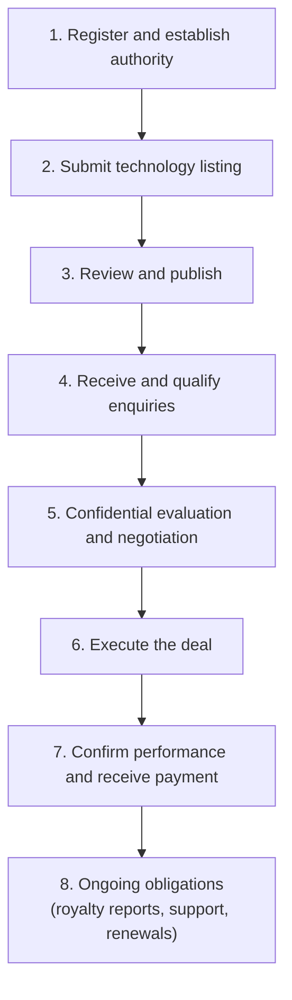

| Step | Provider does | Platform records / checks | System state · release |
| --- | --- | --- | --- |
| 1. Register and establish authority | Submits contact, organization, jurisdiction and representative details, plus proof of authority | Organization verification case; authority scope and expiry | Organization verification (FR-ORG-02) · R1; delegated authority (FR-ORG-04) · R2 |
| 2. Submit listing | Describes the solution, problem solved, stage, evidence, IP status, available rights, applications and preferred partnership types | Versioned draft; rights declaration; evidence quarantine | Technology `draft` → `submitted` · R1 |
| 3. Review and publish | Corrects incomplete information, answers reviewer questions, approves the public view | Review decision, approved field scope, publication snapshot | `in_review` → `changes_requested`, `approved` or `rejected`; `approved` → `published`. First review ≤ 5 WD (FR-TEC-11) · R1 |
| 4. Qualify enquiries | Accepts, declines or asks for clarification; confirms the interested party and use are credible | Enquiry decision with reason | Introduction `supplier_pending` → `approved` or `rejected` · R1 |
| 5. Evaluate and negotiate | Agrees confidentiality terms, shares authorized information, answers questions, reviews proposals | NDA status, document grants, proposal versions | Deal `opportunity` → `qualified` → `due_diligence` → `negotiation` · R2 |
| 6. Execute | An **authorized signatory** approves the final agreement; funding conditions are met; technology or services are delivered | Signature evidence, conditions, delivery records | Deal `contract_draft` → `approval` → `signed` → `conditions_pending` · R2 |
| 7. Get paid | Submits milestone evidence or invoices, responds to acceptance feedback, receives payment through the agreed route (§6) | Acceptance decisions; payments and payouts confirmed by the bank, payment institution or venue | Milestone `submitted` → `accepted`; deal `ready_to_complete` → `completed` · R2 (payment partner R3) |
| 8. Ongoing | Handles royalties, support and renewals | Royalty schedule, reports, reminders | Royalty schedules (FR-DEAL-10) · R3 |

A listing can later move to `update_pending` (a material revision is under review while the old snapshot stays public), `suspended` (rights or safety concern) or `archived` ([06 §6.1](06-implementation-design-v1.md)). A deal that needs a venue-run sale follows §3.5 instead of steps 6–7.

**What the provider submits**

- Public technology summary and intended applications.
- Technical specifications, maturity level and supporting evidence.
- IP information: patent numbers or applications where relevant, ownership, inventors, co-owners and existing encumbrances (licences already granted, security interests).
- Authority to offer the technology, if the submitter is not the owner.
- Commercialization preferences: licence, assignment, joint development, supply, technical services or other collaboration.
- Proposed commercial terms (indicative, not binding).
- Confidential documents only through access-controlled disclosure.

Do not force every provider to give a patent number: valuable technologies may be protected by copyright, know-how, trade secrets or contractual rights. The platform must, however, distinguish **"IP claimed by submitter"** from **"IP independently verified"**. WIPO specifically warns users not to disclose trade secrets in public database submissions.

### 3.2 Workflow B: technology seeker / buyer

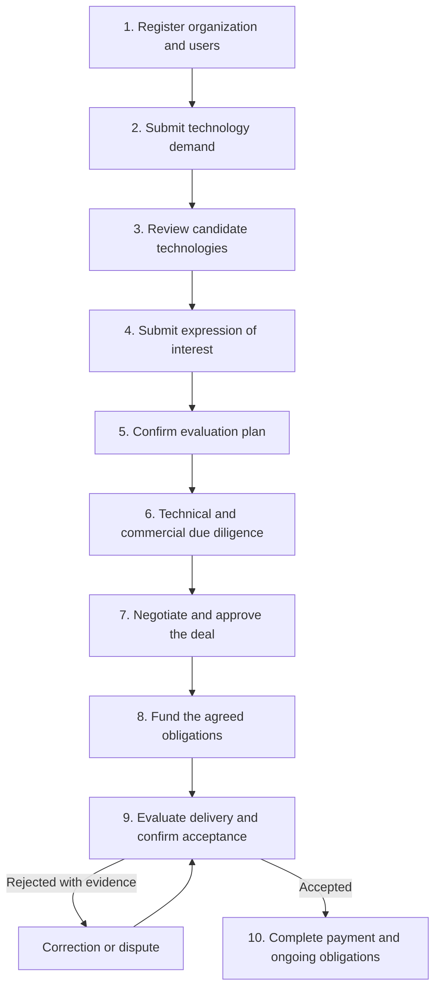

| Step | Buyer does | System state · release |
| --- | --- | --- |
| 1. Register | Establishes the organization and who is authorized to represent it | Organization verification · R1 |
| 2. Submit demand | States the problem, required performance, deployment environment, budget range, deadline, preferred collaboration type and acceptance criteria; chooses the disclosure level (anonymous public, verified users only, or private broker-led) | Demand `draft` → `submitted` → `approved` ([06 §6.2](06-implementation-design-v1.md)); a technology manager may rewrite it, and the buyer approves the public version (FR-DEM-04) · R1 |
| 3. Review candidates | Searches and shortlists; asks for more information or for the platform to find alternatives | Demand `matching` → `shortlisted`; brokers review uncertain candidates (FR-MAT-03) · R1 |
| 4. Express interest | Explains the use case, desired partnership, capability to evaluate or commercialize, and the information needed (consistent with EEN's real enquiry form) | Introduction `requested`; contact details masked until it is approved (FR-INT-02) · R1 |
| 5. Evaluation plan | Agrees which documents, samples, demonstrations, tests and success criteria will be used | Deal `opportunity` → `qualified` · R2 |
| 6. Due diligence | Evaluates technical fit, rights, implementation cost, supplier capability and financial feasibility | Deal `due_diligence`; NDA and data room (FR-INT-05, FR-INT-06) · R2 |
| 7. Negotiate and approve | Agrees scope, rights, fees, milestones, acceptance tests, liability and termination | Deal `negotiation` → `contract_draft` → `approval` → `signed` · R2 |
| 8. Fund | Pays the applicable deposit or milestone through the agreed payment route (§6) | Payment obligation `due`; provider transaction `succeeded` ([08 §6.2](08-china-operating-model.md)) · payment partner R3 |
| 9. Accept | Accepts, rejects with evidence, or requests permitted corrections | Milestone `accepted` or `rejected`; deal stays `conditions_pending` · R2 |
| 10. Complete | Remaining payments are made, or released by the bank or payment institution, when contract conditions are met (§6); then support, royalties, renewals and compliance | Deal `ready_to_complete` → `completed`; royalties (FR-DEAL-10) · R3 |

Every published demand must get a response: an alert fires if it has no candidate or no staff action within 10 WD (FR-DEM-06).

> A buyer's "accept" must have a precise meaning. **Accepting an enquiry, a technical result, a contract and a delivered milestone are four different actions.** The system never treats them as interchangeable (see §4).

### 3.3 Workflow C: R&D collaborators and investors

These users need a different deal model, because the outcome may be a **jointly developed** technology rather than delivery of an existing one. They submit or approve:

- Project proposal, work packages, budget and timeline.
- Contributions of staff, facilities, equipment, data and cash.
- **Background IP** that each party brings into the project.
- Ownership and licensing rules for **newly developed results (foreground IP)**.
- Publication, confidentiality, patent filing and commercialization rules.
- Funding commitments, drawdown conditions and milestone evidence.
- Decisions to continue, pause, change scope or terminate.

WIPO treats R&D cooperation agreements, licensing agreements, assignments and confidentiality agreements as **distinct** technology-transfer instruments. That is why the **deal type** must be a first-class field, not a single generic purchase workflow. For the China launch, R&D collaboration needs a mandatory legal review before signing, and investments and joint ventures are closed by specialists, not through a standard template ([08 §3.1](08-china-operating-model.md)).

### 3.4 Workflow D: platform case manager

The case manager is a platform staff member in deal operations, or an assigned technology manager (技术经理人). They move opportunities forward but never decide for a party.

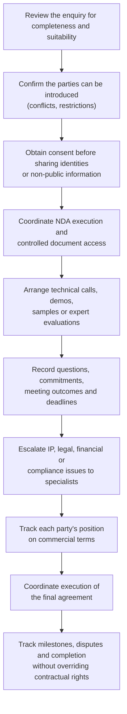

This mirrors yet2's managed model (introductions, NDAs, samples, evaluations) and EEN's advisers supporting partner search and follow-up.

In the system:

- Introductions follow [06 §6.3](06-implementation-design-v1.md): `requested` → `under_review` (broker picks it up) → `supplier_pending` → `approved` → `introduced` → `converted_to_deal`, or end as `rejected` or `withdrawn`. Supplier consent is required; contact cards are exchanged only on approval (FR-INT-03).
- Introduction requests get a first response within 2 WD (OPS-06, [06 §14](06-implementation-design-v1.md)). The operations dashboard flags deals with no activity for more than 10 days (FR-ADM-01).
- Meetings, demos and sample requests are recorded against the introduction or deal (FR-INT-08, R2). A case manager cannot rewrite agreed terms or replace a party's consent ([08 §2.2–§2.3](08-china-operating-model.md)).

### 3.5 Workflow E: venue-routed transaction (platform as agent)

Some sales must run on a licensed venue: formal listing (正式挂牌), competitive bidding, auction and tender, with third-party settlement and a transaction certificate. Venue certificates serve as evidence for ownership transfer, the university due-diligence exemption, inventor rewards and technology-contract registration ([09 §1](09-reference-platform-features.md)). The platform does not perform these steps itself. As the client's **registered practising agent** of STEX (or CTEX), it prepares and checks the submissions, registers buyers, tracks the venue's working-day (WD) deadlines and records the results (FR-VEN, R3). On buyer registrations the agent issues a verification opinion and bears **joint liability** for the materials (STEX rule 82; [09 §2.1](09-reference-platform-features.md)).

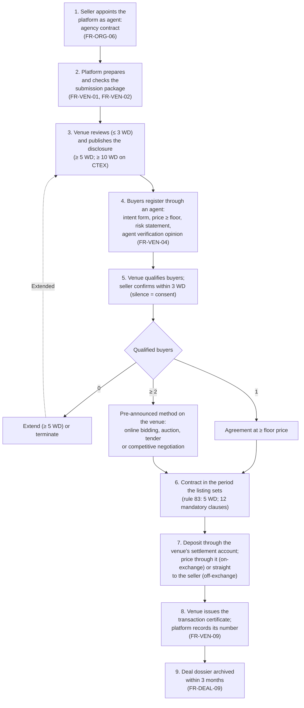

| Step | Client (seller or buyer) | Platform as agent | Venue (STEX / CTEX) | Time limits |
| --- | --- | --- | --- | --- |
| 1. Appoint agent | Seller signs the agency contract; provides identity, decision documents, ownership proof and commitment letter | Checks authority and completeness | — | — |
| 2. Submission | Approves the package and the disclosure text | Assembles the application and disclosure announcement; first and second review by two staff (maker-checker, FR-ADM-02) | Completeness check, receipt | — |
| 3. Review and disclosure | Answers questions | Tracks every deadline on the official working-day calendar (FR-VEN-03, FR-ADM-09) | Compliance review; publishes the disclosure | Review ≤ 3 WD; disclosure ≥ 5 WD (≥ 10 WD on CTEX); changes restart the clock; ≤ 12 months in total |
| 4. Buyer registration | Buyer gives an intent form (price ≥ listing floor, consortium shares) and a risk statement | Verifies the materials and signs the verification opinion (joint liability) | Reviews the registration | Review ≤ 3 WD; corrections ≤ 3 WD |
| 5. Qualification | Seller confirms the qualified buyers | Relays and records each decision | Sends the qualification notice with deposit amount and deadline | Seller ≤ 3 WD (silence = consent); objections ≤ 3 WD |
| 6. Price discovery | Buyers bid or negotiate | Prepares the bidding plan with the seller (FR-VEN-06); never runs a binding bid itself | Runs online bidding (timed phase ≥ 10 min, then continuous cycles ≥ 60 s), tender (deposit ≤ 30%, ≥ 10 WD to prepare bids) or auction (with a licensed auction house) | As stated per method |
| 7. Contract | Both parties sign | Generates the contract with the 12 mandatory clauses (FR-DEAL-03) | Reviews the contract | The listing's period: 5 WD in rule 83, 60 WD in most 2026 STEX listings ([09 §2.3](09-reference-platform-features.md)) |
| 8. Settlement | Buyer pays the deposit into the venue's settlement account. The price goes there too (on-exchange, 场内结算) or straight to the seller's bank account (off-exchange, 场外结算), as the listing states | Tracks deposit, price and refund status (FR-VEN-08). For off-exchange settlement, records the seller's confirmation of receipt with evidence. **Never holds the funds** | Settles through a bank or licensed payment institution; refunds losing deposits | Refunds ≤ 5 WD |
| 9. Certificate and archive | Receives the certificate | Stores the certificate number and PDF, links it to the deal, notice and inventor reward (FR-VEN-09); assembles the deal dossier (FR-DEAL-09) | Issues the transaction certificate; archives the file | Dossier ≤ 3 months; kept permanently, 20, 10 or 5 years by class |

Until the venue route is confirmed (D-01: the proposal in [12](12-decision-record.md) is to register as a CTEX service institution, which has no capital or age minimum, to partner with a registered STEX agent for STEX listings, and to register with STEX once eligible), these functions stay behind a feature flag ([05 §2.2](05-system-design-blueprint.md)). STEX admits a practising agent only if it has been registered for at least 2 years, has registered capital of at least RMB 1 million and at least 2 recognised practitioners, and has a clean record for the last 24 months ([09 §2.1](09-reference-platform-features.md)).

Throughout this workflow the deal record follows the rule in [05 §7.5](05-system-design-blueprint.md) and [06 §6.4](06-implementation-design-v1.md): `negotiation` until the venue fixes the buyer and price, then `contract_draft` → `approval` → `signed`, and `conditions_pending` until settlement and the certificate are recorded. Settlement is the venue's confirmation (on-exchange) or the seller's evidenced receipt of the price (off-exchange).

**One side, one buyer.** CTEX forbids a service institution from acting for both sides of a deal, or for two or more intended buyers of the same project (2022 measures, Art. 18; [09 §2.1](09-reference-platform-features.md)). The platform applies the same rule on both venues. In one venue listing it acts as agent for the seller or for one buyer, never for both, and never for two competing buyers. Other buyers' agents are their own (FR-VEN-04, FR-ORG-07).

### 3.6 Other client and administrator workflows

These workflows are specified elsewhere; this table shows where.

| Workflow | For | Where specified | Release |
| --- | --- | --- | --- |
| University service-invention (职务科技成果) transfer: inventor disclosure, internal approval, pricing method (negotiated price with a public notice of at least 15 days, listing or auction), contract registration, inventor rewards | University TTOs (clients), researchers | [08 §5.4](08-china-operating-model.md); FR-UNI-01 … FR-UNI-07 | R1 notices and TTO workspace · R2 dual publication and rewards · R3 ownership grants |
| Demand rewriting, solution submissions (揭榜) and challenge campaigns | Enterprises, solvers, technology managers | [09 §3.4–§3.5](09-reference-platform-features.md); FR-DEM-04, FR-DEM-07, FR-DEM-08 | R1 rewriting and submissions · R2 campaigns |
| Managed scouting project | Enterprise clients | [04 §12](04-product-strategy.md), [05 §7.6](05-system-design-blueprint.md); FR-CLI-02 | R2 |
| Programme operation and innovation vouchers | Parks and governments (clients) | FR-CLI-05, FR-SVC-06 | R2 |
| Service orders (evaluation, valuation, legal, patent) | Service providers and experts | FR-SVC-01 … FR-SVC-05 | R2 (expert pool R1) |
| Organization verification and listing review queues | Administrators | [05 §9](05-system-design-blueprint.md), [06 §6.1](06-implementation-design-v1.md), [10 §5](10-product-requirements.md) | R1 |
| Disputes | Deal parties, dispute reviewer | [08 §8](08-china-operating-model.md); FR-CMP-04 | R1 basic · R2 mediation |

---

## 4. What "submit, accept, confirm, discuss and agree" mean

These words sound similar in conversation but must have **distinct meanings** in the system. Each one creates an auditable event, not just a changed text field. The last column shows the state change it causes, where a state machine defines one (§8.1).

| Action | Meaning | What the platform records | Resulting state |
| --- | --- | --- | --- |
| Submit | A user sends a new or revised item | Version, submitter, timestamp, required fields | Technology or demand `draft` → `submitted` |
| Review | A reviewer checks the item against defined criteria | Reviewer, decision, evidence, reason | Technology `in_review` → `changes_requested`, `approved` or `rejected` |
| Approve for publication | The platform makes a listing publicly discoverable | Approval scope, reviewer, publication version | Technology `approved` → `published`; public snapshot created |
| Express interest | A party asks to explore an opportunity | Use case, information requested, intended collaboration | Introduction `requested` |
| Accept an introduction | A party consents to contact or a managed introduction | Consent, scope, visibility permissions | Introduction `supplier_pending` → `approved` |
| Accept an NDA | A party validly executes the confidentiality instrument | Document version, parties, signature evidence, effective status | NDA active only when the e-signature provider confirms it (FR-INT-05) |
| Discuss | Parties exchange messages, questions and proposals | Participants, timestamps, attachments, confidentiality level | None |
| Propose terms | A party submits a commercial or technical proposal | Immutable proposal version, expiry, terms | Proposal version `open` |
| Counter-offer | A party changes one or more proposed terms | New version linked to the previous one | Previous version `superseded`, new version `open` |
| Agree terms | All parties confirm the **same complete** set of terms | Exact version accepted by each authorized party | Deal `negotiation` → `contract_draft` (`agree_terms`) |
| Sign contract | Authorized representatives execute the agreement | Executed contract, signature and verification evidence | Deal `approval` → `signed` (`record_signatures`) |
| Fund | Required money is received and **confirmed by the payment provider or bank** | Payment reference, amount, currency, confirmed status | Provider transaction `succeeded`; obligation `partially_satisfied` or `satisfied` |
| Deliver | A party submits the agreed output or evidence | Delivery version, timestamp, files | Milestone `submitted` |
| Accept milestone | The designated party confirms contractual acceptance | Criteria, decision, evidence, authorized actor | Milestone `accepted` (or `rejected` with a reason) |
| Release payment | The payment route transfers the approved amount | Provider reference, amount, fees, recipient, status | Release instruction `submitted` → `completed` |
| Withdraw funds | A recipient requests a payout of an eligible balance | Amount, destination, verification, provider result | Payout `requested` → `paid` (or `failed`, `returned`, `reversed`) |
| Dispute | A party contests a payment, delivery, acceptance or other obligation | Issue, evidence, deadlines, resolution history | Deal `disputed`; affected obligations `disputed` |

### 4.1 Consensus is not the same as agreement

For a two-party licence, a generic "consensus" button is unnecessary. What is needed is a **versioned term sheet** and **explicit acceptance by every required party** of the same version.

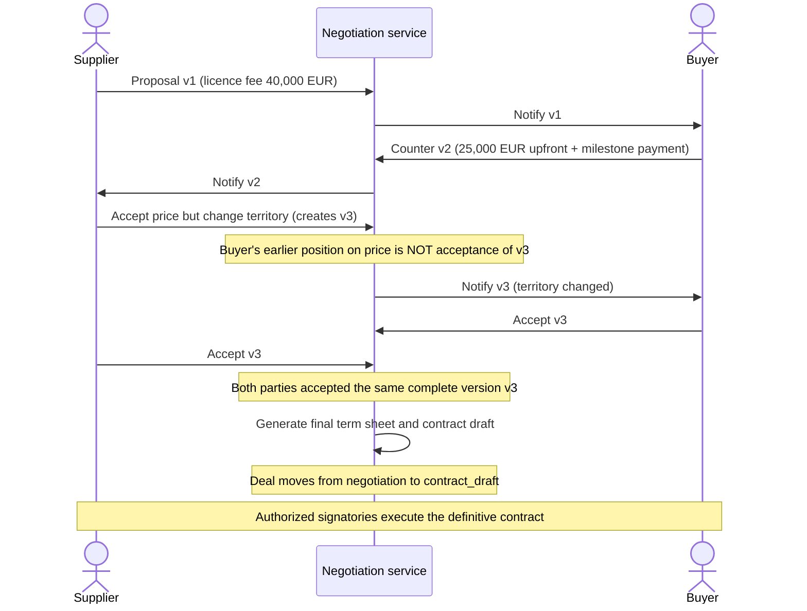

For an R&D consortium the principle is the same, but approvals may involve three or more organizations and several work packages. WIPO's licensing guidance stresses that terms are negotiated for the specific circumstances, with confidentiality, rights, scope, payment and other obligations set out in the actual agreement.

**Implementation:** keep `proposal_versions`, `proposal_responses`, `approval_requests` and `contract_signatures` as separate records ([08 §9](08-china-operating-model.md)). **Never overwrite a previous offer in place.** Versioned proposals with per-party acceptance are FR-DEAL-02 (R2).

---

## 5. Confidentiality, discussion and due diligence

A buyer needs enough information to decide whether to proceed, but a provider may not disclose source code, manufacturing details, unpublished inventions or trade secrets to an unqualified stranger. Use a **disclosure ladder**:

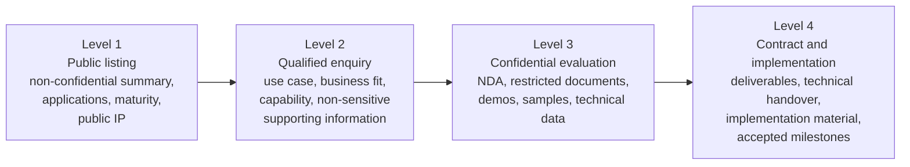

The ladder maps to the access classes in [05 §7.4](05-system-design-blueprint.md): level 1 is *public*; level 2 is *registered user* and *verified buyer*; level 3 is *NDA-covered*; level 4 is *deal-team only*.

WIPO's guidance on NDAs and trade secrets supports this staging. An NDA should define the confidential information, the authorized use, permitted recipients, exceptions, and what happens to the materials if negotiations end. **An NDA is not a licence** and gives no permission to use the technology.

The platform therefore supports:

- Contact details (phone numbers, e-mails, WeChat IDs, URLs) masked in messages until the introduction is approved (FR-INT-02, R1).
- A buyer never sees whether, or how many, other buyers are interested (FR-INT-07, R1).
- **Document-specific** access grants, not access to a whole deal folder (FR-INT-06, R2).
- Time-limited and revocable access where legally and technically appropriate.
- A dynamic watermark with the viewer's name, organization and time, and a log of who viewed or downloaded each confidential file.
- NDA versions and a clear record of which parties are covered. NDAs are signed through the e-signature provider, and their status is verified, never self-declared (FR-INT-05, R2).
- An explicit decision on whether parties may keep, or must return or destroy, confidential material when talks end.
- A rule that privileged information never appears in public search, automated matching or notifications.

The platform can record that a party *claims* to have destroyed a file. It cannot honestly guarantee deletion of every copy a recipient downloaded.

---

## 6. The financial lifecycle: quote, fund, hold, release, withdraw

> **Build scope (owner decision D-02, 2026-10-19).** The platform's payments are built shallow: one adapter, with the owner's own payment testing platform as the first provider, plus payment requests, verified events, refunds and daily reconciliation (FR-PAY-01 … FR-PAY-04, [06 §6.11](06-implementation-design-v1.md)). Conditional holding, release instructions, split payouts and the detailed records in §6.1–§6.6 and §8 are **not** in the build scope. They stay here as background for a later production provider.

This is the most important architectural distinction in the operating model. A marketplace must not invent an "escrow balance" just because it has a database. **A recorded obligation, money received by a payment provider, money reserved for a transaction and money available to withdraw are four different things.**

WIPO's licensing guidance lists upfront fees, milestone payments, royalties and other negotiated compensation. University licensing offices (for example the University of Washington's CoMotion and the University of Central Florida) list upfront fees, milestone payments, patent-cost reimbursement, running royalties and minimum royalties.

In this section, **payment provider** means the bank or licensed payment institution that actually holds and moves the money. It is never the platform.

**Who holds the money.** The platform never holds client funds. Depending on the deal and the release, money moves on one of these routes:

| Route | When | Who holds and moves the money | What the platform does | Release |
| --- | --- | --- | --- | --- |
| Direct payment between the parties | Platform-managed deals before payments are integrated (R2) | The parties and their own banks | Records payment milestones and the payment evidence each party provides; such payments are never shown as provider-confirmed ([08 §11.2](08-china-operating-model.md)) | R2 |
| Venue settlement | Venue-routed deals (§3.5) | The venue's third-party settlement account at a bank or licensed payment institution | Tracks deposit, price and refund status reported by the venue (FR-VEN-08) | R3 |
| Payment provider | Platform-managed deals from R3 (decision D-02) | The owner's payment testing platform during build and test; for live money, a bank or licensed payment institution. Conditional holding is out of scope | Creates payment requests, records verified provider events, handles refunds and reconciles (FR-PAY, [06 §6.11](06-implementation-design-v1.md)) | R3 |
| Platform fees | Subscriptions, service orders, agreed success fees | The platform, as its own revenue | Issues digital e-invoices (数电票) and tracks payment (FR-CLI-07); reports fees separately from deal value (FR-RPT-03) | R2 |

### 6.1 Recommended payment lifecycle

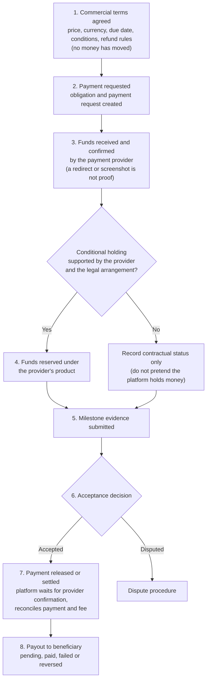

This is a proposed workflow, not a universal escrow process. The actual mechanism depends on the jurisdiction, provider, deal type and contract. It describes the payment-partner route. On the direct-payment route the platform records steps 1, 2, 5 and 6 and the evidence of payment the parties provide; on the venue route the venue settles the deposit and price and the platform tracks the status (§3.5).

### 6.2 What exactly does "locked" mean?

Never use one `locked` status for every situation. At least four meanings exist:

| Term | Meaning | Where the state belongs |
| --- | --- | --- |
| Contractually committed | The buyer owes a payment if the agreed conditions are met | Contract / obligation |
| Payment initiated | A payment instruction exists but is not yet confirmed as successful | Payment record |
| Provider balance pending | Funds sit in a provider balance and are not yet available for payout | Provider balance / payout status |
| Funds reserved under a holding arrangement | Money is restricted under a supported legal and payment structure | Holding arrangement and provider records |

Say "funds secured" only if the actual payment arrangement justifies it. A buyer clicking "Fund deal" is not proof of receipt, and a successful charge is not a completed payout.

For example, Stripe Connect documents "separate charges and transfers", which let a platform collect a payment and later transfer portions to connected accounts, with processing fees, refunds, chargebacks, transfer timing and reversals. That is a **payment-routing mechanism**, not proof that such an arrangement is legally protected escrow. In China, the products to evaluate are bank fund-supervision (资金监管) or custody (存管) accounts and licensed payment institutions' split-settlement (分账) services ([08 §1.2](08-china-operating-model.md)). None of them is assumed to be a universal escrow service.

### 6.3 Worked example: what happens when a buyer pays

The contract calls for a €20,000 upfront licence payment and a separate €10,000 payment on a milestone. The system must not assume the whole €30,000 is payable or releasable at once.

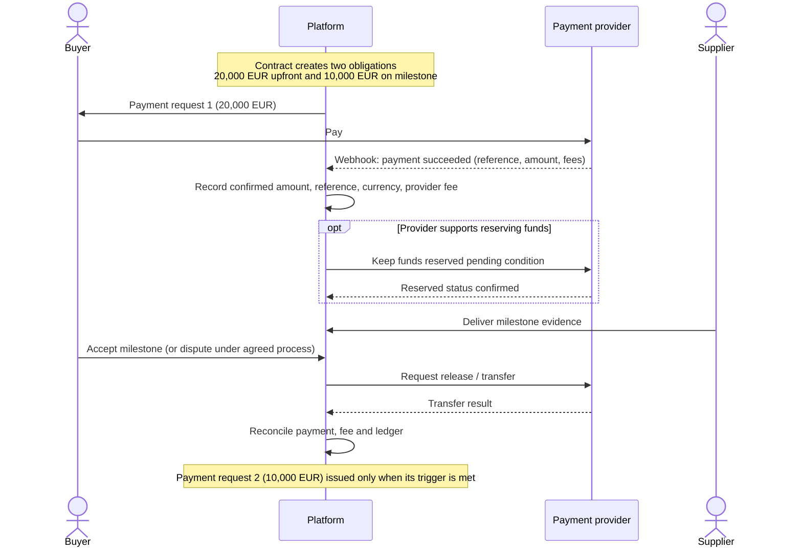

The numbers are illustrative, not a market tariff ([08 §5.1](08-china-operating-model.md) has an RMB example). **Every payment is linked to an obligation, and every release to an explicit reason and authorization.** The platform only *requests* the release; the payment provider moves the money and reports the result.

### 6.4 When the buyer does not accept a deliverable

The platform needs a predetermined procedure, not an administrator who picks a winner. The contract or milestone plan specifies:

- Objective acceptance criteria.
- Who may test and accept the deliverable.
- A review deadline.
- What evidence must accompany a rejection.
- Whether a correction or retest is permitted.
- What happens if the buyer does not respond.
- How a dispute is escalated.
- What happens to the associated payment while a dispute is pending.
- Which remedies are available.

Do **not** implement automatic acceptance after a deadline unless the parties explicitly agreed to it and it is legally appropriate for the deal. The platform must not invent rules that change the parties' contractual rights.

### 6.5 Fees: what the platform charges for

There is no universal technology-transfer fee. Configure fee rules **per deal type** instead of one hard-coded commission:

| Possible fee | When charged | Recommended initial treatment |
| --- | --- | --- |
| Registration | Account or organization onboarding | Free initially |
| Listing / publication | Technology accepted for publication | Free initially, to build supply |
| Managed-service fee | Staff perform search, diligence coordination or negotiation support | Fixed, staged or separately quoted |
| Success fee | A qualifying transaction completes | Percentage or fixed amount, clearly defined in the agreement |
| Payment processing fee | Provider charges for a transaction | Shown separately; specify who bears it |
| Expert assessment fee | Technical or IP specialist performs paid work | Quoted and approved before commissioning |
| Contract / document service | Optional professional service | Clearly priced and separately accepted |
| Renewal or monitoring fee | Continuing service after a deal | Only if the ongoing value is clear |

These are design options, not claims about what the cited organizations charge. EEN, for instance, provides its partnering database and advice as a public network service, while yet2 sells scouting and licensing services. The China fee policy is [08 §7](08-china-operating-model.md); venue fee benchmarks are in [09 §2.6](09-reference-platform-features.md); the fee schedule itself is open decision D-07 ([10 §12](10-product-requirements.md)).

For each fee, record: who owes it · who receives it · which event makes it payable · the amount or formula · currency, tax treatment and refundability · whether it is deducted from a payment or invoiced separately · what happens if the deal is cancelled or the payment refunded.

**Never deduct a success fee because a buyer clicked "Accept introduction".** Define the qualifying event in advance, for example execution of a licence agreement, completion of a specified transaction or receipt of a defined payment. When a fee is shared with a technology manager or an external agent, the split is applied only when the fee is actually received (FR-MAT-08, R3).

### 6.6 Withdrawal and payout

A recipient may request a payout only from funds the payment provider **actually makes available**. The balance lives at the provider; the platform only displays it and forwards an authorized request:

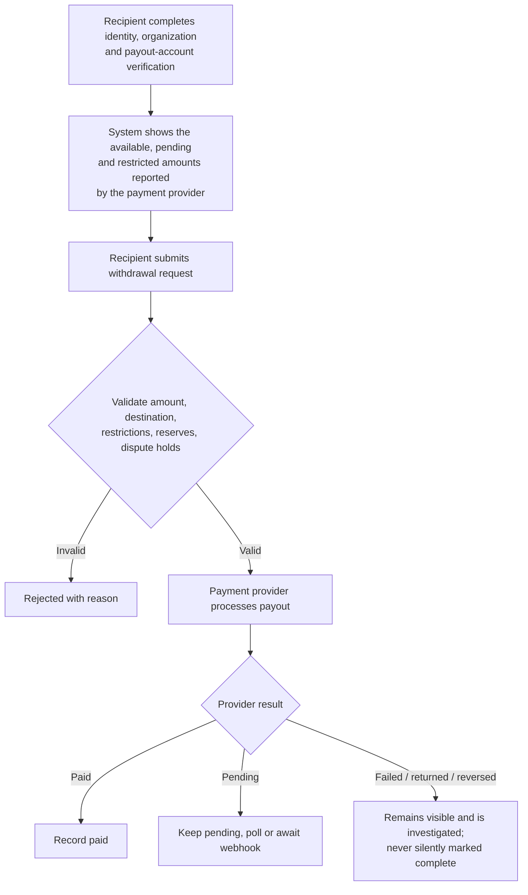

A withdrawal **request** is not a withdrawal, just as a transfer instruction is not proof that the recipient received the money.

> **Regulatory note:** holding or controlling customer funds is regulated almost everywhere. For example, in the European Economic Area the Central Bank of Ireland's guidance describes **safeguarding** obligations (including segregation of users' funds) for payment institutions. In China, payment business may be carried out only by institutions licensed by the People's Bank of China (State Council Decree No. 768, effective 1 May 2024), and Shanghai's venue rules require third-party settlement through a bank or licensed payment institution. Calling an internal database balance "escrow" does not avoid such rules. For the China launch, see [08 §1 and §6](08-china-operating-model.md).

Payment integration is planned for R3, with the owner's payment testing platform as the first provider (D-02 in [12](12-decision-record.md)). Live money needs a bank or licensed payment institution and the written confirmations in [08 §10 B](08-china-operating-model.md). Until R3, deal payments go directly between the parties (see the routes at the start of §6). The platform's payment records are a **reconciled record of obligations and provider events**, never a substitute for a regulated client-money arrangement.

---

## 7. Deal types need different payment and acceptance rules

| Deal type | Typical deliverable | Typical payment model | What confirms completion? |
| --- | --- | --- | --- |
| IP licence | Contractual permission to use specified IP | Upfront fee, milestones, royalties or a combination | Effective licence and satisfaction of the relevant conditions |
| IP assignment | Ownership transfer of specified IP | Lump sum or staged payments | Transfer documents and required formalities. In China a patent assignment takes effect only on registration with CNIPA ([08 §1.1](08-china-operating-model.md)) |
| Technical services | Engineering, integration, consulting or implementation | Deposit plus milestone and final payments | Defined services accepted under acceptance criteria |
| R&D collaboration | Research work, prototypes, test results or jointly developed IP | Funding tranches, milestone payments or agreed contributions | Work-package evidence and contractually defined review |
| Technology supply | Product, equipment, material, software or know-how package | Purchase payment, delivery milestones | Delivery and applicable acceptance tests |
| Commercialization partnership | Manufacturing, distribution, market access or sublicensing rights | Fixed fees, royalties, revenue share or mixed | Contractual launch, sales or reporting obligations |
| Investment | Equity or another negotiated instrument | Funding round, tranche or closing payment | Completion of investment conditions and documents |

These are common patterns, not guaranteed terms. WIPO notes that technology-transfer contracts vary with circumstances, and that licences, assignments, confidentiality agreements and R&D cooperation agreements serve different purposes.

> **Important:** never force an investment through the same milestone-release workflow as a technical-services purchase. An investment may need legal closing conditions, share issuance, shareholder approvals and regulated intermediaries. Likewise, royalties may continue for years, so a deal can be **operationally complete while still carrying ongoing reporting and payment obligations**.

[08 §3](08-china-operating-model.md) adds technology consultation and joint venture / consortium, and maps each type to its Civil Code contract category. The system uses nine deal types: `ip_license`, `ip_assignment`, `technical_service`, `technology_consulting`, `rnd_collaboration`, `technology_supply`, `commercialization`, `investment` and `joint_venture`.

An earlier draft proposed launching with only IP licensing, technical services and R&D collaboration. That was replaced by the decision in §10: all deal types can be listed at launch, and their workflows are built in three tiers ([08 §3.1](08-china-operating-model.md)):

| Tier | Deal types | Workflow |
| --- | --- | --- |
| 1. Standardized | IP licensing, technical services, technology supply, technology consultation | Standard templates, milestone and payment flows |
| 2. Managed legal review | IP assignment, R&D collaboration, commercialization and revenue sharing | Mandatory legal review before signing |
| 3. Specialist-only closing | Investment, joint ventures, regulated technologies, complex cross-border deals | The platform coordinates; specialists close |

The data model allows every type from the start, even where the workflow comes later.

---

## 8. The database records and state machines this requires

The architecture in [06](06-implementation-design-v1.md) already includes users, organizations, technologies, demands, introductions, deals (with their parties embedded), deal milestones, documents and audit events. These workflows add the following records. Names follow [08 §9](08-china-operating-model.md) and [06 §4.9](06-implementation-design-v1.md):

| Record | Purpose | Release |
| --- | --- | --- |
| `organization_authorizations` | Which users may approve disclosure, sign, pay or submit to a venue on behalf of an organization (with limits and expiry) | R2 |
| Deal parties (embedded in `deals`) | Every organization in a deal and its contractual role | R2 |
| `proposal_versions` | Immutable commercial and technical offers and counter-offers | R2 |
| `proposal_responses` | Each party's response to a specific proposal version | R2 |
| `approval_requests` | Required internal approvals, approver, decision and reason | R2 |
| `contract_versions` | The exact agreed contract and its amendments | R2 |
| `contract_signatures` | Signatories and execution evidence | R2 |
| `acceptance_cases` | Milestone evidence, acceptance, rejection, correction and dispute | R2 |
| `disputes` | Contested contractual or financial matters | R1 basic · R2 mediation |
| `venue_submissions`, `buyer_registrations`, `venue_certificates` | Venue-routed transactions (§3.5) | R3 |
| `payment_obligations` | What is owed, by whom, to whom, when and under which conditions | R3 |
| `payment_transactions`, `provider_events` | Actual payment-provider or bank transactions and their verified events | R3 |
| `funding_allocations` | Links confirmed funds to specific obligations or milestones | R3 |
| `release_instructions` | Authorized requests to the payment provider to release or transfer funds | R3 |
| `payouts` | Payout requests and provider-confirmed outcomes | R3 |
| `fee_assessments` | Fee basis, payer, recipient and amount | R3 |
| `refunds` | Refunds, transfer reversals and their reasons | R3 |
| `ledger_entries` | An auditable, balanced record of platform-recognized financial movements | R3 |

These records are background for a later production provider; the R3 build uses only `payment_requests` and `payment_events` ([06 §6.11](06-implementation-design-v1.md), D-02). They record what the bank or payment institution does. **They are not permission for the platform to hold client funds.**

### 8.1 State machines must be separate

A single `status` column on `deals` cannot describe all of this. A deal can be legally signed while the first payment is pending; funded while delivery is incomplete; and a milestone can be accepted while a payout is still pending. The broad business path:

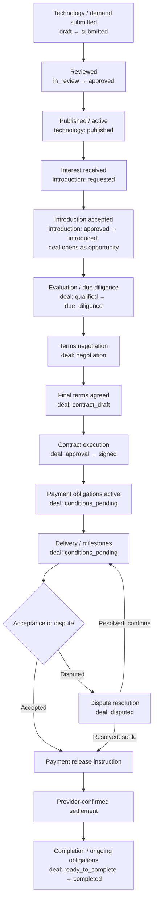

A deal can also be paused (`negotiation` → `on_hold` → `negotiation`) or end as `lost` (not pursued, diligence failed, talks ended or terminated after a dispute). A signed deal waits in `conditions_pending` until every completion condition for its deal type has evidence; only then does it move to `ready_to_complete` and `completed` ([05 §7.5](05-system-design-blueprint.md)).

Real deals vary: an NDA may come before detailed evaluation; some contracts require an upfront payment before delivery; others use no platform-processed payment; royalties may continue after the initial transaction.

Keep these statuses **independent**, each with its own state machine:

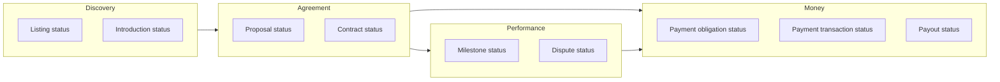

Where each state machine is defined:

| State machine | Defined in | States |
| --- | --- | --- |
| Listing (technology) | [06 §6.1](06-implementation-design-v1.md) | `draft`, `submitted`, `in_review`, `changes_requested`, `approved`, `rejected`, `published`, `update_pending`, `suspended`, `archived` |
| Demand | [06 §6.2](06-implementation-design-v1.md) | `draft`, `submitted`, `clarification`, `approved`, `rejected`, `matching`, `shortlisted`, `no_candidates`, `introduction`, `in_evaluation`, `negotiation`, `fulfilled`, `withdrawn`, `expired` |
| Introduction | [06 §6.3](06-implementation-design-v1.md) | `requested`, `under_review`, `supplier_pending`, `approved`, `introduced`, `converted_to_deal`, `rejected`, `withdrawn` |
| Deal | [05 §7.5, §13](05-system-design-blueprint.md) | `opportunity`, `qualified`, `due_diligence`, `negotiation`, `contract_draft`, `approval`, `signed`, `conditions_pending`, `ready_to_complete`, `completed`, `on_hold`, `lost`, `disputed` |
| Proposal version | [08 §5.1](08-china-operating-model.md) | open, superseded, accepted |
| Milestone | `deal_milestones` ([06 §4.3](06-implementation-design-v1.md)) | `pending`, `submitted`, `accepted`, `rejected`, `waived` |
| Payment obligation, payment request, provider transaction, provider-held funds, release instruction, payout | [08 §6.2](08-china-operating-model.md) | A separate status set for each object |
| Dispute | [08 §8](08-china-operating-model.md) | Dispute workflow; the deal shows `disputed` |

Each transition validates the actor's permissions, the required evidence, the prerequisites and any deadline. Financial transitions are **idempotent** and reconciled against **verified provider events**.

---

## 9. The first working version

For a small team, do not build a payment institution, a universal escrow service, a complex e-signature system and an expert network at the same time. Build this vertical slice in order. The last column shows the release in [10 §9](10-product-requirements.md) that delivers each capability:

| # | Capability | Contents | Release |
| --- | --- | --- | --- |
| 1 | Organization onboarding | Registration, membership, roles, basic verification | R0–R1 (delegated authority R2) |
| 2 | Technology and demand listings | Structured submissions, reviewer workflow, publication, version history | R1 |
| 3 | Introductions | Expressions of interest, accept/decline, managed introductions, communication records with contact masking | R1 |
| 4 | Confidential evaluation | NDA status, controlled document sharing, due-diligence checklist | R2 |
| 5 | Negotiation | Versioned term sheet, counter-offers, approvals, explicit agreement on the final version | R2 |
| 6 | Contract and milestones | Signed agreement, deliverables, acceptance criteria, deadlines, evidence | R2 |
| 7 | Financial integration | Platform invoices (R2); payment requests, verified provider events, refunds and reconciliation through the payment adapter (R3, FR-PAY) | R2 / R3 |
| 8 | Dispute and audit | Audit trail and basic complaints (R1); mediation (R2); evidence preservation, permission-controlled review, disputes over funds (R2–R3) | R1–R3 |

Before payments are integrated (R3), the platform issues its own invoices and records that the buyer **paid the supplier directly**, with the evidence the parties provide. That is much simpler than receiving, safeguarding, reserving and distributing money itself. In R3, payment requests go through the payment adapter (D-02). A provider-backed holding structure is not planned; it would need the confirmations in [08 §10 B](08-china-operating-model.md) and a new owner decision.

---

## 10. Decisions taken

Four decisions were needed to finalize user types, workflow rules and the money model. They were answered as follows and are designed in detail in [08](08-china-operating-model.md) and [10](10-product-requirements.md):

| Question | Options | Decision |
| --- | --- | --- |
| Launch region | Ireland / EEA · **China** · Southeast Asia · cross-border from day one | **China** |
| Deal types at launch | Licensing + services + R&D · **all types** · discovery only | **All deal types**, in three implementation tiers |
| Who handles transaction money | Provider handles, platform tracks · buyer pays supplier directly · **funds held and released conditionally through the platform, subject to legal and provider feasibility** **The platform never holds client funds.** Until R3, deal payments go directly between the parties. From R3, payment requests go through one adapter, with the owner's payment testing platform as the first provider (decided, D-02 in [12](12-decision-record.md)). Conditional holding through a licensed bank or payment institution remains possible later, but it is not designed |
| How formal listing, bidding, settlement and certificates are performed | Apply for a venue licence · **become a practising agent of STEX or CTEX** · partner with an existing agent | **Agent route by default:** these steps run through STEX or CTEX, with the platform as registered practising agent (§3.5). Proposed resolution of D-01 ([12](12-decision-record.md)): register as a CTEX service institution now; for STEX listings work through a registered STEX agent as partner; register with STEX once eligible |

The next deliverable is a complete role-and-permission matrix plus a transition-by-transition specification: exactly who can submit, accept, approve, sign, fund, release, withdraw, cancel and dispute each item, and which evidence each transition requires. That specification is in [08 §2–§4](08-china-operating-model.md), with the permission matrix in [06 §8](06-implementation-design-v1.md) and the numbered requirements in [10 §3](10-product-requirements.md).

---

## Sources

Notes, excerpts and saved copies of these sources (with retrieval dates and archived links) are in [`references/`](references/README.md).

- WIPO GREEN, FAQs: <https://www3.wipo.int/wipogreen/en/faqs.html>
- Enterprise Europe Network, Partnering opportunities: <https://een.ec.europa.eu/partnering-opportunities>
- MIT Technology Licensing Office, Technology transfer overview: <https://tlo.mit.edu/understand-ip/technology-transfer-overview>
- yet2, About / how yet2 works: <https://www.yet2.com/about/>
- University of Washington CoMotion, Licensing FAQs (financial terms in UW licences): <https://comotion.uw.edu/licensing/licensing-faqs>
- University of Central Florida, Licensing technology (financial terms): <https://www.research.ucf.edu/tech-transfer/licensing-technology/>
- WIPO, *Successful Technology Licensing* (licensing terms, payment structures): <https://www.wipo.int/edocs/pubdocs/en/licensing/903/wipo_pub_903.pdf>
- WIPO, Trade secrets (confidentiality, NDAs): <https://www.wipo.int/tradesecrets/en/>
- Stripe, Connect: separate charges and transfers: <https://docs.stripe.com/connect/separate-charges-and-transfers>
- Central Bank of Ireland (payment and e-money institutions, safeguarding): <https://www.centralbank.ie/>
