# 07 — Real-World Roles, Workflows, Approvals and Money Movement

> **About this document**
>
> - **Purpose:** Derive the platform's user groups, workflows, approval rules and payment lifecycle from how real technology-transfer organizations operate, instead of inventing a few roles and CRUD screens.
> - **Audience:** Product owners, business analysts, architects and the operations lead.
> - **Status:** Operating-model design. It refines [05](05-system-design-blueprint.md) and [06](06-implementation-design-v1.md). The China-specific legal and payment model that follows from it is in [08](08-china-operating-model.md).
> - **Previous:** [06 — Implementation design](06-implementation-design-v1.md) · **Next:** [08 — China operating model](08-china-operating-model.md)

---

## Summary

- A technology exchange is **not** "someone posts a technology and someone else buys it". It may coordinate identity and organization verification, discovery, confidential disclosure, technical evaluation, IP due diligence, negotiation, contracting, payment milestones, delivery, acceptance and dispute resolution.
- Real organizations each cover **different parts** of that chain. Their models are complementary, not interchangeable templates.
- Design rule: use a searchable exchange for discovery, but run every serious opportunity through a **separate, managed transaction workflow**. Payment, confidential disclosure and deal closure must never be automatic consequences of a single "Accept" button.

---

## 1. What real-world models tell us

| Model | What it does | What we learn |
| --- | --- | --- |
| **WIPO GREEN** (WIPO, green-technology matching) | Organizations submit technologies and needs, update them and contact partners. Submissions are reviewed for completeness, clarity and relevance. WIPO states that it does not independently verify every claim (for example environmental impact). Supports licensing, collaboration, joint ventures and sales. | A connection platform with **light review**, not an escrow service. Be explicit about what review does and does not verify. |
| **Enterprise Europe Network (EEN)** (EU partner search) | The database distinguishes technology offers, technology requests, business offers, business requests and R&D requests. An interested party submits an enquiry (company, contact, intended collaboration, reasons for interest, information requested). A regional EEN partner handles it before forwarding it to the profile owner. | **Typed opportunities** and **assisted introductions** through an intermediary. |
| **MIT Technology Licensing Office** (university TTO) | Starts with an invention disclosure and assessment, then IP protection and commercialization. Licensing revenue is shared with inventors under institutional policy. | For university-owned inventions, the **researcher may not have authority** to sell or license. The institution decides. |
| **yet2** (commercial scouting and licensing) | Defines the buyer's need, scouts and filters candidates, does outreach and introductions, NDAs, samples and evaluations, and supports licensing negotiations. | A **managed exchange** with hands-on facilitation is a paid business. |
| **STEX** (Shanghai, see [01](01-shanghai-landscape.md)) | Rights registration, tiered disclosure, auction, tender and bidding, third-party settlement, transaction certificates. | The **trusted transaction layer**, partly regulated. |
| **NETC / InnoMatch** (Shanghai, see [01](01-shanghai-landscape.md)) | Demand collection, technology managers, online + offline matching, events. | The **demand-driven network layer**. |

> **Conclusion:** use a searchable exchange for discovery, but build a separate managed transaction workflow for every serious opportunity.

---

## 2. The user groups the platform needs

Do not model everyone as "buyer" or "seller". One organization can be a supplier in one deal and a buyer in another, and within an organization different people hold different authority. Use five layers:

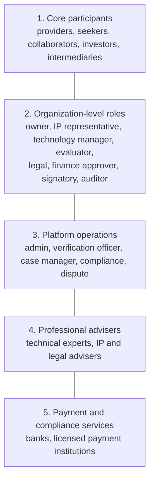

### 2.1 Core participants

| User group | Who they are | What they do |
| --- | --- | --- |
| Technology provider | Company, startup, inventor, research institution | Publishes technology, supplies evidence, answers questions, negotiates rights and commercial terms |
| Technology seeker | Company, manufacturer, public agency, research institution | Describes a technical problem, searches, evaluates candidates, negotiates and acquires rights or services |
| R&D collaborator | Company, university, lab, research consortium | Proposes joint research, contributes staff, data, equipment or funding, agrees ownership of new results |
| Investor or commercialization partner | Investor, corporate venture team, accelerator | Evaluates opportunities and may finance development or commercialization |
| Technology intermediary | TTO, broker, technology manager, innovation consultant | Represents a party, finds partners, supports introductions and negotiations |

These categories mirror real offer/request databases (EEN), provider/seeker platforms (WIPO GREEN) and university licensing practice.

### 2.2 Organization-level roles

Every organization supports multiple members with different permissions:

| Role | Typical permissions | Must **not** automatically be allowed to… |
| --- | --- | --- |
| Organization owner | Manage profile, membership and settings | Sign every contract merely because they created the account |
| Technology / IP owner representative | Submit technologies, confirm rights ownership or authority | Claim rights belonging to another institution without authorization |
| Technology manager | Edit listings, respond to enquiries, upload evidence | Commit the organization to a binding deal unless authorized |
| Buyer / project manager | Create demands, shortlist, coordinate evaluation | Approve funding or execute a contract without the relevant authority |
| Technical evaluator | Review specifications, run tests, submit reports | See unrelated confidential deals or authorize payments |
| Legal / IP reviewer | Review NDAs, IP ownership, licence scope and contracts | Release funds unless separately authorized |
| Finance approver | Approve budgets, invoices, payments and refunds | Change technical acceptance criteria unilaterally |
| Contract signatory | Execute agreements within delegated authority | Sign for another organization |
| Read-only auditor | Inspect permitted deal records and financial history | Edit, approve or delete records |

> **Key rule:** account ownership, organizational authority and deal approval are **separate concepts**. The person who submits a technology may not own the IP, and the person who discusses a price may not have the authority to commit the organization.

### 2.3 Platform operations and external specialists

| Group | Responsibility |
| --- | --- |
| Platform administrator | Configuration, user support, access management |
| Verification / review officer | Organization evidence, listing completeness, identity checks |
| Exchange case manager | Introductions, meetings, deadlines and follow-ups |
| Technical expert | Independent assessment, testing, validation or feasibility report |
| IP / legal adviser | Rights checks, licence terms, agreement review |
| Payment provider | Processes payments, transfers and payouts where supported |
| Dispute reviewer / mediator | Escalated disputes under a defined process |
| Compliance officer | Sanctions, fraud, conflicts, regulated activities and escalations |

In a small team, one employee may wear several hats. The **permissions and audit records must still be distinct**, especially for approving payments, changing bank details, releasing funds and resolving disputes.

A large expert network is not needed on day one. The platform must, however, let external experts be **invited into specific cases** without gaining broad access to confidential information.

---

## 3. Business workflows for each group

These are the recommended product workflows, informed by the real processes above. They do not claim that every reference organization follows this exact sequence.

### 3.1 Workflow A: technology provider

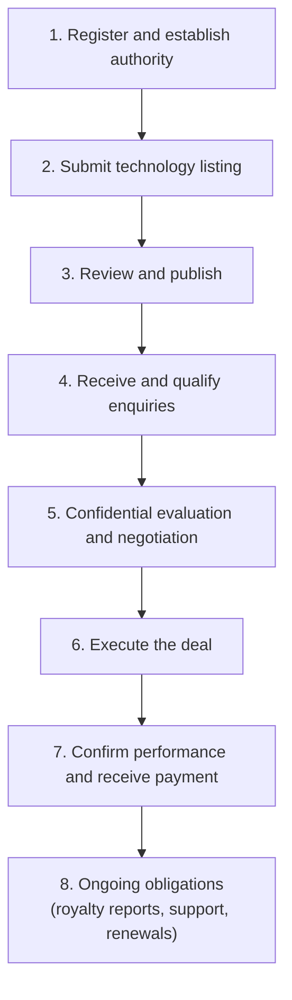

| Step | Provider does | Platform records / checks |
| --- | --- | --- |
| 1. Register and establish authority | Submits contact, organization, jurisdiction and representative details, plus proof of authority | Organization verification case; authority scope and expiry |
| 2. Submit listing | Describes the solution, problem solved, stage, evidence, IP status, available rights, applications and preferred partnership types | Versioned draft; rights declaration; evidence quarantine |
| 3. Review and publish | Corrects incomplete information, answers reviewer questions, approves the public view | Review decision, approved field scope, publication snapshot |
| 4. Qualify enquiries | Accepts, declines or asks for clarification; confirms the interested party and use are credible | Enquiry decision with reason |
| 5. Evaluate and negotiate | Agrees confidentiality terms, shares authorized information, answers questions, reviews proposals | NDA status, document grants, proposal versions |
| 6. Execute | An **authorized signatory** approves the final agreement; funding conditions are met; technology or services are delivered | Signature evidence, conditions, delivery records |
| 7. Get paid | Submits milestone evidence or invoices, responds to acceptance feedback, receives released payments | Acceptance decisions, provider-confirmed payments and payouts |
| 8. Ongoing | Handles royalties, support and renewals | Royalty schedule, reports, reminders |

**What the provider submits**

- Public technology summary and intended applications.
- Technical specifications, maturity level and supporting evidence.
- IP information: patent numbers or applications where relevant, ownership, inventors, co-owners and existing encumbrances (licences already granted, security interests).
- Authority to offer the technology, if the submitter is not the owner.
- Commercialization preferences: licence, assignment, joint development, supply, technical services or other collaboration.
- Proposed commercial terms (indicative, not binding).
- Confidential documents only through access-controlled disclosure.

Do not force every provider to give a patent number: valuable technologies may be protected by copyright, know-how, trade secrets or contractual rights. The platform must, however, distinguish **"IP claimed by submitter"** from **"IP independently verified"**. WIPO specifically warns users not to disclose trade secrets in public database submissions.

### 3.2 Workflow B: technology seeker / buyer

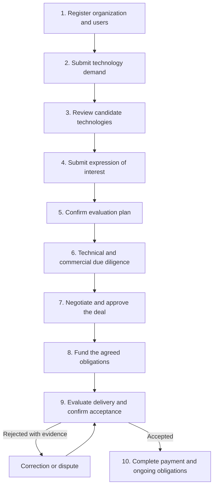

| Step | Buyer does |
| --- | --- |
| 1. Register | Establishes the organization and who is authorized to represent it |
| 2. Submit demand | States the problem, required performance, deployment environment, budget range, deadline, preferred collaboration type and acceptance criteria |
| 3. Review candidates | Searches and shortlists; asks for more information or for the platform to find alternatives |
| 4. Express interest | Explains the use case, desired partnership, capability to evaluate or commercialize, and the information needed (consistent with EEN's real enquiry form) |
| 5. Evaluation plan | Agrees which documents, samples, demonstrations, tests and success criteria will be used |
| 6. Due diligence | Evaluates technical fit, rights, implementation cost, supplier capability and financial feasibility |
| 7. Negotiate and approve | Agrees scope, rights, fees, milestones, acceptance tests, liability and termination |
| 8. Fund | Pays the applicable deposit or milestone through the agreed payment route |
| 9. Accept | Accepts, rejects with evidence, or requests permitted corrections |
| 10. Complete | Payment is released when contract conditions are met; then support, royalties, renewals and compliance |

> A buyer's "accept" must have a precise meaning. **Accepting an enquiry, a technical result, a contract and a delivered milestone are four different actions.** The system never treats them as interchangeable (see §4).

### 3.3 Workflow C: R&D collaborators and investors

These users need a different deal model, because the outcome may be a **jointly developed** technology rather than delivery of an existing one. They submit or approve:

- Project proposal, work packages, budget and timeline.
- Contributions of staff, facilities, equipment, data and cash.
- **Background IP** that each party brings into the project.
- Ownership and licensing rules for **newly developed results (foreground IP)**.
- Publication, confidentiality, patent filing and commercialization rules.
- Funding commitments, drawdown conditions and milestone evidence.
- Decisions to continue, pause, change scope or terminate.

WIPO treats R&D cooperation agreements, licensing agreements, assignments and confidentiality agreements as **distinct** technology-transfer instruments. That is why the **deal type** must be a first-class field, not a single generic purchase workflow.

### 3.4 Workflow D: platform case manager

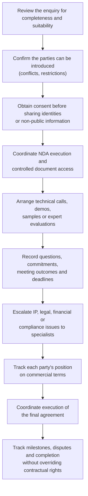

This mirrors yet2's managed model (introductions, NDAs, samples, evaluations) and EEN's advisers supporting partner search and follow-up.

---

## 4. What "submit, accept, confirm, discuss and agree" mean

These words sound similar in conversation but must have **distinct meanings** in the system. Each one creates an auditable event, not just a changed text field.

| Action | Meaning | What the platform records |
| --- | --- | --- |
| Submit | A user sends a new or revised item | Version, submitter, timestamp, required fields |
| Review | A reviewer checks the item against defined criteria | Reviewer, decision, evidence, reason |
| Approve for publication | The platform makes a listing publicly discoverable | Approval scope, reviewer, publication version |
| Express interest | A party asks to explore an opportunity | Use case, information requested, intended collaboration |
| Accept an introduction | A party consents to contact or a managed introduction | Consent, scope, visibility permissions |
| Accept an NDA | A party validly executes the confidentiality instrument | Document version, parties, signature evidence, effective status |
| Discuss | Parties exchange messages, questions and proposals | Participants, timestamps, attachments, confidentiality level |
| Propose terms | A party submits a commercial or technical proposal | Immutable proposal version, expiry, terms |
| Counter-offer | A party changes one or more proposed terms | New version linked to the previous one |
| Agree terms | All parties confirm the **same complete** set of terms | Exact version accepted by each authorized party |
| Sign contract | Authorized representatives execute the agreement | Executed contract, signature and verification evidence |
| Fund | Required money is received and **confirmed by the payment provider or bank** | Payment reference, amount, currency, confirmed status |
| Deliver | A party submits the agreed output or evidence | Delivery version, timestamp, files |
| Accept milestone | The designated party confirms contractual acceptance | Criteria, decision, evidence, authorized actor |
| Release payment | The payment route transfers the approved amount | Provider reference, amount, fees, recipient, status |
| Withdraw funds | A recipient requests a payout of an eligible balance | Amount, destination, verification, provider result |
| Dispute | A party contests a payment, delivery, acceptance or other obligation | Issue, evidence, deadlines, resolution history |

### 4.1 Consensus is not the same as agreement

For a two-party licence, a generic "consensus" button is unnecessary. What is needed is a **versioned term sheet** and **explicit acceptance by every required party** of the same version.

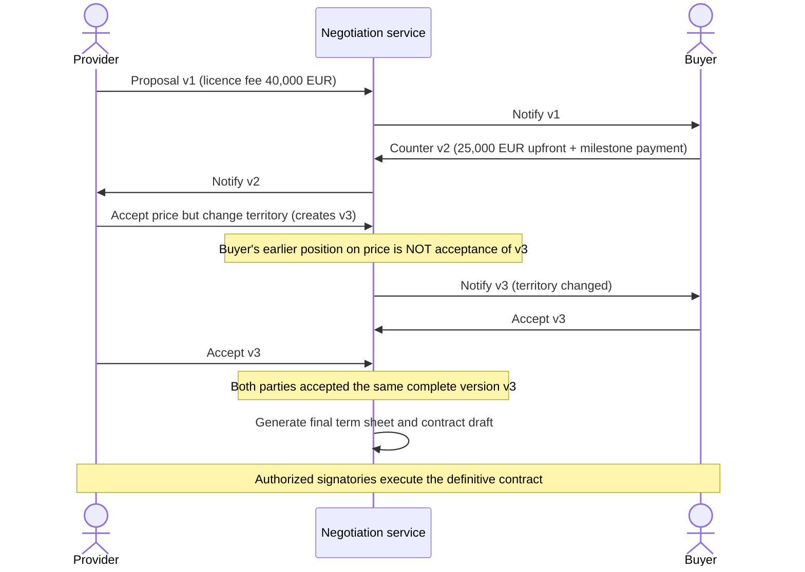

For an R&D consortium the principle is the same, but approvals may involve three or more organizations and several work packages. WIPO's licensing guidance stresses that terms are negotiated for the specific circumstances, with confidentiality, rights, scope, payment and other obligations set out in the actual agreement.

**Implementation:** keep `proposal_versions`, `proposal_responses`, `required_approvals` and `contract_signatures` as separate records. **Never overwrite a previous offer in place.**

---

## 5. Confidentiality, discussion and due diligence

A buyer needs enough information to decide whether to proceed, but a provider may not disclose source code, manufacturing details, unpublished inventions or trade secrets to an unqualified stranger. Use a **disclosure ladder**:

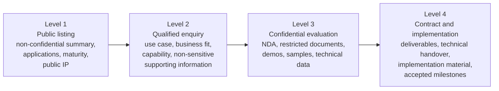

WIPO's guidance on NDAs and trade secrets supports this staging. An NDA should define the confidential information, the authorized use, permitted recipients, exceptions, and what happens to the materials if negotiations end. **An NDA is not a licence** and gives no permission to use the technology.

The platform therefore supports:

- **Document-specific** access grants, not access to a whole deal folder.
- Time-limited and revocable access where legally and technically appropriate.
- A log of who viewed or downloaded each confidential file.
- NDA versions and a clear record of which parties are covered.
- An explicit decision on whether parties may keep, or must return or destroy, confidential material when talks end.
- A rule that privileged information never appears in public search, automated matching or notifications.

The platform can record that a party *claims* to have destroyed a file. It cannot honestly guarantee deletion of every copy a recipient downloaded.

---

## 6. The financial lifecycle: quote, fund, hold, release, withdraw

This is the most important architectural distinction in the operating model. A marketplace must not invent an "escrow balance" just because it has a database. **A recorded obligation, money received by a payment provider, money reserved for a transaction and money available to withdraw are four different things.**

WIPO's licensing guidance lists upfront fees, milestone payments, royalties and other negotiated compensation. University licensing offices (for example Rice University and the University of Minnesota) describe upfront fees, milestone payments, patent-cost reimbursement, royalties and minimum royalties.

### 6.1 Recommended payment lifecycle

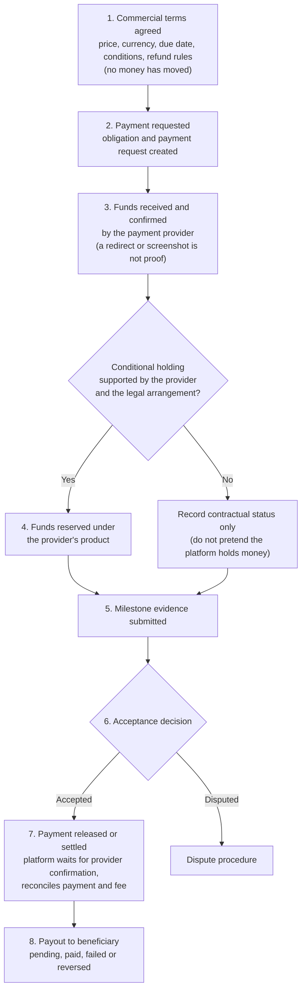

This is a proposed workflow, not a universal escrow process. The actual mechanism depends on the jurisdiction, provider, deal type and contract.

### 6.2 What exactly does "locked" mean?

Never use one `locked` status for every situation. At least four meanings exist:

| Term | Meaning | Where the state belongs |
| --- | --- | --- |
| Contractually committed | The buyer owes a payment if the agreed conditions are met | Contract / obligation |
| Payment initiated | A payment instruction exists but is not yet confirmed as successful | Payment record |
| Provider balance pending | Funds sit in a provider balance and are not yet available for payout | Provider balance / payout status |
| Funds reserved under a holding arrangement | Money is restricted under a supported legal and payment structure | Holding arrangement and provider records |

Say "funds secured" only if the actual payment arrangement justifies it. A buyer clicking "Fund deal" is not proof of receipt, and a successful charge is not a completed payout.

For example, Stripe Connect documents "separate charges and transfers", which let a platform collect a payment and later transfer portions to connected accounts, with processing fees, refunds, chargebacks, transfer timing and reversals. That is a **payment-routing mechanism**, not proof that such an arrangement is legally protected escrow.

### 6.3 Worked example: what happens when a buyer pays

The contract calls for a €20,000 upfront licence payment and a separate €10,000 payment on a milestone. The system must not assume the whole €30,000 is payable or releasable at once.

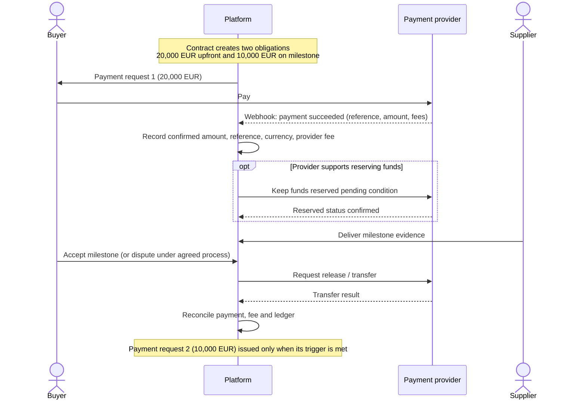

The numbers are illustrative, not a market tariff. **Every payment is linked to an obligation, and every release to an explicit reason and authorization.**

### 6.4 When the buyer does not accept a deliverable

The platform needs a predetermined procedure, not an administrator who picks a winner. The contract or milestone plan specifies:

- Objective acceptance criteria.
- Who may test and accept the deliverable.
- A review deadline.
- What evidence must accompany a rejection.
- Whether a correction or retest is permitted.
- What happens if the buyer does not respond.
- How a dispute is escalated.
- What happens to the associated payment while a dispute is pending.
- Which remedies are available.

Do **not** implement automatic acceptance after a deadline unless the parties explicitly agreed to it and it is legally appropriate for the deal. The platform must not invent rules that change the parties' contractual rights.

### 6.5 Fees: what the platform charges for

There is no universal technology-transfer fee. Configure fee rules **per deal type** instead of one hard-coded commission:

| Possible fee | When charged | Recommended initial treatment |
| --- | --- | --- |
| Registration | Account or organization onboarding | Free initially |
| Listing / publication | Technology accepted for publication | Free initially, to build supply |
| Managed-service fee | Staff perform search, diligence coordination or negotiation support | Fixed, staged or separately quoted |
| Success fee | A qualifying transaction completes | Percentage or fixed amount, clearly defined in the agreement |
| Payment processing fee | Provider charges for a transaction | Shown separately; specify who bears it |
| Expert assessment fee | Technical or IP specialist performs paid work | Quoted and approved before commissioning |
| Contract / document service | Optional professional service | Clearly priced and separately accepted |
| Renewal or monitoring fee | Continuing service after a deal | Only if the ongoing value is clear |

These are design options, not claims about what the cited organizations charge. EEN, for instance, provides its partnering database and advice as a public network service, while yet2 sells scouting and licensing services.

For each fee, record: who owes it · who receives it · which event makes it payable · the amount or formula · currency, tax treatment and refundability · whether it is deducted from a payment or invoiced separately · what happens if the deal is cancelled or the payment refunded.

**Never deduct a success fee because a buyer clicked "Accept introduction".** Define the qualifying event in advance, for example execution of a licence agreement, completion of a specified transaction or receipt of a defined payment.

### 6.6 Withdrawal and payout

A recipient may request a payout only from funds the payment system **actually makes available**:

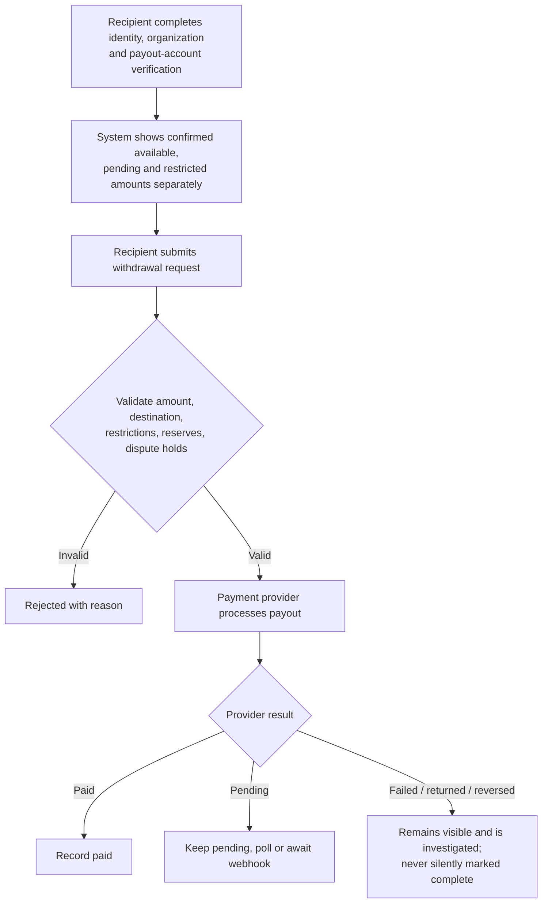

A withdrawal **request** is not a withdrawal, just as a transfer instruction is not proof that the recipient received the money.

> **Regulatory note:** holding or controlling customer funds is regulated almost everywhere. For example, in the European Economic Area the Central Bank of Ireland's guidance describes **safeguarding** obligations (including segregation of users' funds) for payment institutions. Calling an internal database balance "escrow" does not avoid such rules. For the chosen China launch, see [08 §1 and §6](08-china-operating-model.md).

For the first version, integrate a suitable payment provider and keep the platform's own ledger as a **reconciled record of obligations and transactions**, not as a substitute for a regulated client-money arrangement.

---

## 7. Deal types need different payment and acceptance rules

| Deal type | Typical deliverable | Typical payment model | What confirms completion? |
| --- | --- | --- | --- |
| IP licence | Contractual permission to use specified IP | Upfront fee, milestones, royalties or a combination | Effective licence and satisfaction of the relevant conditions |
| IP assignment | Ownership transfer of specified IP | Lump sum or staged payments | Transfer documents and required formalities (e.g. recordal at the patent office) |
| Technical services | Engineering, integration, consulting or implementation | Deposit plus milestone and final payments | Defined services accepted under acceptance criteria |
| R&D collaboration | Research work, prototypes, test results or jointly developed IP | Funding tranches, milestone payments or agreed contributions | Work-package evidence and contractually defined review |
| Technology supply | Product, equipment, material, software or know-how package | Purchase payment, delivery milestones | Delivery and applicable acceptance tests |
| Commercialization partnership | Manufacturing, distribution, market access or sublicensing rights | Fixed fees, royalties, revenue share or mixed | Contractual launch, sales or reporting obligations |
| Investment | Equity or another negotiated instrument | Funding round, tranche or closing payment | Completion of investment conditions and documents |

These are common patterns, not guaranteed terms. WIPO notes that technology-transfer contracts vary with circumstances, and that licences, assignments, confidentiality agreements and R&D cooperation agreements serve different purposes.

> **Important:** never force an investment through the same milestone-release workflow as a technical-services purchase. An investment may need legal closing conditions, share issuance, shareholder approvals and regulated intermediaries. Likewise, royalties may continue for years, so a deal can be **operationally complete while still carrying ongoing reporting and payment obligations**.

Initial launch priority (later superseded by the "all deal types, three tiers" policy in [08 §3](08-china-operating-model.md)):

1. IP licensing.
2. Technical services / implementation.
3. R&D collaboration.

The data model must allow the other types from the start, even if their workflows come later.

---

## 8. The database records and state machines this requires

The architecture in [06](06-implementation-design-v1.md) already includes users, organizations, technologies, demands, introductions, deals, milestones, documents and audit events. These workflows add the following records:

| Record | Purpose |
| --- | --- |
| `organization_authorizations` | Which users may submit, approve, sign or pay on behalf of an organization (with limits and expiry) |
| `deal_parties` | Every organization in a deal and its contractual role |
| `deal_proposal_versions` | Immutable commercial and technical offers and counter-offers |
| `proposal_responses` | Each party's response to a specific proposal version |
| `approval_requests` | Required internal approvals, approver, decision and reason |
| `contract_versions` | The exact agreed contract and its amendments |
| `contract_signatures` | Signatories and execution evidence |
| `payment_obligations` | What is owed, by whom, to whom, when and under which conditions |
| `payment_transactions` | Actual payment-provider or bank transactions |
| `funding_allocations` | Links confirmed funds to specific obligations or milestones |
| `payouts` | Payout requests and provider-confirmed outcomes |
| `platform_fees` | Fee basis, payer, recipient and amount |
| `refunds_and_reversals` | Refunds, transfer reversals and their reasons |
| `milestone_acceptance_cases` | Submitted evidence, acceptance, rejection, correction and dispute |
| `disputes` | Contested contractual or financial matters |
| `ledger_entries` | An auditable, balanced record of platform-recognized financial movements |

These entities are to be implemented **after** the money-handling model is chosen. They are not permission for the platform to hold client funds.

### 8.1 State machines must be separate

A single `status` column on `deals` cannot describe all of this. A deal can be legally signed while the first payment is pending; funded while delivery is incomplete; and a milestone can be accepted while a payout is still pending. The broad business path:

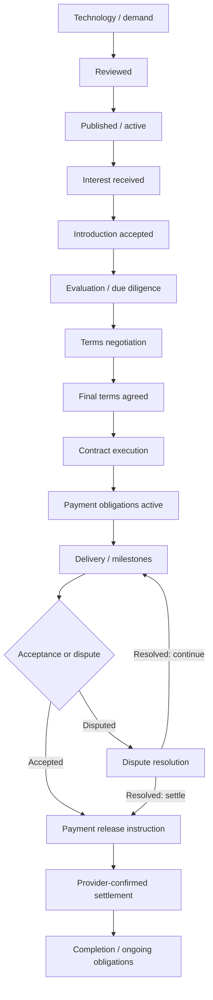

Real deals vary: an NDA may come before detailed evaluation; some contracts require an upfront payment before delivery; others use no platform-processed payment; royalties may continue after the initial transaction.

Keep these statuses **independent**, each with its own state machine:

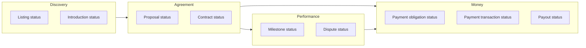

Each transition validates the actor's permissions, the required evidence, the prerequisites and any deadline. Financial transitions are **idempotent** and reconciled against **verified provider events**.

---

## 9. The first working version

For a small team, do not build a payment institution, a universal escrow service, a complex e-signature system and an expert network at the same time. Build this vertical slice first:

| # | Capability | Contents |
| --- | --- | --- |
| 1 | Organization onboarding | Registration, membership, roles, basic verification |
| 2 | Technology and demand listings | Structured submissions, reviewer workflow, publication, version history |
| 3 | Introductions | Expressions of interest, accept/decline, managed introductions, communication records |
| 4 | Confidential evaluation | NDA status, controlled document sharing, due-diligence checklist |
| 5 | Negotiation | Versioned term sheet, counter-offers, approvals, explicit agreement on the final version |
| 6 | Contract and milestones | Signed agreement, deliverables, acceptance criteria, deadlines, evidence |
| 7 | Financial integration | Invoices / payment requests, provider-confirmed payments, fee calculation, payout status, refunds, reconciliation |
| 8 | Dispute and audit | Escalation, evidence preservation, permission-controlled review, complete event history |

In the first release, the platform can issue an invoice and record that the buyer **paid the supplier directly**, if that is the chosen arrangement. That is much simpler than receiving, safeguarding, reserving and distributing money itself. Provider-backed delayed transfers or a legally reviewed holding structure can come later if the market needs them.

---

## 10. Decisions taken

Three decisions were needed to finalize user types, workflow rules and the money model. They were answered as follows and are designed in detail in [08](08-china-operating-model.md):

| Question | Options | Decision |
| --- | --- | --- |
| Launch region | Ireland / EEA · **China** · Southeast Asia · cross-border from day one | **China** |
| Deal types at launch | Licensing + services + R&D · **all types** · discovery only | **All deal types**, in three implementation tiers |
| Who handles transaction money | Provider handles, platform tracks · buyer pays supplier directly · **funds held and released conditionally through the platform, subject to legal and provider feasibility** | **Conditional holding and release through a licensed bank or payment institution**, with the platform coordinating conditions and recording verified events |

The next deliverable is a complete role-and-permission matrix plus a transition-by-transition specification: exactly who can submit, accept, approve, sign, fund, release, withdraw, cancel and dispute each item, and which evidence each transition requires. That specification is in [08 §2–§4](08-china-operating-model.md).

---

## Sources

- WIPO GREEN, FAQs: <https://www3.wipo.int/wipogreen/en/faqs.html>
- Enterprise Europe Network, Partnering opportunities: <https://een.ec.europa.eu/partnering-opportunities>
- MIT Technology Licensing Office, Technology transfer overview: <https://tlo.mit.edu/understand-ip/technology-transfer-overview>
- yet2, About / how yet2 works: <https://www.yet2.com/about/>
- Washington University in St. Louis, Office of Technology Management: <https://otm.wustl.edu/>
- WIPO, *Successful Technology Licensing* (licensing terms, payment structures): <https://www.wipo.int/edocs/pubdocs/en/licensing/903/wipo_pub_903.pdf>
- WIPO, Trade secrets (confidentiality, NDAs): <https://www.wipo.int/tradesecrets/en/>
- Stripe, Connect: separate charges and transfers: <https://docs.stripe.com/connect/separate-charges-and-transfers>
- Central Bank of Ireland (payment and e-money institutions, safeguarding): <https://www.centralbank.ie/>
