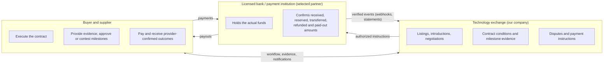
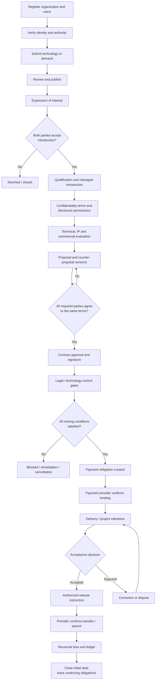
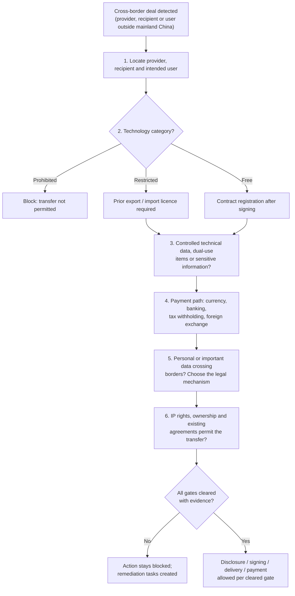
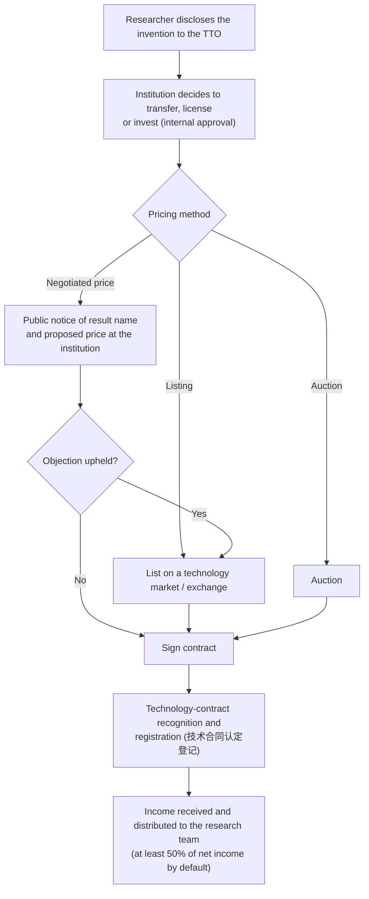
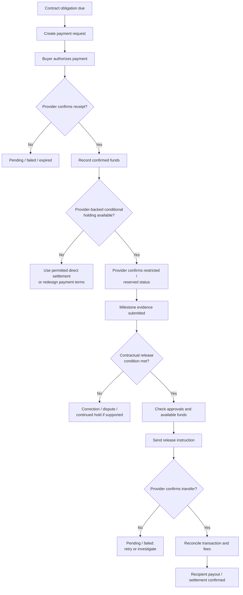
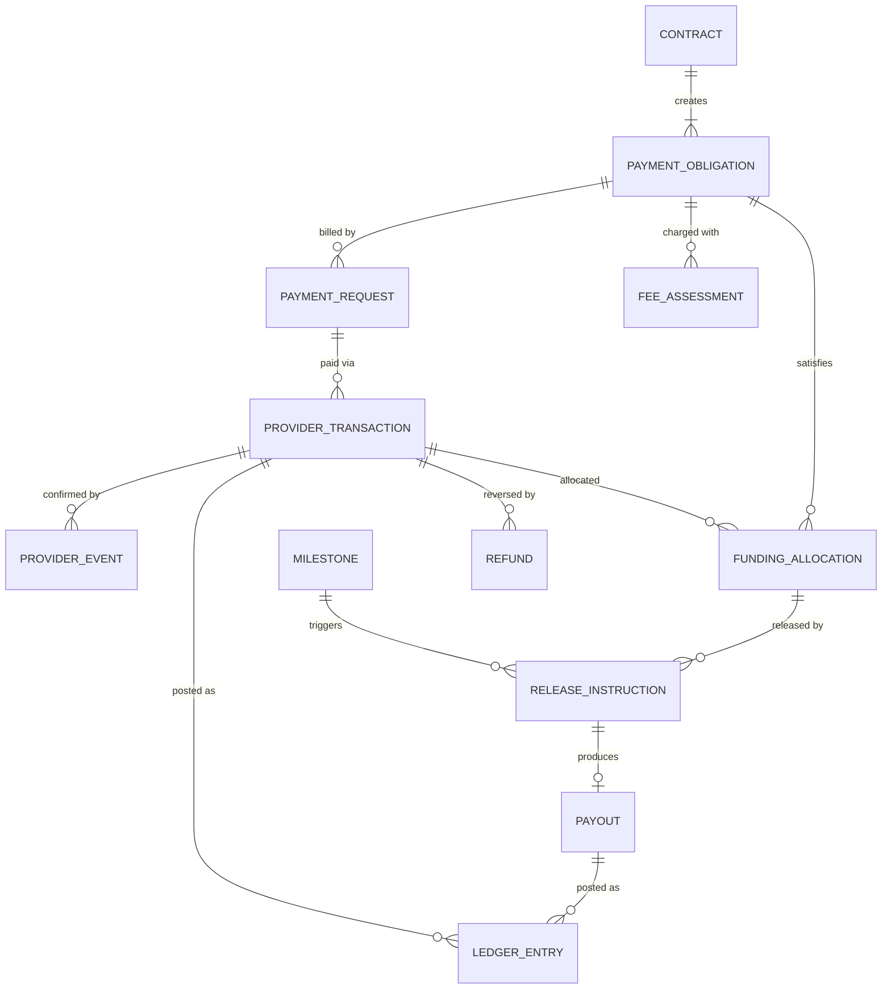
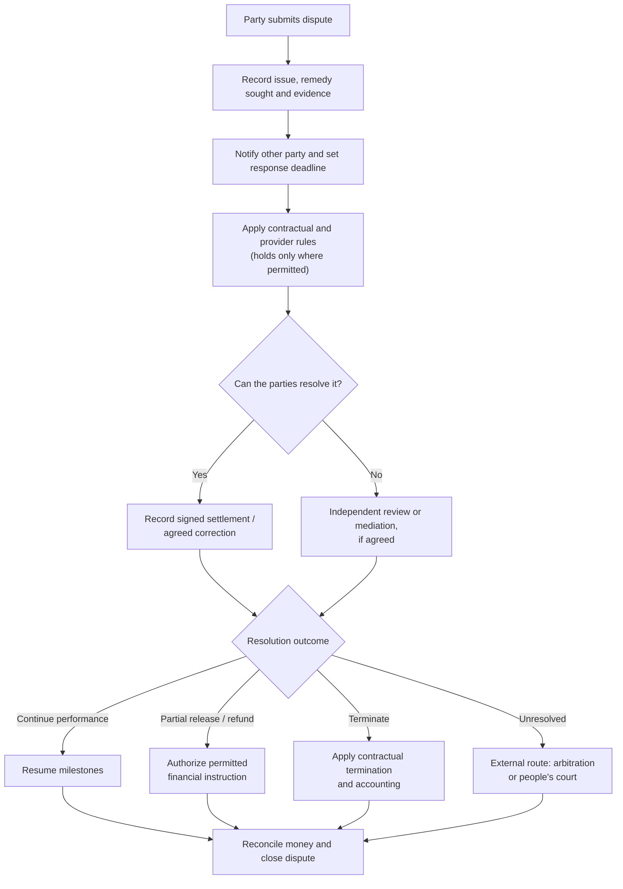
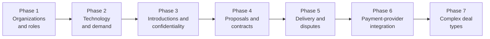

# 08 — Final Operating Model for the China Technology Exchange

> **About this document**
>
> - **Purpose:** Define the final operating model for launching in China: legal boundaries, user groups and authority, deal types, the end-to-end workflow with approvals, contracts, funds handling, fees, disputes, required modules and the launch checklist.
> - **Audience:** Founders, product owner, architects, finance and compliance leads, and the Chinese legal counsel and payment partner who must validate it.
> - **Status:** Final operating model. Implementation baseline: [06](06-implementation-design-v1.md); role and money concepts: [07](07-roles-workflows-and-money.md).
> - **Not legal advice.** Every item marked *legal validation required* must be confirmed by PRC counsel, the relevant regulator or the payment partner before launch.
> - **Previous:** [07 — Roles, workflows and money movement](07-roles-workflows-and-money.md) · **Index:** [README](README.md)

---

## Summary

The platform is a **managed technology exchange**: controlled introductions, negotiated contracts, milestone-based delivery, and **funds handling backed by a licensed bank or payment institution**.

There is one critical qualification. The business wants funds held until contractual conditions are met. The **business process** we want must be separated from the **financial activity the platform is legally permitted to perform** in China:

- The State Council's **Regulations on the Supervision and Administration of Non-bank Payment Institutions** (《非银行支付机构监督管理条例》, State Council Decree No. 768, published December 2023, effective **1 May 2024**) require payment business to be carried out only by institutions licensed by the People's Bank of China (PBOC). They regulate payment processing and customer reserve funds, and prohibit misappropriating reserve funds.
- Shanghai's 2025 rules for licensed technology trading venues likewise require **third-party settlement** through a bank or licensed non-bank payment institution, with segregated client accounts (see [01 §1.3](01-shanghai-landscape.md)).

**Recommendation:** make conditional payment and release part of the product, but **never assume the exchange itself can receive, pool, safeguard or release customer money**. Use a legally reviewed arrangement with a qualified payment institution or bank. The platform coordinates deal conditions and records verified payment events. Whether a provider supports the exact conditional-holding arrangement for each transaction type must be confirmed **before** implementation commits to it.

This document separates three kinds of statement:

| Label | Meaning |
| --- | --- |
| **Evidence** | What official regulations or established technology-transfer practice support |
| **Proposed policy** | How this exchange should operate |
| **Legal validation required** | What PRC counsel, the regulator or the payment partner must confirm before launch |

---

## 1. Legal and operational boundary for the China launch

The platform supports all requested deal types, but the transaction engine applies a **different compliance path to each deal**, and distinguishes **domestic** from **cross-border** technology transfer.

### 1.1 Legal map

| Area | Evidence (Chinese source) | Required product decision |
| --- | --- | --- |
| Platform operation | **E-Commerce Law** (《电子商务法》): platform rules, security measures, and preservation of transaction information for **at least three years** after transaction completion (Art. 31), subject to other rules | Publish platform service agreement and transaction rules; keep immutable, exportable records with retention policies per record category |
| Internet operation | **ICP filing / licensing** for websites in mainland China; online transaction-processing platforms with third-party participants typically need a value-added telecom licence for **online data processing and transaction processing ("EDI")** | Decide the licensing path with counsel before public launch (*legal validation required*) |
| Cybersecurity | **Cybersecurity Law**: classified protection of information systems (网络安全等级保护, "MLPS 2.0") | Plan the grading, filing and assessment of the platform's systems |
| Payment handling | **Non-bank Payment Institution Regulations** (Decree No. 768, effective 1 May 2024): PBOC authorization; regulated payment processing and reserve funds | No general-purpose wallet or pooled balance. Choose a bank or licensed payment institution that confirms it can legally support the exact flow |
| Technology contracts | **Civil Code**, Book III, Chapter 20: technology **development** (commissioned or cooperative), technology **transfer** and **licensing**, technology **consulting** and **services** are distinct contract types | Make deal type, IP rights, scope, deliverables, consideration and acceptance rules explicit in each contract |
| Patent transfer formalities | **Patent Law** Art. 10: assignment of a patent (or application) needs a written contract **registered with CNIPA**, and takes effect **on registration**. Assignment to foreign parties also follows technology-export rules. Licence contracts are normally filed (备案) with CNIPA | "Assignment completed" requires CNIPA registration evidence; track licence filing |
| Public-institution transfers | **Law on Promoting the Transformation of Scientific and Technological Achievements** (《促进科技成果转化法》) Art. 18: state-funded universities and institutes may decide to transfer, license or invest results, pricing by **negotiation (with public notice of the name and proposed price), listing on a technology market, or auction**. Art. 45: absent internal rules or agreement, **at least 50%** of net transfer or licence income goes to the contributing researchers | Support public-notice periods, listing and auction pricing, and income-distribution records for university sellers |
| Technology import/export | **Regulations on Technology Import and Export Administration** and the **Catalogue of Technologies Prohibited or Restricted from Export** (revised 2023): prohibited, restricted and free categories. Free-category contracts are **registered**; restricted technologies need **prior licensing**. Registration certificates are used for foreign-exchange, banking, tax and customs procedures | Screen technology and parties **before** disclosure, signing, delivery and payment; block prohibited transfers; gate restricted ones on approvals |
| Export control | **Export Control Law** (2020): dual-use items and controlled technical data | Flag dual-use and controlled technical data in compliance screening |
| Electronic contracts | **Electronic Signature Law**: a *reliable* electronic signature has the same legal effect as a handwritten signature or seal, under specified conditions | Keep the exact signed version, signer identity and authority, timestamps and integrity evidence. Use a qualified e-signature provider (licensed certification authority) and support company seals (电子印章) |
| Personal information and data | **PIPL**, **Data Security Law** and the 2024 **Provisions on Promoting and Regulating Cross-border Data Flows** | China-based data storage and access controls from day one; assess before sending personal or important data overseas (including to AI providers) |
| Technology-contract registration | Revised **Measures for the Administration of the Recognition and Registration of Technology Contracts** (《技术合同认定登记管理办法》, issued by MIIT, effective **1 March 2026**). Registration is generally voluntary, but in practice it unlocks tax incentives; records are generally kept five years | Generate registration-ready contract packages and track registration status (see §5.5) |
| Licensed trading venues (Shanghai) | 《上海市技术交易场所管理细则》 (2025): venues approved by the municipal government under total-quantity control (Art. 6); rights registration, transaction certification, disclosure, third-party settlement are venue duties. STEX rules require buyers to act through a registered agent, who verifies materials with joint liability | Default route: become a **registered practising agent** of STEX (≥ 2 years registered, capital ≥ RMB 1 M, ≥ 2 recognised practitioners, clean 24-month record) or CTEX, and route formal listing, bidding, settlement and certificates through the venue ([09 §2.1](09-reference-platform-features.md)) |

> This table is an implementation baseline, not a legal opinion that a particular holding structure, company licence or cross-border transaction is permitted. Before production, PRC counsel and the proposed financial institution must validate the legal entities, funds flow, contract wording, regulated activities, tax and foreign-exchange handling.

### 1.2 Money-handling model approved for development



This is a proposed architecture. It does **not** claim that any Chinese provider currently offers a universal escrow service for all technology licensing, investment and R&D transactions. Products to evaluate include bank fund-supervision (资金监管) or custody (存管) accounts and licensed payment institutions' split-settlement (分账) services. Validate fund ownership, release control, dispute handling, refunds, fees and permitted customer types with each candidate (*legal validation required*).

**Do not make any user-facing "escrow" promise until that validation is complete.** If the partner can only process ordinary payments and payouts, the system must describe exactly that.

---

## 2. User groups and authorization model

The exchange needs **organization-level identity, deal-specific roles and platform staff roles**. A user can hold different roles in different organizations and deals.

### 2.1 Organization and deal participants

| User type | Main workflow | Decisions they can make |
| --- | --- | --- |
| Technology owner / provider | Submit, update and commercialize technologies | Authorize an offer, disclose approved information, propose terms, accept deliverable or payment terms on its side |
| Buyer / technology seeker | Publish needs, qualify candidates, evaluate and acquire | Approve its demand, evaluation plan, commercial proposal and acceptance of contracted deliverables |
| R&D collaborator | Propose or join research projects | Approve its work packages, contributions, background IP and new-results arrangements |
| IP owner or co-owner | Verify rights and authorize transactions | Consent to licensing, assignment or disclosure within its authority (co-owners may need to consent jointly) |
| University TTO / technology-transfer center | Manage service inventions (职务科技成果) of the institution | Approve listing, pricing method (negotiation + public notice, listing or auction), contract and income distribution |
| Investor / funding party | Review opportunities and commit funding | Approve its investment conditions, subject to legal and corporate process |
| Technology broker / technology manager (技术经理人) / authorized agent | Represent a party in defined activities | Only the actions explicitly delegated to it |
| Technical evaluator | Test, inspect or assess deliverables | Submit an evaluation report; **cannot** approve payment unless separately authorized |
| Legal / IP adviser | Review rights, contracts and restrictions | Record legal clearance, concerns and conditions |
| Finance approver | Approve budgets and payment instructions | Approve the organization's payment obligations within its limits |
| Authorized signatory | Execute agreements for an organization | Sign only for the organization and scope for which authority is established (legal representative 法定代表人, or a holder of a power of attorney 授权委托书, with company seal or e-seal) |

### 2.2 Platform roles

| Platform role | Responsibilities | Important restriction |
| --- | --- | --- |
| Organization verification officer | Reviews organization and representative evidence | Cannot sign on behalf of an organization |
| Listing reviewer | Reviews listing completeness and policy compliance | Cannot certify technical claims it has not tested |
| Case manager | Coordinates introductions, discussions, milestones and deadlines | Cannot rewrite agreed terms |
| Compliance officer | Reviews technology-control, sanctions, fraud and escalation flags | Cannot bypass mandatory legal gates |
| Financial operations officer | Reconciles provider transactions, investigates failures, prepares payout actions | Cannot create provider confirmations or alter financial history |
| Dispute reviewer | Manages evidence and the dispute process | Must follow agreed rules and disclose conflicts of interest |
| System administrator | Accounts, configuration and system health | Admin access never grants business approval rights |
| Auditor | Reviews authorized records and logs | Read-only by default |

In a small team, one employee may perform several functions. The application must still enforce **separation of duties** for high-risk actions.

### 2.3 Mandatory approval policy

- A provider cannot authorize a transaction solely because it uploaded a listing.
- A broker cannot bind the owner unless valid authority is recorded.
- A technical evaluator cannot release funds.
- A finance approver cannot change technical acceptance criteria.
- A case manager cannot substitute their judgment for a party's contractually required consent.
- A system administrator cannot mark an external payment as successful.
- Every payout or refund needs a recorded authorization **and** a matching provider transaction result.
- Where one user acts for several parties, the system detects and flags the conflict.

Use explicit **organization mandates**, permission scopes, approval limits and expiry dates (`organization_authorizations`). For larger transactions, require **two-person approval** inside the paying organization for payments and for changes to payout destinations.

---

## 3. Deal-type catalogue

All deal types are supported in the data model. Each has its own contract template, compliance checklist and definition of completion.

| Deal type | Civil Code / legal category | Required submissions and contract terms | Funding / payment model | Completion condition |
| --- | --- | --- | --- | --- |
| IP licensing | Technology licensing contract (技术许可合同) | Owner authority, licensed rights, territory, field of use, exclusivity, duration, sublicensing, improvements, reporting, termination | Upfront fee, milestone fees, royalties or a combination | Licence executed, approvals met, initial payment / delivery obligations satisfied; CNIPA licence filing where applicable |
| IP assignment | Technology transfer contract (技术转让合同) | Rights and ownership evidence, assigned assets, consideration, warranties, transfer documents, formalities | Lump sum or instalments | **CNIPA registration of the assignment** and other formalities completed |
| Technical services | Technical service contract (技术服务合同) | Statement of work, deliverables, timetable, dependencies, acceptance tests, revisions, warranties | Deposit plus milestone and final payments | Deliverables accepted or contractually resolved |
| Technology consultation | Technical consulting contract (技术咨询合同) | Scope of investigation, methods, report, assumptions, acceptance criteria | Fixed fee or milestones | Report or service accepted |
| R&D collaboration | Technology development contract (技术开发合同: commissioned or cooperative) | Work packages, funding and contributions, background IP, foreground IP, publication, patent costs, confidentiality, exit | Funding tranches and milestone payments or contributions | Work-package and funding conditions satisfied |
| Technology supply | Sales contract (with technology elements) | Specification, quantity, delivery terms, inspection, warranties, title and risk transfer, service obligations | Deposit, shipment or delivery payments | Delivery and acceptance requirements satisfied |
| Commercialization / distribution | Licence + distribution agreement | Rights, territory, channel, sales targets, lawful pricing controls, reporting, royalties | Licence fee, minimum guarantees, royalties or revenue share | Rights granted; reporting and payment obligations established |
| Investment (incl. technology-for-equity, 作价投资) | Company-law and investment documents | Instrument, valuation, approvals, conditions precedent, equity or rights, disclosures, closing documents | Funds at closing or in tranches | Closing conditions, documents and registration of share changes completed |
| Joint venture / consortium | Company-law or consortium agreement | Structure, contributions, governance, IP, liabilities, exit and deadlock rules | Capital contributions on schedule | Formation and closing conditions met; ongoing obligations tracked |

Cross-border deals add the import/export requirements in §5.3.

### 3.1 Launch policy: three implementation tiers

All deal types can be **listed** at launch, but workflows are implemented in three tiers:

| Tier | Deal types | Workflow |
| --- | --- | --- |
| **1. Standardized** | IP licensing, technical services, technology supply, technology consultation | Standard templates, standard milestone and payment flows |
| **2. Managed legal review** | IP assignment, R&D collaboration, commercialization and revenue sharing | Mandatory legal review step before signing |
| **3. Specialist-only closing** | Investment, joint ventures, regulated technologies, complex cross-border transactions | The platform coordinates the opportunity and evidence, but closing is handled by specialists. Never imply that a standard template or ordinary payment flow is sufficient |

---

## 4. End-to-end business workflow and required approvals

The recommended state machine for the managed exchange. Every arrow is a business transition with its own authorization checks.



Some contracts use a different order: an upfront licence fee may be due **before** technical handover, and an R&D project may have several funding tranches. The workflow engine therefore supports **configurable rules per deal type**, not one hard-coded sequence.

### 4.1 Transition specification

| Transition | Who can initiate? | Required evidence | What becomes true? |
| --- | --- | --- | --- |
| Register organization | Authorized applicant | Business registration (unified social credit code 统一社会信用代码) and representative details | Organization record exists; verification pending |
| Verify organization | Verification officer | Identity and organization evidence (e.g. checked against the National Enterprise Credit Information Publicity System) | A defined verification level is recorded |
| Submit listing | Authorized provider representative | Required listing fields and rights declaration | A version is submitted for review |
| Publish listing | Listing reviewer / authorized workflow | Completeness and policy checks | That version becomes searchable |
| Express interest | Buyer or authorized representative | Use case, intended collaboration, information requested | A non-binding enquiry exists |
| Accept introduction | Each party's authorized contact | Explicit consent and scope | The introduction is permitted |
| Authorize confidential disclosure | Information owner and any other required parties | Disclosure scope and applicable confidentiality terms | Access granted to specified documents |
| Submit proposal | Authorized commercial representative | Complete proposal version, validity period, assumptions | Immutable proposal version exists |
| Accept proposal | Authorized party representative | Acceptance of the exact version | That party's response is recorded |
| Agree final terms | Every required party | Matching acceptance of the same complete version | Terms agreed, subject to contract and legal conditions |
| Execute contract | Authorized signatories | Final document, signature or seal evidence, authority | Contract executed, subject to its conditions |
| Clear compliance gate | Authorized compliance / legal reviewer | Required IP, export/import, party and other checks | Specific transaction gates satisfied |
| Confirm funding | Provider integration / reconciliation process | Authenticated provider event or verified bank reconciliation | Funding status reflects actual receipt |
| Submit milestone | Contractually responsible party | Deliverable, evidence, timestamp | Milestone enters review |
| Accept milestone | Authorized recipient | Acceptance decision against criteria | Milestone accepted |
| Reject milestone | Authorized recipient | Specific reason and supporting evidence | Correction or dispute procedure begins |
| Instruct release | Contract-authorized actor or approved automated rule | Accepted milestone, satisfied conditions, available provider funds, required approvals | Release instruction sent to the provider |
| Confirm payout | Provider integration / reconciled finance officer | Authenticated provider result | Payout status reflects the actual outcome |
| Open dispute | Authorized deal party | Issue, remedy sought, supporting evidence | Affected obligations enter the dispute procedure |
| Close deal | Authorized workflow after required conditions | Contractual closing checklist | Initial deal closed; royalties and other obligations stay active |

### 4.2 "Accept" must always be scoped

Use distinct action labels in the interface and API:

| Label | Meaning |
| --- | --- |
| Accept introduction | Permits the introduction |
| Approve disclosure | Authorizes specified information sharing |
| Accept proposal version | Confirms a particular set of terms |
| Sign contract | Executes the agreement |
| Confirm funds received | Only for authorized reconciliation backed by verified evidence |
| Accept milestone | Confirms the deliverable meets the agreed criteria |
| Approve payment release | Authorizes an eligible payment instruction under the agreed terms |

**Never reuse a generic `accepted = true` field across these concepts.**

---

## 5. Contract and proposal rules

### 5.1 Commercial negotiation

Each proposal is an **immutable version**. Negotiable items:

- Deal type and licensed or transferred assets.
- Scope, territory, duration, exclusivity and permitted use.
- Deliverables, milestones and acceptance tests.
- Price, currency, taxes, payment dates and royalties.
- Background IP and ownership of new results.
- Confidentiality, permitted disclosure and data handling.
- Warranties, liability, indemnities and remedies.
- Termination, refunds, outstanding payments and dispute resolution (mediation, arbitration institution or court).
- Required regulatory approvals, registrations and conditions precedent.

Example (amounts illustrative only):

| Step | Action | Proposal status |
| --- | --- | --- |
| 1 | Provider proposes a non-exclusive licence for RMB 300,000 | v1 open |
| 2 | Buyer counters: RMB 200,000 upfront + RMB 100,000 after a technical milestone | v1 superseded, v2 open |
| 3 | Provider accepts the payment split but changes the licensed territory | v2 superseded, v3 open |
| 4 | Buyer must explicitly accept the **new complete** version v3 | v3 accepted by both |
| 5 | Final term sheet generated; parties review the contract | Contract draft |
| 6 | Authorized representatives execute the definitive agreement | Contract executed |
| 7 | Platform checks remaining regulatory or other closing conditions | Conditions pending / cleared |

Agreeing commercial terms alone does not make every technology-transfer contract effective or immediately performable.

### 5.2 Contract records and signature evidence

For each contract, keep:

- Contract ID, type, language and governing-law / jurisdiction fields.
- Exact version and cryptographic document hash.
- Parties and the legal entities they represent.
- Signatory identity, role and recorded authority.
- Signature or seal evidence and timestamps.
- Effective date and conditions precedent.
- Attachments, schedules, amendments and superseded versions.
- Required regulatory approvals, registrations and certificates.
- Links between clauses, obligations, milestones and payment instructions.

Under the Electronic Signature Law, a **reliable** electronic signature has the same legal effect as a handwritten signature or seal. The product must still verify identity, authority and the requirements of the particular instrument. **A typed name or a click is never treated as sufficient signature evidence.**

### 5.3 Legal gate for cross-border technology deals

A cross-border deal has its own review workflow. Before the system permits controlled disclosure, contract execution or delivery, it determines:



China's technology import/export framework requires **licensing for restricted technologies**, **prohibits** exports of prohibited technologies, and provides **contract registration** for free-category technologies.

**System policy:** a compliance flag **blocks** the relevant action until the required review is complete. No platform employee can bypass a mandatory legal gate by changing a deal status.

### 5.4 University and public-institution transfers

When the seller is a state-funded university or research institute, the transfer of a service invention (职务科技成果) follows extra steps:



The platform supports public-notice periods with evidence, listing and auction pricing (directly or with a licensed venue), contract registration and income-distribution records.

### 5.5 Technology-contract registration and tax incentives

| Item | Detail |
| --- | --- |
| Rule | Revised 《技术合同认定登记管理办法》 (MIIT), effective 1 March 2026 |
| Who applies | In principle the selling or performing party, at the registration office where it is located |
| Why it matters | Registration is generally voluntary, but needed in practice for incentives: VAT exemption for technology transfer and development and directly related consulting or services; corporate income tax relief on technology transfer income (resident enterprises: the first RMB 5 million per year exempt, the excess halved); enhanced R&D deductions; preferential individual income tax treatment for researchers' rewards at universities and non-profit institutes |
| Product feature | Generate a registration-ready package (contract text, attachments, party data), track the registration number and status, and remind sellers |

*Legal and tax validation required:* VAT rules changed with the VAT Law effective 1 January 2026. Confirm the current exemption notice and procedure (a 2026 notice reportedly covers 2026–2027) and all thresholds with a tax adviser before advertising any benefit.

---

## 6. Funding, holding, release and payout rules

This is the most sensitive part of the design. **Model contractual money obligations separately from actual provider-held funds.**

### 6.1 Payment lifecycle



The system never represents an ordinary payment as held funds. If the chosen bank or payment institution does not provide conditional holding for a deal type, use a legally approved alternative or keep that deal **outside** the platform-controlled funds workflow.

### 6.2 Payment statuses

Use **separate** status fields for the obligation, payment request, provider transaction, held funds, release instruction and payout:

| Object | Statuses |
| --- | --- |
| Payment obligation | `draft`, `approved`, `due`, `partially_satisfied`, `satisfied`, `cancelled`, `disputed` |
| Payment request | `created`, `sent`, `pending`, `expired`, `cancelled`, `failed` |
| Provider transaction | `initiated`, `processing`, `succeeded`, `failed`, `reversed`, `refunded`, `partially_refunded` |
| Provider-held funds (if supported) | `not_applicable`, `pending`, `confirmed`, `reserved`, `partially_released`, `released`, `frozen`, `returned` |
| Release instruction | `not_eligible`, `awaiting_approval`, `approved`, `submitted`, `provider_pending`, `completed`, `failed`, `cancelled` |
| Payout | `not_requested`, `requested`, `pending`, `paid`, `failed`, `returned`, `reversed` |

These statuses are **not interchangeable**. A successful payment transaction does not mean funds are available for payout; a submitted release instruction does not mean the recipient was paid.

### 6.3 Payment data model



### 6.4 Funding calculation

For each obligation, store at least: gross amount due · currency · amount received and provider-confirmed · amount refunded or reversed · amount reserved (if supported) · amount released or transferred · platform fee and provider fee · tax or withholding amounts · outstanding amount · provider transaction IDs and reconciliation references.

A simplified outstanding amount:

```text
Outstanding = Gross obligation
            − Confirmed qualifying payments
            + Applicable reversals (refunds or chargebacks of earlier payments)
            − Valid credits
```

An accounting illustration, not a complete legal or tax calculation. Reconcile each currency independently. Every FX conversion records its rate, source and timestamp.

### 6.5 When funds can be released

A release requires **all** of the following:

1. The obligation is linked to an executed contract or another valid arrangement.
2. The relevant legal and compliance gates are satisfied.
3. The funds are confirmed and eligible under the payment partner's product.
4. The contractual release condition is met.
5. Required technical acceptance or other evidence is present.
6. The approving actor has authority for this transaction.
7. No active hold or dispute contractually or legally blocks the release.
8. The release amount does not exceed the eligible amount.
9. The request is idempotent and has a unique provider reference.
10. The provider confirms the result and the ledger is reconciled.

There is **no admin override that releases money directly**. If an exceptional release is legally allowed, it goes through a separately authorized, audited exception workflow with the payment institution.

### 6.6 Royalties and recurring payments

Licensing and commercialization deals carry obligations long after the initial transfer. Support:

- Royalty reporting periods and due dates.
- Sales or usage reports from the licensee.
- Minimum royalties and thresholds.
- Currency and tax fields (including withholding on cross-border royalties).
- Report review and correction.
- Payment-request generation.
- Late-payment reminders and disputes.
- Contract amendments and renewal dates.
- Audit rights where the contract provides them.

A deal can be closed for initial delivery while its royalty schedule stays active. **`deal_closed` never cancels future contractual obligations.**

---

## 7. Fee model

Fees are a **commercial decision**, not something set by technology-transfer law. Support a configurable fee schedule.

### 7.1 Recommended fee policy

| Fee | Recommended rule | Trigger |
| --- | --- | --- |
| Account / organization registration | Free at launch | None |
| Listing fee | Free at launch, to build supply and demand | Publication, only if introduced later |
| Managed-service fee | Fixed or quoted on work scope | Client accepts the service order or a contract milestone |
| Success fee | Contractually defined fixed fee or percentage | An explicit qualifying event, e.g. completion of a defined transaction |
| Technical assessment | Quoted fee for an expert engagement | Written approval of scope and quote |
| Legal / IP service | Separate professional-service fee | Accepted engagement terms |
| Payment-provider fee | Passed through or allocated under disclosed terms | Provider transaction |
| Refund / reversal cost | Allocated only under disclosed terms and applicable law | Actual refund or reversal |
| Royalty administration | Optional, if the platform provides ongoing reporting or collection | Contractually defined reporting period or service milestone |

### 7.2 Required fee rules

Every fee definition includes:

- Payer and recipient.
- Calculation basis and rate, or fixed amount.
- Currency and tax treatment (issue proper invoices, 发票).
- The exact triggering event.
- Whether it is deducted from the transaction or invoiced separately.
- Refundability and cancellation treatment.
- Treatment of partial payment, chargeback, reversal and failed payout.
- Whether it is calculated before or after taxes and provider charges.

If parties agree a success fee based on the amount **actually received** by the provider, the system uses that defined eligible amount, never the asking price or the proposed contract value. **Never deduct a fee just because an introduction was accepted**, unless that is an expressly agreed paid service.

---

## 8. Disputes, rejection and refunds

A managed exchange needs a structured dispute process, but it must not promise that the platform can decide every legal dispute or reverse every payment.

### 8.1 Dispute categories

- Technical deliverable does not meet the agreed specification.
- A milestone is late or incomplete.
- IP ownership, licence scope or authority is disputed.
- Confidential information was disclosed or used outside the permitted scope.
- Payment is missing, late, duplicated or misallocated.
- A refund or payout failed.
- Alleged misrepresentation, fraud or non-performance.
- A cross-border transfer or required approval is blocked.
- Disagreement about royalty calculations or ongoing obligations.

### 8.2 Dispute workflow



### 8.3 Rules for disputed funds

1. Record the exact obligation and amount being contested.
2. Apply only holds that the contract, provider arrangement and law permit.
3. Preserve evidence and notify the parties.
4. Prevent the same disputed amount from being released twice.
5. Keep undisputed obligations separate where legally and operationally possible.
6. Record the outcome and its authority (settlement, mediation agreement, arbitral award or court judgment).
7. Issue refund or release instructions only through the approved payment mechanism.
8. Reconcile the provider result before closing the financial case.

A dispute flag in our database does **not** freeze money at a bank or payment provider. The provider must support the hold, and a contractual and legal basis must exist.

Describe the platform's service as **case management, facilitated resolution or mediation**, depending on what is actually provided. Never present it as a court or binding arbitral tribunal. Contracts should name an external forum, for example an arbitration institution (such as CIETAC or the Shanghai International Arbitration Center) or a competent people's court.

---

## 9. Required database and backend modules

The existing technology, demand, organization, introduction and deal records ([06 §4](06-implementation-design-v1.md)) remain. Add or formalize:

| Module | Core records | Main purpose |
| --- | --- | --- |
| Identity and authority | `users`, `organizations`, `organization_memberships`, `organization_authorizations` | Who the user is and what they may do for an organization |
| Technology and IP | `technologies`, `ip_assets`, `ownership_evidence`, `technology_offers`, `technology_versions` | What is offered, who claims rights, which evidence supports them |
| Discovery | `demands`, `matches`, `shortlists`, `introductions` | Buyer needs, candidates, consent to introductions |
| Negotiation | `deal_proposals`, `proposal_versions`, `proposal_responses`, `approval_requests` | Versioned offers, counter-offers, authorized decisions |
| Contracts | `contracts`, `contract_versions`, `contract_parties`, `contract_signatures`, `contract_conditions`, `contract_registrations` | Executed agreements, amendments, conditions precedent, CNIPA / technology-contract registrations |
| Compliance | `compliance_cases`, `technology_control_reviews`, `regulatory_documents`, `cross_border_reviews` | Legal and regulatory gates |
| Delivery | `milestones`, `deliverables`, `acceptance_cases`, `delivery_evidence` | Work, evidence, acceptance, corrections |
| Payment obligations | `payment_obligations`, `invoices`, `fee_assessments` | Contractual amounts due and platform charges |
| Provider integration | `payment_transactions`, `provider_events`, `funding_allocations`, `release_instructions`, `payouts`, `refunds` | External payment operations and verified outcomes |
| Accounting | `ledger_accounts`, `ledger_entries`, `reconciliations` | Auditable accounting and reconciliation |
| Disputes | `disputes`, `dispute_evidence`, `dispute_decisions`, `settlements` | Contested obligations and recorded outcomes |
| Security and audit | `document_access_grants`, `document_access_events`, `audit_events`, `notifications` | Confidentiality, accountability, communication |

### 9.1 Financial database rules

- Store amounts as `{ currency, amountMinor }` with `amountMinor` as a 64-bit integer (fen for RMB; BSON `long`, through the strict `Int64` Mongoose type of [06 §4.5](06-implementation-design-v1.md)), and rates as `Decimal128`; never binary floating point. Both the Mongoose schema and the database validator reject fractional or floating-point amounts, and APIs return amounts as decimal strings (verified).
- Store the currency on every amount.
- Make external provider transaction and event IDs unique (unique indexes on `provider` + `providerEventId`).
- Process webhooks idempotently and verify their signatures.
- Never delete a confirmed financial event to fix an error; record an adjustment, reversal or correction.
- Keep contractual obligations separate from actual cash movements.
- Keep the provider's actual funds status separate from the platform's calculated status.
- Reconcile provider transactions against ledger entries regularly (at least daily).
- Restrict payout-destination changes with step-up verification and audit logging.
- No arbitrary edits to ledger entries by administrators.
- Keep immutable versions of contracts, proposals and approval decisions.

For the self-hosted first version, keep the **Node.js (Express) modular monolith + MongoDB replica set + private file storage** architecture on the given servers ([06](06-implementation-design-v1.md), [11](11-target-runtime-node12-mongodb.md)). Every financial state change runs in a MongoDB transaction with write concern `majority`, together with its ledger entries, transition record and outbox event. Use separate modules for deals, compliance and payments instead of introducing microservices early. Host data inside mainland China.

---

## 10. China launch checklist

These are **release gates**, not optional enhancements.

### A. Platform registration and operating model

- [ ] Chinese operating entity, business scope and platform service agreements confirmed.
- [ ] Provider and seller verification, transaction rules and platform obligations under the E-Commerce Law in place.
- [ ] ICP filing and any required value-added telecom licence (e.g. EDI) obtained (*legal validation required*).
- [ ] Cybersecurity classified-protection (MLPS) grading and filing planned.

### B. Payment and conditional holding

- [ ] Written confirmation from the bank or payment institution **and** PRC counsel on: who receives and holds funds; who controls release; whether the arrangement is permitted for each deal type; how refunds, disputes and payouts work.
- [ ] Confirmation of whether any additional licence or approval is required.

### C. Technology transfer and IP

- [ ] Process for verifying rights (CNIPA records, ownership evidence) in place.
- [ ] Screening for restricted and prohibited technologies in place.
- [ ] For cross-border transactions: licence, registration and approval requirements determined **before** the relevant transfer or performance is allowed.
- [ ] Public-institution pricing and public-notice support for university sellers.

### D. Data protection and security

- [ ] PIPL assessment completed; privacy notice and consents in place.
- [ ] Data-retention schedule per record category established.
- [ ] Confidential document access restricted and audited.
- [ ] Cross-border transfers of personal information or important data assessed case by case (China's rules provide different mechanisms and exemptions, so no blanket rule).

### E. Contracts and electronic signatures

- [ ] Contract templates per deal type validated.
- [ ] Authority checks, signature and seal process, document integrity and evidence retention validated.

### F0. Venue route

- [ ] Decision taken: register as a STEX (or CTEX) practising agent, partner with an existing agent, or apply for venue status ([10 §12 D-01](10-product-requirements.md)).
- [ ] Agent obligations understood: verification opinion and joint liability for submissions, annual review, change reports within 10 working days.

### F. Technology-contract registration and tax

- [ ] Registration-package generation and tracking in place under the 2026 Measures.
- [ ] Tax incentives and invoicing confirmed with a tax adviser.

### Data retention

The E-Commerce Law requires covered transaction information to be kept for **at least three years** after transaction completion. Three years is **not** enough for every record: contracts, accounting records (accounting-archive rules require much longer retention for vouchers and ledgers), IP disputes, regulatory filings and legal claims may need more. Apply a retention schedule per record category, and preserve evidence under legal hold.

### Cross-border technology contract registration

MOFCOM's **Measures for the Administration of Registration of Technology Import and Export Contracts** cover specified technology import and export contracts and set registration processes for free-category technologies. The 2009 text provides registration within 60 days after the contract takes effect, with royalty-based contracts counting from the first determination of the royalty base. Restricted technologies follow a separate licensing path. *Confirm the current text before relying on these deadlines.*

Track a **regulatory case** for each cross-border contract with:

- Technology classification and review outcome.
- Exporting and importing jurisdictions.
- Required approval, licence or registration.
- Responsible party and filing authority.
- Submission date, status, approval document and expiry.
- Contract amendments that may require an updated filing or approval.
- The event that legally permits disclosure, execution, transfer, delivery or payment.

Do not infer that all cross-border technology contracts need the same registration, or that every filing is a condition of contract validity. That depends on the technology classification and the applicable rule.

---

## 11. Implementation sequence and acceptance tests

### 11.1 Build order



| Phase | Scope |
| --- | --- |
| 1 — Organizations and roles | Identity, organization verification, membership, delegated authority, audit events |
| 2 — Technology and demand | Listings, structured demands, review, publication, evidence, search |
| 3 — Introductions and confidentiality | Expressions of interest, consent, controlled disclosure, NDA tracking, communications |
| 4 — Proposals and contracts | Immutable proposal versions, counter-offers, approval routing, contract versions, signature evidence, compliance gates, contract registration |
| 5 — Delivery and disputes | Milestones, acceptance criteria, evidence, correction cycles, dispute cases, termination |
| 6 — Payment-provider integration | Payment requests, verified provider events, funding allocation, eligible release instructions, payouts, fees, refunds, reconciliation |
| 7 — Complex deal types | Investment, joint ventures, royalties, cross-border contracts, specialized regulatory workflows |

### 11.2 Minimum acceptance tests before launch

- [ ] An unauthorized employee cannot sign, approve a payment or accept a milestone on behalf of an organization.
- [ ] A provider cannot disclose a restricted document before the required authorization.
- [ ] Changing a proposal after one party accepted it invalidates that acceptance as the agreed final version.
- [ ] A contract cannot pass a mandatory compliance gate without the required evidence.
- [ ] A fake or replayed payment webhook cannot duplicate funding or payout records.
- [ ] A buyer's screenshot cannot make the system mark a payment as provider-confirmed.
- [ ] A milestone cannot release more money than the obligation and provider-backed arrangement permit.
- [ ] A dispute blocks only the actions that the contract and payment arrangement require it to block.
- [ ] A failed payout stays failed or pending until reconciled; it is never silently marked paid.
- [ ] Refunds, reversals and partial settlements produce auditable financial adjustments.
- [ ] Royalties and other continuing obligations survive closure of the initial delivery workflow.
- [ ] An administrator cannot rewrite an executed contract, remove financial history or bypass a mandatory regulatory gate.
- [ ] A patent assignment cannot be marked "completed" without CNIPA registration evidence.

---

## Final decision

For the China launch, the operating model is:


- Support **all deal types** in the architecture, but apply different contract, compliance, funding and acceptance rules to each, and keep investment and complex cross-border deals under specialist review.
- Above all, treat platform-controlled holding of funds as a **legal and payment-provider dependency**, not as a feature that can be built safely with a database balance and a release button. That decision drives the payment integration, accounting design, dispute workflow and launch readiness.

---

## Sources

- State Council, 《非银行支付机构监督管理条例》 (Decree No. 768), text as published: <https://www.pds.gov.cn/upload/files/2023/12/18/%E9%9D%9E%E9%93%B6%E8%A1%8C%E6%94%AF%E4%BB%98%E6%9C%BA%E6%9E%84%E7%9B%91%E7%9D%A3%E7%AE%A1%E7%90%86%E6%9D%A1%E4%BE%8B.pdf>; People's Daily report: <https://paper.people.com.cn/rmrb/html/2023-12/18/nw.D110000renmrb_20231218_1-17.htm>
- STCSM, 《上海市技术交易场所管理细则》 (沪科规〔2025〕2号): <https://www.shanghai.gov.cn/nw12344/20250414/7d1e61e9a2de431aa524cb2f817845cf.html>
- MOFCOM, Measures for the Administration of Registration of Technology Import and Export Contracts (WIPO Lex): <https://www.wipo.int/wipolex/en/text/199778>
- China Law & Practice, MIIT revised technology-contract registration measures (2026): <https://www.chinalawandpractice.com/2026/02/27/ministry-of-industry-and-information-technology-measures-for-the-administration-of-the-recognition-and-registration-of-technology-contracts-revised/>
- Ecovis, China updates technology contract registration rules for 2026: <https://www.ecovis.com/heidelberg-en/china-tech-contract-registration-2026/>
- 扬子晚报 / yzwb.net (Aug 2026), technology-contract registration and 2026 VAT notice (single secondary source; verify): <https://www.yzwb.net/news/ch/202608/t20260813_382284.html>
- State Taxation Administration, technology transfer income CIT policy (example guidance): <https://fgk.chinatax.gov.cn/zcfgk/c100012/c5194594/content.html>
- Analysis of Art. 18 pricing rules (协议定价, 挂牌, 拍卖, 公示): <https://www.zhonglun.com/research/articles/8704.html>, <https://www.junhe.com/legal-updates/2227>
- Laws referenced by name (official texts on npc.gov.cn / gov.cn): E-Commerce Law (2018); Civil Code (2020), Book III Ch. 20; Patent Law (2020 amendment); Law on Promoting the Transformation of Scientific and Technological Achievements (2015 amendment); Regulations on Technology Import and Export Administration; Catalogue of Technologies Prohibited or Restricted from Export (2023 revision); Export Control Law (2020); Electronic Signature Law; Cybersecurity Law; Data Security Law; Personal Information Protection Law; Provisions on Promoting and Regulating Cross-border Data Flows (CAC, 2024); VAT Law (effective 2026).
