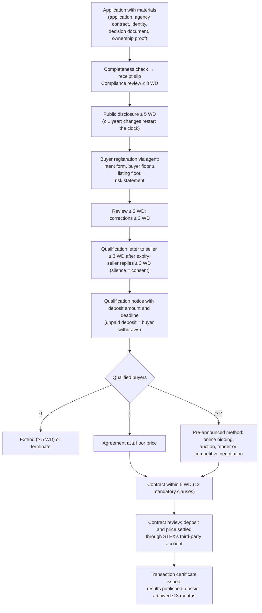
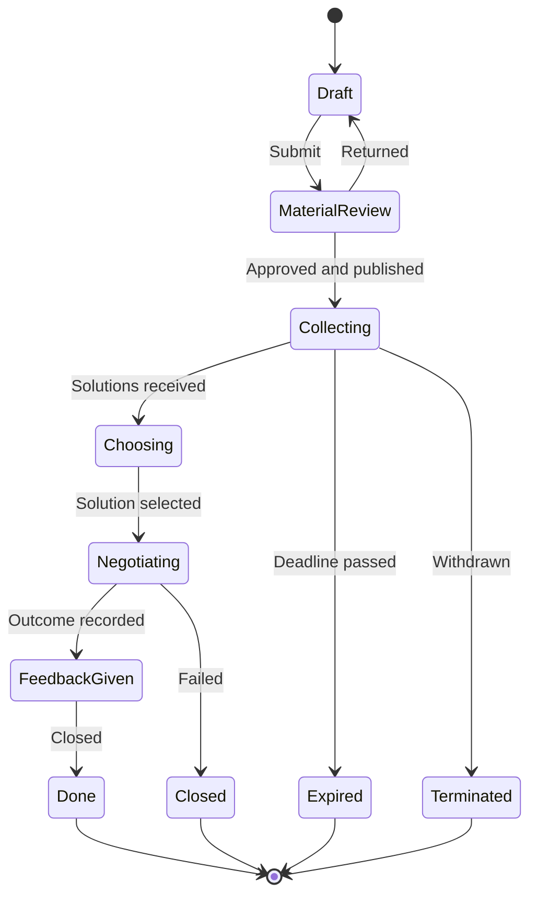
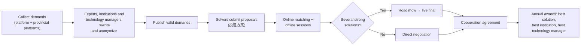

# 09 — Reference Platforms: Real Features, Rules and Architecture

> **About this document**
>
> - **Purpose:** Record what the real Chinese technology exchanges and transfer platforms actually do (modules, user roles, business rules with concrete time limits, technology), and derive what our platform must copy, route to partners or do differently.
> - **Audience:** Product owner, business analysts, architects, and the founders deciding the market position.
> - **Status:** Research findings (October 2026). Requirements derived from them are numbered in [10 — Product requirements](10-product-requirements.md).
> - **Method:** STEX's official site blocks automated access from outside China, so its operating rules were read from **Internet Archive (Wayback Machine) copies** of the official pages and from its live bidding system `bid.stte.com`. Other facts come from government documents, official notices and news sources, listed per section.
> - **Rule numbers:** "STEX rule 82" means the rule text published at `www.stte.com/articles/82`; the number is the page number on STEX's website, not an official article number. The rules used are listed in §2.
> - **Confidence labels:** **V** = verified from the source text · **E** = from a search-engine extract of the official page · **I** = inference or typical practice.
> - **Previous:** [08 — China operating model](08-china-operating-model.md) · **Next:** [10 — Product requirements](10-product-requirements.md) · **Index:** [README](README.md)

---

## Summary

1. **Exchange functions are licensed, and licences are scarce.** In Shanghai, a technology trading venue (技术交易场所) is approved by the municipal government under "total-quantity control, rational layout and prudent approval" (总量控制、合理布局、审慎审批). The rules assign formal listing and bidding, third-party settlement of deposits and prices, rights-registration certificates (技术权益登记凭证) and transaction certificates (交易凭证) to licensed venues as their duties (细则 Art. 11, V). This document calls them **venue functions**. That a platform without a venue licence may not perform them follows from the national clean-up rules on trading venues (国发〔2011〕38号); applying those rules to our platform is a legal-validation item (D-03).
2. **Recommended position:** a **matching and service platform** (like NETC/InnoMatch) that is also a **registered practising agent** (执业类交易服务机构) of a licensed venue. Formal listing, bidding, settlement and certificates are executed through STEX (or CTEX) as the venue ([08 §1.3](08-china-operating-model.md)).
3. **STEX's rules are detailed and time-boxed.** Most steps have a working-day (WD) limit: reviews within 3 WD, disclosure of at least 5 WD, contract within 5 WD, losing bidders' deposits refunded within 3–5 WD. Online bidding uses a timed phase (at least 10 minutes) and a continuous phase of rolling cycles (at least 60 seconds each). Our workflow engine needs a **working-day calendar** that follows China's official holiday and make-up-day schedule (调休).
4. **InnoMatch is demand-driven.** Demands are rewritten by experts and technology managers, anonymized, and answered through "揭榜" (solution submissions). Every demand must get a response. Technology managers earn **points** and rewards. Matching runs online and offline, with challenges and an annual EXPO.
5. **Universities need specific tools.** Negotiated prices for service inventions require a **public notice of at least 15 days**. In Shanghai, publishing the notice **both in the university and on a technology trading market** lets staff rely on the due-diligence exemption (尽职免责) if the result's value later changes. Inventor rewards, ownership grants (赋权) and open licensing (开放许可) have their own notices and rules.
6. **The tech stacks are conventional.** InnoMatch: Vue 3 SPA, REST API with WebSocket, SMS/WeChat login, multi-tenant configuration. STEX: Nuxt 3 portal, a separate bidding system with CA-certificate login, and BI dashboards. CTEX: CMS plus its own blockchain evidence service.

---

## 1. The regulatory frame: Shanghai technology trading venues

Source: 《上海市技术交易场所管理细则》 (沪科规〔2025〕2号), in force 1 May 2025 – 30 April 2030 (V). Full analysis in [01 §1.3](01-shanghai-landscape.md).

| Rule | Content | Consequence for us |
| --- | --- | --- |
| Approval (Art. 6) | New venues need STCSM review, public notice and municipal approval under total-quantity control; no trading while preparing | Becoming a venue is a long, uncertain path, so plan the agent route |
| Changes (Arts. 7–8) | Trading products, modes, rules or major shareholders need consent; senior-manager changes filed within 10 WD | Venue partners change slowly, so build stable integrations |
| Duties (Art. 11) | Rules publication, rights registration, transaction certification, disclosure, notices for university transfers, valuation, settlement, supervision of service institutions, mediation, participant suitability, internal controls | The partner venue performs these; we prepare complete, correct submissions |
| Money (Art. 12) | Third-party settlement through a bank or licensed payment institution, segregated client accounts | Never hold deposits or prices in our own accounts |
| Evidence (Art. 13) | Certificates support ownership transfer, diligence exemption, negotiated pricing, inventor rewards, judicial appraisal, technology-contract registration | Our deal records must link to the venue's certificate numbers |
| Reporting (Arts. 16–17) | Monthly, quarterly and annual reports to STCSM | Provide exports in the venue's format |

Formal auctions also require a **licensed auction house** under the Auction Law. STEX's own auction rule uses a three-party agreement: seller, agent and auction house.

National background: the State Council decision on cleaning up trading venues (国发〔2011〕38号) restricts the use of "交易所" (exchange) in names to approved venues and bars unapproved venues from centralized trading methods. Shanghai's 2025 rules implement the city's trading-venue measures (《上海市交易场所管理暂行办法》, 沪府规〔2025〕2号). Consequences for the product: [08 §1.1](08-china-operating-model.md).

---

## 2. Shanghai Technology Exchange (STEX, 上海技术交易所)

STEX rules used in this section. Most are provisional (暂行) rules; the texts were read from 2024 Internet Archive copies (links in Sources), so check for newer versions before relying on them in production.

| Rule | Chinese title (published) | Subject |
| --- | --- | --- |
| 81 | 发布交易信息操作细则（暂行） (2020-10-20) | Publishing listing information: disclosure periods, extensions, suspension |
| 82 | 登记受让意向操作细则（暂行） (2020-10-20) | Buyer registration and qualification through an agent |
| 83 | 组织交易签约操作细则（暂行） (2020-10-20) | Outcome by number of buyers; contract signing; mandatory clauses |
| 105 | 上海技术交易所交易服务机构管理暂行规则 (2020-10-20) | Service institutions: practising agents and professional providers |
| 177 | 上技所企业技术采购细则（暂行） (2021-03-02) | Enterprise technology procurement |
| 179 | 组织交易（在线竞价）实施办法（暂行） (2021-03-02) | Online bidding |
| 180 | 组织交易（招投标）实施办法（暂行） (2021-03-02) | Tender |
| 181 | 组织交易（竞争性谈判）实施办法（暂行） (2021-03-02) | Competitive negotiation |
| 182 | 组织交易（拍卖）实施办法（暂行） (2021-03-02) | Auction |
| 183 | 交易档案管理暂行办法（暂行） (2021-03-02) | Deal archives and retention |
| 184 | 技术供需信息发布操作细则（暂行） (2021-03-02) | Publishing supply and demand information |
| 195 | 技术作价投资入股细则（暂行） (2021-03-02) | Technology contributed as equity |
| 807 | 企业国有产权公开转让交易规则（试行） (2022-11-09) | Public transfer of state-owned enterprise property rights |

### 2.1 User roles

| Role | Description | Source |
| --- | --- | --- |
| Transferor / holder (转让方 / 持有方) | Lists a technology or technical-service capability | V |
| Intended transferee (意向受让方), bidder (竞买人), buyer (受让方) | Registers intent, qualifies, bids, signs | V |
| Procurer / supplier (采购方 / 投标方) | Enterprise technology procurement listings | V |
| **Practising agent (执业类交易服务机构)** | Represents a party; **intended buyers submit through an appointed agent**, who verifies the materials, issues a verification opinion and bears **joint liability** (连带责任). For supply and demand listings, the applicant's agent verifies the applicant's materials with the same liability (rule 184) | V (rules 82, 105, 184) |
| Professional provider (专业类交易服务机构) | Auction, tender, evaluation, audit, legal, financial, patent-agency and consulting firms | V (rule 105) |
| Service-provider registry "科商" (STEX's list of filed technology service providers) | Providers with a 1-year filing period and service tags (finance, IP, incubation, media, technology transfer) | V |
| Regional members (服务生态网, "service ecosystem network") | Regional technology markets joining STEX's network | V |
| Back-office staff in the bidding system | Ten roles: administrator, intake, first review, second review, settlement, settlement review, media publisher, certificate issuer, certificate reviewer, certificate printer | V |

**Becoming a practising agent** (rule 105, V):

| Requirement | Value |
| --- | --- |
| Legal form | Independent legal entity, domestic or foreign (technology-transfer, asset-management, investment, consulting firm…), with sound organization and financial management |
| Age and capital | Registered **≥ 2 years**, registered capital **≥ RMB 1 million** |
| People | **≥ 2 practitioners** recognised by STEX; experience in technology and equity transactions; fixed premises |
| Integrity | No major violations, dishonesty records or administrative penalties in the last **24 months** |
| Process | STEX review within **7 WD** → cooperation agreement within **15 WD** → fee → certificate |
| Ongoing | Annual review (July); missing two consecutive reviews means exit; changes (legal representative, capital, owners, key staff, litigation) reported within **10 WD**; sanctions: public notice (通报), suspension of services or termination |

Professional providers (专业类) must meet the same age, capital and practitioner thresholds (rule 105). A newly formed company therefore cannot become an agent for its first two years ([08 §1.3](08-china-operating-model.md)).

### 2.2 Products

| Product | What it is | Source |
| --- | --- | --- |
| Formal listing (正式挂牌) | Target, method and floor price fixed; public disclosure; buyer registration; competition if several buyers | V |
| Intent listing (意向挂牌) | Scope, price or method still open; STEX publishes and collects interest | V |
| Private agreement (非公开协议成交) | Deal agreed beforehand; STEX provides certification, settlement and the certificate | V |
| Transfer notice (科技成果转化公示) | Public notice for negotiated prices of universities, institutes and hospitals; STEX issues a no-objection certificate (公示无异议证明) | V |
| Rights registration (技术权益登记) | For results and for technical-service capability | V |
| Enterprise technology procurement | Companies publish technology needs as procurement listings | V |
| Equity contribution (作价投资) | Technology contributed as equity, with dedicated rules | V (rule 195) |
| Evaluation products | 16 products, including patent grading (> 30,000 patents graded) and income-method valuation | V (STCSM 2025) |
| Valuation chain | "Model evaluation + expert price inquiry + market price": big-data model → random expert panel proposes a price range → floor price → market decides | V |
| Technology finance | IP-pledge loans "技知融" (> 600 firms, ¥3.285 bn credit); "one price, two certificates" pledge loans | V |
| Open licensing | STEX acts as Shanghai's IP operation trading platform for open licences | V |
| Special boards (专板) | Green technology, biomedicine, agriculture, meteorology, popular science, digital IP | V |
| "科技成果 + 认股权" | Listed under the national trading venue (STEX) in STCSM's 2024 report: product launched and first deal in China completed | V (STCSM 2024 report) |
| IP forensic appraisal | Trade-secret, patent, copyright and trademark appraisal for courts | V |
| Cross-border | STEX cross-border technology trade centre in Lingang, 19 overseas nodes | V |

### 2.3 The listing-to-certificate pipeline

STEX's bidding system page says the system has **21 processes** and names 20 of them: pre-disclosure → transfer application → media release → buyer registration → bid application (举牌申请) → deposit in → listing withdrawal (撤牌) → buyer qualification → result entry → winner deposit in → price in → contract approval → fee setting → buyer fee in → certificate generation → price out → seller fee out → buyer fee out → result publication → archiving (V). "In" and "out" are payments into and out of STEX's settlement account.

The main path for a formal listing (rules 81, 82, 83, 183, 184):

**Disclosure content** (rule 81, V): basic facts of the target · deal terms · buyer qualifications · material information · competitive method · deposit settings · start and end dates. Real listings add board tags, technical field, the holder's economic type, an applicant commitment letter (申请方承诺函), and for licences the **entry fee + royalty + milestone** structure. Example listing: "the notice period is the due-diligence period" (公告期即尽调期).

**Other rules on the path** (V):

- During disclosure, an intended buyer may inspect the listing materials after giving basic identity proof and a written confidentiality undertaking (rule 81).
- The seller may not change the announcement during disclosure without STEX approval; a change restarts the period. Without a qualified buyer the seller may extend by at least 5 WD at a time; an announcement with no qualified buyer 12 months after first publication ends (rule 81).
- Two or more parties may register jointly as a consortium (联合受让) with stated shares and joint liability, unless the announcement excludes it (rule 82).
- An unqualified buyer may object within 3 WD; the seller re-checks within 5 WD (rule 82).
- An applicant that uses STEX as its **exclusive channel** may not trade off-exchange, or it is liable for breach (rule 184).
- If a contract needs government approval (for example anti-monopoly or technology import/export review), the parties apply and STEX issues the supporting transaction evidence (rule 83).

**Twelve mandatory contract clauses** (rule 83, V; the rule says "including but not limited to"): project name · scope and requirements · parties · trading mode · price, payment method and terms · conditions for effect · handover · confidentiality · dispute resolution · liability for breach · amendment and termination · other matters. Patent contracts must also state the patent name, applicant/patentee, filing date, application number, patent number and validity.

### 2.4 Competitive methods

| Method | Key rules | Source |
| --- | --- | --- |
| **Online bidding** (在线竞价) | Seller files a bidding plan for STEX review. Valid bidders receive a password slip. **Multiple-round mode** (多次报价): first bid ≥ floor, raises in integer multiples of the increment; a **timed phase** (定时报价, normally ≥ 10 minutes; no valid bid ends the bidding), a **continuous phase** of rolling cycles (连续报价, each cycle normally ≥ 60 seconds; a new bid restarts the cycle, a cycle without bids ends bidding), or timed then continuous. **One-shot mode** (一次报价): sealed bid, not below the listing price; highest wins, a tie goes to the earlier bid. If a holder of a statutory pre-emption right exercises it, the highest bidder makes one more bid above the top price, and that final price is the exercise price. The seller and its agent keep bidder names and numbers confidential. Contract within 5 WD of the result | V (rule 179) |
| Example listing (a 2026 disposal of scrapped equipment, not a technology deal) | Deposit ¥2,000 from a company account (no personal accounts); timed phase, then 5-minute cycles; increment ¥100 multiples, max ¥1,000 per raise; no raising against your own top bid; deposit forfeited if the winner withdraws or does not sign within 5 WD | V (bid.stte.com) |
| **Auction** (拍卖) | Seller, agent and a licensed auction house sign a three-party agreement before STEX accepts the application; notice in provincial-level (or higher) economic or financial media and on STEX; 2 or more bidders → auction; 1 bidder → deal per the notice; 0 → extend or terminate; losing deposits refunded **≤ 5 WD** | V (rule 182) |
| **Tender** (招标) | May be run by a tender agent (招标代理机构); deposit **≤ 30%** of listing price; **≥ 10 WD** to prepare bids; evaluation panel of 5 or more (odd number), seller representatives ≤ one-third; evaluation ≤ 3 WD after opening; contract ≤ 3 WD after award; losing deposits refunded ≤ 3 WD | V (rule 180) |
| **Competitive negotiation** (竞争性谈判) | Odd-sized panel of seller representatives and experts, **≥ one-third experts drawn at random** from the expert pool (for complex projects the seller may propose experts, with STEX approval); negotiations normally within 20 WD; signed minutes per session; final quotes; panel report ≤ 5 WD after final quotes (majority decides) | V (rule 181) |
| **Enterprise procurement** (企业技术采购) | Publication ≥ 20 WD (maximum 1 year); bid bond ≤ 2% of budget; discriminatory conditions forbidden (e.g. naming a brand, trademark, patent or supplier); both sides pay STEX's service fee within 5 WD of signing | V (rule 177) |
| **State-owned enterprise property rights** (企业国有产权公开转让) | Pre-disclosure ≥ 20 WD when control of the company changes; formal disclosure ≥ 20 WD; buyer conditions discouraged and, if set, filed with the state-assets regulator before disclosure; first floor price ≥ the approved or filed valuation, relisting ≥ 90% of it without further approval; deposit ≤ 30% of floor; instalments with ≥ 30% down within 5 WD, the rest secured and paid within 1 year; certificate ≤ 3 WD after price and fees arrive | V (rule 807) |

### 2.5 Archives

One dossier per deal, filed within 3 months of completion. Retention: **permanent** (landmark deals), **20 years** (normal deals), **10 years** (qualification files), **5 years** (valuation reports). Paper and electronic copies are kept in parallel, and electronic access requires authentication and permission control (rule 183, V).

### 2.6 Fees (benchmarks)

STEX's general fee schedule could not be found. Its rules only say that fees follow "STEX's charging standard". Published data points:

| Venue | Fee | Source |
| --- | --- | --- |
| STEX (one bidding listing: a 2026 disposal of scrapped equipment, not a technology deal) | Buyer pays a service fee of 5% of the deal price within 3 WD of contract signing | V (bid.stte.com) |
| Tianjin technology trading platform (2021) | Seller, tiered cumulative: **2%** up to ¥1 M · **1%** ¥1–10 M · **0.5%** ¥10–100 M · **0.3%** above ¥100 M; minimum ¥2,000. Buyer ≤ 5%. Bidding service fee ≥ 5%, minimum ¥5,000 per side. Notice and value-added fees separate | V |
| CTEX (one auction listing) | Buyer bidding service fee 10%; fees due within 3 WD of contract signing | E |

### 2.7 Technology hints

| System | Observed technology | Source |
| --- | --- | --- |
| Portal (2025 redesign) | Nuxt 3 server-rendered app ("TEIntegratedPortalPlatform"), Pinia, Tencent Maps, Baidu Analytics; built by STEX Digital Technology Co. | V |
| Bidding system `bid.stte.com` | Enterprise login with **CA-certificate USB key + SMS code**; jQuery/Vue 2 front end; back office with 20 named processes and maker-checker roles (§2.3) | V |
| Data and BI | FineReport/FineBI market dashboards; a "trading index" | V |
| Product to regions | White-label "技术交易信息化综合服务平台" (cockpit, data middle platform, core trading system, SaaS) sold to regional governments | V |

STEX is therefore both a **potential partner** (venue functions) and a **potential competitor** (regional platforms).

---

## 3. NETC and InnoMatch (国家技术转移东部中心 / 全球技术供需对接平台)

### 3.1 Model

"**One platform, one expo, one challenge**" (一平台一展一赛): the InnoMatch platform, the InnoMatch EXPO / Global Technology Transfer Conference, and the innovation challenge. NETC calls itself a "fourth-party platform" combining trading, technology finance and incubation (V).

Scale (official figures):

| Metric | Value | Source |
| --- | --- | --- |
| NETC signed deals facilitated, 2024 | **≈ ¥4.2 billion** (近42亿元) | STCSM 2024 report (V) |
| NETC signed deals, cumulative | **≈ ¥40 billion** (近400亿元); 44 domestic outlets, 11 international channels | STCSM 2024 report (V) |
| InnoMatch, cumulative to June 2024 | 4,395 demands; 3,295 results; match rate > 60%; ¥5.239 bn intended deals; 18,569 technology-manager participations | STCSM reply 沪科建复〔2024〕43号, 5 Jun 2024 (V) |
| InnoMatch, cumulative to end-2024 | 6,468 demands; 4,390 results; 3,015 solutions; 313 deals worth ¥778 M; 2024 alone: 595 matching intentions, > ¥3.4 bn intended | STCSM 2024 report (V) |
| InnoMatch, cumulative to June 2025 | ≈ 30,000 users; > 6,600 demands; ≈ ¥800 M signed and implemented | STCSM reply 沪科建复〔2025〕38号, 25 Jun 2025 (V) |
| InnoMatch platform, August 2022 to 2023 | 2,617 demands from 1,385 firms; 581 solved; match rate up from < 20% to 46% | STCSM reply 沪科提复〔2023〕49号 (V) |

### 3.2 Roles

Demand side (enterprises; about 60 large firms run open-innovation zones) · solution providers / challengers (anyone, including individuals) · **technology managers** (certified on the platform; break down demands; earn points and rewards) · service institutions (302 participating by mid-2024) · **experts** (certified profiles; sign an NDA and disclaimer) · investors · organization showcase pavilions (品牌馆) · administrators (permissions, data scopes, tenants, points rules, period close) (V).

### 3.3 Modules

Libraries (demands, results, SME products, talent demands, cases, experts, videos, news) · smart matching (similar demands, results, firms, patents, experts and managers; "show another batch"; message push) · workbench (my demands, results, matches, pavilion, business card, follows) · challenge campaigns with sub-tracks · **points** (rules, withdrawable points, period close; doubled during challenges) · deal signing and evaluation · online EXPO (exhibitors, registration, livestreams) · community and instant messaging · analytics (industry-chain maps, enterprise and patent ratings) · translation, venue booking, contract square (V).

### 3.4 Demand and solution state machines

Demand fields: overview, technical parameters, expected outcomes, budget in units of ¥10,000 or "negotiable" (面议), deadline countdown. Solutions move draft → review → accepted / not accepted → feedback → signed / matched / failed (V).

### 3.5 Challenge (揭榜) flow

Rules worth copying (V): every demand must receive a response; all participants sign an NDA and a disclaimer; there is a complaint and dispute channel. Example money rules (China Innovation Challenge, Shanghai 2019): prize money for a challenger who solves a demand is in principle paid by the demander, and the prize cannot be made a condition of a transfer, licence or other exclusive cooperation; the organisers separately award ¥100k to each of 5–10 "outstanding challengers" chosen through roadshows, and ¥2,000 to a service institution for each candidate solution the company finds feasible; basic search and matching services are free during the challenge.

Yangtze River Delta "揭榜挂帅" bounty projects set eligibility thresholds: demander revenue ≥ ¥200 M, R&D ≥ 5%, external bounty ≥ 30% of the budget and ≥ ¥2 M. When a demand is published, the demander's identity may be withheld at its request (2023 challenge notice, V).

### 3.6 EXPO and vouchers

- EXPO model "**1 + 3 + 365**": one online platform, three days on site, 365 days of matching. The 2025 EXPO released > 10,000 demands, waived booth fees for firms with revenue ≤ ¥200 M, and runs a "conversion clinic" that has, since its launch, handled 374 projects, moved 19 to pre-proof-of-concept and supported 10 company formations (cumulative figures, E).
- Shanghai **innovation vouchers** (科技创新券): cover 50% of approved service fees, up to ¥300k per firm (¥100k per team) per year. The firm orders the service on the voucher platform first; after delivery the service provider files the contract, invoice, payment proof and results; vouchers are paid quarterly. Proof-of-concept services were added to the voucher catalogue in August 2026 (V).

### 3.7 Technology hints

Vue 3 + Vite + Tailwind single-page apps; REST API plus WebSocket (`/cable`); **multi-tenant configuration**; login by SMS, password, WeChat or e-mail; AMap; an IM SDK; Huawei Cloud OBS and OSS storage. STCSM describes demand "technology portraits" (技术画像) and a self-built matching tool (V; backend framework inferred, I).

---

## 4. Other reference platforms

| Platform | What is worth copying | Source |
| --- | --- | --- |
| **CTEX 中国技术交易所** (Beijing) | "5 categories, 19 services" (registration, trading, finance, consulting, regional services). Open-licence platform (> 2,500 patents). Roadshow livestreams. Disposal of pledged IP. Rules (2023): disclosure **≥ 10 WD**, total ≤ 12 months, deposit ≤ 30% of floor price. The 2020 technology-transfer rules allowed instalments with **≥ 30% down**, rest within 1 year; certificate within 3 WD of funds and fees arriving; payout within 5 WD of the seller's request. Blockchain evidence service "链证中国" with national (SM) cryptography and National Time Service Center timestamps (2025) | E (rules) / V (链证中国) |
| **Zhejiang online technology market** (浙江科技大市场, "浙江拍") | Province–city–county federation (11 cities, 90 counties); 316 service institutions; 350 brokers (a contribution-point system was announced in 2022 as a planned measure); negotiated, listed and auction trades recorded on-chain; livestream auctions with Taobao; insurance for pilot tests and "use first, transfer later"; a county model: collect local demand → result pool → auction, with a 20% buyer subsidy. Auction premiums typically 16–48% | V |
| **China Innovation Challenge** (中国创新挑战赛, MOST Torch) | Demand mining with a survey form → **demand analysis report** → publish (demander may be hidden) → targeted push to likely solvers → expert first and final selection → cooperation agreement → **live final only when competition is strong**; prizes paid in principle by the demander; NDA and disclaimer mandatory | V |
| **Ningbo / Jiangsu challenges** | Live final needs ≥ 3 teams; contract with the winner within 2 months; staged subsidy (40% / 80% / rest). Jiangsu: find → publish → respond → compete → track results; weekly online auction days, real-name verification before bidding | V |
| **科易网** (Xiamen) | Online contract drafting, payment and clearing, delivery of technical files, evidence preservation and acceptance; builds and operates > 55 local-government platforms; revenue reportedly ≈ 90% government contracts | V / reported |

---

## 5. National and university rules the platform must support

| Topic | Rule | Source |
| --- | --- | --- |
| Negotiated pricing notice | Result name and proposed price publicly notified **≥ 15 days**, with an objection procedure | 国发〔2016〕16号 (V) |
| Shanghai diligence exemption (尽职免责) | Staff are not held liable for a later change in the result's value when the price was set by listing or auction on a technology market, **or** when a negotiated price was notified **both in the unit and on a technology trading market**. Written for the city's reform-pilot units; other public research units may follow it | Shanghai guideline 2023 (V) |
| University notice template (example: Fudan) | Notice number; results with application numbers; inventor count; mode; named assignee; price; valuation firm and value; payment terms; 15-day window; real-name written objections; investigation within 10 WD | V |
| Inventor rewards | National: at least 50% of net transfer or licence income (statutory default without a rule or agreement; 国发〔2016〕16号 sets the same floor for state-funded units' own rules). Shanghai: universities and institutes may set at least 70% by rule or agreement. Cash-reward notice of 15 WD including the contract-registration information (Fudan practice) | Law Art. 45; 上海市促进科技成果转化条例 Art. 34; 国科发政〔2018〕103号 (V) |
| Ownership grants (赋权) | Co-ownership or a long-term use right of ≥ 10 years; team agreement → application → approval → notice ≥ 15 days → written agreement; negative list | 国科发区〔2020〕128号 (V) |
| Open licensing (开放许可) | Declaration through CNIPA → publication; implementer gives written notice and pays → licence, then filed. While the open licence runs, the patentee may grant only ordinary (non-exclusive) licences. Not allowed while an exclusive or sole licence is in force, annual fees are unpaid, or the patent is pledged without the pledgee's consent | Patent Law Arts. 50–51; Implementing Regulations (2023) Art. 86 (V) |
| "Use first, pay later" (先使用后付费) | Zero upfront fee, then instalments, milestones or royalties; Beijing pilot: SMEs only, first payment ≥ 1 year after signing or after first revenue | 国知发运字〔2025〕16号; 京科发〔2022〕15号 (V) |
| Patent revitalisation (存量专利盘活) | University patents tagged with conversion intent; companies subscribe and evaluate; CTEX, STEX and the Shenzhen Stock Exchange named as basic, functional trading platforms in a CNIPA notice of 11 September 2024 (E), not in the February plan | 2024 plan (V); CNIPA notice (E) |
| Technology-contract registration | Seller-side registration once, after the contract is formed; written contract; decision within 30 days; gateway to VAT and income-tax relief | 2000 measures (V); revised measures effective 2026-03-01 (see [08 §5.5](08-china-operating-model.md)) |
| Technology-manager credentials | Torch syllabus: junior broker 24 h, mid-level 40 h, senior technology manager 56 h; occupation code 2-06-07-16 (2022 classification); group standard T/CASTEM 1007-2022 | V / E |
| High-tech fields | The 8 national key-supported high-tech fields (国家重点支持的高新技术领域) used as search filters by STEX and expos: electronic information, biotech and new medicine, aerospace, new materials, high-tech services, new energy and energy saving, resources and environment, advanced manufacturing and automation | V (STEX, EXPO forms) |

---

## 6. Gap analysis: our design vs. the reference platforms

| Capability | Reference practice | Our design before this research | Change | Requirements in [10](10-product-requirements.md) |
| --- | --- | --- | --- | --- |
| Market position | Venue functions licensed; agents verify buyers with joint liability | "Exchange later, via licence or partner" | **Agent route** with STEX/CTEX defined as the standard path for formal listing, bidding, settlement and certificates ([08 §1.3](08-china-operating-model.md)) | FR-ORG-06, FR-VEN-01 … FR-VEN-10; D-01 |
| Time limits | Working-day rules everywhere (3/5/10/15/20 WD) | Business-day SLAs only | **Working-day calendar** with official holidays and make-up days; configurable minimum periods per process | FR-ADM-09, FR-VEN-03 |
| Listing types | Formal, intent, private agreement, notice, procurement, licence with entry fee + royalty + milestones | Technology + offers | Add listing types and licence price structure to offers; procurement listings as a demand type | FR-TEC-06, FR-TEC-07, FR-DEM-10, FR-VEN-01 |
| Buyer qualification | Intent form, floor price, risk statement, agent verification, seller confirmation, silence = consent | Introduction requests | Add **buyer registration and qualification** for listing-based deals (via venue) | FR-VEN-04, FR-CMP-03 |
| Competitive methods | Online bidding (timed + continuous), auction, tender, competitive negotiation | Not designed | Model the methods; run binding ones through the venue; competitive negotiation with expert panels can be prepared on the platform as a non-binding step (D-03) | FR-VEN-05 … FR-VEN-07 |
| Demand handling | Expert rewriting, anonymization, every demand answered, solution submissions (揭榜), challenges with live finals | Demand + matching | Add **challenge campaigns**, solution submissions and "every demand answered" SLA | FR-DEM-04 … FR-DEM-09 |
| Technology managers | Certification levels, points, rewards, attribution | Brokers as users | **Technology-manager network**: credentials, assignment, points ledger, attribution | FR-MAT-04 … FR-MAT-08 |
| University tools | 15-day notices, dual publication, reward notices, ownership grants | Partly in 08 | Add **notice module**, inventor-reward notices and grant workflow | FR-UNI-03 … FR-UNI-07 |
| Open licensing and "use first, pay later" | National programmes with templates | Not designed | Add open-licence listings and a deferred-payment licence template | FR-TEC-07, FR-TEC-14 |
| Events | EXPO "1+3+365", roadshows, livestreams, conversion clinics | Not designed | Add **events and roadshows** module | FR-EVT-01 … FR-EVT-05 |
| Evidence | Blockchain or timestamped evidence (CTEX), archives with retention classes (STEX) | Audit trail only | Add **hash-chained evidence** with trusted timestamps, and deal dossiers with retention classes | FR-CMP-02, FR-DEAL-09 |
| Service institutions | Registry with eligibility, annual review, sanctions | Service providers listed | Add onboarding rules, annual review and sanctions | FR-SVC-01 |
| Login for binding actions | CA-certificate USB key + SMS for bidding on the venue's system | SMS + password, MFA for staff | CA-based e-signature for NDAs and contracts (via e-signature provider); binding bids stay on the venue's own system | FR-DEAL-04, FR-INT-05 |

These changes are specified as numbered requirements in [10](10-product-requirements.md).

---

## Sources

Notes, excerpts and saved copies of these sources (with retrieval dates and archived links) are in [`references/`](references/README.md).

- 《上海市技术交易场所管理细则》 (沪科规〔2025〕2号), final text as issued: <https://www.shanghai.gov.cn/nw12344/20250414/7d1e61e9a2de431aa524cb2f817845cf.html>; issued text as a PDF (dated 11 April 2025): <https://stcsm.sh.gov.cn/cmsres/ba/ba7b10fcb800469ea1da3cf19001f714/363919f6ae1bad3c9f21bfacd938b066.pdf>; earlier draft for comment (修订草案征求意见稿): <https://stcsm.sh.gov.cn/cmsres/2e/2e1ef844ae7c4d4d9c500895a2731224/8c48bcc25f6e89782431194ef55fba79.pdf>
- State Council, 国发〔2011〕38号 (clean-up of trading venues): <https://www.gov.cn/zwgk/2011-11/24/content_2002092.htm>
- STEX rules (Internet Archive copies of the official pages): information release rule 81 <http://web.archive.org/web/20240718145342/https://www.stte.com/articles/81>; buyer registration rule 82 <http://web.archive.org/web/20240718134706/https://www.stte.com/articles/82>; signing rule 83 <http://web.archive.org/web/20240718150251/https://www.stte.com/articles/83>; service institutions rule 105 <http://web.archive.org/web/20240624032021/https://www.stte.com/articles/105>; procurement 177 <http://web.archive.org/web/20240624024635/https://www.stte.com/articles/177>; online bidding 179 <http://web.archive.org/web/20240624024414/https://www.stte.com/articles/179>; tender 180 <http://web.archive.org/web/20240624025921/https://www.stte.com/articles/180>; negotiation 181 <http://web.archive.org/web/20240624040825/https://www.stte.com/articles/181>; auction 182 <http://web.archive.org/web/20240624025611/https://www.stte.com/articles/182>; archives 183 <http://web.archive.org/web/20240624040640/https://www.stte.com/articles/183>; supply and demand 184 <http://web.archive.org/web/20240624025334/https://www.stte.com/articles/184>; equity contribution 195 <http://web.archive.org/web/20240624025808/https://www.stte.com/articles/195>; state-owned property rights 807 <http://web.archive.org/web/20240624043919/https://www.stte.com/articles/807>; rule index <http://web.archive.org/web/20240808134107/https://www.stte.com/policies/rules>
- STEX bidding system and listings: <http://bid.stte.com/page/login>; system description (roles and processes) <http://web.archive.org/web/20240624022534/https://www.stte.com/bidding>; products and finance services <http://web.archive.org/web/20240915225228/https://www.stte.com/services/business>; 科商 registry <http://web.archive.org/web/20240915230455/https://www.stte.com/keshang>; example listing <http://web.archive.org/web/20260106060806/https://bid.stte.com/page/s/prjs/real_right/detail?flushResources=true&bshow=true&id=9348>
- Tsinghua PBCSF report on technology exchanges: <https://www.pbcsf.tsinghua.edu.cn/__local/B/5F/10/0DF73D686DF7BCA0F225309ADC3_E1443148_124049.pdf>
- STCSM 2024 report (STEX and NETC figures): <https://stcsm.sh.gov.cn/newspecial/2024jb/pdf/4.pdf>; STCSM replies on STEX evaluation products and InnoMatch: <https://stcsm.sh.gov.cn/cmsres/cd/cdb79143bcd740c492cd553dc3e1068f/beae17a516c40ac89bfa969742331cb1.pdf>, <https://stcsm.sh.gov.cn/cmsres/1d/1d53be21ff5f458c8edddaa63645470f/507c46bece268afb611978ef1082ae12.pdf>
- STEX finance and boards: <https://www.shanghai.gov.cn/nw4411/20240114/9980ba9d32d24f1ebb1fef6fa89ebb9e.html>; <https://news.10jqka.com.cn/20250728/c669930204.shtml>; <https://www.21jingji.com/article/20240104/herald/edbf2e7d6a7dd9bcb883c94fcef44a3f.html>; cross-border centre <https://www.gcs.gov.mo/news/detail/en/N26GAs9Ol2>
- NETC / InnoMatch: MOST <https://www.most.gov.cn/dfkj/sh/tpxw/201505/t20150520_119593.html>; 沪科提复〔2023〕49号 <https://www.shanghai.gov.cn/cmsres/7c/7c113929b0554fe6ab4970f086323048/d73ed26f8aacdc5495cca6611958b8db.pdf>; challenge notices <https://stcsm.sh.gov.cn/cmsres/d0/d062ffde2d544b79aa1f7dae84754591/20d896ae7d332071cffb5b7bd05cfd38.pdf>; 2025 EXPO notice <https://stcsm.sh.gov.cn/cmsres/8f/8fe2403a36d1440daae93500594e5873/44a23419cfc8c3d6de3ee822ac73dd82.pdf>; voucher rules <https://stcsm.sh.gov.cn/cmsres/35/3540a40b98dd4f5bb99e980f3b5d89a2/5e163d54dc89c40c7bea1b267e392b1a.pdf>, <https://stcsm.sh.gov.cn/cmsres/d5/d5dcdec159b0461393d7277f01478d11/eb51a9cce1d4ac1c48d1656cb9dfb80b.pdf>; proof-of-concept vouchers (Aug 2026) <https://stcsm.sh.gov.cn/cmsres/d8/d823d33b395247069042af26c062edbd/99516d8392b607b5dbcc44a65d8ae4c4.pdf>; InnoMatch <https://www.innomatch.net/home>; challenge money rules (沪科合〔2019〕23号) <https://kyc.sues.edu.cn/_upload/article/files/4b/14/4cb347644e3ab9a0a3842377d654/32aba211-60e8-417a-9cca-fd3936c3b402.pdf>
- CTEX: <https://us.ctex.cn/article/aboutus/introduction/>; rules <https://us.ctex.cn/article/rules/202311/20231100140553.shtml>; 链证中国 <https://xian.ctex.cn/article/zyzx/zxdt/202503/20250300151707.shtml>; NCSTI guide <https://www.ncsti.gov.cn/kjdt/ztbd/xzhn_czhh_2021/zhwkjchgzhhshx_2021/202111/t20211123_51800.html>
- Zhejiang: <https://kjt.zj.gov.cn/art/2022/7/19/art_1229514947_43497.html>; <http://www.chinanews.com.cn/cj/2023/12-11/10126595.shtml>; <https://www.most.gov.cn/dfkj/zj/zxdt/202206/t20220621_181204.html>
- Tianjin fee schedule: <https://www.tpre.cn/rule/sfbf/12850.html>
- Technology-contract registration (2000): <https://www.gov.cn/gongbao/content/2000/content_60268.htm>
- 国发〔2016〕16号: <https://www.gov.cn/zhengce/content/2016-03/02/content_5048192.htm>; Shanghai diligence-exemption guideline: <https://www.shanghai.gov.cn/cmsres/55/55e069468cae46ffbb6bf687433e3b30/a4eb2a56b97c478bc7939d63be196a26.pdf>; Fudan notice example: <https://ist.fudan.edu.cn/Data/View/3033>
- 上海市促进科技成果转化条例 (2017), copy hosted by the Shanghai Jiao Tong University School of Medicine TTO: <https://www.shsmu.edu.cn/tto/fj/cjkj.docx>
- Ownership grants, 国科发区〔2020〕128号: <https://www.gov.cn/zhengce/zhengceku/2020-05/19/content_5512908.htm>; patent revitalisation plan (2024), official explanation: <https://www.gov.cn/zhengce/202402/content_6930437.htm>
- Open licensing (Patent Law Arts. 50–51, Implementing Regulations Art. 86), university guide: <https://kyc.bjfu.edu.cn/docs/2024-11/8bd42f89f4fc4ae6ab61fbb733bc28fb.pdf>
- Torch training syllabus for technology managers: <https://www.panjin.gov.cn:803/web12/site/attach/0/b8b9677c95ac4533bfeaa7a3c52de68f.pdf>
