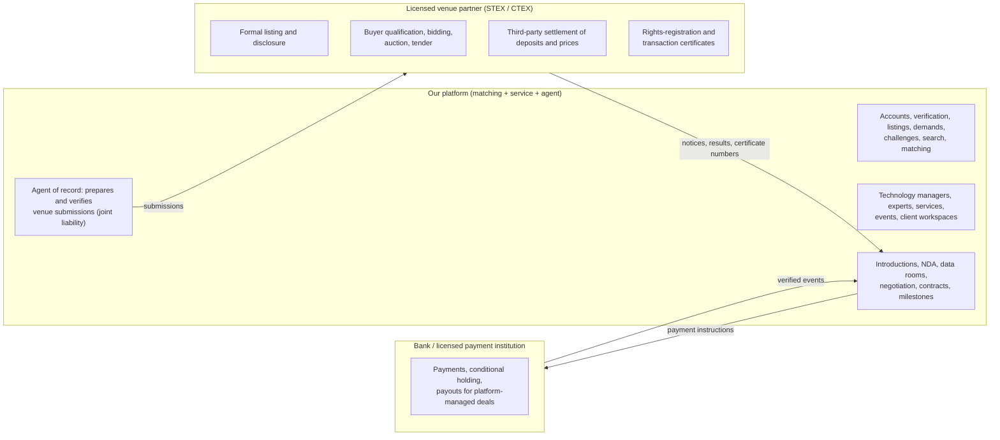
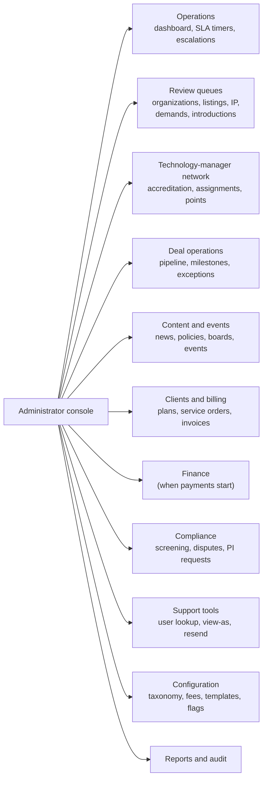
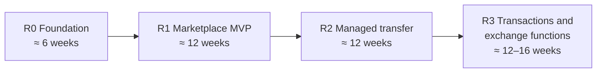

# 10 — Product Requirements Specification

> **About this document**
>
> - **Purpose:** The numbered, testable requirements for the platform, for its **users** (people working on the platform), **clients** (organizations with a contract) and **administrators** (platform staff). Requirements are derived from the real reference platforms ([09](09-reference-platform-features.md)), the operating model ([07](07-roles-workflows-and-money.md), [08](08-china-operating-model.md)) and the system design ([05](05-system-design-blueprint.md), [06](06-implementation-design-v1.md)).
> - **Audience:** Product owner, engineers, QA, operations lead, and client-facing staff.
> - **Status:** Baseline for release planning. Change requirements through the product owner; keep IDs stable.
> - **Target stack:** Node.js 12.4 + MongoDB 4.4 / 5.0 ([11](11-target-runtime-node12-mongodb.md)).

---

## Summary

- **Position:** a demand-driven **matching and service platform** with managed transfer workflows, acting as a **registered practising agent** of a licensed trading venue (STEX or CTEX). Formal listing, binding bidding, settlement and statutory certificates run **through the venue**; the platform prepares, tracks and records them.
- **138 numbered functional requirements** in 17 modules (67 start in R1, 53 in R2, 18 in R3), each tagged with release, reference source and regulatory status. **17 non-functional requirements** have measurable targets.
- **R1 (MVP)** delivers verified organizations, reviewed technology listings with bulk import, demands and basic challenges, Chinese search, public pages, inquiries with contact masking, university public notices, a working-day calendar, notifications, the admin console and audit.
- The rest follows in **R2 (managed transfer and clients)** and **R3 (venue-routed transactions and payments)**, gated by the legal and partner decisions in §12.

---

## 1. Scope, position and conventions

### 1.1 Who does what

### 1.2 Requirement conventions

| Field | Meaning |
| --- | --- |
| **ID** | `FR-<MODULE>-<nn>`; never reused |
| **Rel** | **R1** = MVP marketplace · **R2** = managed transfer and clients · **R3** = venue-routed transactions and payments |
| **Ref** | Where the requirement comes from: section of [09](09-reference-platform-features.md) (e.g. `09 §2.3`), or a design document |
| **Reg** | **L** = needs a licence or a licensed partner (venue, payment, e-signature, auction house) · **C** = compliance obligation, no licence · blank = none |
| Working days (WD) | Counted on the **official China calendar** including make-up working days (调休), provided by FR-ADM-09 |

---

## 2. Who the platform serves

Three groups use the platform. They need different interfaces, permissions and service levels.

| Group | Who | What they pay | What "success" means for them |
| --- | --- | --- | --- |
| **Users** | Individual people acting for an organization: researchers, TTO staff, company R&D managers, technology managers, experts | Usually nothing directly; their organization may be a client | Find the right counterpart quickly; stay in control of confidential information; know the status of every opportunity |
| **Clients** | Organizations with a contract: enterprises (scouting subscriptions), universities and institutes (TTO workspace), parks and governments (programme operation), service providers | Subscriptions, service orders, success fees, programme contracts | Measurable results: qualified candidates, completed transfers, reports they can show to management or authorities |
| **Administrators** | Platform staff: operations, reviewers, technology managers employed by the platform, finance, compliance, support, system administrators | — | Queues under control, no overdue cases, no data incidents, accurate reporting |

### 2.1 Personas

| Persona | Organization | Main goals | Key screens | Frequency |
| --- | --- | --- | --- | --- |
| **Wang, university TTO officer** | University technology-transfer center | Publish the institution's portfolio, run public notices for negotiated prices, track licence income and distribution to inventors | TTO workspace, bulk import, public notice tool, deal workspace, income ledger | Daily |
| **Dr. Li, researcher (inventor)** | University lab | Describe the invention correctly; answer technical questions; see what happens to it | Invention disclosure form, inquiry inbox (read-only for commercial terms) | Weekly |
| **Zhao, R&D manager** | Manufacturing company | Solve a specific technical problem within budget and time; compare candidates; get internal approval | Demand wizard, match review, compare view, evaluation scorecards, deal workspace | Weekly |
| **Chen, startup founder** | Technology startup (supplier and buyer) | Find licensees or partners; license a missing component | Supplier workspace, inquiries, offers | Weekly |
| **Sun, technology manager (技术经理人)** | Independent or employed by a broker / the platform | Take on demands, find and qualify candidates, broker deals, earn commission or points | Broker workspace: queue, candidate search, outreach log, deal pipeline, earnings | Daily |
| **Liu, enterprise innovation director** | Large enterprise (client) | Run scouting programmes, see reports, track pipeline across business units | Client dashboard, scouting projects, reports, team management | Weekly |
| **Zhou, programme manager** | Science park or district government (client) | Run a technology-transfer programme or innovation vouchers, report KPIs to superiors | Programme workspace, applications, voucher ledger, KPI dashboard | Weekly |
| **Expert / service provider** | Evaluation agency, law firm, patent agency | Receive scoped tasks, deliver reports, get paid | Task inbox, quote and delivery forms | As assigned |
| **Platform reviewer** | Platform staff | Verify organizations and listings within SLA | Review queues, checklists | Daily |
| **Operations lead** | Platform staff | Keep every queue moving; spot stalled deals | Operations dashboard | Daily |
| **Finance officer** | Platform staff | Invoices, reconciliation, payouts (when enabled) | Finance console | Daily |
| **Compliance officer** | Platform staff | Export-control screening, disputes, personal-information requests | Compliance queue, case files | As needed |

---

## 3. Functional requirements

### 3.1 Accounts, identity and verification (ACC)

| ID | Requirement | Rel | Ref | Reg |
| --- | --- | --- | --- | --- |
| FR-ACC-01 | Register with a **mobile number + SMS code** (default) or e-mail; accept the versioned terms and privacy policy; store the accepted versions | R1 | 06 §9.2 | C |
| FR-ACC-02 | Log in with SMS code or password; lock the account for 15 min after 5 failed attempts; image CAPTCHA after repeated SMS requests | R1 | 06 §9.2 | |
| FR-ACC-03 | **TOTP MFA mandatory** for platform staff; optional for users; mandatory for organization owners and signatories in R2 | R1 | 06 §9.2 | |
| FR-ACC-04 | One person can belong to several organizations and switch the active organization; permissions follow the active organization | R1 | 05 §5 | |
| FR-ACC-05 | **Verification levels** shown on profiles and used by permissions: L0 registered · L1 phone verified · L2 person real-name verified · L3 organization verified · L4 organization verified with an authorized signatory | R1 (L0, L1, L3) / R2 (L2, L4) | 09 §2.1 | C |
| FR-ACC-06 | Personal real-name verification through a licensed identity-verification provider; store result and level, never raw ID-card images in the main database | R2 | 06 §9.2 | C |
| FR-ACC-07 | Users can export their personal data and request deletion; requests are tracked as compliance cases with deadlines | R1 | 08 §10 D | C |
| FR-ACC-08 | Session list with "sign out other devices"; all sessions revoked on password change or suspension | R1 | 06 §9.2 | |

### 3.2 Organizations, authority and agents (ORG)

| ID | Requirement | Rel | Ref | Reg |
| --- | --- | --- | --- | --- |
| FR-ORG-01 | Create an organization with legal name, type (university, institute, hospital, company, government, service institution…), **unified social credit code**, legal representative, economic type and scale; duplicates detected by credit code | R1 | 09 §2.3 | C |
| FR-ORG-02 | Organization verification case: business licence (OCR in R2), authorization letter (授权委托书) for the applicant, check against the national enterprise credit system; decision with reason; re-check date | R1 | 05 §9.2 | C |
| FR-ORG-03 | Invite members with roles (owner, admin, technology manager, demand manager, deal manager, viewer); invitations expire after 7 days | R1 | 06 §8.2 | |
| FR-ORG-04 | **Delegated authority** records: who may approve disclosure, sign contracts, approve payments, with amount limits, validity and evidence; enforced by every related action | R2 | 07 §2.2, 08 §2.3 | |
| FR-ORG-05 | Organization showcase page (品牌馆): profile, technologies, news, videos, contact form | R2 | 09 §3.3 | |
| FR-ORG-06 | **Agent of record**: a party can appoint an agent organization (agency contract uploaded); the agent can act within the delegated scope and must record a verification opinion with joint-liability acknowledgement on venue submissions | R2 | 09 §2.1 | L (for venue submissions) |
| FR-ORG-07 | Conflict detection: warn when one user acts for both sides of an introduction or deal | R2 | 08 §2.3 | |

### 3.3 Technology listings and offers (TEC)

| ID | Requirement | Rel | Ref | Reg |
| --- | --- | --- | --- | --- |
| FR-TEC-01 | Six-step listing wizard with autosave: basics · technical profile · rights and evidence · commercial offer · disclosure settings · review and submit | R1 | 06 §7.2 | |
| FR-TEC-02 | Bilingual fields (Chinese required, English optional); machine-translation drafts marked "unreviewed" until a person confirms | R1 | 06 §4.2 | |
| FR-TEC-03 | Taxonomy: 8 national high-tech fields, GB/T 4754 industry codes, IPC classes for patents, application tags; controlled by admins | R1 | 09 §5 | |
| FR-TEC-04 | TRL claimed vs assessed (1–9), with evidence per level; GB/T 22900 mapping shown to domestic users | R1 | 04 §8 | |
| FR-TEC-05 | IP assets: type (invention patent, utility model, design, software copyright, IC layout, plant variety, know-how), number, status, holder, encumbrances (licences, pledges); legal-status re-check every 6 months | R1 | 09 §2.3 | |
| FR-TEC-06 | Offers per technology: transfer, licence (exclusive / sole / ordinary), equity contribution (作价投资), joint development, technical service, pilot; territory, field of use, duration | R1 | 09 §2.2 | |
| FR-TEC-07 | Licence price structure: **entry fee + royalty (rate and base) + milestone payments**, or "negotiable"; "use first, pay later" option (no upfront fee, first payment ≥ 12 months or after first revenue) | R1 (structure) / R2 (deferred template) | 09 §2.3, §5 | |
| FR-TEC-08 | **Bulk import** from an Excel template (with validation report per row and cell) for universities and portfolio owners; up to 1,000 rows per file | R1 | 09 §5 | |
| FR-TEC-09 | Holder commitment letter (versioned click-through): clear title, truthfulness, consent to promotion, exclusive-channel clause where agreed | R1 | 09 §2.3 | C |
| FR-TEC-10 | Listing quality score with tips (completeness, evidence, images, bilingual summary); shown to the owner and to reviewers | R1 | 05 §19 | |
| FR-TEC-11 | Review workflow with field-level approval, restricted attachments and decision reasons ([06 §6.1](06-implementation-design-v1.md)); first review **≤ 5 WD** | R1 | 05 §7.1 | |
| FR-TEC-12 | Publication creates a public snapshot, a pre-rendered page and a search entry within 5 minutes; suspension removes them within 5 minutes | R1 | 11 §6–§7 | |
| FR-TEC-13 | **Stale-listing control**: owners must re-confirm every 6 months; reminder at 30 and 7 days; unconfirmed listings are hidden, then archived after 60 days | R1 | 05 §19 | |
| FR-TEC-14 | Open-licence listings: import CNIPA open-licence declarations; eligibility checks (no exclusive licence, fees paid, pledgee consent); licence fee shown; one-click written notice and payment record; reminder to file the licence with CNIPA | R2 | 09 §5 | C |
| FR-TEC-15 | Owner analytics: views, saves, inquiries, introduction requests by industry and region, per listing | R2 | 05 §6 | |

### 3.4 University and institute tools (UNI)

| ID | Requirement | Rel | Ref | Reg |
| --- | --- | --- | --- | --- |
| FR-UNI-01 | TTO workspace: portfolio view of all institutional technologies and patents, status, inventors, offers, deals, income | R1 | 09 §5 | |
| FR-UNI-02 | Inventor disclosure form for researchers; TTO approves before anything becomes a listing; researchers cannot set commercial terms | R1 | 07 §2.2 | |
| FR-UNI-03 | **Negotiated-price public notice** (公示): template with notice number, results and application numbers, inventor count, mode, named assignee, price, valuation firm and value, payment terms; **≥ 15 days**; real-name written objections; 10 WD investigation timer; pause, close or convert to listing | R1 | 09 §5 | C |
| FR-UNI-04 | **Dual publication**: notice embedded on the university's site and published through the venue partner, with the venue's no-objection certificate linked, to support the Shanghai due-diligence exemption | R2 | 09 §5 | L |
| FR-UNI-05 | Pricing-method record for each transfer: negotiated + notice, listing, or auction; evidence attached | R1 | 08 §5.4 | C |
| FR-UNI-06 | Income ledger and inventor-reward calculation (national ≥ 50%, Shanghai ≥ 70%, or the institution's rule); reward notice ≥ 15 WD including the contract-registration number | R2 | 09 §5 | C |
| FR-UNI-07 | Ownership-grant (赋权) workflow: team agreement, application, approval, ≥ 15-day notice, co-ownership share or ≥ 10-year use right with expiry alerts, negative-list screening, annual list export | R3 | 09 §5 | C |
| FR-UNI-08 | Patent revitalisation: tag patents with conversion intent, let companies subscribe and give feedback, report outcomes in the official categories (open, ordinary, sole or exclusive licence, industrialised) | R2 | 09 §5 | |
| FR-UNI-09 | Annual transfer-report export (prior year, by 30 March) | R2 | 09 §1 | C |

### 3.5 Demands, challenges and procurement (DEM)

| ID | Requirement | Rel | Ref | Reg |
| --- | --- | --- | --- | --- |
| FR-DEM-01 | Demand wizard: problem, technical parameters, expected outcomes, hard constraints vs preferences, TRL, route (licence, purchase, joint development, service, investment), budget in ¥10,000 or "negotiable", deadline | R1 | 09 §3.4 | |
| FR-DEM-02 | AI-assisted structuring of free text into the demand form (buyer confirms every field) | R2 | 04 §6 | C (if a generative-AI service is used) |
| FR-DEM-03 | Disclosure levels: anonymous public · verified users only · private (broker-led); buyer identity and budget never public by default | R1 | 05 §7.2 | |
| FR-DEM-04 | **Demand rewriting**: a technology manager or expert writes a demand analysis (需求分析报告) and an anonymized public version; buyer approves before publication | R1 | 09 §3.5, §4 | |
| FR-DEM-05 | Demand state machine: draft → review → collecting → choosing → negotiating → feedback → done, with terminated / closed / expired; closure reason mandatory | R1 | 09 §3.4 | |
| FR-DEM-06 | **Every demand gets a response**: SLA alert if a published demand has no candidate or no staff action within 10 WD | R1 | 09 §3.5 | |
| FR-DEM-07 | **Solution submission (揭榜)**: solvers (organizations or individuals) submit proposals with attachments under NDA; states draft → review → accepted / not accepted → feedback → signed / matched / failed | R1 | 09 §3.4 | |
| FR-DEM-08 | **Challenge campaigns**: campaign pages with tracks, eligibility rules (e.g. revenue, R&D ratio, minimum bounty), deadlines, expert first and final selection, roadshow, live final only with ≥ 3 teams, awards, prize paid by the demander, contract tracking (e.g. within 2 months) | R2 | 09 §3.5, §4 | |
| FR-DEM-09 | Staged subsidy tracker for government-funded challenges (e.g. 40% / 80% / rest) | R3 | 09 §4 | |
| FR-DEM-10 | **Enterprise technology procurement listing**: ≥ 20 WD publication, bid bond ≤ 2% of budget, anti-discrimination checklist (no brand or patent naming), supplier qualification rules | R3 | 09 §2.4 | L (if run through a venue) |
| FR-DEM-11 | Demand owner sees candidates, compares up to 4 side by side, scores them with an evaluation scorecard and records decisions | R1 | 06 §7.3 | |

### 3.6 Search, discovery and public pages (SRC)

| ID | Requirement | Rel | Ref | Reg |
| --- | --- | --- | --- | --- |
| FR-SRC-01 | Chinese and English full-text search over approved public snapshots (Meilisearch), with synonyms maintained by admins | R1 | 11 §6 | |
| FR-SRC-02 | Filters: 8 high-tech fields, industry, patent type, trading mode, TRL, price band, territory, deadline, holder type, badges, board | R1 | 09 §5 | |
| FR-SRC-03 | Saved searches with daily or weekly alerts | R1 | 06 §7.3 | |
| FR-SRC-04 | Result cards show what the technology does, problem solved, TRL and evidence status, available deal types, and open questions; never confidential prices or rights details | R1 | 06 §7.3 | |
| FR-SRC-05 | Pre-rendered public pages per technology and public demand; sitemap; submission to the Baidu push API; canonical URLs | R1 | 11 §7 | |
| FR-SRC-06 | **Special boards** (专板): admin-curated collections (e.g. green and low-carbon, biomedicine, agriculture, AI) with landing pages and board-specific fields | R2 | 09 §2.2 | |
| FR-SRC-07 | Public market data: deal announcements (with consent), counts by field, a simple trading index | R3 | 09 §2.7 | |
| FR-SRC-08 | Search results re-checked against current status and permissions before display; suspended items never appear | R1 | 05 §11.4 | |

### 3.7 Matching and the technology-manager network (MAT)

| ID | Requirement | Rel | Ref | Reg |
| --- | --- | --- | --- | --- |
| FR-MAT-01 | Matching job per demand version: hard filters, text retrieval, scoring with a versioned weighting, explanation per candidate ([06 §10](06-implementation-design-v1.md)) | R1 | 05 §7.3 | |
| FR-MAT-02 | Recommendations: similar demands, technologies, patents, experts and technology managers; "show another batch"; push via in-app message | R2 | 09 §3.3 | C (algorithm-recommendation rules if consumer-facing) |
| FR-MAT-03 | Broker review queue for high-value or uncertain candidates; structured rejection reasons; feedback stored for tuning | R1 | 05 §9.4 | |
| FR-MAT-04 | **Technology-manager registration**: profile, credentials (junior 24 h / mid 40 h / senior 56 h training certificates), fields of expertise, organization; verified by staff | R2 | 09 §5 | |
| FR-MAT-05 | Assignment of demands to technology managers (by field, load and performance); acceptance within 2 WD or reassignment | R2 | 09 §3.2 | |
| FR-MAT-06 | Outreach log per candidate (contact, date, outcome) with attribution of introductions and deals to the technology manager | R2 | 09 §3.3 | |
| FR-MAT-07 | **Points ledger**: configurable rules (actions, multipliers during challenges), period close, statements; conversion to cash only as a contracted fee paid through the payment partner | R2 | 09 §3.3 | L (if points are cashed out) |
| FR-MAT-08 | Commission split rules per deal (platform, technology manager, external agent), applied when a fee is actually received | R3 | 07 §6.5 | |
| FR-MAT-09 | Technology-manager performance dashboard: response time, introductions, deals, client ratings | R2 | 05 §19 | |

### 3.8 Inquiries, introductions, NDAs and data rooms (INT)

| ID | Requirement | Rel | Ref | Reg |
| --- | --- | --- | --- | --- |
| FR-INT-01 | Inquiry and messaging between organizations, threaded per technology or demand | R1 | 07 §3 | |
| FR-INT-02 | **Contact masking** before an introduction is approved: phone numbers, e-mails, WeChat IDs and URLs in messages and attachments' text are masked; a warning explains why | R1 | 09 §2.3 (exclusive-channel) | |
| FR-INT-03 | Introduction request with use case, intended collaboration and information requested; supplier consent required; contact cards exchanged on approval | R1 | 06 §6.3 | |
| FR-INT-04 | Exclusive-channel / off-platform clause where agreed by the holder; breach reports tracked as compliance cases | R1 | 09 §2.3 | |
| FR-INT-05 | NDA templates (mutual, one-way), versioned; signed through the e-signature provider; status verified, never self-declared | R2 | 07 §5 | L (e-signature provider) |
| FR-INT-06 | Data room per deal: per-document grants (view or download), expiry, revocation, **dynamic watermark** with viewer name, organization and time, full access log | R2 | 05 §7.4 | |
| FR-INT-07 | Confidentiality of other buyers: a buyer never sees whether, or how many, other buyers are interested | R1 | 09 §2.4 | |
| FR-INT-08 | Meeting scheduling and minutes (technical calls, demos, sample requests) attached to the introduction or deal | R2 | 07 §3.4 | |

### 3.9 Deals, contracts and dossiers (DEAL)

| ID | Requirement | Rel | Ref | Reg |
| --- | --- | --- | --- | --- |
| FR-DEAL-01 | Deal workspace with parties, stage, manager, timeline, documents, milestones and completion checklist ([06 §7.4](06-implementation-design-v1.md)) | R2 | 06 §6.4 | |
| FR-DEAL-02 | Versioned proposals and counter-proposals; acceptance per party of an exact version; changed terms highlighted | R2 | 07 §4.1 | |
| FR-DEAL-03 | **Contract generator** with the 12 mandatory clauses and patent fields, per deal type (Civil Code categories) | R2 | 09 §2.3 | C |
| FR-DEAL-04 | E-signature with company e-seals through a licensed provider; signatory authority checked against FR-ORG-04; document hash stored | R2 | 08 §5.2 | L |
| FR-DEAL-05 | Contract deadline tracking (e.g. sign within 5 WD of the buyer being fixed) with reminders and escalation | R2 | 09 §2.3 | |
| FR-DEAL-06 | Milestones with deliverables, acceptance criteria, evidence, acceptance or rejection with reason | R2 | 07 §6.4 | |
| FR-DEAL-07 | Regulatory checklist per deal: patent-assignment registration with CNIPA, licence filing, technology import/export review, anti-monopoly filing if applicable; documents linked | R2 | 08 §1.1 | C |
| FR-DEAL-08 | **Technology-contract registration assistant**: registration package (contract, commitments, non-technical cost list), registration number and certified technical income recorded | R2 | 08 §5.5 | L (registration body) |
| FR-DEAL-09 | **Deal dossier**: one per deal, assembled within 3 months of completion; retention class permanent / 20 / 10 / 5 years; access logged | R2 | 09 §2.5 | C |
| FR-DEAL-10 | Royalty schedules, licensee reports, minimum royalties and reminders after the initial deal is closed | R3 | 08 §6.6 | |

### 3.10 Venue-routed transactions (VEN)

These requirements cover listing-based sales that must run on a licensed venue. The platform prepares, submits, tracks and records; the venue performs the regulated steps.

| ID | Requirement | Rel | Ref | Reg |
| --- | --- | --- | --- | --- |
| FR-VEN-01 | Venue submission package for formal listing, intent listing, private-agreement registration and notices: application, agency contract, identity, decision documents, ownership proof, commitment letter; completeness checklist before submission | R3 | 09 §2.3 | L |
| FR-VEN-02 | Disclosure announcement builder with all required fields (target, terms, buyer qualifications, material information, method, deposit, floor price, dates, board tags) | R3 | 09 §2.3 | L |
| FR-VEN-03 | Listing timeline tracking with WD rules: review ≤ 3 WD, disclosure ≥ 5 WD (≥ 10 WD on CTEX), extensions ≥ 5 WD, maximum 12 months; clock restarts after changes | R3 | 09 §2.3, §4 | L |
| FR-VEN-04 | **Buyer registration on behalf of clients**: intent form with buyer floor ≥ listing floor, consortium shares, risk statement, agent verification opinion; corrections ≤ 3 WD; seller confirmation ≤ 3 WD (silence = consent); objections ≤ 3 WD | R3 | 09 §2.3 | L |
| FR-VEN-05 | Outcome router: 0 buyers → extend or terminate; 1 → agreement at ≥ floor; ≥ 2 → the competitive method announced in advance | R3 | 09 §2.3 | L |
| FR-VEN-06 | Competitive-method support: bidding plans for online bidding (timed ≥ 10 min, continuous cycles ≥ 60 s, increments, no self-outbidding, one-shot sealed bids, pre-emption final bid), auction hand-off to a licensed auction house, tender (deposit ≤ 30%, ≥ 10 WD preparation) | R3 | 09 §2.4 | L |
| FR-VEN-07 | **Competitive negotiation on the platform** (non-binding preparation): odd-sized panel, ≥ one-third experts drawn at random from the expert pool, signed minutes, final quotes, panel report ≤ 5 WD | R3 | 09 §2.4 | |
| FR-VEN-08 | Settlement tracking: deposit and price status from the venue (amounts, dates, refunds ≤ 5 WD, instalments with ≥ 30% down); the platform never holds the funds | R3 | 09 §2.4, §4 | L |
| FR-VEN-09 | Certificates: store venue rights-registration, no-objection and transaction certificate numbers and PDFs; link them to deals, notices and reward records | R3 | 09 §1 | L |
| FR-VEN-10 | Venue data interface: import and export listings and status updates with partner venues (API or file exchange), with reconciliation | R3 | 09 §2.2 | L |

### 3.11 Services, experts and valuation (SVC)

| ID | Requirement | Rel | Ref | Reg |
| --- | --- | --- | --- | --- |
| FR-SVC-01 | **Service-institution onboarding**: eligibility (legal entity, years registered, capital, qualified practitioners, clean record), review ≤ 7 WD, agreement, certificate, annual review, change reports ≤ 10 WD, sanctions (reprimand, suspension, termination) | R2 | 09 §2.1 | |
| FR-SVC-02 | Service catalogue: evaluation, valuation, patent search and grading, freedom to operate, legal, technology-contract registration help, pilot testing; priced or "quote on request" | R2 | 09 §2.2 | |
| FR-SVC-03 | Service orders: request → quote → acceptance → delivery → client acceptance → invoice; ratings and complaints | R2 | 05 §7.6 | |
| FR-SVC-04 | **Expert pool**: certified profiles (title, field, honours, proof), NDA and disclaimer signed, conflict-of-interest declaration, random draw for panels, fee records | R1 (pool) / R2 (draw) | 09 §2.4, §3.2 | C |
| FR-SVC-05 | Valuation workflow: quick-valuation request, third-party report upload, expert price-inquiry panel producing a suggested price range | R2 | 09 §2.2 | L (statutory asset appraisal by a licensed appraiser) |
| FR-SVC-06 | Innovation-voucher support: mark voucher-eligible services; export the contract, invoice and payment-proof pack the voucher platform requires | R2 | 09 §3.6 | C |

### 3.12 Events, roadshows and EXPO (EVT)

| ID | Requirement | Rel | Ref | Reg |
| --- | --- | --- | --- | --- |
| FR-EVT-01 | Event pages (roadshow, matchmaking session, training, EXPO) with agenda, speakers, related technologies and demands | R2 | 09 §3.6 | |
| FR-EVT-02 | Registration with approval, capacity and waiting list; QR check-in; reminders | R2 | 09 §3.6 | |
| FR-EVT-03 | **1:1 meeting scheduling** between registered buyers and suppliers during the event, with table and time slots | R2 | 09 §3.6 | |
| FR-EVT-04 | Livestream links and recordings attached to technologies | R2 | 09 §4 | |
| FR-EVT-05 | Signing records and outcome statistics per event ("1 + 3 + 365" follow-up: leads tracked for 12 months) | R2 | 09 §3.6 | |

### 3.13 Clients: enterprise and institutional (CLI)

| ID | Requirement | Rel | Ref | Reg |
| --- | --- | --- | --- | --- |
| FR-CLI-01 | Plans and entitlements (Free, Professional, Enterprise; institutional contracts): seats, private demands, saved searches, scouting projects, API access; limits enforced and visible | R2 | 04 §11 | |
| FR-CLI-02 | **Scouting projects** for enterprise clients: brief, timeline, weekly status, candidate cards with evidence, client decisions, final report | R2 | 04 §12 | |
| FR-CLI-03 | Client dashboard: pipeline by stage, demands, introductions, deals, spend and value; export to Excel/PDF | R2 | 05 §19 | |
| FR-CLI-04 | Team management with approval chains (e.g. a department head approves a demand before publication) | R2 | 07 §2.2 | |
| FR-CLI-05 | **Programme workspace** for parks and governments: programme setup, applications, review, voucher or subsidy ledger, KPI dashboard and report exports | R2 | 09 §3.6 | C |
| FR-CLI-06 | Co-branded portal for an institutional client (subdomain, logo, scoped content); data stays on the shared platform with tenant isolation | R3 | 09 §2.7, §3.7 | |
| FR-CLI-07 | Service orders and subscriptions invoiced with digital e-invoices (数电票); payment status tracked | R2 | 08 §7 | C |

### 3.14 Notifications (NTF)

| ID | Requirement | Rel | Ref | Reg |
| --- | --- | --- | --- | --- |
| FR-NTF-01 | In-app notification centre with unread counts and links to the exact item | R1 | 09 §3.3 | |
| FR-NTF-02 | E-mail and SMS per the matrix in §6; WeChat official-account messages in R2 | R1 / R2 | §6 | C (SMS templates approved by provider) |
| FR-NTF-03 | User preferences per category and channel; security messages cannot be disabled; quiet hours 22:00–08:00 | R1 | §6 | |
| FR-NTF-04 | Delivery status per channel visible to support; failed deliveries retried 3 times with backoff | R1 | 06 §6.5 | |

### 3.15 Administration (ADM)

| ID | Requirement | Rel | Ref | Reg |
| --- | --- | --- | --- | --- |
| FR-ADM-01 | Operations dashboard: queue sizes, SLA breaches, stalled deals (> 10 days idle), failed outbox events and notifications | R1 | §5.2 | |
| FR-ADM-02 | **Maker-checker** on sensitive decisions (e.g. first review / second review for organization verification and venue submissions; certificate recording by one person, approval by another) | R1 | 09 §2.1 | |
| FR-ADM-03 | Review queues with claim, assignment rules (round-robin, skills), checklists, SLA timers and escalation | R1 | 05 §9 | |
| FR-ADM-04 | Configuration without code: taxonomy, synonyms, boards, fee schedules, plan entitlements, notification templates, legal-text versions, feature flags | R1 | §5.1 | |
| FR-ADM-05 | Support tools: user and organization lookup, read-only **view as** (ticket + reason + banner + audit), resend codes and notifications, unlock accounts, merge duplicates with undo window | R1 | §5.3 | |
| FR-ADM-06 | Bulk operations as background jobs with preview, progress and result report (imports, re-index, mass notification) | R1 | §5.3 | |
| FR-ADM-07 | Content management: news, policies (政策), case studies, FAQs, help centre, banners | R1 | 09 §2.2 | C (content moderation) |
| FR-ADM-08 | Sensitive-word and content-moderation checks on public text and messages, with a review queue | R1 | 08 §1.1 | C |
| FR-ADM-09 | **Working-day calendar**: official holidays and make-up working days per year, maintained by admins; all WD timers use it | R1 | 09 §6 | |
| FR-ADM-10 | Staff role management with quarterly access review and automatic expiry of temporary roles | R1 | 06 §4.6 | |

### 3.16 Reporting and statistics (RPT)

| ID | Requirement | Rel | Ref | Reg |
| --- | --- | --- | --- | --- |
| FR-RPT-01 | Funnel report: suppliers, listings, demands, matches, introductions, deals, completed transfers; conversion and time between stages, with failure reasons | R1 | 06 §16 | |
| FR-RPT-02 | Operational SLA report per queue and per staff member | R1 | 06 §14 | |
| FR-RPT-03 | Commercial report: revenue by stream (subscriptions, services, fees), receivables; never mixing deal value with platform revenue | R2 | 03 §1 | |
| FR-RPT-04 | Exports for partners and authorities: monthly, quarterly and annual statistics in Excel; university annual transfer report | R2 | 09 §1 | C |

### 3.17 Compliance, evidence and disputes (CMP)

| ID | Requirement | Rel | Ref | Reg |
| --- | --- | --- | --- | --- |
| FR-CMP-01 | Append-only audit of all state changes, permission changes, confidential access and admin actions, searchable by resource, actor and time | R1 | 06 §4.6 | C |
| FR-CMP-02 | **Evidence preservation**: hash chain over listing snapshots, notices, proposals, contracts and acceptance decisions; optional trusted timestamps or judicial-blockchain anchoring | R2 | 09 §4 | Partner (optional) |
| FR-CMP-03 | Versioned risk statements and commitments (buyer risk statement, holder commitment, notice and commitment) captured per action | R1 | 09 §2.3 | C |
| FR-CMP-04 | Complaints and disputes: ticket, evidence, response deadline, mediation log, escalation, outcome ([08 §8](08-china-operating-model.md)) | R1 (basic) / R2 (mediation) | 08 §8 | |
| FR-CMP-05 | Export-control and cross-border screening flags on technologies and parties; blocks disclosure, signing, delivery and payment until cleared | R2 | 08 §5.3 | C |
| FR-CMP-06 | Retention schedule per record category, legal hold, and deletion jobs with reports | R2 | 08 §10 | C |
| FR-CMP-07 | State-owned asset flags: valuation/filing proof, pre-disclosure and formal disclosure, buyer conditions filed in advance; route to a designated property exchange | R3 | 09 §2.4 | L |

---

## 4. Requirement map by release

```mermaid
flowchart LR
    subgraph R1["R1 — Marketplace MVP"]
        a1["ACC · ORG basics"]
        a2["TEC listings, bulk import,<br/>review, public pages"]
        a3["UNI notices, TTO workspace"]
        a4["DEM demands, rewriting,<br/>solution submissions"]
        a5["SRC Chinese search, filters,<br/>saved searches"]
        a6["INT inquiries, masking,<br/>introductions"]
        a7["ADM console, WD calendar,<br/>maker-checker · CMP audit"]
    end
    subgraph R2["R2 — Managed transfer and clients"]
        b1["MAT technology managers,<br/>points, recommendations"]
        b2["INT NDA, data rooms ·<br/>DEAL contracts, e-sign, dossiers"]
        b3["DEM challenges · EVT events"]
        b4["SVC institutions, experts,<br/>valuation · CLI clients"]
    end
    subgraph R3["R3 — Venue-routed transactions"]
        c1["VEN listing, buyer registration,<br/>competitive methods, certificates"]
        c2["Payments via partner ·<br/>royalties · ownership grants"]
    end
    R1 --> R2 --> R3
```

| Module | R1 | R2 | R3 | Total |
| --- | ---: | ---: | ---: | ---: |
| ACC | 7 | 1 | 0 | 8 |
| ORG | 3 | 4 | 0 | 7 |
| TEC | 13 | 2 | 0 | 15 |
| UNI | 4 | 4 | 1 | 9 |
| DEM | 7 | 2 | 2 | 11 |
| SRC | 6 | 1 | 1 | 8 |
| MAT | 2 | 6 | 1 | 9 |
| INT | 5 | 3 | 0 | 8 |
| DEAL | 0 | 9 | 1 | 10 |
| VEN | 0 | 0 | 10 | 10 |
| SVC | 1 | 5 | 0 | 6 |
| EVT | 0 | 5 | 0 | 5 |
| CLI | 0 | 6 | 1 | 7 |
| NTF | 4 | 0 | 0 | 4 |
| ADM | 10 | 0 | 0 | 10 |
| RPT | 2 | 2 | 0 | 4 |
| CMP | 3 | 3 | 1 | 7 |
| **Total** | **67** | **53** | **18** | **138** |

Counts use the release in which each requirement **starts**; some are completed in a later release (shown as "R1 / R2" in the tables).

---

## 5. Administrator console requirements

### 5.1 Console map

### 5.2 Daily operating routine

| When | Who | Routine |
| --- | --- | --- |
| 09:00 daily | Operations lead | Review the dashboard: queue sizes, items breaching SLA, stalled deals (no activity > 10 days), failed outbox events, failed notifications |
| Morning | Reviewers | Claim cases in priority and due-date order; nothing stays unclaimed for more than 4 business hours |
| Daily | Technology managers | Work the assigned-demand queue; log every outreach; update candidate status |
| Daily | Support | Answer tickets; resend codes or notifications; unlock accounts after identity checks |
| Weekly | Operations lead | Stale listing sweep (§4 TEC requirements), demand follow-ups, technology-manager performance review |
| Monthly | Compliance + security | Access review of staff roles, restore drill, review of audit anomalies |
| Monthly | Management | KPI report (funnel, revenue, SLA) and government programme reports where applicable |

### 5.3 Support tools: rules that keep them safe

- **View as user** is read-only, requires a ticket number and a reason, shows a visible banner, and writes an audit event. It never shows NDA-covered documents unless the staff member holds a case-related grant.
- Corrections to organization or listing data require a reason, and create a new version or a transition record. Nothing is edited "silently".
- Merging duplicate organizations or users is a reviewed operation with an undo window.
- Bulk operations (import, re-index, mass notification) run as background jobs with a preview, a progress view and a downloadable result report.

---

## 6. Notifications

Every notification is defined by an event, its recipients, the channels and the timing. Users choose channels per category in their settings. Security notifications cannot be switched off.

| Event | Recipients | In-app | E-mail | SMS | WeChat (R2) | Timing |
| --- | --- | --- | --- | --- | --- | --- |
| Login code, password reset | User | — | ✓ | ✓ | — | Immediate |
| New login from unknown device | User | ✓ | ✓ | — | ✓ | Immediate |
| Organization verified / rejected | Organization admins | ✓ | ✓ | ✓ | ✓ | Immediate |
| Listing review decision | Technology managers of the owner | ✓ | ✓ | — | ✓ | Immediate |
| Public notice started / ended (university pricing) | TTO officers | ✓ | ✓ | — | — | Immediate |
| New inquiry or introduction request | Supplier's responsible users | ✓ | ✓ | ✓ (if unanswered 24 h) | ✓ | Immediate + reminder |
| New qualified matches | Buyer's demand managers | ✓ | Digest | — | ✓ | Daily digest |
| Saved-search alert | Subscriber | ✓ | Digest | — | ✓ | Daily or weekly |
| Challenge (揭榜) deadline approaching | Registered solvers | ✓ | ✓ | — | ✓ | 7 days and 1 day before |
| Proposal received / changed | Counterparty negotiators | ✓ | ✓ | — | ✓ | Immediate |
| Signature requested | Authorized signatories | ✓ | ✓ | ✓ | ✓ | Immediate + daily reminder |
| Milestone due / overdue | Responsible party, deal manager | ✓ | ✓ | ✓ (overdue) | ✓ | 7 days, 1 day before; on overdue |
| Payment requested / confirmed / payout status (R3) | Payer, payee, finance approvers | ✓ | ✓ | ✓ | ✓ | On provider event |
| Event registration confirmed / reminder | Registrant | ✓ | ✓ | ✓ (day before) | ✓ | Immediate; 1 day before |
| Case assigned / SLA breach | Staff member / their lead | ✓ | ✓ | — | Work WeChat (optional) | Immediate |

Rules: SMS only for time-critical or security events (cost, and SMS template approval in China); quiet hours 22:00–08:00 except security codes; every message links to the exact item; delivery status is stored per channel and visible to support.

---

## 7. Non-functional requirements

Targets for the first production release on the target stack (Node 12.4, MongoDB 4.4/5.0). They are commitments to test against, not marketing claims.

| ID | Area | Requirement | How it is verified |
| --- | --- | --- | --- |
| NFR-01 | Availability | Public site and workspaces ≥ **99.5%** monthly (excluding announced maintenance windows, max. 4 h/month, outside 08:00–22:00 Beijing time) | Uptime monitor every 60 s from two locations |
| NFR-02 | Performance | API p95 ≤ **500 ms** for reads and ≤ **1 s** for writes at 50 concurrent users; search p95 ≤ **300 ms** | Load test before launch and after major releases |
| NFR-03 | Page load | Public technology page first contentful paint ≤ **2 s** on a 4G mobile connection (pre-rendered HTML, compressed assets) | Lighthouse in CI on 3 sample pages |
| NFR-04 | Uploads | Documents up to **200 MB** each, resumable or chunked; PDF, Office, images, ZIP; malware-scanned before access | Integration test with large files and the EICAR test file |
| NFR-05 | Recovery | **RPO ≤ 24 h** at launch (nightly backup); ≤ 15 min once point-in-time recovery is enabled. **RTO ≤ 4 h** | Monthly restore drill with timing recorded |
| NFR-06 | Data residency | All personal data, documents and backups stored in mainland China | Infrastructure inventory |
| NFR-07 | Security | OWASP ASVS level 2 controls for authentication, session, access control and input handling; MFA for all staff; annual penetration test; dependency scan on every build | Checklist + pen-test report + CI scan |
| NFR-08 | Classified protection | System prepared for **MLPS (等保) level 2** filing at launch; level-3 readiness before platform-controlled funds | Gap assessment by a qualified assessor |
| NFR-09 | Audit | Every state transition, permission change, confidential access and admin action is audited; audit records are append-only and retained ≥ 5 years | Automated tests + role check (`texApp` insert-only) |
| NFR-10 | Retention | Transaction information ≥ 3 years after completion (E-Commerce Law); contracts and accounting records per category schedule (longer) | Retention schedule review |
| NFR-11 | Localization | `zh-CN` default and `en`; all UI strings externalized; dates in `Asia/Shanghai`; Chinese sorting by pinyin (full ICU) | i18n lint + ICU test in CI |
| NFR-12 | Browsers and devices | Latest two versions of Chrome, Edge, Safari, Firefox, 360 and QQ browsers; responsive down to **360 px** width; WeChat in-app browser for public pages | Cross-browser test matrix |
| NFR-13 | Accessibility | WCAG 2.1 AA for public pages and core workflows (contrast, keyboard, labels) | Automated axe checks + manual review |
| NFR-14 | Scalability (year 1) | 50,000 published technologies, 10,000 demands, 5,000 organizations, 200 concurrent users without architecture change | Load test with synthetic data |
| NFR-15 | Observability | Structured logs with request IDs; metrics for latency, errors, queue (outbox) backlog, search lag; alerts to the on-call channel within 5 min | Alert test each release |
| NFR-16 | Runtime compatibility | Every dependency passes the Node 12.4 smoke test; code uses only the MongoDB 4.4 feature set | `verification/node12-mongodb/run.sh` in CI |
| NFR-17 | Maintainability | Unit-test coverage ≥ 70% on services and policies; every state machine fully covered by transition tests | Coverage report in CI |

## 8. Integrations (China)

Providers are examples to evaluate, not decisions. Every integration goes through the outbox (no external calls inside database transactions) and has a sandbox, retries, timeouts and an admin view of failures.

| Capability | Purpose | Examples to evaluate | Release |
| --- | --- | --- | --- |
| SMS | Login codes, critical notifications | Aliyun SMS, Tencent Cloud SMS (signature and template approval required) | MVP |
| E-mail | Notifications, digests | Enterprise SMTP service (Aliyun DirectMail, Tencent Exmail…) | MVP |
| WeChat | Official-account template messages, QR login, link previews | WeChat Official Account, WeChat Open Platform | R2 |
| Enterprise information | Check legal name, unified social credit code, legal representative, status | National Enterprise Credit Information Publicity System (manual) at launch; commercial APIs (e.g. Qichacha, Tianyancha) later | MVP (manual) / R2 (API) |
| Personal real-name verification | Verify identity of signatories and representatives | Licensed identity-verification services from cloud providers | R2 |
| Corporate bank-account verification | Prove control of the organization (small-amount transfer check) | Payment partner or bank service | R3 |
| Patent data | Check patent number, holder, legal status | CNIPA public search (manual) at launch; commercial patent databases (e.g. incoPat, PatSnap) later | MVP (manual) / R2 |
| E-signature | Sign NDAs and contracts with company e-seals | Licensed e-signature services (e.g. Fadada, eSignBao, BestSign) | R2 |
| Payments and settlement | Payment requests, conditional holding, payouts | Bank fund-supervision accounts or licensed payment institutions (see [08 §1.2](08-china-operating-model.md)) | R3 |
| E-invoices | Issue platform invoices for services and subscriptions | Digital e-invoice (数电票) through the tax platform or an invoicing service | R2 |
| Search engine submission | Fast indexing of new public pages | Baidu search-resource platform push API; sitemap | MVP |
| OCR | Read business licences and patent certificates during verification | Cloud OCR services | R2 |
| Maps (optional) | Show organization location on profiles | Amap / Baidu Maps | R3 |
| AI models | Demand structuring, translation drafts, summaries | Domestic model providers that have completed generative-AI filing; never send confidential documents without a data agreement | R2–R3 |

---

## 9. Release plan

Indicative plan for **3–4 developers plus a part-time designer, a QA engineer and the operations team**. Durations depend on decisions, design readiness and integrations. Each release ends with a pilot group of real users.

| Release | Scope | Exit criteria |
| --- | --- | --- |
| **R0 — Foundation** | Server survey and target runtime set-up (doc 11), repository and CI with the Node 12 compatibility gate, migrations, authentication (SMS + password, staff MFA), organizations and memberships, audit, admin shell, design system | A staff user and a pilot organization can log in; cross-tenant tests pass; release and rollback rehearsed |
| **R1 — Marketplace MVP** | All **R1** requirements in §3: verification queue, technology listings with review and publication, bulk import, demands, challenges (basic), search, saved searches, pre-rendered public pages, inquiries with contact masking, notifications, content pages, basic reports | 3–5 pilot universities and 10 pilot companies use it; ≥ 300 reviewed listings; review SLA met for 4 weeks |
| **R2 — Managed transfer** | Technology-manager network, matching and broker queues, introductions, NDA and data rooms with watermarks, proposals and negotiation, e-signature, deal workspace and milestones, events and roadshows, enterprise client workspace and scouting projects, institutional (TTO / programme) workspaces, invoices, WeChat notifications | First completed licence or service deals recorded end to end; first paying enterprise client |
| **R3 — Transactions and exchange functions** | Payment-partner integration (requests, confirmations, conditional holding if approved, payouts, reconciliation), listing-based sales with bidding through a licensed venue partner or own licence, technology-contract registration packages, dispute workflow, advanced reports | Legal and payment-partner sign-off ([08 §10](08-china-operating-model.md)); reconciliation runs clean for one month |

---

## 10. User acceptance scenarios

Each release is accepted when these scenarios pass with real pilot users, not only with test accounts.

| # | Persona | Scenario | Pass condition |
| --- | --- | --- | --- |
| UAT-01 | TTO officer | Import 50 technologies from the Excel template, fix the rows flagged as errors, submit them for review | All valid rows become drafts; errors are listed per row and cell; nothing is published before review |
| UAT-02 | Reviewer | Process 20 listing reviews: approve some, request changes on others, restrict one confidential attachment | Decisions recorded with reasons; supplier sees field-level feedback; restricted file never appears publicly |
| UAT-03 | TTO officer | Publish a negotiated-price public notice for a service invention; receive one objection; switch to listing | Notice page live for the configured period; objection recorded; pricing method change audited |
| UAT-04 | R&D manager | Describe a problem in Chinese free text, accept the structured demand, publish it anonymously | Buyer identity and budget never visible publicly; demand searchable by keywords |
| UAT-05 | Technology manager | Take an assigned demand, log outreach to 5 suppliers, shortlist 3, request introductions | Every step timestamped; supplier consent required before identities are shared |
| UAT-06 | Buyer and supplier | Exchange messages before introduction approval | Phone numbers, e-mails and WeChat IDs in messages are masked; after approval, contact cards are shared |
| UAT-07 | Supplier | Grant an NDA-covered buyer access to two of five documents | Buyer sees exactly two; downloads are watermarked with the buyer's name and time; access log complete |
| UAT-08 | Buyer and supplier | Negotiate three proposal versions and sign with e-seals | Only the final version is "agreed"; signed PDF hash stored; signatory authority checked |
| UAT-09 | Enterprise client | Commission a scouting project and receive the report | Report visible only to authorized client users; candidates traceable to evidence |
| UAT-10 | Programme manager | Run an innovation-voucher round: applications, approval, redemption against a service order, KPI report | Voucher ledger balances; report exports to Excel |
| UAT-11 | Support | Use "view as" to diagnose a buyer's problem | Read-only, banner shown, audit event written, no confidential documents visible |
| UAT-12 | Compliance | Suspend a listing after a rights dispute | Removed from search and public pages within 5 minutes; open introductions frozen; owner notified |
| UAT-13 | Operations | Restore yesterday's backup into staging and run smoke tests | Completed within the RTO; data and documents consistent |

---

## 11. Cold start and operations: making the marketplace real

A technology exchange fails if it opens empty. These operational requirements are as important as the software.

| ID | Requirement | Owner | Target (first 6 months, hypotheses) |
| --- | --- | --- | --- |
| OPS-01 | **Supply seeding** through TTO partnerships: bulk import of university portfolios (FR-TEC-08), reviewed before publication | Operations + TTOs | 5 universities, ≥ 1,000 reviewed listings |
| OPS-02 | **Demand acquisition** through technology managers, industry associations and park programmes; every demand rewritten (FR-DEM-04) | Technology managers | ≥ 150 published demands |
| OPS-03 | Monthly **roadshow or matchmaking event** (FR-EVT), alternating industries; quarterly challenge (FR-DEM-08) from R2 | Events team | 6 events, ≥ 30 introductions |
| OPS-04 | Technology-manager network recruited and onboarded (FR-MAT-04); first 20 accredited | Operations | 20 active technology managers |
| OPS-05 | Venue partnership: apply to become a STEX practising agent (requirements in [09 §2.1](09-reference-platform-features.md)), or sign a cooperation agreement with a registered agent | Founders | Decision before R3 |
| OPS-06 | Response discipline: every inquiry answered within 2 WD; every demand acted on within 10 WD (FR-DEM-06) | Operations | ≥ 90% within SLA |
| OPS-07 | Content: weekly policy and case articles; help centre complete for every R1 workflow | Content | 1 article per week |

## 12. Open decisions and dependencies

| # | Decision or dependency | Why it matters | Needed before |
| --- | --- | --- | --- |
| D-01 | **Venue route**: become a STEX (or CTEX) practising agent, partner with an existing agent, or apply for a venue licence | Determines how FR-VEN, FR-UNI-04 and certificates work | R3 design |
| D-02 | Payment partner and product (bank fund supervision, licensed payment institution) and written legal confirmation ([08 §10 B](08-china-operating-model.md)) | Platform-managed payments and payouts | R3 |
| D-03 | Whether non-binding online indications of price (意向报价) on a non-venue platform are acceptable under trading-venue rules | Scope of the platform's own competitive features | R2 |
| D-04 | Internet licensing: ICP filing, and whether an EDI licence is required for paid online transaction services | Public launch | R1 launch |
| D-05 | MLPS (等保) grading level and assessor | Security investment and launch readiness | R1 launch |
| D-06 | E-signature provider; SMS provider; e-invoice service | Introductions, contracts, invoices | R2 |
| D-07 | Fee schedule (benchmarks in [09 §2.6](09-reference-platform-features.md)) and plan pricing | Revenue and client contracts | R2 |
| D-08 | Node.js 12.4 → 12.22.12 upgrade (or accepted risk), and MongoDB 4.4 vs 5.0 ([11 §1](11-target-runtime-node12-mongodb.md)) | Security baseline | R0 |

## Traceability

| Source | Requirements that implement it |
| --- | --- |
| STEX listing and buyer rules ([09 §2.3](09-reference-platform-features.md)) | FR-VEN-01 … FR-VEN-05, FR-TEC-09, FR-CMP-03 |
| STEX competitive methods ([09 §2.4](09-reference-platform-features.md)) | FR-VEN-06, FR-VEN-07, FR-DEM-10 |
| STEX service institutions and agents ([09 §2.1](09-reference-platform-features.md)) | FR-ORG-06, FR-SVC-01, FR-ADM-02 |
| STEX archives ([09 §2.5](09-reference-platform-features.md)) | FR-DEAL-09, FR-CMP-06 |
| InnoMatch demands, solutions and challenges ([09 §3](09-reference-platform-features.md)) | FR-DEM-01 … FR-DEM-09, FR-MAT-02 … FR-MAT-07 |
| InnoMatch EXPO and vouchers ([09 §3.6](09-reference-platform-features.md)) | FR-EVT-01 … FR-EVT-05, FR-SVC-06, FR-CLI-05 |
| University rules ([09 §5](09-reference-platform-features.md)) | FR-UNI-01 … FR-UNI-09, FR-TEC-14, FR-TEC-07 |
| Operating model and money ([07](07-roles-workflows-and-money.md), [08](08-china-operating-model.md)) | FR-ORG-04, FR-DEAL-01 … FR-DEAL-10, FR-CMP-04, FR-CMP-05 |
| System design ([05](05-system-design-blueprint.md), [06](06-implementation-design-v1.md)) | FR-ACC, FR-SRC, FR-MAT-01, FR-ADM, FR-CMP-01 |
