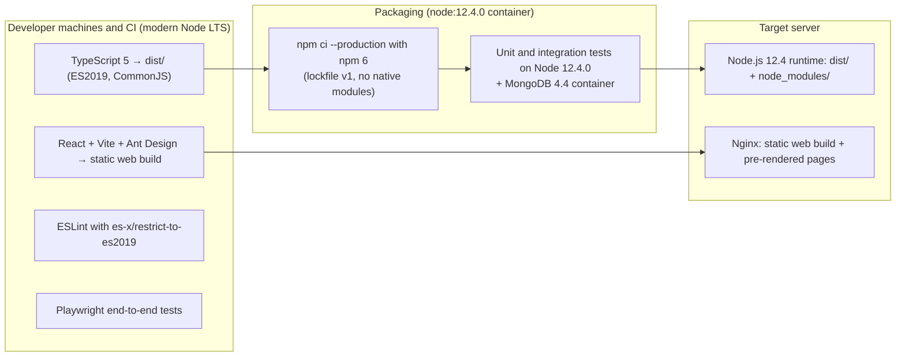
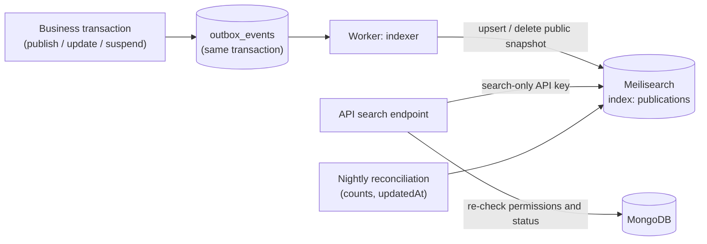
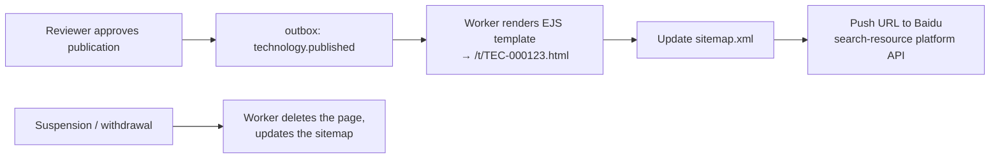
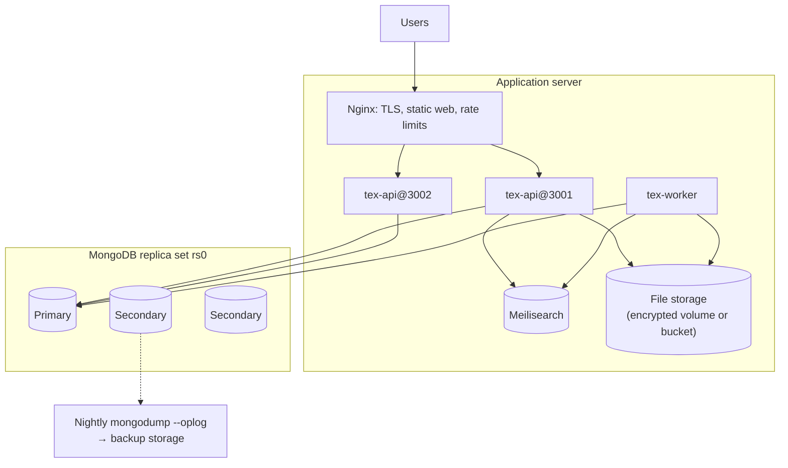
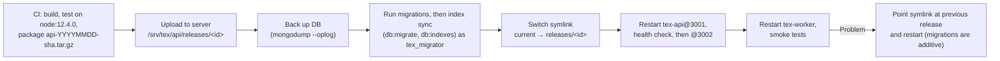
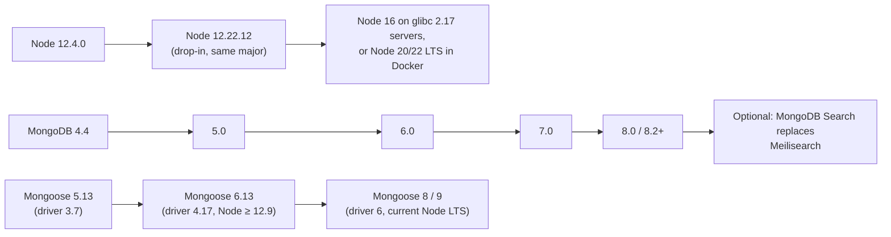

# 11 — Target Runtime: Node.js 12.4 and MongoDB 4.4 / 5.0

> **About this document**
>
> - **Purpose:** Define how the backend is built and operated on the target server stack (**Node.js 12.4** and **MongoDB "about 4.5"**), which libraries are approved, which coding rules apply, how search, SEO and deployment work on this stack, and what the risks and upgrade path are.
> - **Audience:** Tech lead, backend engineers, DevOps and the product owner (for the risk decisions).
> - **Status:** Binding engineering baseline. Every compatibility claim marked *verified* was tested with real binaries by the checks in [`draft-implementation/`](draft-implementation/README.md), the project's draft backend code.
> - **Related:** [06 — Implementation design](06-implementation-design-v1.md) applies these rules to the data model, API and deployment.

---

## Summary

- The design **runs on Node.js 12.4.0 with MongoDB 4.4 and 5.0**, using **Mongoose 5.13** for data access. This was verified in a real run: 34 runtime libraries, the Mongoose models and their database validators, the Document API in multi-document transactions, tenant isolation, the permission policy and Chinese search (90 database checks per MongoDB version).
- **"MongoDB 4.5" is not a production release.** Before 5.0, odd minor versions were development builds. Use **4.4.x** (if the CPU lacks AVX or the OS is old) or **5.0.x**. All code targets the 4.4 feature set, so it works on both.
- Four constraints shape the design:
  1. Data access uses **Mongoose 5.13.23**, which bundles driver **3.7.4**. Mongoose 6+ (driver 4+) needs Node ≥ 12.9.
  2. MongoDB 4.4/5.0 **cannot search Chinese text**, so search runs on **Meilisearch** (verified).
  3. Node 12 ships **English-only ICU**, so `full-icu` is required for Chinese dates and pinyin sorting (verified).
  4. TypeScript must compile to **ES2019/CommonJS**, with modern built-in APIs banned by lint.
- **Both Node.js 12 and MongoDB 4.4/5.0 are end-of-life.** For a platform that will hold trade secrets and coordinate payments, that is a real security and compliance risk. §11 gives compensating controls and an upgrade path. At minimum, move from **12.4.0 to 12.22.12** (same major version, many security fixes).

---

## 1. The target environment

| Stated target | What it is | Consequence |
| --- | --- | --- |
| Node.js **12.4** | Released June 2019. The Node 12 line reached **end-of-life on 30 April 2022**. Bundles **OpenSSL 1.1.1b** (OpenSSL 1.1.1 is end-of-life since September 2023) | No security patches. Missing modern APIs (§4.3). Only older library versions run |
| MongoDB **"about 4.5"** | 4.5 was the development series that became 5.0. Production choices: **4.4.x** (EOL Feb 2024) or **5.0.x** (EOL Oct 2024). Tested: **4.4.30** and **5.0.33** | No MongoDB Search (needs 8.2+). Default write concern differs. Mongoose 5 / driver 3.7 API style |

### 1.1 Server survey: run this first on the target server

```bash
node -v && npm -v                  # runtime actually installed
mongod --version                   # server version and build
cat /etc/os-release                # OS and version
ldd --version | head -1            # glibc: Node 16 needs >= 2.17, Node 18+ needs >= 2.28
grep -o -m1 avx /proc/cpuinfo      # empty output = no AVX = MongoDB 5.0+ will not run
nproc && free -h && df -h          # CPU, memory, disk
nginx -v                           # reverse proxy version (http2 directive syntax, §9.3)
docker --version                   # if Docker exists, the Node version problem largely disappears (§11.2)
```

### 1.2 MongoDB 4.4 or 5.0?

| Question | 4.4.x | 5.0.x |
| --- | --- | --- |
| CPU without AVX instructions | **Only option** | Will not start |
| Default write concern | `w:1` (**must set `w=majority` explicitly**) | `majority` |
| Validation error details | Generic "Document failed validation" | Detailed `errInfo` |
| Support status | EOL Feb 2024 | EOL Oct 2024 |
| Recommendation | Use if 5.0 is impossible | **Prefer** |

All code in this repository uses only 4.4 features, so the team can move from 4.4 to 5.0 without code changes.

---

## 2. Verification results

[`draft-implementation/`](draft-implementation/README.md) reproduces these results with `./run.sh` (Docker only):

| Check | Node 12.4.0 + MongoDB 4.4.30 | Node 12.4.0 + MongoDB 5.0.33 |
| --- | --- | --- |
| 34 runtime libraries load and work (including Mongoose 5.13.23 and `@casl/mongoose` 5.0.0) | PASS | PASS |
| Release steps: `migrate-mongo up` (validators, roles), index sync from the Mongoose schemas, drift check | PASS | PASS |
| Mongoose schemas reject bad data before it is sent (TRL 10, money with fractions, unknown state or field, budget min > max, buyer = supplier, one-party deal…) | PASS | PASS |
| Database validators still reject bad raw writes that bypass Mongoose; unique and TTL indexes hold | PASS | PASS |
| Money stored as BSON Int64, round-trips exactly, serializes as a string | PASS | PASS |
| Optimistic concurrency on `save()`; immutable frozen versions and append-only history | PASS | PASS |
| Document API use cases in cross-database transactions (create, update, submit, revise, discard, list); no partial writes; concurrent edits give one 409 | PASS (25/25) | PASS (25/25) |
| Permission policy (CASL 5) on plain objects and Mongoose documents, `accessibleBy` filters, tenant-scope plugin on every query type | PASS (25/25) | PASS (25/25) |
| Login sessions through the Mongoose connection (`connect-mongo` 3) | PASS | PASS |
| Chinese full-text search with MongoDB text index | **Returns nothing** | (same engine) |
| Chinese full-text search with Meilisearch v1.11.3 | PASS | — |
| Chinese date formatting and pinyin sorting with `full-icu` | PASS (fails without it) | — |

---

## 3. Approved runtime stack

Only these versions may be deployed to the Node 12 runtime. A new dependency is admitted only after it passes `tests/smoke.js` on `node:12.4.0`.

| Layer | Package @ version | Verified on 12.4.0 | Notes |
| --- | --- | --- | --- |
| HTTP server | `express@4.22.3`, `helmet@4.6.0`, `cookie-parser@1.4.7`, `multer@1.4.5-lts.1` | Yes | Express 4 is still an officially supported line |
| Rate limiting | `express-rate-limit@5.5.1` (+ Nginx `limit_req`) | Yes | Edge limits in Nginx; per-user limits in the app |
| Input validation | `zod@3.22.4` | Yes | Same schemas shared with the frontend |
| MongoDB access (ODM) | **`mongoose@5.13.23`** (bundles `mongodb@3.7.4`) | Yes | Schemas, models, Document API, plugins (§5.2); no direct driver use outside the model files |
| Authorization filters | `@casl/mongoose@5.0.0` | Yes | `Model.accessibleBy(ability, action)`; version 5 is the last for Mongoose 5 |
| Migrations | `migrate-mongo@8.2.3` | Yes (CLI `up` and `status` run on 12.4.0) | Validators, roles, data fixes. Bundles driver 4.17, which declares Node ≥ 12.9; it runs only in the release step. Fallback: run migrations from the build machine |
| Passwords | `bcryptjs@2.4.3` (cost 12) | Yes | Pure JS: no native build; argon2 needs Node 14 |
| MFA (staff) | `otplib@12.0.1` (TOTP) | Yes | Required for platform staff |
| Sessions | `express-session@1.18.1` + `connect-mongo@3.2.0` with `mongooseConnection` and `autoRemove: 'disabled'` | Yes | Shares the Mongoose pool; TTL index on `sessions.expires` comes from a migration. HttpOnly, Secure, SameSite cookies |
| Authorization | `@casl/ability@5.4.4` | Yes | RBAC + ABAC policies (06 §8.4) |
| Background jobs | MongoDB outbox + job collection with leases (no Redis); optional `bull@3.29.3` + Redis later | Yes | `bull@4.16.5` **fails** on 12.4 |
| Scheduling | `node-cron@3.0.3` in the single worker process | Yes | |
| Search | **Meilisearch v1.11.3** server, called via `axios@0.34.0` | Yes | Alternative: Elasticsearch 7.17 + IK, client `@elastic/elasticsearch@7.17.14` (loads) |
| File storage | Storage adapter: local encrypted volume (single server), or S3-compatible via `aws-sdk@2.1692.0`, or Aliyun OSS via `ali-oss@6.21.0` | Yes | aws-sdk v2 reached end-of-support Sept 2025 |
| Documents | `pdf-lib@1.17.1` + `@pdf-lib/fontkit@1.1.1` (watermarks with a CJK font), `exceljs@4.4.0` (bulk import/export), `sanitize-html@2.13.1` | Yes | |
| Templates | `ejs@3.1.10` (public page pre-rendering, e-mail bodies) | Yes | Auto-escapes output |
| E-mail | `nodemailer@6.9.16` | Yes | SMS and WeChat via provider HTTP APIs (axios) |
| Logging and metrics | `pino@6.14.0`, `prom-client@14.2.0` | Yes | OpenTelemetry SDK needs Node 14+ |
| Locale data | `full-icu@1.5.0` + `NODE_ICU_DATA` | Yes | Mandatory for Chinese formatting and sorting |
| Utilities | `dayjs@1.11.13` (+ utc and timezone plugins), `uuid@8.3.2` | Yes | |
| Tests (runtime) | `jest@27.5.1` or `mocha@9.2.2` | Loads | Run unit tests on `node:12.4.0` in CI |

**Considered and not selected:** NestJS 8.4.7 runs on 12.4.0. However, it is end-of-life, and `@nestjs/platform-express@8` pins an older Express with known vulnerabilities that npm 6 cannot override (npm 6 has no `overrides`). The backend therefore uses **plain Express with an explicit module structure** (06 §11.4).

**Not approved on Node 12.4.0:** `mongodb` ≥ 4 and `mongoose` ≥ 6 (driver 4 declares Node ≥ 12.9; a basic Mongoose 6.13 transaction test does run on 12.4.0, but outside the declared range; it becomes the next step after the Node 12.22.12 upgrade, §11.2), `@casl/mongoose` ≥ 6 (needs Mongoose 6), `mongoose-long` (works, but silently truncates fractional amounts; a strict `Int64` type is used instead), `bull` 4.16.5 (syntax error at load), `argon2` ≥ 0.28 (Node 14), `minio` ≥ 7.1 (Node 16), `agenda` ≥ 4, NestJS ≥ 10, Next.js ≥ 12, Prisma, recent AWS SDK v3, OpenTelemetry SDK.

---

## 4. Engineering rules for Node 12

### 4.1 Build machine vs. target server

Only the **runtime** is old. Everything else (TypeScript compiler, frontend build, linting, end-to-end tests) runs on a modern Node.js on developer machines and CI.



### 4.2 Compiler and lint settings

```json
{
  "compilerOptions": {
    "target": "ES2019",
    "lib": ["ES2019"],
    "module": "commonjs",
    "moduleResolution": "node",
    "types": ["node"],
    "strict": true,
    "esModuleInterop": true,
    "skipLibCheck": true,
    "outDir": "dist",
    "sourceMap": true
  }
}
```

- Use `@types/node@12`, so the compiler rejects Node APIs that do not exist at runtime. Mongoose 5.13 ships its own typings (they pull in `@types/mongodb@3.6`). They have small gaps, such as missing query hook names, `SchemaType.path` and `Aggregate.model()`; the draft implementation shows the narrow casts used for each.
- 64-bit integers: `BigInt` exists in Node 12 but is ES2020, so the ES2019 lint rejects it. Use the driver's `Long` (`mongoose.mongo.Long`) through the `Int64` schema type.
- TypeScript **down-levels syntax** (`?.`, `??`), but it does **not** add missing built-ins such as `Promise.allSettled`. Enforce this with ESLint `eslint-plugin-es-x` and its `plugin:es-x/restrict-to-es2019` config. CI also runs every unit test on `node:12.4.0`.
- CommonJS only. ES modules are experimental in Node 12.
- No native add-ons (`bcrypt`, `argon2`, `sharp`…), so artifacts are portable across server OS and glibc versions.
- npm 6: commit a v1 lockfile, install with `npm ci`, and choose top-level versions deliberately (npm 6 has no `overrides`).

### 4.3 Missing APIs on 12.4.0 and replacements (verified)

| Not available on Node 12.4.0 | Use instead |
| --- | --- |
| `?.` and `??` syntax | TypeScript compiles them away (target ES2019) |
| `Promise.allSettled` (12.9+) | A small helper in `core/util` |
| `fetch`, `AbortController` | `axios` with `timeout` |
| `crypto.randomUUID` | `uuid` v4 |
| `String.prototype.replaceAll`, `Array.prototype.at`, `Object.hasOwn` | `replace(/x/g)`, index arithmetic, `Object.prototype.hasOwnProperty.call` |
| `fs.rm`, recursive `fs.rmdir` (12.10+) | Explicit file deletion, or a vetted utility |
| `stream/promises` | `util.promisify(stream.pipeline)` |
| Full ICU locale data | `full-icu` + `NODE_ICU_DATA` (without it, `zh-CN` dates print as `10/19/2026` and pinyin sorting is wrong) |

### 4.4 Process model

- Run **two API instances** (`tex-api@3001`, `tex-api@3002`) behind Nginx and **one worker** (`tex-worker`) under systemd (§9.2). This gives zero-downtime restarts and uses two CPU cores without the `cluster` module.
- Set `--max-old-space-size` explicitly (for example 1024 MB) and alert on memory growth.
- Shut down gracefully on `SIGTERM`: stop accepting requests, finish in-flight requests, close the MongoDB client.

---

## 5. MongoDB 4.4 / 5.0 rules

### 5.1 Topology and connection

- A **replica set is mandatory**, even with one node, because transactions require one. Production should use **three data-bearing members** for automatic failover. A single-node replica set is acceptable only for staging, or for launch with tested backups and a documented manual recovery.
- Connection string (the application user holds only the `texApp` role):

```text
mongodb://tex_app:<password>@db1:27017,db2:27017,db3:27017/tex?replicaSet=rs0&authSource=admin&w=majority&retryWrites=true&readPreference=primary
```

  Driver options (`useUnifiedTopology`, `useNewUrlParser`…) are set globally in `mongoose-settings.ts` ([06 §4.5](06-implementation-design-v1.md)); `connect()` gets only the URI, pool size and timeouts. **`w=majority` is mandatory on 4.4**, whose default is `w:1`.
- Enable authentication (SCRAM-SHA-256), bind `mongod` to private interfaces only, and use TLS when the application and the database run on different hosts.
- Users: `tex_migrator` (migrations and index sync), `tex_app` (`texApp` role: CRUD, audit insert-only, **no index creation**), `tex_backup` (backup role), `tex_readonly` (reporting).

### 5.2 Mongoose 5.13 rules

Mongoose 5.13.23 is the newest Mongoose that runs on Node 12.4. It differs from current Mongoose (8.x) in ways that matter for correctness and security. Each rule below is applied in the draft implementation and checked by its tests.

| Topic | Mongoose 5.13 (this project) | Current Mongoose (after the upgrade) |
| --- | --- | --- |
| Driver options | `useNewUrlParser`, `useUnifiedTopology`, `useCreateIndex: true`, `useFindAndModify: false`, set **globally** with `mongoose.set()` | Removed; these are the defaults |
| Where settings apply | Global settings must be loaded **before any model compiles**. A `useDb()` connection created before `connect()` (the audit database) does not inherit `connect()` options. Verified: it built its own indexes with the deprecated `ensureIndex` | Same advice |
| Unknown fields and filter paths | `strict: 'throw'` and `strictQuery: 'throw'`. The 5.x default keeps unknown filter paths; `true` silently drops them, so `{ ownerOrgId: x }` would match every document | Set explicitly in every version (the default changed in 6 and again in 7) |
| Validation on update queries | Off by default. Set `runValidators: true`. Cross-field validators receive no document there, so they use `crossField()` and the database `$expr` validator covers updates | Same |
| Query injection | No `sanitizeFilter` (added in 6.0). Build filters only from **zod-parsed** values; never pass `req.body` or `req.query` objects into a filter. `sanitizeProjection: true` is set | `sanitizeFilter` and `mongoose.trusted()` available |
| 64-bit integers (money) | No built-in type; the project's strict `Int64` schema type stores BSON `long` and serializes to a JSON string | Re-evaluate the built-in `BigInt` schema type of recent versions |
| `findOneAndUpdate` | `{ new: true }` returns the updated document (Mongoose unwraps the driver's `{ value }`) | `{ new: true }` or `returnDocument: 'after'` |
| Transactions | `session.withTransaction()` resolves to the **commit result**; the `inTransaction()` helper captures the callback's result. `connection.transaction()` is not used: in 5.13 it never ends its session | Driver 6 resolves to the callback's result; re-evaluate `connection.transaction()` |
| Sessions on documents | A document loaded with `.session(s)` saves in that session; `Model.create()` takes a session only in the array form | Same |
| Optimistic concurrency | `versionKey: 'rev'` + `optimisticConcurrency: true` (available since 5.10) | Same |
| Index management | `Model.diffIndexes()` + `createIndexes()` at release; `autoIndex` off; **never** `syncIndexes()` in production | Same |
| Callbacks, `remove()` | Use promises and `deleteOne()` / `deleteMany()` only | Callbacks and `remove()` removed in 7 |
| Typings | Bundled, with gaps (narrow casts shown in the draft implementation) | Much better inference (`HydratedDocument`, `InferSchemaType`) |

### 5.3 Features to avoid (not in 4.4)

`$setWindowFields`, time-series collections, `$dateAdd` / `$dateDiff` / `$dateTrunc`, `$densify` / `$fill`, change-stream pre/post images, clustered collections, Queryable Encryption, and **MongoDB Search / Vector Search** (`$search` needs 8.2+). `run.sh` fails if migrations use 5.0-only options, because it also runs them on 4.4.

### 5.4 Validation, transactions and indexes

- **Mongoose schemas are the primary definition**; database validators (`$jsonSchema`) are the **safety net** for writes that bypass Mongoose. The test that saves documents through every model into the validated collections keeps the two in step. `zod` in the API produces the user-facing error messages, because 4.4 reports only "Document failed validation".
- Keep transactions **short** (well under a second; hard limit 60 s) and **small** (hundreds of documents, not thousands). Run them through `inTransaction()` ([06 §4.7](06-implementation-design-v1.md)): `withTransaction` retries transient errors, with read concern `snapshot` and write concern `majority`.
- Declare indexes in the Mongoose schemas. The release step creates them with `npm run db:indexes` as `tex_migrator`, and CI runs `npm run db:indexes:check`. Check every new query with `explain()`.

### 5.5 Backup and restore

| What | How | Frequency |
| --- | --- | --- |
| Logical backup | `mongodump --oplog --gzip` from a secondary (consistent snapshot of a replica set) to separate storage | Nightly; keep 30 daily + 12 monthly |
| Point-in-time recovery | Percona Backup for MongoDB, or regular oplog archiving. **Check the tool's version matrix for 4.4/5.0** before adopting | When RPO < 24 h is required |
| Uploaded files | Sync the storage volume or bucket to a separate failure domain | Nightly + on-change |
| Search index | **Not backed up**: rebuilt from MongoDB with `npm run search:rebuild` | On restore |
| Restore test | Restore into a scratch environment and run smoke tests | Monthly |

---

## 6. Search design (Meilisearch)

### 6.1 Evidence

| Query | MongoDB 4.4 text index | Meilisearch v1.11.3 |
| --- | --- | --- |
| 缺陷检测 (defect detection) | no results | correct listing |
| 电池 (battery) | no results | both battery listings |
| 固态电解质 (solid-state electrolyte) | no results | correct listing |
| defect | correct listing | correct listing |

MongoDB's text index splits words on spaces, so continuous Chinese text becomes one unsearchable token. Meilisearch segments Chinese words (jieba-based) out of the box.

### 6.2 Architecture



- Index **only public data**: approved publication snapshots and anonymized public demands. Drafts, restricted fields and documents are never sent to Meilisearch.
- The API server holds a **search-only key**. The master key stays in the admin tooling.
- Search results are **re-checked** against MongoDB before display. The index is never the authority for access or status (05 §11.4).
- Settings: searchable attributes `title.zh`, `title.en`, `summary.zh`, `summary.en`, `keywords`; filterable `industryCodes`, `trl.claimed`, `offerTypes`, `territories`, `badges`, `ownerType`; sortable `publishedAt`; a curated **synonym list** (锂电 ↔ 锂电池 ↔ lithium battery); a stop-word list.
- Meilisearch runs as a single node. That is acceptable because the index can be rebuilt from MongoDB within minutes for the expected catalogue size.
- Move to Elasticsearch 7.17 + IK analyzer only if complex aggregations or very large scale are needed. Revisit MongoDB Search (8.2+) after a database upgrade.

---

## 7. Public pages and SEO without server-side rendering

Modern server-side rendering frameworks (Next.js 12+) do not run on Node 12. Public technology pages must still be indexable by Baidu and other search engines, so they are **pre-rendered at publication time**:



- The pages contain only approved public fields, a canonical URL, title and description meta tags, and a link to the interactive app.
- Interactive workspaces remain a single-page app (React + Vite + Ant Design, built on CI). Browser support does not depend on the server's Node version.

---

## 8. Frontend

| Item | Choice |
| --- | --- |
| Framework | React 18 + TypeScript, built with Vite on CI |
| UI library | Ant Design 5 (mature Chinese enterprise components; `zh_CN` locale) |
| Data fetching | TanStack Query; API types and validation shared through `zod` schemas |
| i18n | `zh-CN` default, `en` second; all strings in resource files |
| Browsers | Latest two versions of Chrome, Edge, Safari, Firefox, 360 and QQ browsers (Chromium-based); mobile width ≥ 360 px |

---

## 9. Deployment on the target server

### 9.1 Topology



For launch on a single server, the replica set may have one member on the same host. Accept that only with tested backups and an agreed recovery time.

### 9.2 systemd units (verified with `systemd-analyze verify`)

```ini
# /etc/systemd/system/tex-api@.service — systemctl enable --now tex-api@3001 tex-api@3002
[Unit]
Description=Technology exchange API (port %i)
After=network-online.target mongod.service
Wants=network-online.target

[Service]
Type=simple
User=tex
Group=tex
WorkingDirectory=/srv/tex/api/current
EnvironmentFile=/etc/tex/api.env
Environment=PORT=%i
Environment=NODE_ENV=production
Environment=NODE_ICU_DATA=/srv/tex/api/current/node_modules/full-icu
ExecStart=/usr/local/bin/node --max-old-space-size=1024 dist/main.js
Restart=always
RestartSec=3
TimeoutStopSec=30
LimitNOFILE=65536
NoNewPrivileges=true
PrivateTmp=true
ProtectSystem=strict
ProtectHome=true
ReadWritePaths=/var/lib/tex /var/log/tex

[Install]
WantedBy=multi-user.target
```

`tex-worker.service` is identical except for `ExecStart=… dist/worker.js`, `TimeoutStopSec=60`, and write access to the pre-rendered page directory.

### 9.3 Nginx (verified with `nginx -t`)

```nginx
limit_req_zone $binary_remote_addr zone=api_per_ip:10m  rate=10r/s;
limit_req_zone $binary_remote_addr zone=auth_per_ip:10m rate=5r/m;   # login and SMS-code endpoints

upstream tex_api {
    least_conn;
    server 127.0.0.1:3001 max_fails=3 fail_timeout=10s;
    server 127.0.0.1:3002 max_fails=3 fail_timeout=10s;
    keepalive 32;
}

server {
    listen 80;
    server_name www.example.cn;
    return 301 https://$host$request_uri;
}

server {
    listen 443 ssl;
    http2 on;                      # Nginx < 1.25.1: remove this line and use "listen 443 ssl http2;"
    server_name www.example.cn;

    ssl_certificate     /etc/nginx/certs/site.crt;
    ssl_certificate_key /etc/nginx/certs/site.key;
    ssl_protocols       TLSv1.2 TLSv1.3;
    add_header Strict-Transport-Security "max-age=31536000" always;
    add_header X-Content-Type-Options    "nosniff" always;
    add_header Referrer-Policy           "strict-origin-when-cross-origin" always;

    root /srv/tex/web/current;                                   # SPA build + pre-rendered pages

    location /t/            { try_files $uri $uri.html =404; expires 10m; }
    location = /sitemap.xml { try_files /seo/sitemap.xml =404; }

    location /api/v1/auth/ {
        limit_req zone=auth_per_ip burst=5 nodelay;
        proxy_pass http://tex_api;
        include /etc/nginx/conf.d/proxy_params.inc;
    }

    location /api/ {
        limit_req zone=api_per_ip burst=40 nodelay;
        client_max_body_size 200m;                               # uploads are streamed by the API
        proxy_request_buffering off;
        proxy_read_timeout 120s;
        proxy_pass http://tex_api;
        include /etc/nginx/conf.d/proxy_params.inc;
    }

    location /assets/ { expires 30d; add_header Cache-Control "public, immutable"; }
    location /        { try_files $uri /index.html; }
}
```

`proxy_params.inc` sets `proxy_http_version 1.1`, an empty `Connection` header, `Host`, `X-Real-IP`, `X-Forwarded-For`, `X-Forwarded-Proto` and `X-Request-Id $request_id`.

### 9.4 Release procedure



Migrations follow **expand-and-contract**: add fields and indexes first; remove old ones only in a later release, once no running code needs them. That keeps rollback a symlink switch. Index sync only **creates** missing indexes, so the previous release's schemas still find theirs after a rollback; dropping an index is a separate migration in a later release.

---

## 10. Operational checklist for this stack

- [ ] Server survey (§1.1) recorded; MongoDB 4.4 vs 5.0 decided.
- [ ] Node upgraded to at least 12.22.12, or the risk formally accepted.
- [ ] `full-icu` installed and `NODE_ICU_DATA` set for every Node process.
- [ ] Replica set initiated; `w=majority` in the connection string; authentication and private binding enabled.
- [ ] `tex_app` uses the `texApp` role (audit insert-only, no index creation); migrations and index sync use `tex_migrator`.
- [ ] `npm run db:indexes:check` reports no differences after each release; no deprecation warnings in the API log at start-up (a warning means a Mongoose setting is missing).
- [ ] Meilisearch running with a master key; the API uses a search-only key; rebuild command tested.
- [ ] Nightly `mongodump --oplog` copied off-server; monthly restore test scheduled.
- [ ] CI runs `draft-implementation/run.sh` (or the project's own equivalent) on every dependency change.

---

## 11. Risks, compensating controls and upgrade path

### 11.1 Risk register

| Risk | Impact | Compensating control |
| --- | --- | --- |
| Node.js 12 is end-of-life (no security fixes since April 2022); OpenSSL 1.1.1b | Unpatched runtime vulnerabilities; findings in a classified-protection (等保) assessment | Upgrade to 12.22.12 now; terminate TLS in a current Nginx; Node listens on localhost only; strict input limits; WAF rules; dependency scanning; plan the move to a supported runtime |
| MongoDB 4.4 / 5.0 end-of-life | Unpatched database vulnerabilities | No public exposure; authentication + TLS; least-privilege roles; network ACLs; tested backups |
| Mongoose 5 end-of-life (1 March 2024; last release 5.13.23) | No fixes for ODM bugs or advisories | Strict global settings (§5.2); filters built only from zod-parsed input; database validators as a second layer; move to Mongoose 6.13 together with Node 12.22.12 (§11.2) |
| Old library versions (e.g. aws-sdk v2 reached end-of-support; the 0.x axios line only receives selected fixes) | Known vulnerabilities, fewer fixes | Pin the latest patched release of each line (axios 0.34.0, Express 4.22.3); prefer local or OSS storage over aws-sdk; review advisories monthly |
| Smaller ecosystem (many libraries need Node 14–18+) | Slower development, hand-written utilities | Approved-library list (§3) and smoke-test admission rule |
| `bcryptjs` is slower than native hashing | Higher CPU at login peaks | Cost 12; login rate limits; separate auth throttling |
| Recruiting and maintainability on an old stack | Higher long-term cost | Keep code free of version-specific tricks so the upgrade is mechanical |

### 11.2 Upgrade path (recommended before handling client funds or a level-3 等保 assessment)



- **Node:** 12.22.12 is a drop-in step. If the server allows Docker, run the API and worker in a container with a current LTS Node. The host's Node version then no longer matters.
- **MongoDB:** upgrade one major version at a time, setting `featureCompatibilityVersion` after each step, and take a backup before each one.
- **Mongoose:** Mongoose 6 is in limited maintenance (security patches) and its driver 4.17 declares Node ≥ 12.9, so it pairs with the Node 12.22.12 step. A basic test (connect, transaction, optimistic concurrency) passed with Mongoose 6.13.11 on Node 12.22.12; the draft implementation has not yet been ported. Expected changes: remove the four driver options from `mongoose-settings.ts`, set `strictQuery` explicitly (its default changed), `@casl/mongoose` 6+, and typing adjustments. Mongoose 7 removes callbacks and `remove()`, which the code already avoids. Because services use only models and the `inTransaction()` helper, never the driver, these changes stay inside `core/db` and the model typings.

---

## Sources

- Node.js release schedule (Node 12 end-of-life 30 April 2022): <https://github.com/nodejs/release#end-of-life-releases>
- MongoDB lifecycle schedules (4.4 and 5.0 end-of-life): <https://www.mongodb.com/legal/support-policy/lifecycles>
- MongoDB Search and Vector Search for Community Edition (8.2+, mongot): <https://www.mongodb.com/products/updates/now-ga-mongodb-search-and-vector-search-for-community-edition/>
- MongoDB Search language analyzers (`lucene.smartcn`): <https://www.mongodb.com/docs/search/index/analyzers/language/>
- Meilisearch language support (Chinese segmentation): <https://www.meilisearch.com/docs/learn/configuration/language>
- Express version support: <https://expressjs.com/en/support>
- Mongoose version support (5.x end-of-life 1 March 2024; 6.x limited maintenance): <https://mongoosejs.com/docs/version-support.html>
- Mongoose 5 guides: transactions <https://mongoosejs.com/docs/5.x/docs/transactions.html>, optimistic concurrency <https://mongoosejs.com/docs/5.x/docs/guide.html#optimisticConcurrency>, `strictQuery` <https://mongoosejs.com/docs/5.x/docs/guide.html#strictQuery>, update validators <https://mongoosejs.com/docs/5.x/docs/validation.html#update-validators>
- CASL Mongoose integration: <https://casl.js.org/v5/en/package/casl-mongoose>
- Draft implementation and verification results: [`draft-implementation/`](draft-implementation/README.md)
