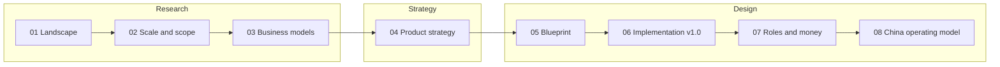

# Technology Exchange & Transfer Platform — Documentation

Design documentation for a technology exchange and technology-transfer platform. It is benchmarked on Shanghai's two leading platforms, the **Shanghai Technology Exchange (STEX, 上海技术交易所)** and the **National Technology Transfer Center East (NETC, 国家技术转移东部中心) / InnoMatch**, and on international models (WIPO GREEN, Enterprise Europe Network, university TTOs, yet2). The documents take the work from market research to a China-specific operating model.

## Reading order

| # | Document | What it covers | Main audience |
| --- | --- | --- | --- |
| 01 | [Shanghai technology-trading landscape](01-shanghai-landscape.md) | What STEX and NETC are, how they relate (same parent group), what Shanghai's 2025 rules require from an exchange | Everyone |
| 02 | [STEX vs NETC/InnoMatch: scale and scope](02-stex-vs-netc-scale-and-scope.md) | Transaction value vs ecosystem breadth vs revenue; how each turns a technology into a deal | Founders, product, analysts |
| 03 | [Business models and revenue](03-business-models-and-revenue.md) | Verified financials, revenue streams, profit pools, lessons for our pricing | Founders, business planning |
| 04 | [Product strategy](04-product-strategy.md) | What to copy, what to do differently, demand-first design, TRL, verification, scouting, strategic stages | Founders, product, architects |
| 05 | [System design blueprint](05-system-design-blueprint.md) | Target architecture: domain model, roles, workflows, sequence diagrams, data, APIs, AI, security, roadmap, KPIs | Product, architects, engineering leads |
| 06 | [Implementation-level design v1.0](06-implementation-design-v1.md) | Executable PostgreSQL schema, API catalogue, state machines, UI specs, permissions, self-hosted deployment, sprint plan | Engineers, tech lead |
| 07 | [Real-world roles, workflows and money movement](07-roles-workflows-and-money.md) | User groups and authority, workflows per role, action vocabulary, disclosure ladder, payment lifecycle, deal types | Product, operations, architects |
| 08 | [China operating model](08-china-operating-model.md) | Legal map, authority model, deal-type catalogue, transitions, cross-border and university rules, funds handling, disputes, launch checklist | Founders, compliance, finance, counsel |

## Key decisions at a glance

| Topic | Decision | Reference |
| --- | --- | --- |
| Positioning | Managed technology exchange: demand-driven marketplace + managed transfer workflow; not a statutory exchange at launch | [04](04-product-strategy.md), [06 §1](06-implementation-design-v1.md) |
| Launch market | China (one region first) | [08](08-china-operating-model.md) |
| Users at launch | Technology suppliers and buyers, supported by platform staff | [06 §1](06-implementation-design-v1.md) |
| Deal types | All types in the data model; three implementation tiers (standardized, legal review, specialist-only) | [08 §3](08-china-operating-model.md) |
| Money | Funds held and released only by a licensed bank or payment institution; the platform coordinates conditions and records verified events | [08 §1, §6](08-china-operating-model.md) |
| Architecture | FastAPI modular monolith, PostgreSQL, private object storage, explicit state machines, transactional outbox | [06 §3–§6](06-implementation-design-v1.md) |
| Hosting and team | Self-hosted Linux VMs with Docker Compose; 1–4 developers | [06 §11, §13](06-implementation-design-v1.md) |

## Glossary

| Term | Meaning |
| --- | --- |
| **STEX** (上海技术交易所) | Shanghai Technology Exchange: licensed technology trading venue (registration, trading, custody / disclosure, settlement) |
| **NETC** (国家技术转移东部中心) | National Technology Transfer Center East: regional technology-transfer platform; operates **InnoMatch** |
| **InnoMatch** | NETC's global technology supply–demand matching platform and annual matching fair |
| **Technology manager** (技术经理人) | Professional broker who turns a match into a deal |
| **TTO** | Technology-transfer office of a university or institute |
| **Service invention** (职务科技成果) | A result created in the course of employment; owned by the institution, not the researcher |
| **Technology / Offer / Demand** | A technology is the asset; an offer is a specific commercial opportunity for it (licence, assignment…); a demand is a buyer's structured need |
| **Match → Introduction → Deal** | A recorded candidate pairing → a consented, controlled contact → a managed negotiation and transaction |
| **TRL** | Technology Readiness Level (1–9); China uses GB/T 22900-2022 |
| **CRL / CRI, MRL** | Commercial readiness and manufacturing readiness scales, tracked separately from TRL |
| **Rights registration** (权属登记) / **Transaction certification** (交易鉴证) | Regulated functions of a licensed technology trading venue |
| **Technology-contract registration** (技术合同认定登记) | Registration of technology contracts that unlocks tax incentives in China (MIIT measures, effective 2026-03-01) |
| **Payment obligation / transaction / payout** | What is owed / money actually moved and confirmed by the provider / money paid out to a recipient. Never the same thing |
| **Transactional outbox** | A table written in the same database transaction as a business change, used to publish events reliably |

## Viewing the diagrams

All diagrams are standard [Mermaid](https://mermaid.js.org/) code blocks (`flowchart`, `stateDiagram-v2`, `sequenceDiagram`, `erDiagram`). They render on GitHub, GitLab, Gitea, Obsidian, Typora and in VS Code with a Mermaid preview extension. Every diagram was validated with the Mermaid CLI.

## Revision notes

These documents began as ChatGPT conversation exports. This revision:

- Rewrote every file in a documentation voice, with a consistent structure (purpose, audience, summary, sections, sources) and cross-links.
- Replaced ChatGPT's rendered-SVG/CSS "mermaid" output (unreadable outside ChatGPT) with **pure Mermaid source**, reconstructed from the surviving labels. Converted the ASCII sketches into Mermaid diagrams as well.
- Fixed formatting defects: collapsed one-line Python code, broken LaTeX formulas, flattened tables in 08, headings nested in list items, dead `images.openai.com` thumbnails, favicon and "+N" citation artefacts, and `utm_source=chatgpt.com` tracking parameters.
- Expanded the workflows with actors, step tables, state machines, exception handling and service levels.

### Factual corrections (checked against primary sources)

| Earlier statement | Correction | Source |
| --- | --- | --- |
| STEX "~¥189B transaction volume" (2024) | ¥18.922B was STEX's **2023** value (decimal error); 2024 on-exchange value was **¥30.933B** | Fund prospectus; STCSM 2024 report |
| NETC revenue "not found" | NETC's operating company reported **¥46.20M** revenue in 2023, more than STEX's ¥28.43M | Fund prospectus |
| STEX and NETC treated as independent competitors | Both belong to the same state-owned group (杨浦科创集团), with overlapping leadership | Fund prospectus |
| NETC cumulative value "¥40B" vs "¥400B" | Contradictory and unverified; flagged for confirmation | — |
| STEX profile source labelled "Shanxi Provincial Government" | It is the **Shanghai Yangpu District** government site | — |
| TRL list with non-standard definitions and a fixed TRL→CRL mapping | Replaced with EU/Horizon TRL definitions; CRL treated as an independent scale | EU H2020 Annex G; ARENA CRI |
| `documents.classification` default `'restricted'` (not allowed by its own CHECK) | Default changed to `'organization_only'` | Validated on PostgreSQL 16 |
| Status CHECK lists out of sync with the state machines; `technology_type` missing; matches without technology version or idempotency key | Aligned and added; `updated_at` trigger, outbox, idempotency and platform-role tables added | Validated on PostgreSQL 16 |
| `CREATE EXTENSION pgcrypto` for `gen_random_uuid()` | Not needed since PostgreSQL 13; removed | PostgreSQL docs |
| Civil Code contract types listed without technology **development** contracts; no CNIPA registration for patent assignments | Added development contracts, Patent Law Art. 10 registration, university pricing rules (Art. 18 / Art. 45), 2026 technology-contract registration measures, ICP/EDI and MLPS items | See [08 Sources](08-china-operating-model.md#sources) |

> Figures are as of the cited sources (2023–2026). Legal statements are an implementation baseline, **not legal advice**; items marked *legal validation required* in [08](08-china-operating-model.md) must be confirmed by PRC counsel before launch.
