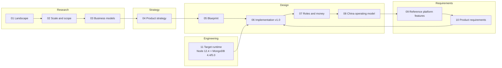

# Technology Exchange & Transfer Platform — Documentation

Design documentation for a technology exchange and technology-transfer platform. It is benchmarked on Shanghai's two leading platforms, the **Shanghai Technology Exchange (STEX, 上海技术交易所)** and the **National Technology Transfer Center East (NETC, 国家技术转移东部中心) / InnoMatch**, and on international models (WIPO GREEN, Enterprise Europe Network, university TTOs, yet2). The documents take the work from market research to a China-specific operating model.

## Reading order

| # | Document | What it covers | Main audience |
| --- | --- | --- | --- |
| 01 | [Shanghai technology-trading landscape](01-shanghai-landscape.md) | What STEX and NETC are, how they relate (same parent group), what Shanghai's 2025 rules require from an exchange | Everyone |
| 02 | [STEX vs NETC/InnoMatch: scale and scope](02-stex-vs-netc-scale-and-scope.md) | Transaction value vs ecosystem breadth vs revenue; how each turns a technology into a deal | Founders, product, analysts |
| 03 | [Business models and revenue](03-business-models-and-revenue.md) | Verified financials, revenue streams, profit pools, lessons for our pricing | Founders, business planning |
| 04 | [Product strategy](04-product-strategy.md) | What to copy, what to do differently, demand-first design, TRL, verification, scouting, strategic stages | Founders, product, architects |
| 05 | [System design blueprint](05-system-design-blueprint.md) | Target architecture: domain model, roles, workflows, sequence diagrams, data, APIs, AI, security, roadmap, KPIs | Product, architects, engineering leads |
| 06 | [Implementation-level design v1.0](06-implementation-design-v1.md) | Verified Mongoose models, database validators, indexes, roles, transactions and Document API patterns; tenant-scope plugin; API catalogue; state machines; UI specs; permissions (CASL); search; deployment; sprint plan | Engineers, tech lead |
| 07 | [Real-world roles, workflows and money movement](07-roles-workflows-and-money.md) | User groups and authority, workflows per role, action vocabulary, disclosure ladder, payment lifecycle, deal types | Product, operations, architects |
| 08 | [China operating model](08-china-operating-model.md) | Legal map, authority model, deal-type catalogue, transitions, cross-border and university rules, funds handling, disputes, launch checklist | Founders, compliance, finance, counsel |
| 09 | [Reference platform features](09-reference-platform-features.md) | What STEX, NETC/InnoMatch, CTEX and other Chinese platforms actually provide: modules, rules, flows, architecture hints, gap analysis | Product, business analysts |
| 10 | [Product requirements specification](10-product-requirements.md) | Numbered functional requirements for users, clients and administrators; non-functional requirements; integrations; release plan; UAT scenarios | Product, engineering, QA, operations |
| 11 | [Target runtime: Node.js 12.4 + MongoDB 4.4/5.0](11-target-runtime-node12-mongodb.md) | Verified library versions, coding rules, MongoDB rules, Chinese search, SEO, deployment configs, risks and upgrade path | Tech lead, engineers, DevOps |

## Key decisions at a glance

| Topic | Decision | Reference |
| --- | --- | --- |
| Positioning | Demand-driven **matching and service platform** with managed transfer workflows, acting as a **registered practising agent** of a licensed venue (STEX / CTEX) for formal listing, bidding, settlement and certificates | [09 §1–§2](09-reference-platform-features.md), [10 §1](10-product-requirements.md) |
| Requirements | 138 numbered functional requirements (67 start in R1) and 17 measurable non-functional requirements | [10](10-product-requirements.md) |
| Launch market | China (one region first) | [08](08-china-operating-model.md) |
| Users at launch | Technology suppliers and buyers, supported by platform staff | [06 §1](06-implementation-design-v1.md) |
| Deal types | All types in the data model; three implementation tiers (standardized, legal review, specialist-only) | [08 §3](08-china-operating-model.md) |
| Money | Funds held and released only by a licensed bank or payment institution; the platform coordinates conditions and records verified events | [08 §1, §6](08-china-operating-model.md) |
| Target runtime | **Node.js 12.4 + MongoDB 4.4 / 5.0** replica set ("4.5" is a development series); verified with real binaries | [11](11-target-runtime-node12-mongodb.md), [`verification/`](draft-implementation/README.md) |
| Architecture | Express 4 modular monolith (TypeScript → ES2019), MongoDB through **Mongoose 5.13** models (with database validators, transactions and least-privilege roles), Meilisearch for Chinese search, transactional outbox, pre-rendered public pages | [06 §3–§6, §10](06-implementation-design-v1.md) |
| Data access | **Mongoose 5.13** schemas, models and Document API; tenant-scope plugin on every tenant-owned model; database validators as a safety net; indexes from the schemas | [06 §4](06-implementation-design-v1.md), [11 §5.2](11-target-runtime-node12-mongodb.md) |
| Hosting and team | Self-hosted: Nginx + systemd on the given servers; 1–4 developers | [06 §11, §13](06-implementation-design-v1.md), [11 §9](11-target-runtime-node12-mongodb.md) |

## Glossary

| Term | Meaning |
| --- | --- |
| **STEX** (上海技术交易所) | Shanghai Technology Exchange: licensed technology trading venue (registration, trading, custody / disclosure, settlement) |
| **NETC** (国家技术转移东部中心) | National Technology Transfer Center East: regional technology-transfer platform; operates **InnoMatch** |
| **InnoMatch** | NETC's global technology supply–demand matching platform and annual matching fair |
| **Technology manager** (技术经理人) | Professional broker who turns a match into a deal |
| **TTO** | Technology-transfer office of a university or institute |
| **Service invention** (职务科技成果) | A result created in the course of employment; owned by the institution, not the researcher |
| **Technology / Offer / Demand** | A technology is the asset; an offer is a specific commercial opportunity for it (licence, assignment…); a demand is a buyer's structured need |
| **Match → Introduction → Deal** | A recorded candidate pairing → a consented, controlled contact → a managed negotiation and transaction |
| **TRL** | Technology Readiness Level (1–9); China uses GB/T 22900-2022 |
| **CRL / CRI, MRL** | Commercial readiness and manufacturing readiness scales, tracked separately from TRL |
| **Rights registration** (权属登记) / **Transaction certification** (交易鉴证) | Regulated functions of a licensed technology trading venue |
| **Technology-contract registration** (技术合同认定登记) | Registration of technology contracts that unlocks tax incentives in China (MIIT measures, effective 2026-03-01) |
| **Payment obligation / transaction / payout** | What is owed / money actually moved and confirmed by the provider / money paid out to a recipient. Never the same thing |
| **Transactional outbox** | A collection written in the same database transaction as a business change, used to publish events reliably (search indexing, notifications, page rendering) |
| **Publication snapshot** | The approved, public part of a technology version; the only technology data sent to search and public pages |
| **揭榜挂帅 / challenge** | A demand published as an open challenge: solvers submit proposals, an expert panel selects the winner |

## Viewing the diagrams

All diagrams are standard [Mermaid](https://mermaid.js.org/) code blocks (`flowchart`, `stateDiagram-v2`, `sequenceDiagram`, `erDiagram`). They render on GitHub, GitLab, Gitea, Obsidian, Typora and in VS Code with a Mermaid preview extension. Every diagram was validated with the Mermaid CLI.

## Revision notes

### Revision 4 — Mongoose data layer

- Data access moved from the native driver with repositories to **Mongoose 5.13.23** (bundles driver 3.7.4; the newest Mongoose that runs on Node 12.4). All 24 collections are Mongoose models with interfaces, schemas, indexes and plugins. Services use the Document API (`new Model()` + `save()`, `findById()` + `set()` + `save()`, `deleteOne()`, `lean()` lists with `populate()`), always inside transactions.
- Tenant isolation is a Mongoose plugin: every query on tenant data must name a tenant or an audited staff reason. Version history and audit records are protected by `freezablePlugin` and `appendOnlyPlugin`. CASL rules become query filters through `@casl/mongoose`.
- Database `$jsonSchema` validators are kept as a safety net under the schemas. Indexes are declared in the schemas and created by a release step (`npm run db:indexes`).
- Verified on Node 12.4.0 with MongoDB 4.4.30 and 5.0.33: 90 database checks per version, plus 34 library smoke checks. Findings:
  - global Mongoose settings must load before any model compiles (the audit connection otherwise built its own indexes);
  - update queries need `runValidators`;
  - `mongoose-long` silently truncates fractional amounts, so a strict `Int64` type was written;
  - Mongoose 5.13's `connection.transaction()` never ends its session;
  - Mongoose 5 has been end-of-life since 1 March 2024; Mongoose 6.13 is the next step with Node 12.22.12.
- Docs 05, 06, 11 and the README were updated, and the code folder was renamed to [`draft-implementation/`](draft-implementation/README.md).

### Revision 3 — target stack and strengthened requirements

- Backend changed to **Node.js + MongoDB** on the given target servers (Node 12.4, MongoDB 4.4 / 5.0). Docs 05, 06 and 08 were updated; doc 11 added.
- All schema definitions and code samples were **verified with real binaries** (Node 12.4.0; MongoDB 4.4.30 and 5.0.33; Meilisearch 1.11.3). The checks can be re-run from [`draft-implementation/`](draft-implementation/README.md) (named `verification/node12-mongodb/` in revision 3).
- Findings from the verification: MongoDB 4.4/5.0 cannot search Chinese text (Meilisearch adopted); Node 12 needs `full-icu` for Chinese dates and pinyin sorting; `bull@4` fails on Node 12.4 despite its declared engines; driver 3.x API differences are documented (superseded by the Mongoose rules in revision 4).
- Docs 09 (real platform features) and 10 (numbered product requirements for users, clients and administrators) added.

### Revision 2 — rewrite of the ChatGPT drafts

These documents began as ChatGPT conversation exports. That revision:

- Rewrote every file in a documentation voice, with a consistent structure (purpose, audience, summary, sections, sources) and cross-links.
- Replaced ChatGPT's rendered-SVG/CSS "mermaid" output (unreadable outside ChatGPT) with **pure Mermaid source**, reconstructed from the surviving labels. Converted the ASCII sketches into Mermaid diagrams as well.
- Fixed formatting defects: collapsed one-line Python code, broken LaTeX formulas, flattened tables in 08, headings nested in list items, dead `images.openai.com` thumbnails, favicon and "+N" citation artefacts, and `utm_source=chatgpt.com` tracking parameters.
- Expanded the workflows with actors, step tables, state machines, exception handling and service levels.

### Factual corrections (checked against primary sources)

| Earlier statement | Correction | Source |
| --- | --- | --- |
| STEX "~¥189B transaction volume" (2024) | ¥18.922B was STEX's **2023** value (decimal error); 2024 on-exchange value was **¥30.933B** | Fund prospectus; STCSM 2024 report |
| NETC revenue "not found" | NETC's operating company reported **¥46.20M** revenue in 2023, more than STEX's ¥28.43M | Fund prospectus |
| STEX and NETC treated as independent competitors | Both belong to the same state-owned group (杨浦科创集团), with overlapping leadership | Fund prospectus |
| NETC "¥42B facilitated in 2024"; cumulative "¥40B" vs "¥400B" | 2024: **≈ ¥4.2 billion** (近42亿元, a 10× unit error); cumulative **≈ ¥40 billion** (近400亿元) | STCSM 2024 report |
| STEX profile source labelled "Shanxi Provincial Government" | It is the **Shanghai Yangpu District** government site | — |
| TRL list with non-standard definitions and a fixed TRL→CRL mapping | Replaced with EU/Horizon TRL definitions; CRL treated as an independent scale | EU H2020 Annex G; ARENA CRI |
| Draft SQL schema: status lists out of sync with the state machines, a default value rejected by its own CHECK, missing `technology_type`, matches without version or idempotency key | Fixed in revision 2; superseded in revision 3 by the verified MongoDB design (validators enforce the same rules) | [06 §4](06-implementation-design-v1.md) |
| Civil Code contract types listed without technology **development** contracts; no CNIPA registration for patent assignments | Added development contracts, Patent Law Art. 10 registration, university pricing rules (Art. 18 / Art. 45), 2026 technology-contract registration measures, ICP/EDI and MLPS items | See [08 Sources](08-china-operating-model.md#sources) |

> Figures are as of the cited sources (2023–2026). Legal statements are an implementation baseline, **not legal advice**; items marked *legal validation required* in [08](08-china-operating-model.md) must be confirmed by PRC counsel before launch.
